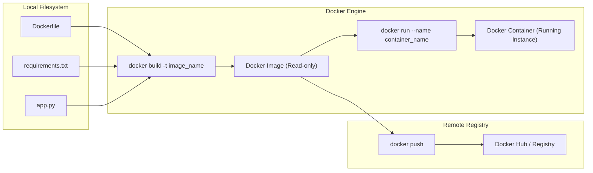
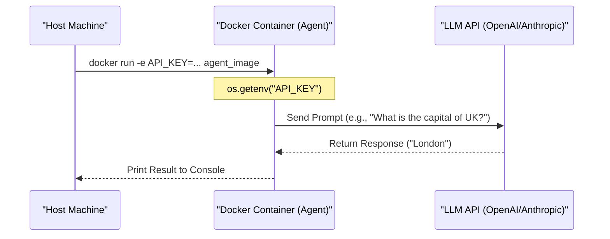

<!-- source: DeepWiki mcp.deepwiki.com · repo NirDiamant/agents-towards-production · page 4.1 Containerization · fetched 2026-10-29 -->

# Containerization

<details>
<summary>Relevant source files</summary>

The following files were used as context for generating this wiki page:

- [tutorials/docker-intro/README.md](tutorials/docker-intro/README.md)

</details>


## Purpose and Scope

This document covers the foundational patterns for running AI agents in containers using Docker. It explains how containerization solves reproducibility challenges in AI agent development and provides practical guidance on creating, building, and running containerized agents across different environments.

For cloud-specific deployment strategies, see [4.2 Cloud Deployment](). For model customization approaches, see [4.3 Model Customization]().

Sources: [tutorials/docker-intro/README.md:3-11](), [tutorials/docker-intro/README.md:27-36]()

## Why Containerization Matters for AI Agents

AI agents rely on complex ecosystems of dependencies including specific Python versions, machine learning libraries (e.g., PyTorch, TensorFlow), vector databases, API clients, and often GPU drivers. Containerization ensures consistent execution across development and production environments by:

1.  **Eliminating "it works on my machine" problems**: Standardizing the OS and runtime environment [tutorials/docker-intro/README.md:14-21]().
2.  **Environment isolation**: Preventing dependency conflicts between different agents or services [tutorials/docker-intro/README.md:11-11]().
3.  **Enabling seamless deployment and scaling**: Moving from a local laptop to a Kubernetes cluster without code changes [tutorials/docker-intro/README.md:11-11]().
4.  **Facilitating reliable updates**: Versioning the entire environment alongside the code [tutorials/docker-intro/README.md:103-105]().

### Reproducibility Factors in AI Development

| Factor | Impact on AI Agents | Docker Solution |
| :--- | :--- | :--- |
| **Software Version** | Python or library updates (e.g., `pandas` v1 vs v2) can break agent logic [tutorials/docker-intro/README.md:105-105](). | Fixed versions in `requirements.txt` within the image. |
| **Operating System** | Different C/C++ compilers for ML libraries impact performance/results [tutorials/docker-intro/README.md:106-106](). | Consistent Linux-based base image (e.g., Debian/Alpine). |
| **Hardware** | Differences in CPU architecture (ARM vs Intel) or GPU drivers [tutorials/docker-intro/README.md:107-108](). | Multi-platform builds and standardized driver interfaces. |

Sources: [tutorials/docker-intro/README.md:9-11](), [tutorials/docker-intro/README.md:85-93](), [tutorials/docker-intro/README.md:101-108]()

## Docker Fundamentals

Docker is a tool that enables OS-level virtualization, allowing applications and their dependencies to be packaged in virtual containers [tutorials/docker-intro/README.md:86-87]().

### Core Components and Code Entities

The following diagram maps the logical flow of containerization to the specific entities and commands used in the `docker-intro` tutorial.

**Process Flow: Code to Container**


Sources: [tutorials/docker-intro/README.md:84-93](), [tutorials/docker-intro/README.md:150-157](), [tutorials/docker-intro/README.md:220-225]()

## The Dockerfile

The `Dockerfile` is a text file containing instructions for building a Docker image [tutorials/docker-intro/README.md:181-182]().

### Key Dockerfile Commands

| Command | Role in Agent Deployment |
| :--- | :--- |
| `FROM` | Sets the base image (e.g., `python:3.10-slim`) [tutorials/docker-intro/README.md:192-192](). |
| `WORKDIR` | Sets the execution context inside the container [tutorials/docker-intro/README.md:200-200](). |
| `COPY` | Transfers agent code and `requirements.txt` from host to image [tutorials/docker-intro/README.md:199-199](). |
| `RUN` | Installs dependencies (e.g., `pip install -r requirements.txt`) [tutorials/docker-intro/README.md:198-198](). |
| `ENV` | Defines API keys or model paths as environment variables [tutorials/docker-intro/README.md:194-194](). |
| `CMD` | Defines the entry point (e.g., `python agent_main.py`) [tutorials/docker-intro/README.md:201-201](). |

### Image Layers and Caching

Docker images are built in layers. Each command in the `Dockerfile` creates a new layer [tutorials/docker-intro/README.md:285-288]().

**Layered Architecture for an AI Agent**
```mermaid
stack
    label "Layer 4: CMD ['python', 'agent.py'] (Metadata)"
    label "Layer 3: COPY . /app (Agent Code - Changes Often)"
    label "Layer 2: RUN pip install -r requirements.txt (Heavy Deps)"
    label "Layer 1: FROM python:3.10-slim (Base OS)"
```

**Optimization Tip:** Place `COPY requirements.txt` and `RUN pip install` *before* `COPY . /app`. This ensures that changes to your agent's logic don't trigger a full re-installation of heavy ML libraries [tutorials/docker-intro/README.md:355-450]().

Sources: [tutorials/docker-intro/README.md:181-215](), [tutorials/docker-intro/README.md:285-298](), [tutorials/docker-intro/README.md:355-450]()

## Running and Managing Containers

### Container Execution (`docker run`)

The `docker run` command instantiates a container from an image [tutorials/docker-intro/README.md:454-455]().

*   **Interactive Mode**: Use `-it` to interact with an agent via the terminal [tutorials/docker-intro/README.md:487-500]().
*   **Port Mapping**: Use `-p 8000:8000` to expose an agent's FastAPI or Streamlit interface [tutorials/docker-intro/README.md:454-462]().
*   **Environment Variables**: Use `-e OPENAI_API_KEY=sk-...` to securely pass secrets [tutorials/docker-intro/README.md:619-675]().

### Volume Mounting

Volume mounting (`-v`) allows the container to access folders on the host machine. This is critical for:
1.  **Local Development**: Editing agent code on the host and seeing changes immediately inside the container [tutorials/docker-intro/README.md:502-510]().
2.  **Persistent Storage**: Storing agent logs or SQLite databases (e.g., `checkpoint.sqlite` in LangGraph) so they survive container restarts [tutorials/docker-intro/README.md:502-510]().

Sources: [tutorials/docker-intro/README.md:454-462](), [tutorials/docker-intro/README.md:487-500](), [tutorials/docker-intro/README.md:502-565]()

## Containerizing AI Agents: Implementation Pattern

This pattern demonstrates how to package a standard AI agent that requires external API access.

**Agent-Container Interaction Diagram**


### Best Practices for Agents
1.  **Secret Management**: Never hardcode API keys in the `Dockerfile`. Use `.env` files or the `-e` flag during `docker run` [tutorials/docker-intro/README.md:606-607]().
2.  **Slim Images**: Use `-slim` or `-alpine` variants of base images to reduce deployment latency and storage costs [tutorials/docker-intro/README.md:566-617]().
3.  **Non-Root Users**: For production, configure the `Dockerfile` to run the agent as a non-privileged user to enhance security.

Sources: [tutorials/docker-intro/README.md:566-617](), [tutorials/docker-intro/README.md:619-675](), [tutorials/docker-intro/README.md:651-654]()

## Integration with Repository Frameworks

Containerization is the standard delivery mechanism for the various frameworks explored in this playbook:

*   **LangGraph**: Containers provide the stable Python environment needed for complex state machines [tutorials/docker-intro/README.md:9-11]().
*   **Memory Systems**: Agents in containers connect to external Redis containers via Docker networks for short-term and long-term memory.
*   **Observability**: Tracing tools like LangSmith can be configured via environment variables passed into the agent container.

Sources: [tutorials/docker-intro/README.md:9-11](), [tutorials/docker-intro/README.md:677-682]()

---

