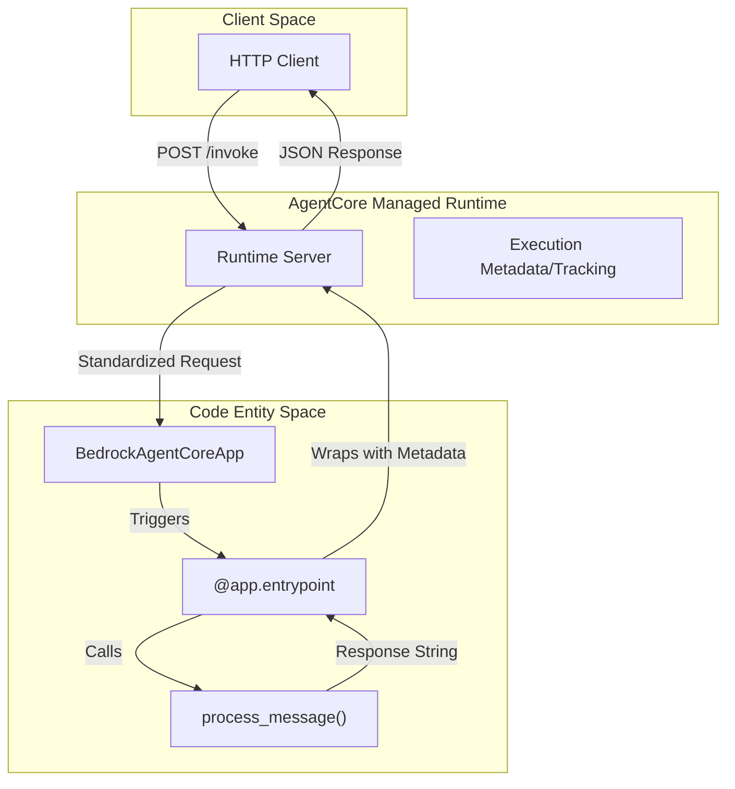
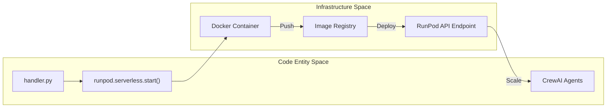
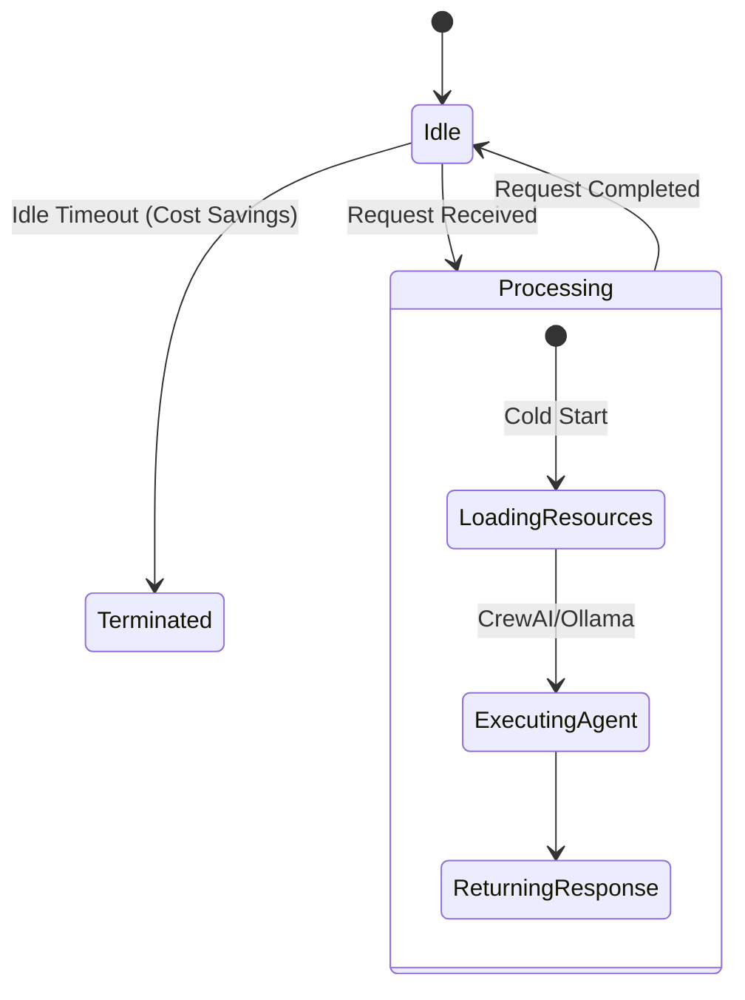

<!-- source: DeepWiki mcp.deepwiki.com · repo NirDiamant/agents-towards-production · page 4.2 Cloud Deployment · fetched 2026-10-29 -->

# Cloud Deployment

Relevant source files

The following files were used as context for generating this wiki page:

- [assets/repos_images/sponsors_logos/trimmed_padded/Mem0 Word Logo Dark.png](assets/repos_images/sponsors_logos/trimmed_padded/Mem0 Word Logo Dark.png)
- [assets/repos_images/sponsors_logos/trimmed_padded/Mem0 Word Logo.png](assets/repos_images/sponsors_logos/trimmed_padded/Mem0 Word Logo.png)
- [assets/repos_images/sponsors_logos/trimmed_padded/trimmed_padded_langchain_white.png](assets/repos_images/sponsors_logos/trimmed_padded/trimmed_padded_langchain_white.png)
- [assets/repos_images/sponsors_logos/trimmed_padded/trimmed_padded_tavily_white.png](assets/repos_images/sponsors_logos/trimmed_padded/trimmed_padded_tavily_white.png)
- [tutorials/aws_agentcore/agentcore_tutorial.ipynb](tutorials/aws_agentcore/agentcore_tutorial.ipynb)
- [tutorials/aws_agentcore/assets/agentcore-diagram.png](tutorials/aws_agentcore/assets/agentcore-diagram.png)
- [tutorials/runpod-gpu-deploy/README.md](tutorials/runpod-gpu-deploy/README.md)

## Purpose and Scope

This document covers scalable cloud deployment strategies for AI agents, focusing on two primary production-ready environments: **RunPod Serverless GPU infrastructure** and the **AWS Bedrock AgentCore** managed runtime. It details the process of containerizing agents, wrapping them as managed services using the `BedrockAgentCoreApp` SDK, and deploying them to GPU-accelerated environments. These approaches enable high-availability, request tracking, and automatic scaling without the overhead of manual server management.

## AWS Bedrock AgentCore: Managed Agent Runtime

AWS Bedrock AgentCore is a runtime framework that transforms local Python functions or classes into production-ready managed services. It acts as an infrastructure layer—a "control tower"—that sits between the agent logic and the production environment, handling request management, execution control, and standardized communication [tutorials/aws_agentcore/agentcore_tutorial.ipynb:11-33]().

### Architecture and Data Flow

AgentCore separates the agent's core logic from infrastructure concerns like HTTP handling, input validation, and error management [tutorials/aws_agentcore/agentcore_tutorial.ipynb:34-39]().

**Diagram: AgentCore Managed Execution Flow**  
Sources: [tutorials/aws_agentcore/agentcore_tutorial.ipynb:26-58]()

### Implementation Pattern

To deploy an agent using AgentCore, the `bedrock-agentcore` SDK provides a decorator pattern to convert a standard function into an HTTP service [tutorials/aws_agentcore/agentcore_tutorial.ipynb:32-33]().

| Component | Code Entity | Role |
|:---|:---|:---|
| **Application Wrapper** | `BedrockAgentCoreApp` | Initializes the runtime environment and manages the HTTP interface [tutorials/aws_agentcore/agentcore_tutorial.ipynb:152-160](). |
| **Service Entry Point** | `@app.entrypoint` | Decorator that registers a function as the primary handler for incoming agent requests [tutorials/aws_agentcore/agentcore_tutorial.ipynb:162-170](). |
| **Logic Handler** | `process_message` | The core agent function (e.g., calling OpenAI or Bedrock) wrapped by the SDK [tutorials/aws_agentcore/agentcore_tutorial.ipynb:133-145](). |

Sources: [tutorials/aws_agentcore/agentcore_tutorial.ipynb:113-170]()

---

## RunPod Serverless: GPU Cloud Deployment

RunPod Serverless provides a cloud-compute platform for dockerized applications, allowing developers to bind a Python function to a GPU-optimized endpoint [tutorials/runpod-gpu-deploy/README.md:65-68](). This is ideal for resource-intensive agents using local models like **Ollama**.

### RunPod Deployment Workflow

The deployment process follows four distinct phases to move from local code to a scalable API [tutorials/runpod-gpu-deploy/README.md:39-49]().

**Diagram: RunPod Serverless Integration**  
Sources: [tutorials/runpod-gpu-deploy/README.md:41-48](), [tutorials/runpod-gpu-deploy/README.md:134-135]()

### Defining the Handler

The `runpod` SDK requires a handler function that processes a `job` object containing user input [tutorials/runpod-gpu-deploy/README.md:76-81]().

1. **Input Extraction**: The handler receives a JSON request, typically accessing data via `job["input"]` [tutorials/runpod-gpu-deploy/README.md:110-112]().
2. **Agent Execution**: The handler triggers the agent logic (e.g., a `create_blog_post` function using CrewAI) [tutorials/runpod-gpu-deploy/README.md:117-119]().
3. **Registration**: The service is started using `runpod.serverless.start({"handler": handler})` [tutorials/runpod-gpu-deploy/README.md:134-135]().

Sources: [tutorials/runpod-gpu-deploy/README.md:96-135]()

### Containerization Strategy

For agents using local LLMs, the container must package the agent framework, the model runtime, and the model weights [tutorials/runpod-gpu-deploy/README.md:137-141]().

| Feature | Implementation |
|:---|:---|
| **Base Image** | `runpod/pytorch:2.0.1-py3.10-cuda11.8.0-devel-ubuntu22.04` for GPU support [tutorials/runpod-gpu-deploy/README.md:143-143](). |
| **Model Runtime** | Integration of **Ollama** to run models like OpenHermes directly in the container [tutorials/runpod-gpu-deploy/README.md:34-37](). |
| **Agent Framework** | **CrewAI** for multi-agent coordination (Research and Writing agents) [tutorials/runpod-gpu-deploy/README.md:33-33](). |

Sources: [tutorials/runpod-gpu-deploy/README.md:29-48](), [tutorials/runpod-gpu-deploy/README.md:143-155]()

---

## Comparison of Deployment Environments

| Feature | AWS Bedrock AgentCore | RunPod Serverless |
|:---|:---|:---|
| **Primary Use Case** | Managed runtime for production APIs with request tracking [tutorials/aws_agentcore/agentcore_tutorial.ipynb:13-15](). | Scalable GPU workloads for local model inference [tutorials/runpod-gpu-deploy/README.md:19-22](). |
| **Scaling** | Managed by AWS Bedrock runtime [tutorials/aws_agentcore/agentcore_tutorial.ipynb:32-33](). | Automatic scaling of container workers based on request volume [tutorials/runpod-gpu-deploy/README.md:52-53](). |
| **Entry Point** | `@app.entrypoint` decorator [tutorials/aws_agentcore/agentcore_tutorial.ipynb:32-32](). | `runpod.serverless.start()` function [tutorials/runpod-gpu-deploy/README.md:78-78](). |
| **Billing Model** | Managed execution (Bedrock pricing) [tutorials/aws_agentcore/agentcore_tutorial.ipynb:30-32](). | Pay-per-compute-second for active GPU time [tutorials/runpod-gpu-deploy/README.md:15-17](). |

Sources: [tutorials/aws_agentcore/agentcore_tutorial.ipynb:11-40](), [tutorials/runpod-gpu-deploy/README.md:5-57]()

## Worker Lifecycle Management

In serverless environments, workers transition through states to optimize cost and performance [tutorials/runpod-gpu-deploy/README.md:52-57]().

**Diagram: Serverless Worker State Transitions**  
Sources: [tutorials/runpod-gpu-deploy/README.md:15-18](), [tutorials/runpod-gpu-deploy/README.md:238-247]()

Key management features:
- **Automatic Scaling**: Spin up containers based on volume [tutorials/runpod-gpu-deploy/README.md:53-53]().
- **Cold Start Mitigation**: Pre-loading models in Docker images [tutorials/runpod-gpu-deploy/README.md:137-141]().
- **Zero Idle Costs**: Billing stops when the handler finishes and the worker times out [tutorials/runpod-gpu-deploy/README.md:17-17]().

Sources: [tutorials/runpod-gpu-deploy/README.md:50-57](), [tutorials/runpod-gpu-deploy/README.md:137-155]()

---

