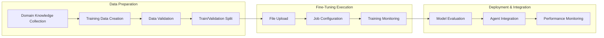
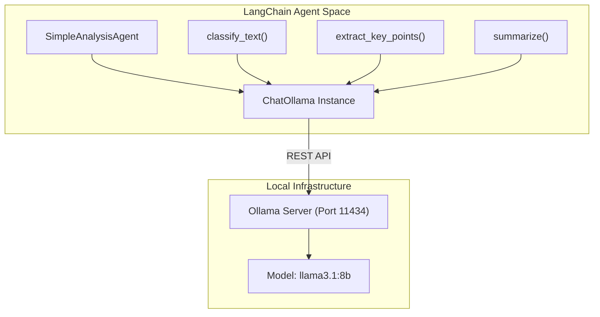
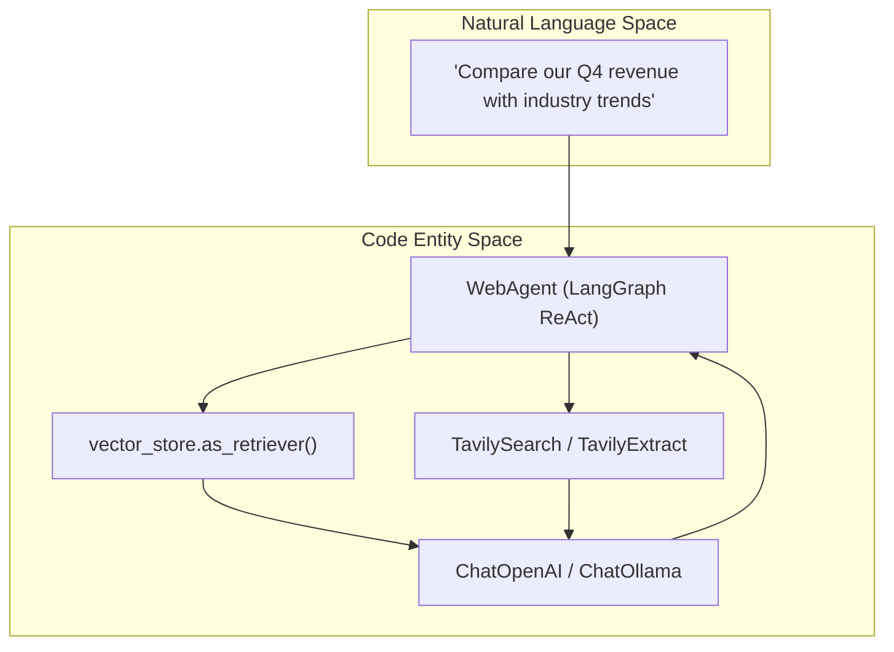

<!-- source: DeepWiki mcp.deepwiki.com · repo NirDiamant/agents-towards-production · page 4.3 Model Customization · fetched 2026-10-29 -->

# Model Customization

<details>
<summary>Relevant source files</summary>

The following files were used as context for generating this wiki page:

- [tutorials/agent-with-streamlit-ui/building-chatbot-notebook.ipynb](tutorials/agent-with-streamlit-ui/building-chatbot-notebook.ipynb)
- [tutorials/agent-with-tavily-web-access/hybrid-agent-tutorial.ipynb](tutorials/agent-with-tavily-web-access/hybrid-agent-tutorial.ipynb)
- [tutorials/agent-with-tavily-web-access/supplemental/vectorize_tutorial.ipynb](tutorials/agent-with-tavily-web-access/supplemental/vectorize_tutorial.ipynb)
- [tutorials/agent-with-tavily-web-access/web-agent-tutorial.ipynb](tutorials/agent-with-tavily-web-access/web-agent-tutorial.ipynb)
- [tutorials/fine-tuning-agents/fine_tuning_agents_guide.ipynb](tutorials/fine-tuning-agents/fine_tuning_agents_guide.ipynb)
- [tutorials/on-prem-llm-ollama/scripts/langchain_agent.ipynb](tutorials/on-prem-llm-ollama/scripts/langchain_agent.ipynb)

</details>


This document covers the process of fine-tuning language models to enhance AI agent capabilities for specialized domains and tasks, as well as running models on-premises using Ollama for data privacy and low latency. It explains how to prepare training data, execute supervised fine-tuning (SFT), and integrate customized or local models into agent workflows.

## Purpose and Scope

The Model Customization section focuses on adapting foundation models for specific agent behaviors and domain knowledge. This includes:

- **Supervised Fine-Tuning (SFT)**: Creating high-quality training datasets and executing fine-tuning jobs to internalize domain expertise.
- **Local Inference with Ollama**: Running models on-premises to ensure data privacy, reduce latency, and eliminate dependency on cloud APIs.
- **Hybrid Integration**: Combining fine-tuned or local models with external tools and internal data sources.

Sources: [tutorials/fine-tuning-agents/fine_tuning_agents_guide.ipynb:10-69](), [tutorials/on-prem-llm-ollama/scripts/langchain_agent.ipynb:16-27]()

## Fine-Tuning Overview

Fine-tuning takes a pre-trained language model and further trains it on a specialized dataset. This process allows AI agents to internalize domain knowledge, maintain consistent response styles, and generate structured outputs more reliably.

### Key Benefits of Fine-Tuning

| Benefit | Description |
|---------|-------------|
| **Domain Expertise** | Internalizes specialized regulations and reduces hallucinations [tutorials/fine-tuning-agents/fine_tuning_agents_guide.ipynb:23-26]() |
| **Consistent Style** | Learns to maintain brand voice and provide uniform responses [tutorials/fine-tuning-agents/fine_tuning_agents_guide.ipynb:28-31]() |
| **Structured Outputs** | Reliably generates specific formats like JSON, SQL, or Markdown [tutorials/fine-tuning-agents/fine_tuning_agents_guide.ipynb:33-35]() |
| **Reduced Prompting** | Eliminates lengthy system prompts, reducing token usage and costs [tutorials/fine-tuning-agents/fine_tuning_agents_guide.ipynb:36-39]() |
| **Enhanced Efficiency** | Smaller tuned models can replace larger base models for faster responses [tutorials/fine-tuning-agents/fine_tuning_agents_guide.ipynb:41-44]() |

Sources: [tutorials/fine-tuning-agents/fine_tuning_agents_guide.ipynb:14-53]()

## Fine-Tuning Process

The model customization workflow follows a structured process from data preparation through deployment:



Sources: [tutorials/fine-tuning-agents/fine_tuning_agents_guide.ipynb:54-62]()

### Data Preparation

Training data must be formatted as **JSONL (JSON Lines)** files with UTF-8 encoding [tutorials/fine-tuning-agents/fine_tuning_agents_guide.ipynb:134-140](). Each example follows the chat format with `system`, `user`, and `assistant` roles [tutorials/fine-tuning-agents/fine_tuning_agents_guide.ipynb:142-146]().

#### Data Format Example
```json
{
  "messages": [
    {"role": "system", "content": "You are a helpful domain expert assistant."},
    {"role": "user", "content": "What is the policy on this matter?"},
    {"role": "assistant", "content": "According to our policies..."}
  ]
}
```
Sources: [tutorials/fine-tuning-agents/fine_tuning_agents_guide.ipynb:149-157]()

### Fine-Tuning Execution

The implementation uses the `OpenAI` client to manage the fine-tuning job [tutorials/fine-tuning-agents/fine_tuning_agents_guide.ipynb:124-124]().

```python
# Create fine-tuning job
job = client.fine_tuning.jobs.create(
    training_file=train_file_id,
    validation_file=validation_file_id,
    model="gpt-4o-mini-2024-07-18",
    suffix="banking-support"
)
```
Sources: [tutorials/fine-tuning-agents/fine_tuning_agents_guide.ipynb:468-474]()

## On-Premises Inference with Ollama

For scenarios requiring data privacy and low latency, agents can be migrated from cloud APIs to local inference using **Ollama**.

### Local Agent Implementation

The `SimpleAnalysisAgent` class demonstrates how to replace OpenAI models with local models like `llama3.1:8b` using `ChatOllama` [tutorials/on-prem-llm-ollama/scripts/langchain_agent.ipynb:45-53]().



### Key Functions in Local Inference
- `check_ollama_model()`: Validates if the required model is available on the local Ollama server [tutorials/on-prem-llm-ollama/scripts/langchain_agent.ipynb:116-124]().
- `classify_text()`: Uses a `ChatPromptTemplate` to categorize input [tutorials/on-prem-llm-ollama/scripts/langchain_agent.ipynb:56-65]().
- `analyze_text()`: Chains multiple LLM calls (classification, extraction, summarization) into a single workflow [tutorials/on-prem-llm-ollama/scripts/langchain_agent.ipynb:93-114]().

Sources: [tutorials/on-prem-llm-ollama/scripts/langchain_agent.ipynb:36-124]()

## Hybrid Agent Architectures

Customized models often need to interact with both web data and internal knowledge bases.

### Combining Web and Internal Data
The repository demonstrates a **Hybrid Agent** that uses:
1. **Tavily**: For real-time web search, extraction, and crawling [tutorials/agent-with-tavily-web-access/web-agent-tutorial.ipynb:140-153]().
2. **Chroma**: As a local vector store for proprietary documents (e.g., CRM data) [tutorials/agent-with-tavily-web-access/hybrid-agent-tutorial.ipynb:135-147]().



Sources: [tutorials/agent-with-tavily-web-access/hybrid-agent-tutorial.ipynb:135-182](), [tutorials/agent-with-tavily-web-access/web-agent-tutorial.ipynb:140-184]()

## Best Practices for Customization

1.  **Data Quality**: Include at least 10 examples per behavior; vary phrasing while keeping formatting consistent [tutorials/fine-tuning-agents/fine_tuning_agents_guide.ipynb:280-285]().
2.  **Validation**: Reserve 10-20% of data for validation to monitor for overfitting [tutorials/fine-tuning-agents/fine_tuning_agents_guide.ipynb:289-291]().
3.  **Local Setup**: Ensure Ollama is running and models are "pulled" before initializing agents [tutorials/on-prem-llm-ollama/scripts/langchain_agent.ipynb:49-51]().
4.  **UI Integration**: Use frameworks like **Streamlit** to provide a chat interface for interacting with customized models [tutorials/agent-with-streamlit-ui/building-chatbot-notebook.ipynb:13-22]().

Sources: [tutorials/fine-tuning-agents/fine_tuning_agents_guide.ipynb:280-296](), [tutorials/on-prem-llm-ollama/scripts/langchain_agent.ipynb:49-51](), [tutorials/agent-with-streamlit-ui/building-chatbot-notebook.ipynb:13-22]()

---

