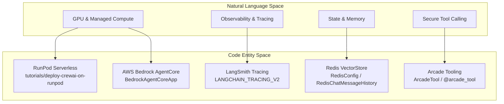
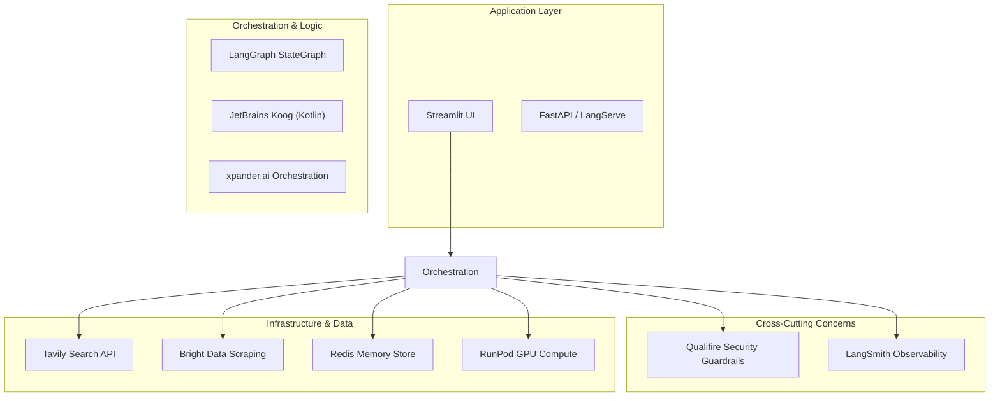

<!-- source: DeepWiki mcp.deepwiki.com · repo NirDiamant/agents-towards-production · page 5 Partner Ecosystem · fetched 2026-10-29 -->

# Partner Ecosystem

Relevant source files

The following files were used as context for generating this wiki page:

- [README.md](README.md)
- [assets/repos_images/ai_architecture_diagram.svg](assets/repos_images/ai_architecture_diagram.svg)
- [assets/repos_images/sponsors_logos/trimmed_padded/trimmed_padded_anchorbroswer_light.png](assets/repos_images/sponsors_logos/trimmed_padded/trimmed_padded_anchorbroswer_light.png)
- [assets/repos_images/sponsors_logos/trimmed_padded/trimmed_padded_anchorbrowser_dark.png](assets/repos_images/sponsors_logos/trimmed_padded/trimmed_padded_anchorbrowser_dark.png)
- [assets/repos_images/sponsors_logos/trimmed_padded/trimmed_padded_arcade_black.png](assets/repos_images/sponsors_logos/trimmed_padded/trimmed_padded_arcade_black.png)
- [assets/repos_images/sponsors_logos/trimmed_padded/trimmed_padded_arcade_white_tight.png](assets/repos_images/sponsors_logos/trimmed_padded/trimmed_padded_arcade_white_tight.png)
- [assets/repos_images/sponsors_logos/trimmed_padded/trimmed_padded_contextual_black.png](assets/repos_images/sponsors_logos/trimmed_padded/trimmed_padded_contextual_black.png)
- [assets/repos_images/sponsors_logos/trimmed_padded/trimmed_padded_contextual_white.png](assets/repos_images/sponsors_logos/trimmed_padded/trimmed_padded_contextual_white.png)
- [assets/repos_images/sponsors_logos/trimmed_padded/trimmed_padded_langchain_white.png](assets/repos_images/sponsors_logos/trimmed_padded/trimmed_padded_langchain_white.png)
- [assets/repos_images/sponsors_logos/trimmed_padded/trimmed_padded_tavily_white.png](assets/repos_images/sponsors_logos/trimmed_padded/trimmed_padded_tavily_white.png)

This page provides an overview of the technology partners and sponsors that provide infrastructure, tools, and services for production AI agent development within this repository. The ecosystem is designed to bridge the gap between experimental prototypes and enterprise-grade applications by integrating industry-standard solutions for memory, compute, observability, and tool calling.

For specific implementation details of individual partners, see:
- [Infrastructure & Deployment Partners](#5.1)
- [Observability & Security Partners](#5.2)
- [Memory & Tool Integration Partners](#5.3)

## Partnership Model Overview

The repository operates on a technical integration model where partners provide practical technology solutions featured in step-by-step tutorials. These integrations are represented in the codebase through specific SDKs, API clients, and infrastructure configurations.

### Architecture Mapping: Natural Language to Code Entity
The following diagram maps high-level partner categories to the specific code entities and directories used to implement them.

Sources: [README.md:32-150](), [README.md:2334-2360]()

## Technical Integration Architecture

The "Agents Towards Production" architecture relies on a layered stack where partners provide specialized services at each tier.

### Production Agent Stack
This diagram illustrates how partner technologies interact within the system's runtime.

Sources: [assets/repos_images/ai_architecture_diagram.svg:91-170](), [README.md:32-150]()

## Partner Categories

### Infrastructure & Deployment Partners
These partners provide the compute and runtime environments necessary to host agents.
*   **RunPod:** Enables serverless GPU deployment for LLMs and agent workloads.
*   **AWS Bedrock AgentCore:** Provides a managed runtime for wrapping agents as HTTP services using the `BedrockAgentCoreApp` SDK.
*   **xpander.ai:** Offers agent orchestration Backend-as-a-Service, including specialized examples like the `meeting-recorder-agent`.

For details, see [Infrastructure & Deployment Partners](#5.1).

### Observability & Security Partners
These partners ensure that agents are reliable, traceable, and secure against adversarial inputs.
*   **Qualifire:** Implements security guardrails (e.g., `LlamaFirewall`) and behavioral monitoring dashboards.
*   **LangSmith:** The primary platform for tracing nested agent loops and debugging complex `StateGraph` transitions.
*   **JetBrains:** Supports the Kotlin ecosystem via the `Koog` framework for type-safe agent development.

For details, see [Observability & Security Partners](#5.2).

### Memory & Tool Integration Partners
These partners extend the agent's capabilities with persistent state and external data access.
*   **Redis:** Used for dual-memory systems, handling both short-term checkpointing and long-term semantic search.
*   **Arcade:** Provides secure multi-user OAuth2 tool calling, essential for agents interacting with sensitive user data (e.g., Google Calendar, Slack).
*   **Tavily & Bright Data:** Supply high-quality web data via real-time search and enterprise-grade scraping.
*   **Mem0 & Contextual AI:** Enable self-improving memory and managed RAG pipelines.

For details, see [Memory & Tool Integration Partners](#5.3).

## Standardized Integration Patterns

The repository utilizes consistent patterns to integrate these diverse services:

| Integration Type | Implementation Pattern | Code Reference Examples |
| :--- | :--- | :--- |
| **Managed Runtime** | Decorator-based entrypoints | `@app.entrypoint` in Bedrock AgentCore |
| **Tool Calling** | Pydantic-based schemas | `ArcadeTool` definitions |
| **Observability** | Middleware / Environment variables | `LANGCHAIN_PROJECT` for LangSmith |
| **Security** | Firewall Wrappers | `LlamaFirewall` initialization |

Sources: [README.md:24-150](), [assets/repos_images/ai_architecture_diagram.svg:1-150]()

---

