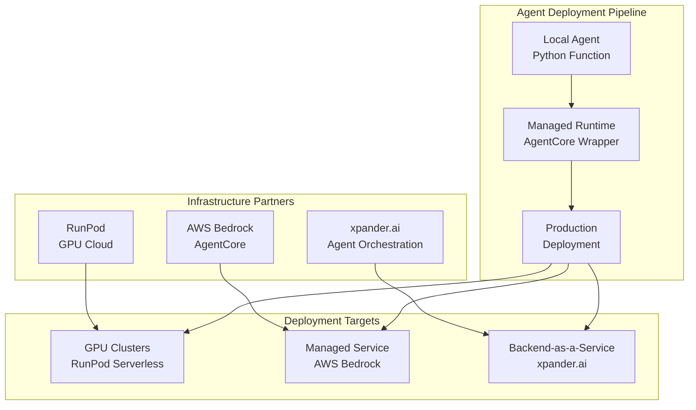
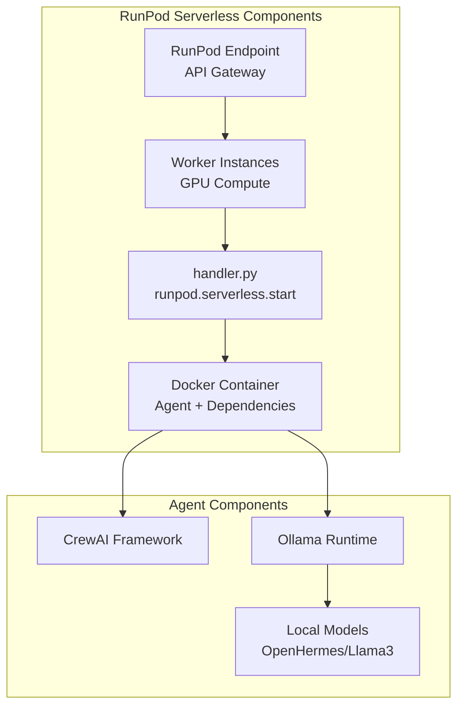
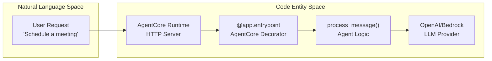
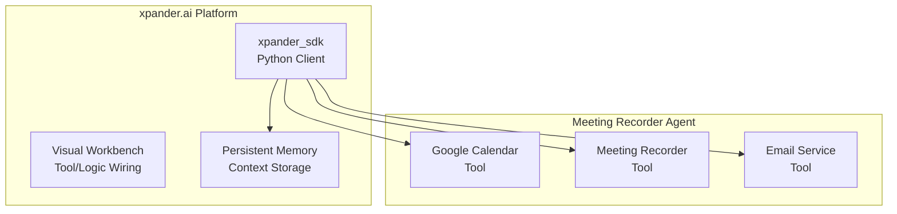

<!-- source: DeepWiki mcp.deepwiki.com · repo NirDiamant/agents-towards-production · page 5.1 Infrastructure & Deployment Partners · fetched 2026-10-29 -->

# Infrastructure & Deployment Partners

Relevant source files

The following files were used as context for generating this wiki page:

- [assets/repos_images/sponsors_logos/trimmed_padded/Mem0 Word Logo Dark.png](assets/repos_images/sponsors_logos/trimmed_padded/Mem0 Word Logo Dark.png)
- [assets/repos_images/sponsors_logos/trimmed_padded/Mem0 Word Logo.png](assets/repos_images/sponsors_logos/trimmed_padded/Mem0 Word Logo.png)
- [assets/repos_images/sponsors_logos/trimmed_padded/trimmed_padded_Redis_white.svg](assets/repos_images/sponsors_logos/trimmed_padded/trimmed_padded_Redis_white.svg)
- [assets/repos_images/sponsors_logos/trimmed_padded/trimmed_padded_brightdata_white.svg](assets/repos_images/sponsors_logos/trimmed_padded/trimmed_padded_brightdata_white.svg)
- [assets/repos_images/sponsors_logos/trimmed_padded/trimmed_padded_jetbrains_white.svg](assets/repos_images/sponsors_logos/trimmed_padded/trimmed_padded_jetbrains_white.svg)
- [assets/repos_images/sponsors_logos/trimmed_padded/trimmed_padded_langchain_white.png](assets/repos_images/sponsors_logos/trimmed_padded/trimmed_padded_langchain_white.png)
- [assets/repos_images/sponsors_logos/trimmed_padded/trimmed_padded_runpod_white.svg](assets/repos_images/sponsors_logos/trimmed_padded/trimmed_padded_runpod_white.svg)
- [assets/repos_images/sponsors_logos/trimmed_padded/trimmed_padded_tavily_white.png](assets/repos_images/sponsors_logos/trimmed_padded/trimmed_padded_tavily_white.png)
- [tutorials/aws_agentcore/agentcore_tutorial.ipynb](tutorials/aws_agentcore/agentcore_tutorial.ipynb)
- [tutorials/aws_agentcore/assets/agentcore-diagram.png](tutorials/aws_agentcore/assets/agentcore-diagram.png)

This section covers infrastructure and deployment partners that provide the foundational compute, managed runtimes, and orchestration services required to deploy AI agents at scale. These partners focus on GPU compute resources, managed agent execution environments, and Agentic Backend-as-a-Service (BaaS) platforms.

## Partner Ecosystem Overview

The infrastructure and deployment partner ecosystem provides three primary categories of services: scalable GPU compute, managed agent runtimes, and orchestration platforms. Each partner addresses specific production challenges such as hardware acceleration, request tracking, and multi-tool coordination.

### Deployment Infrastructure Landscape

Sources: [tutorials/aws_agentcore/agentcore_tutorial.ipynb:9-19](), [tutorials/aws_agentcore/agentcore_tutorial.ipynb:26-38](), [tutorials/runpod-gpu-deploy/README.md:5-57]()

## GPU Infrastructure - RunPod

RunPod serves as the primary GPU infrastructure partner, providing scalable GPU compute resources for AI agent deployments that require high-performance hardware acceleration. The integration focuses on serverless deployment of resource-intensive agent workloads, such as those running local LLMs via Ollama or complex CrewAI workflows.

### RunPod Serverless Architecture

### Key Capabilities

- **Serverless Execution**: Run agents on-demand using the `runpod` Python SDK to wrap agent logic.
- **GPU Acceleration**: Access to enterprise-grade GPU hardware for demanding inference tasks.
- **Containerized Portability**: Agents are packaged with all dependencies, including the Ollama runtime and pre-downloaded models, to ensure consistent execution.

Sources: [tutorials/runpod-gpu-deploy/README.md:11-57](), [tutorials/runpod-gpu-deploy/README.md:139-201](), [assets/repos_images/sponsors_logos/trimmed_padded/trimmed_padded_runpod_white.svg:1-8]()

## Managed Agent Runtime - AWS Bedrock AgentCore

AWS Bedrock AgentCore provides a runtime framework designed to transform local AI agents into production-ready managed systems. It acts as an infrastructure layer that sits between agent logic and the production environment, handling request management and standardized communication.

### AgentCore Architecture

The `bedrock-agentcore` SDK provides a decorator pattern to convert standard Python functions into managed HTTP services.

### Implementation Details

The integration uses the `BedrockAgentCoreApp` class to wrap agent functions. The `@app.entrypoint` decorator standardizes the input/output format and enables request tracking.

| Component | Code Entity | Description |
| :--- | :--- | :--- |
| **SDK** | `bedrock-agentcore` | Python library for wrapping agents [tutorials/aws_agentcore/agentcore_tutorial.ipynb:79-86]() |
| **App Instance** | `BedrockAgentCoreApp()` | The main application container [tutorials/aws_agentcore/agentcore_tutorial.ipynb:161-165]() |
| **Entrypoint** | `@app.entrypoint` | Decorator that exposes a function as a managed endpoint [tutorials/aws_agentcore/agentcore_tutorial.ipynb:167-171]() |
| **Base Logic** | `process_message()` | The core agent function using LLM APIs [tutorials/aws_agentcore/agentcore_tutorial.ipynb:133-145]() |

### Key Benefits
- **Separation of Concerns**: Agent code focuses on logic, while AgentCore handles HTTP, input validation, and execution tracking [tutorials/aws_agentcore/agentcore_tutorial.ipynb:34-38]().
- **Standardized Communication**: Provides a consistent HTTP interface for interacting with agents [tutorials/aws_agentcore/agentcore_tutorial.ipynb:13-19]().

Sources: [tutorials/aws_agentcore/agentcore_tutorial.ipynb:13-19](), [tutorials/aws_agentcore/agentcore_tutorial.ipynb:26-38](), [tutorials/aws_agentcore/agentcore_tutorial.ipynb:133-171]()

## Agent Orchestration BaaS - xpander.ai

xpander.ai is an orchestration Backend-as-a-Service platform that enables the deployment of autonomous AI agents with built-in memory and tool orchestration. It is used in the repository to demonstrate complex, multi-step agentic applications.

### xpander.ai Integration Architecture

### Application Example: Meeting Recorder Agent
The `meeting-recorder-agent` example demonstrates how xpander.ai orchestrates multiple external services:
1. **Discovery**: Uses Google Calendar tools to find upcoming meetings.
2. **Action**: Initiates meeting recordings via specialized recorder tools.
3. **Retrieval**: Fetches post-meeting assets (summaries, recordings).
4. **Distribution**: Sends summaries to teams via email.

### Platform Capabilities
- **Tool Orchestration**: Seamlessly connects prebuilt cloud tools or custom Python functions as tools [tutorials/agentic-applications-by-xpander.ai/meeting-recorder-agent/creating_multi_step_ai_agents_with_xpander_tutorial.ipynb:9-47]().
- **Visual Workbench**: Allows developers to trace tool calls and model decisions without manual logging [tutorials/agentic-applications-by-xpander.ai/meeting-recorder-agent/creating_multi_step_ai_agents_with_xpander_tutorial.ipynb:191-206]().

Sources: [tutorials/agentic-applications-by-xpander.ai/meeting-recorder-agent/creating_multi_step_ai_agents_with_xpander_tutorial.ipynb:9-47](), [tutorials/agentic-applications-by-xpander.ai/meeting-recorder-agent/creating_multi_step_ai_agents_with_xpander_tutorial.ipynb:191-206]()

## Summary of Partner Roles

| Partner | Role | Primary Use Case |
| :--- | :--- | :--- |
| **RunPod** | GPU Compute | Hosting local LLMs and high-compute agent workflows. |
| **AWS Bedrock** | Managed Runtime | Standardizing agent deployment with request tracking and HTTP wrappers. |
| **xpander.ai** | Orchestration BaaS | Building complex agents that require persistent memory and multi-tool coordination. |

Sources: [tutorials/aws_agentcore/agentcore_tutorial.ipynb:13-19](), [tutorials/runpod-gpu-deploy/README.md:11-57](), [tutorials/agentic-applications-by-xpander.ai/meeting-recorder-agent/creating_multi_step_ai_agents_with_xpander_tutorial.ipynb:9-47]()

---

