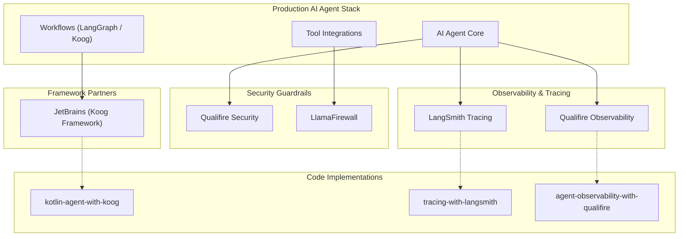
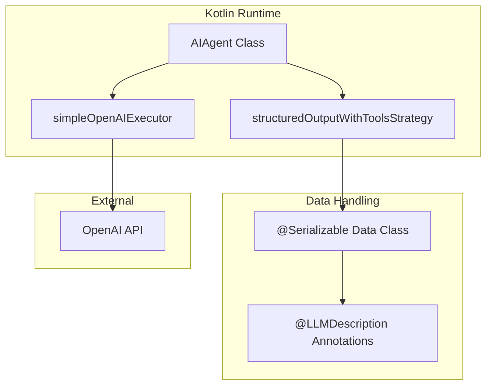
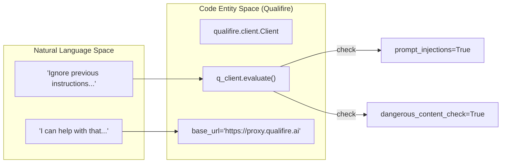

<!-- source: DeepWiki mcp.deepwiki.com · repo NirDiamant/agents-towards-production · page 5.2 Observability & Security Partners · fetched 2026-10-29 -->

# Observability & Security Partners

Relevant source files

The following files were used as context for generating this wiki page:

- [tutorials/agent-memory-with-redis/README.md](tutorials/agent-memory-with-redis/README.md)
- [tutorials/fastapi-agent/fastapi-agent-tutorial.ipynb](tutorials/fastapi-agent/fastapi-agent-tutorial.ipynb)
- [tutorials/kotlin-agent-with-koog/README.md](tutorials/kotlin-agent-with-koog/README.md)
- [tutorials/kotlin-agent-with-koog/Step3_StructuredOutput.kt](tutorials/kotlin-agent-with-koog/Step3_StructuredOutput.kt)
- [tutorials/kotlin-agent-with-koog/tutorial.md](tutorials/kotlin-agent-with-koog/tutorial.md)
- [tutorials/tracing-with-langsmith/langsmith_basics.ipynb](tutorials/tracing-with-langsmith/langsmith_basics.ipynb)

This document covers the key partners and technologies that provide observability, monitoring, security, and specialized framework support for production AI agents. These partners offer solutions for tracing agent workflows, implementing security guardrails, and building type-safe agent applications.

For information about deployment infrastructure partners, see [Infrastructure & Deployment Partners](5.1). For details about memory and tool integration partners, see [Memory & Tool Integration Partners](5.3).

## Partner Ecosystem Overview

The repository integrates with several specialized partners to provide comprehensive observability and security coverage. This includes JetBrains for JVM-based agent development, LangChain for tracing, and Qualifire for security and monitoring.

### Observability, Security & Framework Architecture

Sources: [tutorials/kotlin-agent-with-koog/tutorial.md:9-26](), [tutorials/tracing-with-langsmith/langsmith_basics.ipynb:12-26](), [tutorials/agent-observability-with-qualifire/README.md:1-38]()

## Framework Partners: JetBrains (Koog)

JetBrains provides the **Koog** framework, an open-source library for building LLM-powered agents in Kotlin. It bridges the gap for JVM-based backend infrastructure, offering type safety, coroutine support, and structured output.

### Koog Agent Architecture

**Key Features:**
- **Type Safety**: Uses Kotlin data classes for structured LLM responses [tutorials/kotlin-agent-with-koog/Step3_StructuredOutput.kt:25-46]().
- **Asynchronous Execution**: Built on Kotlin coroutines (`suspend` functions) [tutorials/kotlin-agent-with-koog/tutorial.md:170-173]().
- **ReAct Loop**: Native support for Reason-Act-Observe patterns [tutorials/kotlin-agent-with-koog/tutorial.md:18-21]().

Sources: [tutorials/kotlin-agent-with-koog/tutorial.md:5-13](), [tutorials/kotlin-agent-with-koog/Step3_StructuredOutput.kt:68-76]()

## Observability Partners

### LangSmith Tracing & Debugging

LangSmith serves as the "flight recorder" for AI systems, capturing every decision, timing, and data flow within LangGraph and LangChain workflows [tutorials/tracing-with-langsmith/langsmith_basics.ipynb:20-22]().

#### Implementation Details

| Component | Code Entity / Configuration | Purpose |
| :--- | :--- | :--- |
| **Activation** | `LANGCHAIN_TRACING_V2='true'` | Enables automatic interception of LangGraph operations [tutorials/tracing-with-langsmith/langsmith_basics.ipynb:95-95](). |
| **Project** | `LANGCHAIN_PROJECT` | Organizes traces into specific dashboard views [tutorials/tracing-with-langsmith/langsmith_basics.ipynb:96-96](). |
| **Model Init** | `ChatOpenAI(model="gpt-4o-mini")` | Traced LLM calls with deterministic settings [tutorials/tracing-with-langsmith/langsmith_basics.ipynb:150-150](). |

Sources: [tutorials/tracing-with-langsmith/langsmith_basics.ipynb:38-43](), [tutorials/tracing-with-langsmith/langsmith_basics.ipynb:62-67]()

### Qualifire Observability

Qualifire focuses on enterprise-grade monitoring using OpenTelemetry standards. It provides a proxy-based approach to intercept LLM traffic for logging and quality metrics.

**Integration Pattern:**
- **SDK Initialization**: `qualifire.init(api_key=...)` [tutorials/agent-observability-with-qualifire/agent-observability-with-qualifire.ipynb:140-150]().
- **Proxy Integration**: Uses a custom `base_url` (e.g., `https://proxy.qualifire.ai/api/providers/openai/`) to capture traces without changing agent logic [tutorials/agent-observability-with-qualifire/agent-observability-with-qualifire.ipynb:9-38]().

## Security Partners

### Qualifire Security Guardrails

Qualifire provides real-time defense against prompt injections, hallucinations, and policy violations.

#### Security Implementation Map

**Key Security Controls:**
- **Prompt Injection**: Blocks malicious attempts to override system instructions [tutorials/agent-security-with-qualifire/1-agent-security-with-qualifire.ipynb:95-307]().
- **Hallucination Prevention**: Uses `grounding_check=True` to ensure responses are based on provided context.
- **Content Filtering**: Automatically scans for hate speech, harassment, and sexual content [tutorials/agent-security-with-qualifire/1-agent-security-with-qualifire.ipynb:460-540]().

Sources: [tutorials/agent-security-with-qualifire/1-agent-security-with-qualifire.ipynb:1-40](), [tutorials/agent-security-with-qualifire/1-agent-security-with-qualifire.ipynb:184-206]()

## Partner Integration Matrix

| Partner | Category | Primary Integration Point | Key Code Symbols |
| :--- | :--- | :--- | :--- |
| **JetBrains** | Framework | JVM / Kotlin Backend | `AIAgent`, `simpleOpenAIExecutor`, `structuredOutputWithToolsStrategy` |
| **LangChain** | Observability | Tracing & Debugging | `LANGCHAIN_TRACING_V2`, `StateGraph`, `HumanMessage` |
| **Qualifire** | Security | Guardrails & Monitoring | `qualifire.init()`, `q_client.evaluate()`, `X-Qualifire-Api-Key` |

Sources: [tutorials/kotlin-agent-with-koog/Step3_StructuredOutput.kt:1-10](), [tutorials/tracing-with-langsmith/langsmith_basics.ipynb:139-147](), [tutorials/agent-security-with-qualifire/1-agent-security-with-qualifire.ipynb:519-540]()

---

