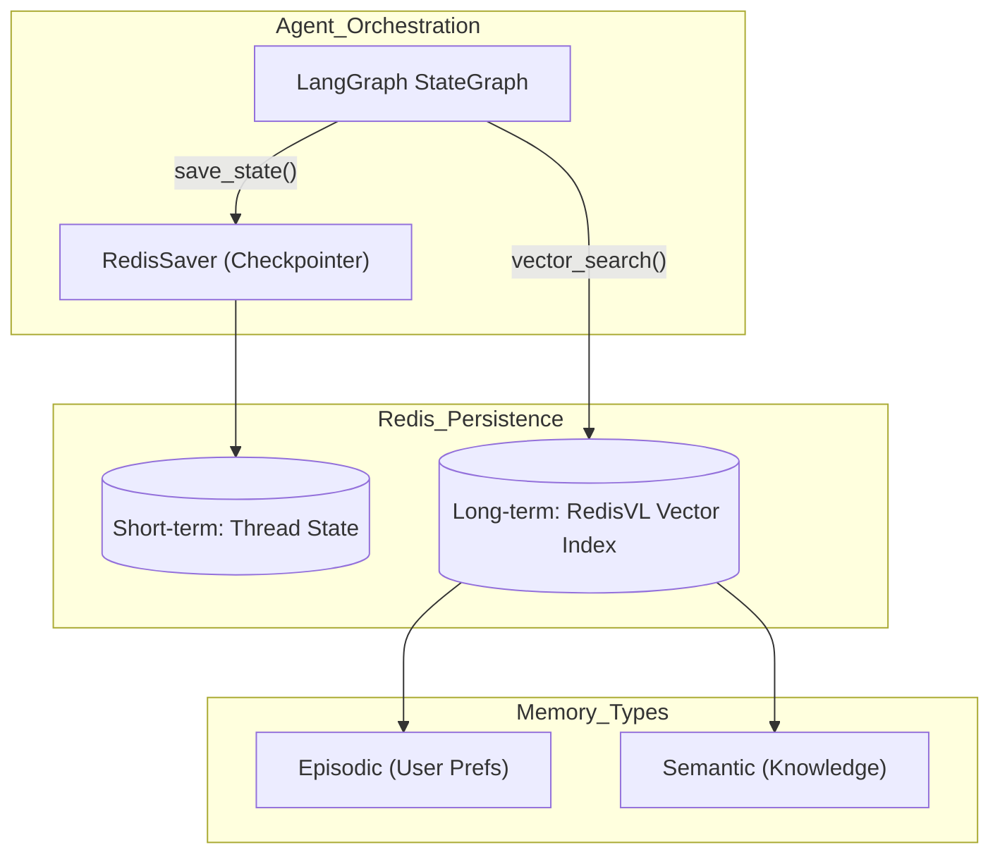
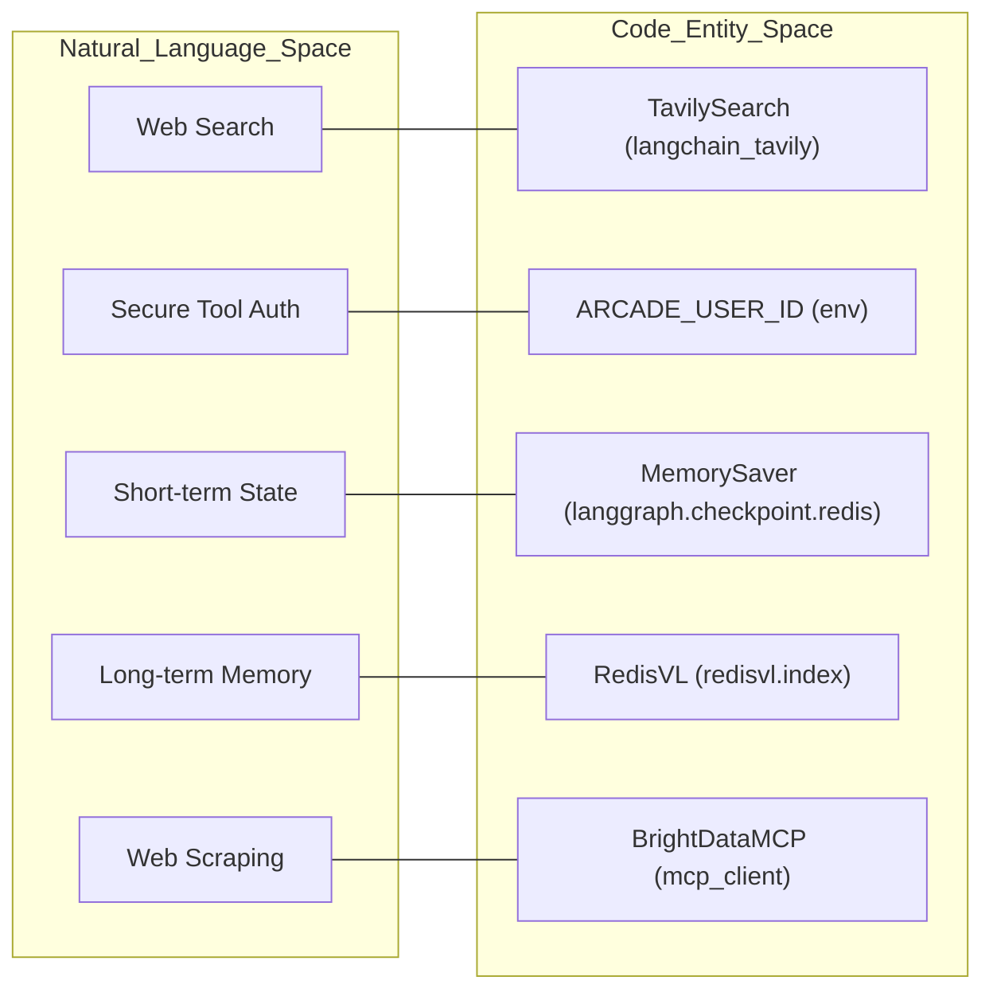

<!-- source: DeepWiki mcp.deepwiki.com · repo NirDiamant/agents-towards-production · page 5.3 Memory & Tool Integration Partners · fetched 2026-10-29 -->

# Memory & Tool Integration Partners

Relevant source files

The following files were used as context for generating this wiki page:

- [tutorials/agent-RAG-with-Contextual/README.md](tutorials/agent-RAG-with-Contextual/README.md)
- [tutorials/agent-RAG-with-Contextual/contextual_tutorial.ipynb](tutorials/agent-RAG-with-Contextual/contextual_tutorial.ipynb)
- [tutorials/agent-RAG-with-Contextual/requirements.txt](tutorials/agent-RAG-with-Contextual/requirements.txt)
- [tutorials/agent-memory-with-mem0/Assets/mem0_add_architecture.jpg](tutorials/agent-memory-with-mem0/Assets/mem0_add_architecture.jpg)
- [tutorials/agent-memory-with-mem0/Assets/mem0_architecture.png](tutorials/agent-memory-with-mem0/Assets/mem0_architecture.png)
- [tutorials/agent-memory-with-mem0/Assets/mem0_search_architecture.jpg](tutorials/agent-memory-with-mem0/Assets/mem0_search_architecture.jpg)
- [tutorials/agent-memory-with-mem0/README.md](tutorials/agent-memory-with-mem0/README.md)
- [tutorials/agent-memory-with-mem0/mem0_tutorial.ipynb](tutorials/agent-memory-with-mem0/mem0_tutorial.ipynb)
- [tutorials/agent-memory-with-redis/agent_memory_tutorial.ipynb](tutorials/agent-memory-with-redis/agent_memory_tutorial.ipynb)
- [tutorials/agent-with-brightdata/assets/Settings.png](tutorials/agent-with-brightdata/assets/Settings.png)
- [tutorials/agent-with-brightdata/assets/Signup.png](tutorials/agent-with-brightdata/assets/Signup.png)
- [tutorials/agent-with-brightdata/langgraph_integration.ipynb](tutorials/agent-with-brightdata/langgraph_integration.ipynb)
- [tutorials/agent-with-brightdata/web_scraping_agent.ipynb](tutorials/agent-with-brightdata/web_scraping_agent.ipynb)
- [tutorials/agent-with-streamlit-ui/building-chatbot-notebook.ipynb](tutorials/agent-with-streamlit-ui/building-chatbot-notebook.ipynb)
- [tutorials/agent-with-tavily-web-access/hybrid-agent-tutorial.ipynb](tutorials/agent-with-tavily-web-access/hybrid-agent-tutorial.ipynb)
- [tutorials/agent-with-tavily-web-access/supplemental/vectorize_tutorial.ipynb](tutorials/agent-with-tavily-web-access/supplemental/vectorize_tutorial.ipynb)
- [tutorials/agent-with-tavily-web-access/web-agent-tutorial.ipynb](tutorials/agent-with-tavily-web-access/web-agent-tutorial.ipynb)
- [tutorials/arcade-secure-tool-calling/arcade-diagram.png](tutorials/arcade-secure-tool-calling/arcade-diagram.png)
- [tutorials/arcade-secure-tool-calling/multiuser-agent-arcade.ipynb](tutorials/arcade-secure-tool-calling/multiuser-agent-arcade.ipynb)
- [tutorials/on-prem-llm-ollama/scripts/langchain_agent.ipynb](tutorials/on-prem-llm-ollama/scripts/langchain_agent.ipynb)

This page details the technical implementation and integration patterns for the repository's core memory systems and external tool partners. These integrations enable agents to maintain state, learn from interactions, and access real-time web data through secure, production-ready interfaces.

## Memory Systems Architecture

The repository implements a dual-memory architecture that distinguishes between short-term operational state and long-term persistent knowledge.

### Redis: Dual-Memory Implementation
Redis serves as the high-performance backbone for both short-term checkpointing and long-term semantic storage.

1.  **Short-term Memory (Checkpointing)**: Uses `langgraph-checkpoint-redis` to persist the state of `StateGraph` nodes. This allows agents to resume conversations and maintain thread-specific context [tutorials/agent-memory-with-redis/agent_memory_tutorial.ipynb:46-50]().
2.  **Long-term Memory (RedisVL)**: Utilizes the `RedisVL` client to store **Episodic** memory (user experiences/preferences) and **Semantic** memory (general knowledge) using vector embeddings [tutorials/agent-memory-with-redis/agent_memory_tutorial.ipynb:53-61]().

**Memory Data Flow:**

Sources: [tutorials/agent-memory-with-redis/agent_memory_tutorial.ipynb:42-61]()

### Mem0: Self-Improving Memory
Mem0 provides a managed memory layer that automatically extracts insights and resolves conflicts across interactions. It utilizes a hybrid approach combining vector databases (e.g., Qdrant) for semantic recall and graph databases (e.g., Neo4j) for entity relationship mapping [tutorials/agent-memory-with-mem0/mem0_tutorial.ipynb:56-63]().

**Key Class**: `mem0.Memory` [tutorials/agent-memory-with-mem0/mem0_tutorial.ipynb:146-146]()

Sources: [tutorials/agent-memory-with-mem0/mem0_tutorial.ipynb:22-63](), [tutorials/agent-memory-with-mem0/README.md:9-13]()

---

## Tool Integration Partners

### Tavily: Real-time Web Intelligence
Tavily is integrated as a primary tool for agents requiring up-to-date information. It offers specialized endpoints for searching, extracting, and crawling web data.

**Implementation Entities:**
*   `TavilySearch`: General web search with `max_results` and `topic` parameters [tutorials/agent-with-tavily-web-access/web-agent-tutorial.ipynb:146-146]().
*   `TavilyExtract`: Deep content extraction from specific URLs [tutorials/agent-with-tavily-web-access/web-agent-tutorial.ipynb:149-149]().
*   `TavilyCrawl`: Recursive site crawling [tutorials/agent-with-tavily-web-access/web-agent-tutorial.ipynb:152-152]().

Sources: [tutorials/agent-with-tavily-web-access/web-agent-tutorial.ipynb:140-152]()

### Arcade: Secure Multi-User Tool Calling
Arcade solves the challenge of managing OAuth2 flows and user-specific credentials in production. It acts as a secure proxy between the agent and services like Gmail, Slack, and Notion [tutorials/arcade-secure-tool-calling/multiuser-agent-arcade.ipynb:13-26]().

**Technical Flow:**
1.  Agent identifies a tool need.
2.  Arcade handles the `ARCADE_USER_ID` lookup [tutorials/arcade-secure-tool-calling/multiuser-agent-arcade.ipynb:114-128]().
3.  If unauthorized, Arcade triggers a secure auth flow.
4.  Tool execution happens in a hosted environment, returning only the result to the agent.

Sources: [tutorials/arcade-secure-tool-calling/multiuser-agent-arcade.ipynb:13-26](), [tutorials/arcade-secure-tool-calling/multiuser-agent-arcade.ipynb:114-128]()

### Bright Data: Enterprise Web Scraping
Bright Data provides robust infrastructure for bypassing bot detection and extracting structured data at scale.

*   **SERP Tool**: Integrated via `langchain-brightdata` to navigate search engine results pages [tutorials/agent-with-brightdata/langgraph_integration.ipynb:22-26]().
*   **MCP Integration**: Uses the Model Context Protocol (MCP) to provide agents with direct access to browser automation and platform-specific scrapers (e.g., e-commerce, social media) [tutorials/agent-with-brightdata/web_scraping_agent.ipynb:22-27]().

Sources: [tutorials/agent-with-brightdata/langgraph_integration.ipynb:22-26](), [tutorials/agent-with-brightdata/web_scraping_agent.ipynb:12-27]()

---

## Managed RAG & Evaluation

### Contextual AI: Managed RAG Pipeline
Contextual AI simplifies the RAG stack by providing a managed platform for document ingestion, chunking, and retrieval.

**Key Operations:**
*   **Datastore Configuration**: Creating indexes for document storage [tutorials/agent-RAG-with-Contextual/contextual_tutorial.ipynb:41-41]().
*   **Hierarchy-Aware Parsing**: Handling complex document structures like tables and charts [tutorials/agent-RAG-with-Contextual/contextual_tutorial.ipynb:42-42]().
*   **Client**: `contextual.ContextualAI` [tutorials/agent-RAG-with-Contextual/contextual_tutorial.ipynb:104-104]().

Sources: [tutorials/agent-RAG-with-Contextual/contextual_tutorial.ipynb:16-45]()

### IntellAgent: Behavioral Evaluation
IntellAgent is used for automated behavioral testing of agents, ensuring that tool calls and memory retrievals align with expected performance metrics.

---

## Integration Entity Mapping

The following diagram maps the Natural Language concepts to the specific Code Entities used in the partner integrations.

**Code Entity Bridge:**

Sources: [tutorials/agent-with-tavily-web-access/web-agent-tutorial.ipynb:146-146](), [tutorials/arcade-secure-tool-calling/multiuser-agent-arcade.ipynb:127-127](), [tutorials/agent-memory-with-redis/agent_memory_tutorial.ipynb:47-47](), [tutorials/agent-memory-with-redis/agent_memory_tutorial.ipynb:29-29](), [tutorials/agent-with-brightdata/web_scraping_agent.ipynb:23-23]()

---

