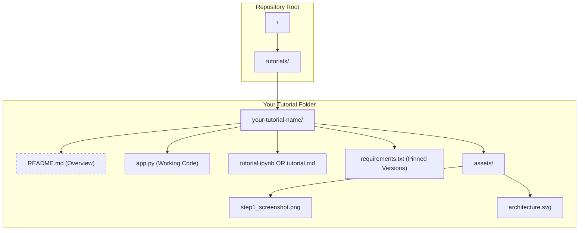
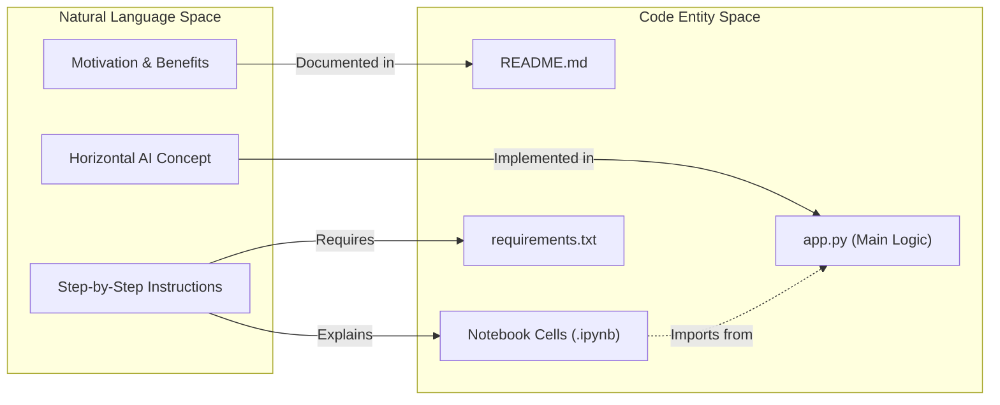

<!-- source: DeepWiki mcp.deepwiki.com · repo NirDiamant/agents-towards-production · page 6.1 Contributing Guidelines · fetched 2026-10-29 -->

# Contributing Guidelines

Relevant source files

The following files were used as context for generating this wiki page:

- [CONTRIBUTING.md](CONTRIBUTING.md)

## Purpose and Scope

This document provides comprehensive guidelines for contributing tutorials, code improvements, and enhancements to the **Agents Towards Production** playbook. It defines the required file structures, content quality standards, documentation practices, and the technical submission process necessary to maintain a high-quality educational resource for production-ready AI agents.

For information about issue reporting and community support processes, see [6.2 Issue Reporting & Support]().

## Tutorial Structure Requirements

### Required File Hierarchy

Every tutorial must be self-contained within its own directory under the `tutorials/` root. To ensure consistency and ease of use (especially for Google Colab integration), each folder must adhere to a specific structure.

| File/Folder | Requirement | Description |
| :--- | :--- | :--- |
| `README.md` | **Mandatory** | High-level overview, motivation, benefits, and "what you will learn" section. |
| `tutorial.ipynb` or `tutorial.md` | **Mandatory** | The core documentation. Use `.ipynb` for interactive guides or `.md` for screenshot-heavy guides. |
| `app.py` | **Mandatory** | The main application code or entry point. Must be well-commented. |
| `requirements.txt` | **Mandatory** | List of dependencies with specific versions to ensure reproducibility. |
| `assets/` | **Mandatory** | Directory for all media including images, videos, and Mermaid-generated SVGs. |

Sources: [CONTRIBUTING.md:15-36](), [CONTRIBUTING.md:38-47]()

### Visualizing the Directory Structure

The following diagram maps the physical file structure to the logical components required for a valid contribution.

**Tutorial Directory Layout**

Sources: [CONTRIBUTING.md:38-47]()

## Content Quality Standards

### Tutorial Content Flow
A high-quality tutorial must follow a logical progression from theory to practical implementation. Contributors should follow this 8-step structure:

1.  **README.md**: High-level overview with motivation and learning objectives [CONTRIBUTING.md:51-51]().
2.  **Title and Overview**: Clear explanation of the "Why" and "How" [CONTRIBUTING.md:52-52]().
3.  **Detailed Explanation**: Deep dive into components and method details [CONTRIBUTING.md:53-53]().
4.  **Visual Representation**: Diagrams using Mermaid (exported as SVG to `assets/`) [CONTRIBUTING.md:54-54]().
5.  **Implementation**: Step-by-step code blocks accompanied by screenshots [CONTRIBUTING.md:55-55]().
6.  **Usage Example**: A practical demonstration of the agent in action [CONTRIBUTING.md:56-56]().
7.  **External Tool Integration**: Explicit screenshots for every external UI action [CONTRIBUTING.md:57-57]().
8.  **Additional Considerations**: Discussion on limitations and potential improvements [CONTRIBUTING.md:58-58]().

### Signup and Partner Tracking
If a tutorial utilizes a third-party service or sponsor tool, specific tracking requirements apply:
*   **UTM Parameters**: All external links must include: `?utm_source=agents-towards-production&utm_medium=github&utm_campaign=tutorial` [CONTRIBUTING.md:12-12]().
*   **Instructions**: Place signup steps prominently at the start of the documentation [CONTRIBUTING.md:10-10]().
*   **Visuals**: Include screenshots of the signup/API key generation process [CONTRIBUTING.md:13-13]().

Sources: [CONTRIBUTING.md:9-14](), [CONTRIBUTING.md:49-59](), [CONTRIBUTING.md:80-86]()

## Code and Documentation Best Practices

### Code Standards
*   **Readability**: Break code into small, documented blocks [CONTRIBUTING.md:69-69]().
*   **Context**: Every code cell in a notebook must be preceded by a markdown cell explaining *what* happens and *why* [CONTRIBUTING.md:70-70]().
*   **Hygiene**: Remove unnecessary outputs (pip install logs, debug prints) before committing [CONTRIBUTING.md:71-71]().
*   **Comments**: Use thorough commenting for complex logic [CONTRIBUTING.md:106-106]().

### Documentation Standards
*   **Horizontal Concepts**: Help readers understand that implementations are specific examples of broader, horizontal ideas applicable to various use cases [CONTRIBUTING.md:64-65]().
*   **Self-Containment**: Explanations should be detailed enough to understand the logic without necessarily running the code [CONTRIBUTING.md:66-66]().
*   **Screenshots**: Include screenshots for every significant step in the setup process [CONTRIBUTING.md:100-100]().

**Documentation to Code Mapping**

Sources: [CONTRIBUTING.md:62-72](), [CONTRIBUTING.md:94-108]()

## Submission Process

### Git Workflow
Contributors should follow the standard GitHub Flow:

1.  **Fork** the repository [CONTRIBUTING.md:112-112]().
2.  **Branch**: Create a feature branch: `git checkout -b feature/AmazingFeature` [CONTRIBUTING.md:113-113]().
3.  **Commit**: Use descriptive commit messages: `git commit -m 'Add some AmazingFeature'` [CONTRIBUTING.md:114-114]().
4.  **Push**: `git push origin feature/AmazingFeature` [CONTRIBUTING.md:115-115]().
5.  **Pull Request**: Open a PR against the main repository [CONTRIBUTING.md:116-116]().

### Pre-PR Checklist
Before submitting, ensure the following:
- [ ] `README.md` includes motivation, methods, and learning goals [CONTRIBUTING.md:121-121]().
- [ ] Code runs without errors and contains no sensitive API keys [CONTRIBUTING.md:122-124]().
- [ ] All external links use UTM tracking [CONTRIBUTING.md:130-130]().
- [ ] Notebook outputs are cleared of non-essential logs [CONTRIBUTING.md:71-71]().
- [ ] Assets (images/diagrams) are correctly stored in the `assets/` folder [CONTRIBUTING.md:44-47]().

Sources: [CONTRIBUTING.md:111-137]()

---

