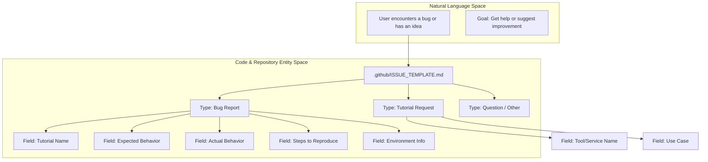
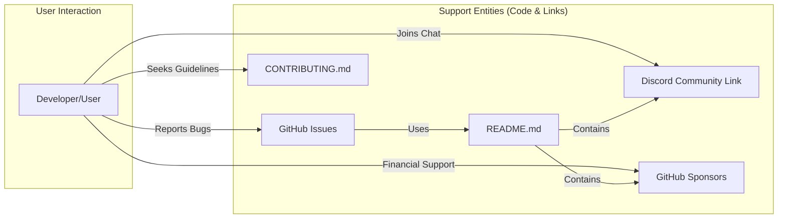

<!-- source: DeepWiki mcp.deepwiki.com · repo NirDiamant/agents-towards-production · page 6.2 Issue Reporting & Support · fetched 2026-10-29 -->

# Issue Reporting & Support

Relevant source files

The following files were used as context for generating this wiki page:

- [CONTRIBUTING.md](CONTRIBUTING.md)
- [README.md](README.md)
- [assets/repos_images/ai_architecture_diagram.svg](assets/repos_images/ai_architecture_diagram.svg)

This page outlines the formal processes for reporting technical issues, requesting new tutorial content, and engaging with the **Agents Towards Production** community. The repository utilizes structured workflows to ensure that bug reports are actionable and community support is efficient.

## Issue Reporting Workflow

The repository employs a standardized GitHub issue system to manage bug reports and feature requests. This structure ensures that the maintainer and community have the necessary technical context to resolve issues across diverse environments (Colab, Docker, Local Python).

### GitHub Issue Template Structure

The following diagram maps the logical flow of the issue reporting process to the requirements defined in the repository's issue configuration.

**Sources:** [README.md:452-456](), [CONTRIBUTING.md:120-137]()

---

## Support Channels & Community Engagement

Support for the project is distributed across formal tracking (GitHub) and real-time interaction (Discord).

### Support Ecosystem Mapping

This diagram bridges the community interaction points to the specific files and resources used to facilitate support.

**Sources:** [README.md:13-16](), [README.md:452-456](), [CONTRIBUTING.md:3-5]()

### Community Discord
The project maintains a Discord server for real-time collaboration. This is the primary venue for:
- Quick troubleshooting of tutorial code.
- Architecting custom agent workflows based on repository patterns.
- Networking with other AI engineers building production systems.

**Access:** The join link is located in the header of the [README.md:15]().

### GitHub Issues
Formal tracking is reserved for:
1.  **Bug Reports**: Errors in `app.py` files, broken links in `README.md`, or outdated `requirements.txt` dependencies.
2.  **Tutorial Requests**: Suggestions for new integrations (e.g., new Vector DBs or Agent Frameworks).
3.  **Documentation Improvements**: Clarifications needed in the `tutorial.md` or Jupyter Notebooks.

**Sources:** [README.md:452-456](), [CONTRIBUTING.md:17-36]()

---

## Technical Support for Tutorials

When seeking support for a specific tutorial, users are encouraged to provide technical metadata to speed up resolution.

### Required Context for Support
To effectively debug agent implementations, the following information is typically required:

| Category | Entities to Provide | Reference File |
| :--- | :--- | :--- |
| **Environment** | Python version, OS, Docker version (if applicable) | `requirements.txt` |
| **Dependencies** | Output of `pip freeze` or specific library versions | `requirements.txt` |
| **Logs** | Tracebacks from `app.py` or LangSmith trace URLs | `tutorials/*/app.py` |
| **Integration** | Confirmation of API key setup (without sharing keys) | `README.md` (Setup) |

**Sources:** [CONTRIBUTING.md:31-35](), [CONTRIBUTING.md:122-124]()

### Direct Maintainer Contact
For matters that fall outside of public issues (e.g., security vulnerabilities or sponsorship opportunities):
- **Sponsorships**: Managed via the GitHub Sponsors program [README.md:16]().
- **Professional Networking**: Reachable via LinkedIn and Twitter links provided in the repository header [README.md:13-14]().

---

## Issue Resolution Process

The lifecycle of a reported issue follows a standard open-source triage flow:

1.  **Triage**: The maintainer reviews the issue against the [CONTRIBUTING.md]() standards.
2.  **Labeling**: Issues are categorized (e.g., `bug`, `enhancement`, `help wanted`).
3.  **Reproduction**: For bugs, the community attempts to reproduce the error using the provided "Steps to Reproduce" [README.md:452-456]().
4.  **Resolution**: A fix is submitted via a Pull Request (PR). Contributors should follow the [Contributing Guidelines](6.1) for PR formatting.
5.  **Verification**: The fix is verified against the tutorial's `requirements.txt` and `app.py` before merging.

**Sources:** [CONTRIBUTING.md:110-116](), [README.md:452-456]()

---

