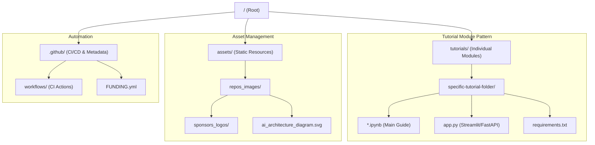
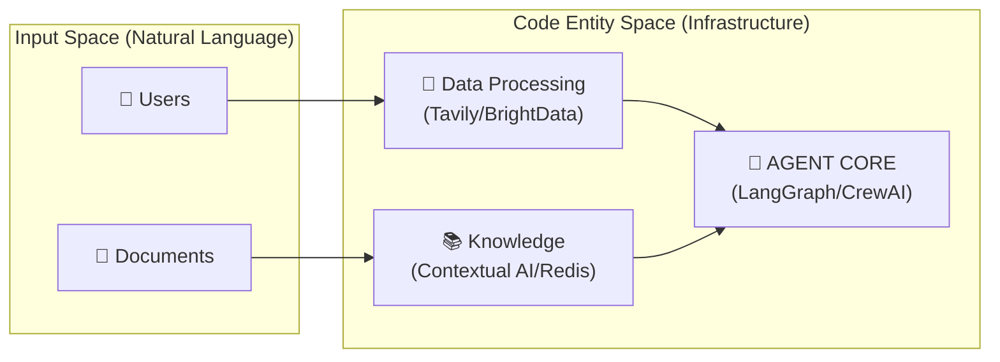

<!-- source: DeepWiki mcp.deepwiki.com · repo NirDiamant/agents-towards-production · page 7 Repository Infrastructure · fetched 2026-10-29 -->

# Repository Infrastructure

Relevant source files

The following files were used as context for generating this wiki page:

- [README.md](README.md)
- [assets/repos_images/ai_architecture_diagram.svg](assets/repos_images/ai_architecture_diagram.svg)
- [assets/repos_images/visit-site-badge.svg](assets/repos_images/visit-site-badge.svg)

This document covers the technical infrastructure that supports the **Agents Towards Production** repository, including development environment configuration, asset organization, and operational systems. The repository is designed as a modular playbook where each tutorial functions as a self-contained unit within a unified structural framework.

For details on setting up your local machine or using Google Colab, see [Development Environment](#7.1). For information regarding the visual identity and sponsor assets, see [Visual Assets & Branding](#7.2).

## Repository Layout and Directory Structure

The repository follows a strict organizational pattern to ensure scalability as new tutorials and partners are added. The core logic resides in the `tutorials/` directory, while global assets and configurations are managed at the root.

### High-Level Directory Organization

Sources: [README.md:38-140](), [assets/repos_images/ai_architecture_diagram.svg:1-65]()

## Development Environment Architecture

The repository is built around a Python-centric development environment with comprehensive tooling support for multiple development workflows, including specialized support for JVM-based agents (Kotlin).

### Python and IDE Support
The infrastructure supports multiple integrated development environments and virtual environment managers. This is reflected in the extensive `.gitignore` configuration which handles artifacts from various platforms.

| Tool Category | Supported Tools | Configuration Files |
|---------------|----------------|-------------------|
| IDEs | IntelliJ IDEA, VS Code, PyCharm | `.idea/`, `.vscode/` |
| Environments | venv, conda, .venv | `venv/`, `.env`, `bin/` |
| Notebooks | Jupyter, Google Colab | `.ipynb_checkpoints` |
| Languages | Python, Kotlin (Koog) | `*.py`, `*.kt` |

For a deep dive into environment variables and dependency management, see [Development Environment](#7.1).

Sources: [README.md:7-15](), [.gitignore:1-46]()

## Visual and Branding Infrastructure

To maintain a professional production-grade appearance, the repository utilizes a centralized asset management system for branding and architectural diagrams.

### Architecture Visualization
The repository includes a comprehensive `ai_architecture_diagram.svg` that maps the relationship between input sources, data processing (e.g., `Bright Data`, `Tavily`), and agent orchestration.

### Asset Organization
Branding assets are stored in `assets/repos_images/`, featuring specialized subdirectories for `sponsors_logos/`. These include:
*   **Theme-aware logos**: Variants like `trimmed_padded_langchain_white.png` for dark mode and standard versions for light mode.
*   **UI Components**: Reusable SVG badges like `visit-site-badge.svg`.

For details on asset naming conventions and logo specifications, see [Visual Assets & Branding](#7.2).

Sources: [assets/repos_images/ai_architecture_diagram.svg:70-150](), [README.md:39-44](), [assets/repos_images/visit-site-badge.svg:1-17]()

## Operational & Funding Infrastructure

### Version Control Strategy
The repository implements a comprehensive exclusion strategy to keep the codebase clean. This includes:
1.  **Testing Artifacts**: `htmlcov/`, `.tox/`, and `.coverage` are excluded to prevent local test runs from polluting the repo.
2.  **OS Metadata**: Protection against macOS `.DS_Store` and Windows `Thumbs.db`.
3.  **Analytics**: A custom `atp_views_tracker/` is excluded to keep internal metrics separate from the public tutorials.

### Funding and Sustainability
The repository utilizes GitHub Sponsors integration, configured via `.github/FUNDING.yml`, to support the ongoing development of the open-source playbook.

Sources: [.gitignore:47-75](), [.github/FUNDING.yml:1]()

---

