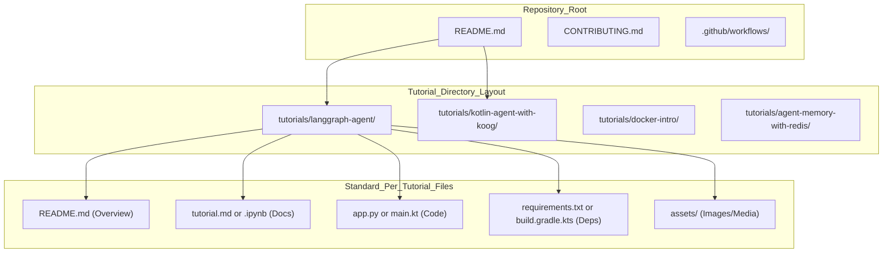
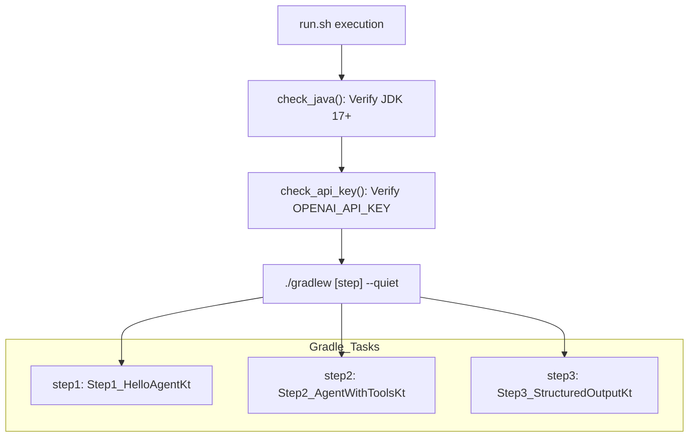
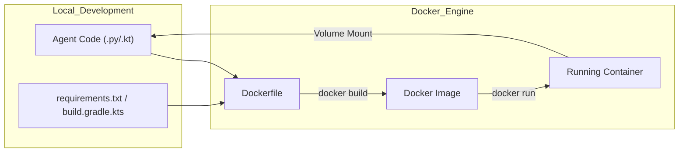

<!-- source: DeepWiki mcp.deepwiki.com · repo NirDiamant/agents-towards-production · page 7.1 Development Environment · fetched 2026-10-29 -->

# Development Environment

Relevant source files

The following files were used as context for generating this wiki page:

- [CONTRIBUTING.md](CONTRIBUTING.md)
- [tutorials/docker-intro/README.md](tutorials/docker-intro/README.md)
- [tutorials/kotlin-agent-with-koog/.gitignore](tutorials/kotlin-agent-with-koog/.gitignore)
- [tutorials/kotlin-agent-with-koog/build.gradle.kts](tutorials/kotlin-agent-with-koog/build.gradle.kts)
- [tutorials/kotlin-agent-with-koog/run.sh](tutorials/kotlin-agent-with-koog/run.sh)

## Purpose and Scope

This document details the development environment setup for the **Agents Towards Production** repository. It covers the repository's directory layout, Python and Kotlin development stacks, environment configuration, and tooling patterns that support a tutorial-based learning approach. The environment is designed to enable consistent, reproducible agent development across various partner integrations, from local prototyping to containerized production deployment.

## Repository Structure and Organization

The repository follows a modular, tutorial-first architecture. Each module is self-contained within the `tutorials/` directory, ensuring that dependencies for a specific technology (e.g., Redis memory or Kotlin frameworks) do not conflict with others.

### Repository Architecture Diagram

Sources: [CONTRIBUTING.md:15-47](), [tutorials/docker-intro/README.md:1-10]()

## Python Development Environment

Most tutorials utilize Python 3.10+. Each tutorial folder contains a `requirements.txt` file specifying exact versions to ensure reproducibility [CONTRIBUTING.md:33-33]().

### Python Setup Workflow
1. **Isolation**: Users are encouraged to create a virtual environment (`python -m venv venv`) within the specific tutorial directory.
2. **Dependencies**: Installation is handled via `pip install -r requirements.txt`.
3. **Execution**: Tutorials are typically run as Jupyter Notebooks (`.ipynb`) for interactive learning or as standalone FastAPI/Streamlit apps (`app.py`) [CONTRIBUTING.md:27-31]().

## Kotlin Development Environment (JVM)

The repository includes support for JVM-based agent development, specifically using the **Koog** framework by JetBrains [tutorials/kotlin-agent-with-koog/build.gradle.kts:11-12]().

### Kotlin Tooling and Dependencies
The Kotlin environment is managed via **Gradle** with the following key configurations:
- **JDK Version**: Requires JDK 17 or higher [tutorials/kotlin-agent-with-koog/run.sh:31-35]().
- **Build System**: Uses `build.gradle.kts` to manage dependencies like `ai.koog:koog-agents`, `kotlinx-coroutines`, and `kotlinx-serialization-json` [tutorials/kotlin-agent-with-koog/build.gradle.kts:10-22]().
- **Source Layout**: Source files are placed at the tutorial root instead of the standard Maven structure to simplify navigation [tutorials/kotlin-agent-with-koog/build.gradle.kts:50-57]().

### Kotlin Execution Flow
The `run.sh` script provides an interactive environment check and runner for Kotlin tutorials.

Sources: [tutorials/kotlin-agent-with-koog/run.sh:26-101](), [tutorials/kotlin-agent-with-koog/build.gradle.kts:29-48]()

## Docker-Based Development

Docker is utilized to solve the "reproducibility problem" caused by OS differences, hardware variations, and complex dependency chains (e.g., GPU drivers or vector databases) [tutorials/docker-intro/README.md:95-111]().

### Docker Environment Matrix

| Component | Role | Code Entity / Command |
|-----------|------|-----------------------|
| **Virtualization** | OS-level isolation | `Docker Desktop` [tutorials/docker-intro/README.md:47-49]() |
| **Image Definition** | Blueprint for the environment | `Dockerfile` [tutorials/docker-intro/README.md:31-31]() |
| **Registry** | Image storage and sharing | `Docker Hub` [tutorials/docker-intro/README.md:69-71]() |
| **Persistence** | Data mapping between host and container | `Mounting volumes` [tutorials/docker-intro/README.md:34-34]() |

### Containerization Workflow

Sources: [tutorials/docker-intro/README.md:84-94](), [tutorials/docker-intro/README.md:30-36]()

## Google Colab Integration

For Python-based tutorials, the repository supports Google Colab for immediate execution without local setup. Each tutorial README includes a tracker link that facilitates analytics and provides a gateway to interactive notebooks [CONTRIBUTING.md:1-1]().

## Continuous Integration (CI)

The repository uses GitHub Actions (located in `.github/workflows/`) to maintain code quality.
- **Tracking**: Tutorials include an analytics pixel to monitor usage and health [CONTRIBUTING.md:1-1]().
- **Standards**: Pull Requests are evaluated against the `Pre-PR Checklist`, which ensures all required files (`README.md`, `app.py`, `requirements.txt`, and `assets/`) are present and functional [CONTRIBUTING.md:118-137]().

## Development Tools Matrix

| Category | Tools | Usage |
| :--- | :--- | :--- |
| **Languages** | Python 3.10+, Kotlin 2.1.0 | Core agent logic and framework implementation. |
| **Build Tools** | pip, Gradle 8.x+ | Dependency resolution and task execution. |
| **Runtime** | Docker, JVM 17 | Environment isolation and cross-platform execution. |
| **IDE Support** | VS Code, IntelliJ IDEA | Recommended for Python and Kotlin development respectively. |
| **Cloud** | RunPod, Google Colab | Remote execution and GPU-accelerated workloads. |

Sources: [tutorials/kotlin-agent-with-koog/build.gradle.kts:1-4](), [tutorials/docker-intro/README.md:45-55](), [CONTRIBUTING.md:31-35]()

---

