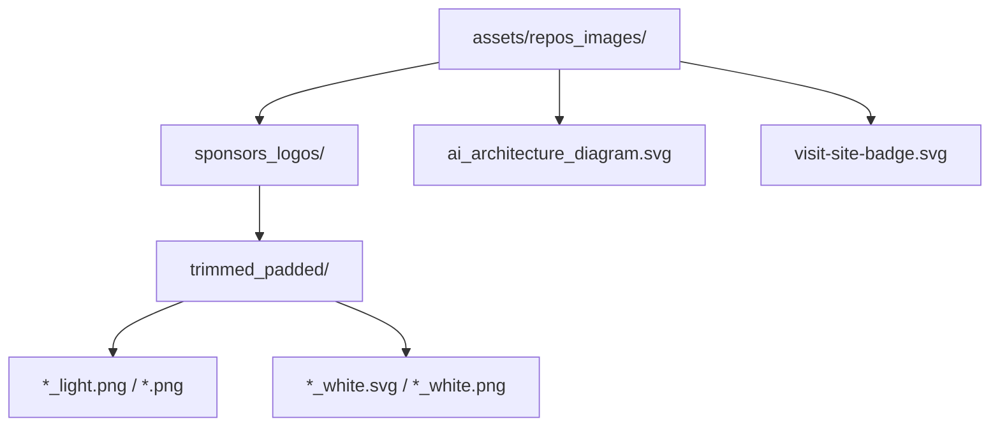
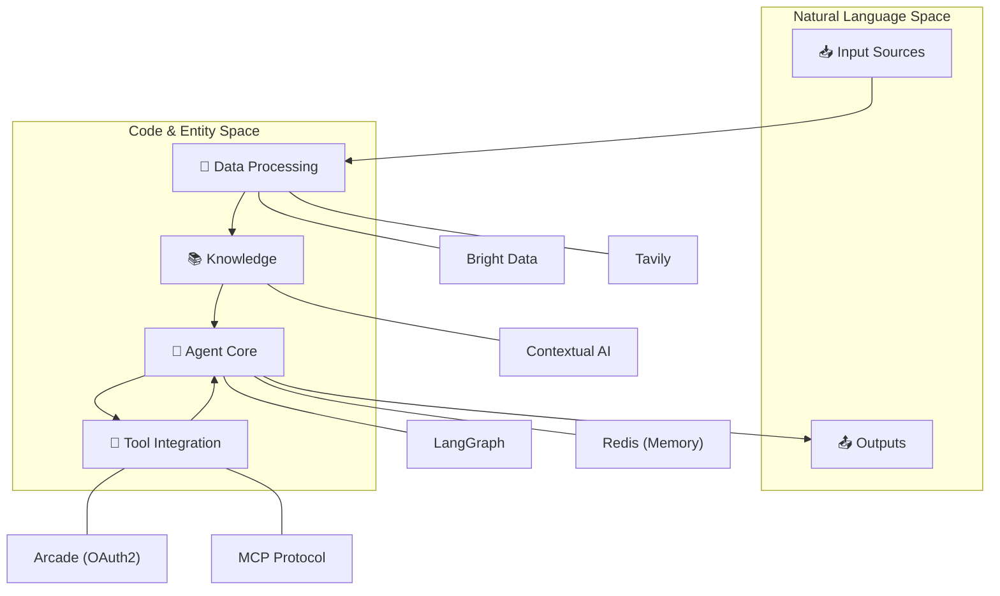

<!-- source: DeepWiki mcp.deepwiki.com · repo NirDiamant/agents-towards-production · page 7.2 Visual Assets & Branding · fetched 2026-10-29 -->

# Visual Assets & Branding

Relevant source files

The following files were used as context for generating this wiki page:

- [README.md](README.md)
- [assets/repos_images/ai_architecture_diagram.svg](assets/repos_images/ai_architecture_diagram.svg)
- [assets/repos_images/sponsors_logos/trimmed_padded/trimmed_padded_anchorbroswer_light.png](assets/repos_images/sponsors_logos/trimmed_padded/trimmed_padded_anchorbroswer_light.png)
- [assets/repos_images/sponsors_logos/trimmed_padded/trimmed_padded_anchorbrowser_dark.png](assets/repos_images/sponsors_logos/trimmed_padded/trimmed_padded_anchorbrowser_dark.png)
- [assets/repos_images/sponsors_logos/trimmed_padded/trimmed_padded_arcade_black.png](assets/repos_images/sponsors_logos/trimmed_padded/trimmed_padded_arcade_black.png)
- [assets/repos_images/sponsors_logos/trimmed_padded/trimmed_padded_arcade_white_tight.png](assets/repos_images/sponsors_logos/trimmed_padded/trimmed_padded_arcade_white_tight.png)
- [assets/repos_images/sponsors_logos/trimmed_padded/trimmed_padded_contextual_black.png](assets/repos_images/sponsors_logos/trimmed_padded/trimmed_padded_contextual_black.png)
- [assets/repos_images/sponsors_logos/trimmed_padded/trimmed_padded_contextual_white.png](assets/repos_images/sponsors_logos/trimmed_padded/trimmed_padded_contextual_white.png)
- [assets/repos_images/sponsors_logos/trimmed_padded/trimmed_padded_coral_black.png](assets/repos_images/sponsors_logos/trimmed_padded/trimmed_padded_coral_black.png)
- [assets/repos_images/sponsors_logos/trimmed_padded/trimmed_padded_coral_white.png](assets/repos_images/sponsors_logos/trimmed_padded/trimmed_padded_coral_white.png)
- [assets/repos_images/sponsors_logos/trimmed_padded/trimmed_padded_langchain_white.png](assets/repos_images/sponsors_logos/trimmed_padded/trimmed_padded_langchain_white.png)
- [assets/repos_images/sponsors_logos/trimmed_padded/trimmed_padded_portia_black_tight.png](assets/repos_images/sponsors_logos/trimmed_padded/trimmed_padded_portia_black_tight.png)
- [assets/repos_images/sponsors_logos/trimmed_padded/trimmed_padded_portia_white_tight.png](assets/repos_images/sponsors_logos/trimmed_padded/trimmed_padded_portia_white_tight.png)
- [assets/repos_images/sponsors_logos/trimmed_padded/trimmed_padded_tavily_white.png](assets/repos_images/sponsors_logos/trimmed_padded/trimmed_padded_tavily_white.png)
- [assets/repos_images/visit-site-badge.svg](assets/repos_images/visit-site-badge.svg)

This document covers the visual identity system, sponsor branding, and architectural diagrams used throughout the **Agents Towards Production** repository. It details the organization of the `assets/repos_images/` directory, the multi-theme logo system, and the technical implementation of the repository's primary architectural visualization.

## Asset Directory Structure

The repository maintains a structured approach to visual assets to ensure compatibility across different GitHub themes (light/dark) and high-quality documentation rendering.

**Sources:** [README.md:37-140](), [assets/repos_images/ai_architecture_diagram.svg:1-65]()

## Sponsor Branding System

The repository features a sophisticated sponsor display system in the `README.md` that adapts to the user's system theme using the HTML `<picture>` element and specialized image variants.

### Logo Variants & Theme Support
Sponsor logos are stored in `assets/repos_images/sponsors_logos/trimmed_padded/` with specific naming conventions to handle transparency and contrast:

| Variant Type | Suffix / Format | Purpose |
|--------------|-----------------|---------|
| **Standard** | `.png` / `_black.png` | Optimized for GitHub Light Mode. |
| **Dark Mode**| `_white.png` / `_white.svg` | High-contrast variants for GitHub Dark Mode. |
| **Tight**    | `_tight.png` | Minimal padding for specific grid alignments. |

**Implementation Example:**
The `README.md` utilizes the `<source media="(prefers-color-scheme: dark)">` tag to toggle between these assets [README.md:39-44]().

### Visit Site Badge
The `visit-site-badge.svg` is a standardized call-to-action component used under sponsor logos to direct users to partner platforms.

- **Dimensions:** 96x28 pixels [assets/repos_images/visit-site-badge.svg:3]()
- **Visual Identity:** Features a linear gradient from `#0269d2` to `#0480ff` [assets/repos_images/visit-site-badge.svg:5-8]().
- **Typography:** Uses a system-ui stack with semi-bold (600) weight [assets/repos_images/visit-site-badge.svg:13-14]().

**Sources:** [README.md:48-50](), [assets/repos_images/visit-site-badge.svg:1-17]()

## AI Architecture Diagram

The `ai_architecture_diagram.svg` serves as the primary technical visualization for the repository's "Production Playbook" philosophy. It maps high-level agent concepts to the specific tools and partners covered in the tutorials.

### Architectural Mapping
The diagram organizes the agent lifecycle into three distinct horizontal layers:

### Visual Styling & Markers
The diagram uses SVG definitions for semantic clarity:
- **Main Flow:** Blue arrows (`#2563eb`) indicate the primary data path [assets/repos_images/ai_architecture_diagram.svg:41-43]().
- **Support Flow:** Grey arrows (`#6b7280`) indicate auxiliary connections [assets/repos_images/ai_architecture_diagram.svg:45-47]().
- **Feedback Loops:** Green arrows (`#059669`) indicate iterative agent reasoning or memory updates [assets/repos_images/ai_architecture_diagram.svg:49-51]().

**Sources:** [assets/repos_images/ai_architecture_diagram.svg:1-145]()

## Technical Implementation Details

### SVG Definitions & Filters
The architectural diagram utilizes a `defs` section to manage visual consistency without code duplication:
- **Gradients:** Unique linear gradients are defined for each functional block (e.g., `agentGrad`, `toolGrad`, `knowledgeGrad`) [assets/repos_images/ai_architecture_diagram.svg:5-33]().
- **Shadows:** A standard drop shadow filter (`id="shadow"`) is applied to all component rectangles to provide depth [assets/repos_images/ai_architecture_diagram.svg:36-38]().

### Layout Constants
The diagram is built on a `1000x580` viewport [assets/repos_images/ai_architecture_diagram.svg:1](), divided into functional zones:
- **Top Row (y=70):** Input Sources, Data Processing, Knowledge Management, and Outputs [assets/repos_images/ai_architecture_diagram.svg:70-133]().
- **Middle Row (y=210):** Agent Core and Tool Integration [assets/repos_images/ai_architecture_diagram.svg:138-145]().

**Sources:** [assets/repos_images/ai_architecture_diagram.svg:1-145]()

---

