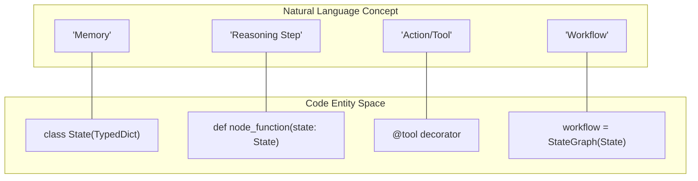
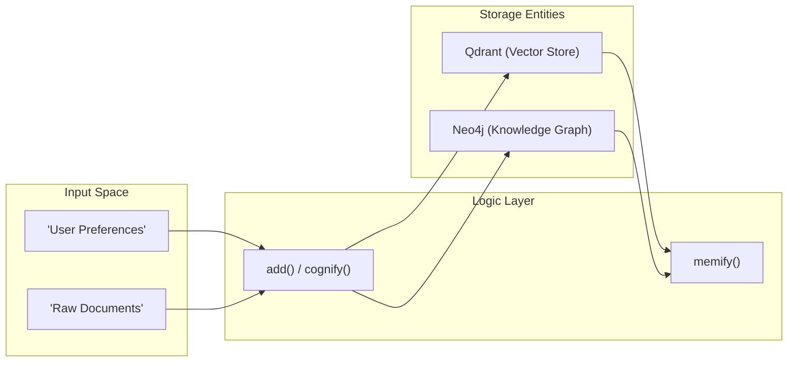

<!-- source: DeepWiki mcp.deepwiki.com · repo NirDiamant/agents-towards-production · page 8 Glossary · fetched 2026-10-29 -->

# Glossary

Relevant source files

The following files were used as context for generating this wiki page:

- [README.md](README.md)
- [assets/repos_images/ai_architecture_diagram.svg](assets/repos_images/ai_architecture_diagram.svg)
- [assets/repos_images/sponsors_logos/trimmed_padded/Mem0 Word Logo Dark.png](assets/repos_images/sponsors_logos/trimmed_padded/Mem0 Word Logo Dark.png)
- [assets/repos_images/sponsors_logos/trimmed_padded/Mem0 Word Logo.png](assets/repos_images/sponsors_logos/trimmed_padded/Mem0 Word Logo.png)
- [tutorials/LangGraph-agent/langgraph_tutorial.ipynb](tutorials/LangGraph-agent/langgraph_tutorial.ipynb)
- [tutorials/a2a/a2a_tutorial.ipynb](tutorials/a2a/a2a_tutorial.ipynb)
- [tutorials/agent-evaluation-intellagent/intellagent-evaluation-tutorial.ipynb](tutorials/agent-evaluation-intellagent/intellagent-evaluation-tutorial.ipynb)
- [tutorials/agent-memory-with-mem0/Assets/mem0_add_architecture.jpg](tutorials/agent-memory-with-mem0/Assets/mem0_add_architecture.jpg)
- [tutorials/agent-memory-with-mem0/Assets/mem0_architecture.png](tutorials/agent-memory-with-mem0/Assets/mem0_architecture.png)
- [tutorials/agent-memory-with-mem0/Assets/mem0_search_architecture.jpg](tutorials/agent-memory-with-mem0/Assets/mem0_search_architecture.jpg)
- [tutorials/agent-memory-with-mem0/README.md](tutorials/agent-memory-with-mem0/README.md)
- [tutorials/agent-memory-with-mem0/mem0_tutorial.ipynb](tutorials/agent-memory-with-mem0/mem0_tutorial.ipynb)
- [tutorials/agent-memory-with-redis/README.md](tutorials/agent-memory-with-redis/README.md)
- [tutorials/agent-security-apex/agent-security-evaluation-tutorial.ipynb](tutorials/agent-security-apex/agent-security-evaluation-tutorial.ipynb)
- [tutorials/agent-security-with-llamafirewall/README.md](tutorials/agent-security-with-llamafirewall/README.md)
- [tutorials/agent-with-brightdata/README.md](tutorials/agent-with-brightdata/README.md)
- [tutorials/agent-with-mcp/mcp-tutorial.ipynb](tutorials/agent-with-mcp/mcp-tutorial.ipynb)
- [tutorials/ai-memory-with-cognee/cognee-ai-memory.ipynb](tutorials/ai-memory-with-cognee/cognee-ai-memory.ipynb)
- [tutorials/ai-memory-with-cognee/data/cognee_diagram.png](tutorials/ai-memory-with-cognee/data/cognee_diagram.png)
- [tutorials/aws_agentcore/agentcore_tutorial.ipynb](tutorials/aws_agentcore/agentcore_tutorial.ipynb)
- [tutorials/aws_agentcore/assets/agentcore-diagram.png](tutorials/aws_agentcore/assets/agentcore-diagram.png)
- [tutorials/fastapi-agent/fastapi-agent-tutorial.ipynb](tutorials/fastapi-agent/fastapi-agent-tutorial.ipynb)
- [tutorials/kotlin-agent-with-koog/README.md](tutorials/kotlin-agent-with-koog/README.md)
- [tutorials/kotlin-agent-with-koog/Step3_StructuredOutput.kt](tutorials/kotlin-agent-with-koog/Step3_StructuredOutput.kt)
- [tutorials/kotlin-agent-with-koog/tutorial.md](tutorials/kotlin-agent-with-koog/tutorial.md)
- [tutorials/tracing-with-langsmith/langsmith_basics.ipynb](tutorials/tracing-with-langsmith/langsmith_basics.ipynb)

This glossary defines technical terms, architectural patterns, and domain-specific jargon used throughout the **Agents Towards Production** repository. It serves as a reference for onboarding engineers to understand how these concepts are implemented in the codebase.

## 1. Agent Frameworks & Orchestration

Terms related to the construction and execution of autonomous agent workflows.

| Term | Definition | Code Implementation |
| :--- | :--- | :--- |
| **StateGraph** | The core orchestration class in LangGraph used to define agentic workflows as a directed graph where nodes represent functions and edges represent transitions. | `langgraph.graph.StateGraph` [tutorials/LangGraph-agent/langgraph_tutorial.ipynb:138-138]() |
| **ReAct** | A prompting pattern ("Reason" + "Act") where the agent generates a reasoning trace followed by an action (tool call), allowing it to solve complex tasks. | Used in `classification_node` and tool-calling loops [tutorials/LangGraph-agent/langgraph_tutorial.ipynb:188-197]() |
| **Koog** | A JetBrains-developed framework for building LLM agents specifically for the Kotlin/JVM ecosystem. | `ai.koog.agents.core.agent.AIAgent` [tutorials/kotlin-agent-with-koog/tutorial.md:177-177]() |
| **Node** | A specific function or step within a `StateGraph` that processes the current state and returns updates. | e.g., `classification_node`, `entity_extraction_node` [tutorials/LangGraph-agent/langgraph_tutorial.ipynb:188-204]() |
| **AgentCore** | An AWS Bedrock runtime framework that wraps local agent functions into managed production services with HTTP endpoints. | `bedrock_agentcore.AgentCoreApp` [tutorials/aws_agentcore/agentcore_tutorial.ipynb:84-84]() |

### Natural Language to Agent Code Mapping
The following diagram illustrates how natural language concepts are mapped to specific classes and functions in the orchestration layer.

**Agent Orchestration Mapping**

Sources: [tutorials/LangGraph-agent/langgraph_tutorial.ipynb:137-168](), [tutorials/tracing-with-langsmith/langsmith_basics.ipynb:139-150]()

---

## 2. Memory & Knowledge Systems

Terms related to how agents persist information across sessions and retrieve domain knowledge.

*   **Episodic Memory**: Short-term storage of specific interaction sequences, often implemented via checkpointing or vector stores.
*   **Semantic Memory**: Long-term storage of facts and concepts, typically stored in Knowledge Graphs or Vector Databases [tutorials/agent-memory-with-mem0/README.md:9-13]().
*   **Cognify**: The process in the Cognee framework of using AI to extract entities and relationships from raw data to build a Knowledge Graph [tutorials/ai-memory-with-cognee/cognee-ai-memory.ipynb:58-58]().
*   **Self-Improving Memory**: A memory architecture (like Mem0) that extracts insights and resolves conflicts automatically over time [tutorials/agent-memory-with-mem0/mem0_tutorial.ipynb:26-26]().

### Memory Data Flow
This diagram shows the relationship between the natural language data and the storage entities used in the `Mem0` and `Cognee` implementations.

**Memory Implementation Flow**

Sources: [tutorials/agent-memory-with-mem0/mem0_tutorial.ipynb:58-62](), [tutorials/ai-memory-with-cognee/cognee-ai-memory.ipynb:54-61]()

---

## 3. Security & Guardrails

Terms related to protecting agents from malicious inputs and ensuring safe outputs.

*   **Prompt Injection**: A security vulnerability where a user provides input designed to override the agent's system instructions.
*   **LlamaFirewall**: An open-source framework for implementing input/output validation and tool security [tutorials/agent-security-with-llamafirewall/README.md:7-7]().
*   **Input Guardrail**: A defensive layer that scans incoming user messages for malicious intent before they reach the LLM [tutorials/agent-security-with-llamafirewall/README.md:26-27]().
*   **Output Guardrail**: A layer that validates LLM responses to ensure they comply with safety policies or formatting requirements [tutorials/agent-security-with-llamafirewall/README.md:29-30]().

Sources: [tutorials/agent-security-with-llamafirewall/README.md:15-18]()

---

## 4. Protocols & Tools

Standardized methods for agents to interact with the external world and each other.

*   **MCP (Model Context Protocol)**: A protocol that allows agents to discover and use tools across different platforms via a standardized server interface [tutorials/agent-with-brightdata/README.md:23-24]().
*   **A2A (Agent-to-Agent)**: A communication protocol based on JSON-RPC for multi-agent coordination [tutorials/a2a/a2a_tutorial.ipynb:1-1]().
*   **ReAct Loop**: The cycle of Reasoning (generating text) -> Acting (calling a tool) -> Observing (receiving tool output) [tutorials/kotlin-agent-with-koog/tutorial.md:18-21]().

Sources: [tutorials/agent-with-brightdata/README.md:7-19](), [tutorials/kotlin-agent-with-koog/tutorial.md:5-7]()

---

## 5. Infrastructure & Observability

Terms related to deploying and monitoring agents in production.

*   **Observability**: The ability to measure the internal state of a system by examining its outputs, often called a "flight recorder" for agents [tutorials/tracing-with-langsmith/langsmith_basics.ipynb:20-20]().
*   **Trace**: A complete record of a single execution path through an agent, including all LLM calls and tool invocations [tutorials/tracing-with-langsmith/langsmith_basics.ipynb:26-26]().
*   **Runtime Server**: In AWS AgentCore, the component that handles HTTP requests and routes them to the agent logic [tutorials/aws_agentcore/agentcore_tutorial.ipynb:32-32]().
*   **`@app.entrypoint`**: A decorator used in AgentCore to designate a specific function as the primary handler for incoming agent requests [tutorials/aws_agentcore/agentcore_tutorial.ipynb:32-32]().

Sources: [tutorials/tracing-with-langsmith/langsmith_basics.ipynb:16-26](), [tutorials/aws_agentcore/agentcore_tutorial.ipynb:28-38]()