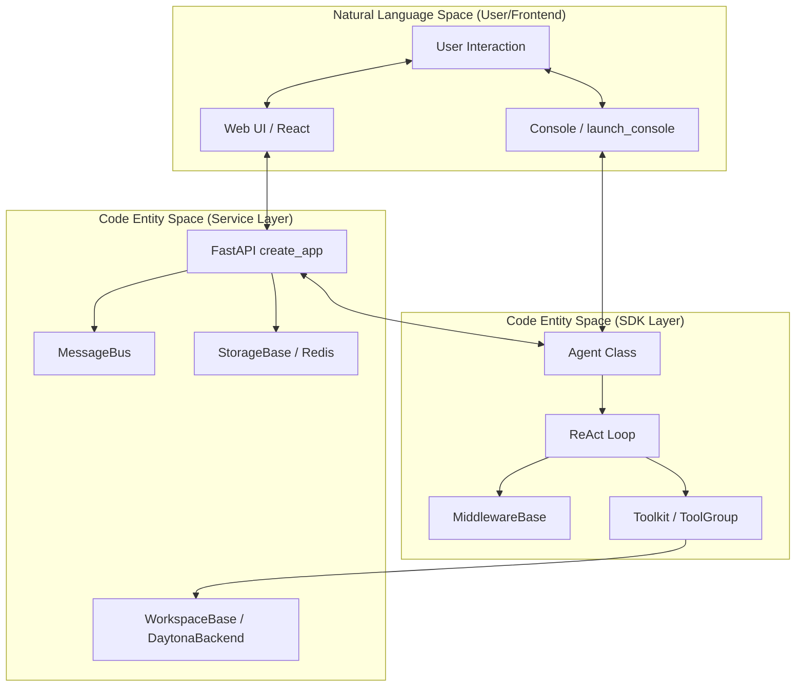
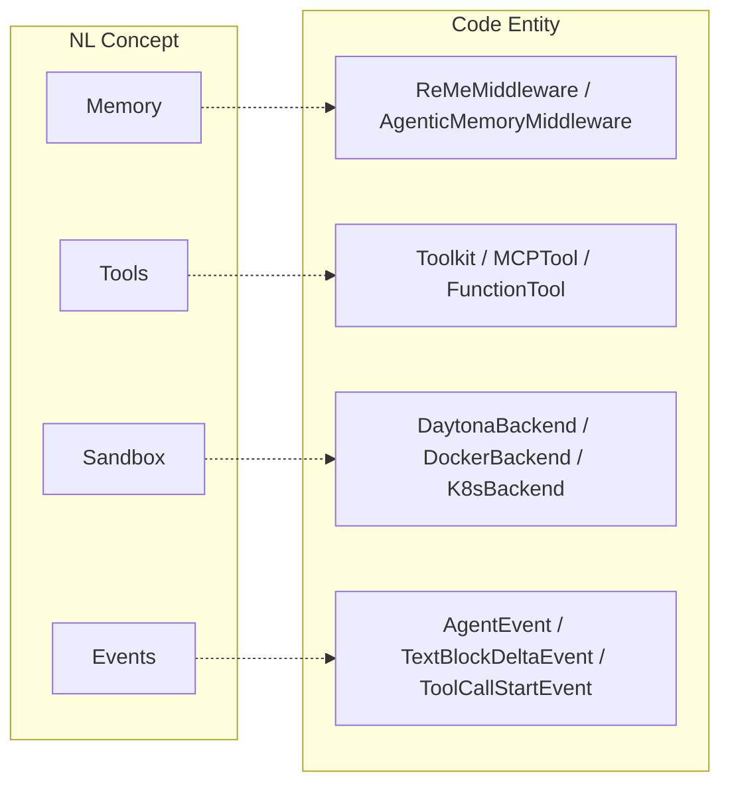

<!-- source: DeepWiki mcp.deepwiki.com · repo agentscope-ai/agentscope · page 1 AgentScope Overview · fetched 2026-10-30 -->

# AgentScope Overview

Relevant source files

The following files were used as context for generating this wiki page:

- [.gemini/styleguide.md](.gemini/styleguide.md)
- [.github/copilot-instructions.md](.github/copilot-instructions.md)
- [README.md](README.md)
- [README_zh.md](README_zh.md)
- [docs/NEWS.md](docs/NEWS.md)
- [docs/NEWS_zh.md](docs/NEWS_zh.md)
- [examples/console/README.md](examples/console/README.md)
- [examples/console/main.py](examples/console/main.py)
- [src/agentscope/__init__.py](src/agentscope/__init__.py)
- [src/agentscope/_version.py](src/agentscope/_version.py)
- [src/agentscope/console/__init__.py](src/agentscope/console/__init__.py)
- [src/agentscope/console/_console.py](src/agentscope/console/_console.py)
- [tests/console_renderer_test.py](tests/console_renderer_test.py)

AgentScope v2 is a production-ready, high-performance multi-agent framework designed to leverage the reasoning and tool-calling capabilities of modern Large Language Models (LLMs). Unlike frameworks that rely on rigid prompt templates, AgentScope focuses on flexible abstractions that allow agents to operate autonomously while providing developers with robust control through a two-layer architecture [README.md:64-70]().

The current version of the framework is `2.0.6` [src/agentscope/_version.py:4-4](). For a quick setup, see [Getting Started & Installation](#1.1).

## Two-Layer Architecture

AgentScope is structured into two primary layers: the **SDK Layer** for local development and agent logic, and the **Agent Service Layer** for production deployment and multi-agent orchestration [README.md:124-142]().

### SDK Layer (Core Logic)
The SDK provides the building blocks for creating individual agents. It revolves around the `Agent` class and the **ReAct** (Reasoning-Acting) loop, which handles structured outputs, real-time interruptions, and tool execution [README.md:128-128]().

*   **Models:** Support for LLM, Embedding, and TTS providers including OpenAI, Anthropic, Gemini, DashScope, DeepSeek, and Ollama [README.md:130-130]().
*   **Middleware:** A hook-based system (e.g., `RAGMiddleware`, `TTSMiddleware`, `AgenticMemoryMiddleware`) that wraps agent actions to handle context compression, memory, and tracing [README.md:134-134](), [examples/console/main.py:23-23]().
*   **Tool System:** Managed via `Toolkit`, supporting Python functions, MCP (Model Context Protocol), and specialized skills [README.md:129-129]().

### Agent Service Layer (Backend & Deployment)
The Service layer facilitates scaling agents into multi-user, multi-session applications. It utilizes a FastAPI-based backend to manage agent lifecycles, persistence, and communication [README.md:77-80]().

*   **Persistence:** Standardized storage for SQL and Redis backends [README.md:84-85]().
*   **Workspaces:** Sandboxed environments for safe tool execution (Docker, K8s, Daytona, E2B, OpenSandbox) [README.md:81-82]().
*   **Channels:** Integration with IM platforms like Feishu (Lark) and Discord [README.md:77-77]().

AgentScope Architecture Overview

**Sources:** [README.md:124-142](), [src/agentscope/console/_console.py:95-131](), [examples/console/main.py:55-84]()

## Key Design Principles

AgentScope is built on several core principles to ensure maintainability and performance:

1.  **Reasoning over Constraints:** The framework prioritizes the model's innate reasoning and tool-use abilities over opinionated orchestrations [README.md:68-70]().
2.  **Lazy Loading:** To keep the core package lightweight, third-party dependencies are imported only when needed at the function level [.github/copilot-instructions.md:10-19]().
3.  **Strict Encapsulation:** Internal framework components are prefixed with `_` to distinguish them from the public API, with exposure controlled through `__init__.py` [src/agentscope/__init__.py:5-10](), [.github/copilot-instructions.md:27-30]().
4.  **Extensibility:** Features like Long-term Memory are implemented as swappable middlewares, such as `ReMe long-term memory` or `AgenticMemoryMiddleware` [README.md:83-84](), [examples/console/main.py:75-79]().
5.  **Event-Driven Interaction:** Real-time feedback is provided via a stream of `AgentEvent` objects, which are rendered by components like `ConsoleRenderer` or the Web UI [src/agentscope/console/_renderer.py:6-15](), [tests/console_renderer_test.py:9-27]().

Bridging NL and Code Entities

**Sources:** [.github/copilot-instructions.md:10-30](), [README.md:77-84](), [src/agentscope/console/__init__.py:1-20](), [tests/console_renderer_test.py:9-27]()

## Wiki Navigation

This wiki is organized to take you from basic setup to deep architectural dives:

*   **[Getting Started & Installation](#1.1):** Environment setup, API key configuration, and running your first agent.
*   **[Contributing & Development Standards](#1.2):** Guidelines for PRs, lazy-loading rules, testing, and coding style.
*   **[Core SDK Architecture](#2):** Deep dive into the `Agent` class, message system, and middleware hooks.
*   **[Model Layer](#3):** Details on LLM adapters (OpenAI, Anthropic, etc.), embedding models, and TTS integration.
*   **[Tool System](#4):** How to build skills, use built-in tools (Bash, Filesystem), and integrate with MCP servers.
*   **[Workspace & Execution Environments](#5):** Managing local and sandboxed environments (Docker, K8s, Daytona).
*   **[RAG (Retrieval-Augmented Generation)](#6):** Implementing document pipelines, vector stores, and long-term memory.
*   **[Agent Service (Backend)](#7):** Building and deploying the FastAPI backend, session management, and multi-agent teams.
*   **[Web UI Frontend](#8):** Exploring the React-based frontend components and SSE streaming.
*   **[Testing Infrastructure](#9):** Overview of unit tests, integration tests, and model example scripts.
*   **[Glossary](#10):** Definitions of codebase-specific terms and code pointers.

**Sources:** [README.md:124-150](), [src/agentscope/_version.py:4-4](), [.github/copilot-instructions.md:1-97]()

---

