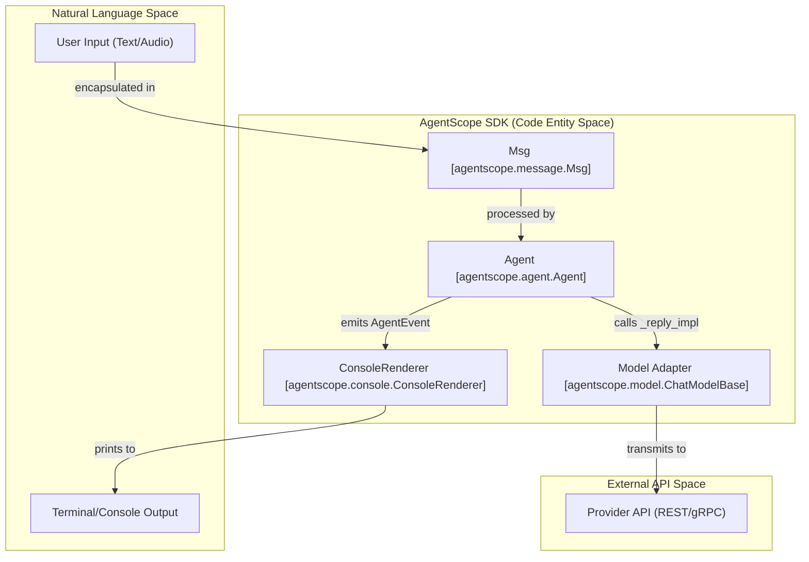

<!-- source: DeepWiki mcp.deepwiki.com · repo agentscope-ai/agentscope · page 1.1 Getting Started & Installation · fetched 2026-10-30 -->

# Getting Started & Installation

<details>
<summary>Relevant source files</summary>

The following files were used as context for generating this wiki page:

- [.gemini/styleguide.md](.gemini/styleguide.md)
- [.github/copilot-instructions.md](.github/copilot-instructions.md)
- [README.md](README.md)
- [README_zh.md](README_zh.md)
- [docs/NEWS.md](docs/NEWS.md)
- [docs/NEWS_zh.md](docs/NEWS_zh.md)
- [examples/console/README.md](examples/console/README.md)
- [examples/console/main.py](examples/console/main.py)
- [pyproject.toml](pyproject.toml)
- [src/agentscope/_version.py](src/agentscope/_version.py)
- [src/agentscope/console/__init__.py](src/agentscope/console/__init__.py)
- [src/agentscope/console/_console.py](src/agentscope/console/_console.py)
- [src/agentscope/rag/__init__.py](src/agentscope/rag/__init__.py)
- [src/agentscope/rag/_parser/__init__.py](src/agentscope/rag/_parser/__init__.py)
- [src/agentscope/rag/_parser/_excel.py](src/agentscope/rag/_parser/_excel.py)
- [src/agentscope/rag/_parser/_word.py](src/agentscope/rag/_parser/_word.py)
- [src/agentscope/rag/_vdb/__init__.py](src/agentscope/rag/_vdb/__init__.py)
- [tests/console_renderer_test.py](tests/console_renderer_test.py)
- [tests/rag_parser_test.py](tests/rag_parser_test.py)
- [tests/rag_vdb_elasticsearch_test.py](tests/rag_vdb_elasticsearch_test.py)
- [tests/rag_vdb_milvus_lite_test.py](tests/rag_vdb_milvus_lite_test.py)
- [tests/rag_vdb_mongodb_test.py](tests/rag_vdb_mongodb_test.py)

</details>


AgentScope 2.0 is a production-ready, multi-agent platform designed to bridge the gap between high-level agentic reasoning and robust execution. This page provides a technical guide to setting up the environment, managing dependencies via `pyproject.toml`, and executing your first agentic workflow using the SDK and the new Console interface.

## Installation

AgentScope requires **Python 3.11** or higher [pyproject.toml:20-20](). It uses a modular installation approach via `pyproject.toml` extras to keep the core footprint minimal while supporting a vast ecosystem of models, storage backends, and sandboxes.

### Core Installation
To install the base SDK with standard dependencies:
```bash
pip install agentscope
```

### Optional Dependencies (Extras)
For advanced features like RAG, distributed services, or specific vector databases, use the following extras defined in `pyproject.toml` [pyproject.toml:51-167]():

| Extra | Description | Key Dependencies |
| :--- | :--- | :--- |
| `models` | Extended provider support (Gemini, Ollama, xAI) | `google-genai`, `ollama`, `xai-sdk` |
| `service` | Backend Agent Service components | `fastapi`, `uvicorn`, `ag-ui-protocol` |
| `rag` | Document processing pipeline | `pypdf`, `python-pptx`, `pandas` |
| `vdb-qdrant` | In-memory/cloud vector search | `qdrant-client` |
| `vdb-milvus` | Local/Lite vector search | `milvus-lite`, `pymilvus` |
| `vdb-mongodb` | MongoDB Atlas vector search | `pymongo` |
| `workspace` | Sandboxed execution (Docker, K8s, E2B, Daytona) | `aiodocker`, `kubernetes-asyncio`, `e2b`, `daytona` |
| `channel` | External platform integrations | `lark-oapi`, `discord.py` |
| `full` | All features and integrations | All above extras |

**Example: Installing RAG with local Milvus support**
```bash
pip install "agentscope[rag,vdb-milvus]"
```

**Sources:**
- [pyproject.toml:51-167]()
- [README.md:100-120]()

---

## Environment & Credential Management

AgentScope uses a centralized `CredentialFactory` to manage API keys and provider-specific configurations. This allows for a clean separation between agent logic and sensitive configuration.

### Supported Credential Providers
Each provider is implemented as a subclass of `CredentialBase`.

| Provider | Credential Class | Discriminator `type` |
| :--- | :--- | :--- |
| OpenAI | `OpenAICredential` | `openai_credential` |
| Gemini | `GeminiCredential` | `gemini_credential` |
| Anthropic | `AnthropicCredential` | `anthropic_credential` |
| DashScope | `DashScopeCredential` | `dashscope_credential` |
| Ollama | `OllamaCredential` | `ollama_credential` |

### Configuration Example
Credentials can be initialized directly or managed via environment variables.

```python
import os
from agentscope.model import OpenAIChatModel

# 1. Initialize model with environment-based authentication
# AgentScope model adapters automatically look for standard API keys 
# if a specific credential object is not provided.
model = OpenAIChatModel(
    model="gpt-4o",
    api_key=os.environ.get("OPENAI_API_KEY")
)
```

**Sources:**
- [README.md:130-130]()
- [src/agentscope/rag/__init__.py:1-51]()

---

## Architecture: Mapping NL to Code

AgentScope bridges the gap between natural language interaction and structured code execution. The following diagrams map these conceptual spaces to specific code entities.

### Request Execution Pipeline
This diagram shows how a user's natural language input is transformed into a model call through SDK entities.



### RAG Subsystem Mapping
Mapping the RAG concepts to the `agentscope.rag` module classes [src/agentscope/rag/__init__.py:4-28]().

```mermaid
graph LR
    subgraph "Natural Language Space"
        Docs["Documents (PDF/Docx/XLSX)"]
        Query["User Query"]
    end

    subgraph "RAG Module (Code Entity Space)"
        P["Parser [ParserBase]"]
        C["Chunker [ApproxTokenChunker]"]
        VDB["Vector Store [VectorStoreBase]"]
        KB["KnowledgeBase [KnowledgeBase]"]
    end

    Docs -->|parse()| P
    P -->|chunk()| C
    C -->|VectorRecord| VDB
    VDB --> KB
    Query -->|search()| KB
```

**Sources:**
- [src/agentscope/rag/__init__.py:4-28]()
- [src/agentscope/rag/_vdb/__init__.py:4-13]()
- [src/agentscope/console/__init__.py:1-20]()

---

## Running Your First Agent (Console Mode)

AgentScope 2.0 introduces `launch_console` [src/agentscope/console/_console.py](), an interactive chat loop bound to a single agent for testing without writing UI code.

```python
from agentscope.agent import ReActAgent
from agentscope.console import launch_console

# 1. Define your agent
agent = ReActAgent(
    name="Assistant",
    model_config_name="my_gpt4_config",
    sys_prompt="You are a helpful assistant."
)

# 2. Launch the terminal-based interactive loop
# This handles input, streaming output, and tool-call confirmation
launch_console(agent)
```

For more granular control, use the `ConsoleRenderer` [src/agentscope/console/_renderer.py:1-20]() to turn an `AgentEvent` stream into line-based terminal output [src/agentscope/console/__init__.py:6-9]().

**Sources:**
- [src/agentscope/console/__init__.py:1-20]()
- [examples/console/main.py:1-10]()

---

## Vector Database Setup for RAG

For Retrieval-Augmented Generation, you must select a `VectorStoreBase` implementation [src/agentscope/rag/_vdb/_vector_store.py:8-8]().

| Database | Implementation Class | Extra |
| :--- | :--- | :--- |
| Qdrant | `QdrantStore` | `vdb-qdrant` |
| Milvus Lite | `MilvusLiteStore` | `vdb-milvus` |
| MongoDB | `MongoDBStore` | `vdb-mongodb` |
| Elasticsearch | `ElasticsearchStore` | `vdb-elasticsearch` |

### Quick-Start: Milvus Lite
Milvus Lite allows for local file-based persistence without requiring a server [pyproject.toml:107-107]().

```python
from agentscope.rag import MilvusLiteStore

# Creates a local database file 'rag_storage.db'
store = MilvusLiteStore(uri="./rag_storage.db")
```

**Sources:**
- [src/agentscope/rag/_vdb/__init__.py:12-12]()
- [pyproject.toml:105-108]()

---

