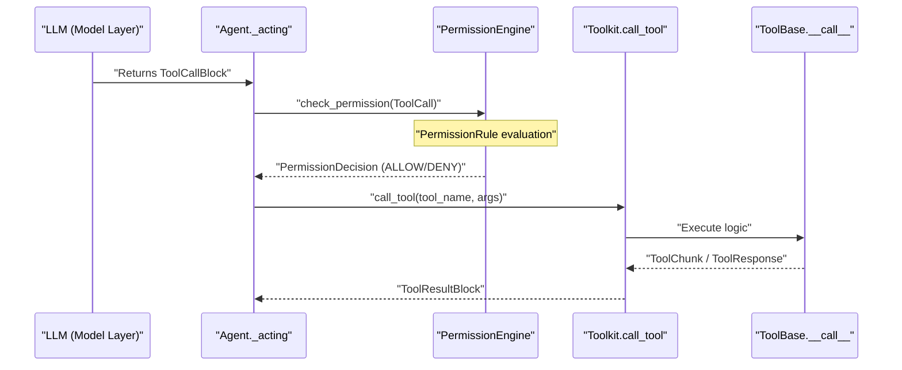

<!-- source: DeepWiki mcp.deepwiki.com · repo agentscope-ai/agentscope · page 10 Glossary · fetched 2026-10-30 -->

# Glossary

<details>
<summary>Relevant source files</summary>

The following files were used as context for generating this wiki page:

- [README.md](README.md)
- [README_zh.md](README_zh.md)
- [docs/NEWS.md](docs/NEWS.md)
- [docs/NEWS_zh.md](docs/NEWS_zh.md)
- [examples/console/README.md](examples/console/README.md)
- [examples/console/main.py](examples/console/main.py)
- [src/agentscope/agent/_agent.py](src/agentscope/agent/_agent.py)
- [src/agentscope/agent/_config.py](src/agentscope/agent/_config.py)
- [src/agentscope/app/_service/_workspace.py](src/agentscope/app/_service/_workspace.py)
- [src/agentscope/app/middleware/_protocol/_agui.py](src/agentscope/app/middleware/_protocol/_agui.py)
- [src/agentscope/app/middleware/_protocol/_base.py](src/agentscope/app/middleware/_protocol/_base.py)
- [src/agentscope/console/__init__.py](src/agentscope/console/__init__.py)
- [src/agentscope/console/_console.py](src/agentscope/console/_console.py)
- [src/agentscope/console/_renderer.py](src/agentscope/console/_renderer.py)
- [src/agentscope/event/_event.py](src/agentscope/event/_event.py)
- [src/agentscope/middleware/_base.py](src/agentscope/middleware/_base.py)
- [src/agentscope/state/_state.py](src/agentscope/state/_state.py)
- [src/agentscope/tool/_adapters.py](src/agentscope/tool/_adapters.py)
- [src/agentscope/tool/_builtin/_meta.py](src/agentscope/tool/_builtin/_meta.py)
- [src/agentscope/tool/_builtin/_skill.py](src/agentscope/tool/_builtin/_skill.py)
- [src/agentscope/tool/_response.py](src/agentscope/tool/_response.py)
- [src/agentscope/tool/_tool_group.py](src/agentscope/tool/_tool_group.py)
- [src/agentscope/tool/_toolkit.py](src/agentscope/tool/_toolkit.py)
- [src/agentscope/tool/_types.py](src/agentscope/tool/_types.py)
- [src/agentscope/tool/_utils.py](src/agentscope/tool/_utils.py)
- [src/agentscope/workspace/_base.py](src/agentscope/workspace/_base.py)
- [src/agentscope/workspace/_local_workspace.py](src/agentscope/workspace/_local_workspace.py)
- [src/agentscope/workspace/_utils.py](src/agentscope/workspace/_utils.py)
- [tests/agent_basic_test.py](tests/agent_basic_test.py)
- [tests/agent_interrupt_test.py](tests/agent_interrupt_test.py)
- [tests/agent_structured_output_test.py](tests/agent_structured_output_test.py)
- [tests/agui_protocol_test.py](tests/agui_protocol_test.py)
- [tests/console_renderer_test.py](tests/console_renderer_test.py)
- [tests/hitl_external_execution_test.py](tests/hitl_external_execution_test.py)
- [tests/hitl_user_confirmation_test.py](tests/hitl_user_confirmation_test.py)
- [tests/mcp_sse_client_test.py](tests/mcp_sse_client_test.py)
- [tests/mcp_streamable_http_client_test.py](tests/mcp_streamable_http_client_test.py)
- [tests/middleware_test.py](tests/middleware_test.py)
- [tests/toolkit_skill_test.py](tests/toolkit_skill_test.py)
- [tests/toolkit_test.py](tests/toolkit_test.py)
- [tests/workspace_bubblewrap_test.py](tests/workspace_bubblewrap_test.py)
- [tests/workspace_local_test.py](tests/workspace_local_test.py)

</details>


This page provides technical definitions and implementation details for the core concepts, abbreviations, and domain-specific terms used within the AgentScope codebase.

## Core Concepts

### Agent
The fundamental unit of execution in AgentScope. An `Agent` encapsulates a Large Language Model (LLM), a `Toolkit`, and a set of `Middleware` to perform reasoning and actions.
*   **Implementation**: Defined in `Agent` class [[src/agentscope/agent/_agent.py:112-129]]().
*   **Data Flow**: The agent operates within a **ReAct Loop** (Reasoning-Acting), processing inputs via the `reply` or `reply_stream` methods [[src/agentscope/agent/_agent.py:228-260]]().

### ReAct Loop
The Reasoning-Acting cycle where the agent iteratively generates reasoning (thoughts) and actions (tool calls) until a termination condition is met or the maximum iterations are reached.
*   **Configuration**: Managed via `ReActConfig` [[src/agentscope/agent/_config.py:186-218]]().
*   **Logic**: Implemented in `_reply_impl` [[src/agentscope/agent/_agent.py:382-446]]() which orchestrates `_reasoning` and `_acting` phases. It handles structured output via `_GenerateStructuredOutput` [[src/agentscope/agent/_agent.py:103-103]]().

### Middleware
A system of composable hooks that wrap agent operations (onion pattern). Middlewares can intercept and modify data at various stages: model calls, tool execution, system prompt generation, and context compression.
*   **Base Class**: `MiddlewareBase` [[src/agentscope/middleware/_base.py:17-48]]().
*   **Execution**: Hooks like `on_reply`, `on_model_call`, and `on_acting` are filtered by implemented hooks and triggered during the agent's lifecycle [[src/agentscope/agent/_agent.py:191-212]]().

### Toolkit
A registry and execution manager for tools, MCP clients, and skills. It handles the generation of JSON schemas for LLM consumption and the dispatching of tool calls.
*   **Implementation**: `Toolkit` class [[src/agentscope/tool/_toolkit.py:66-86]]().
*   **Key Function**: `get_tool_schemas` [[src/agentscope/tool/_toolkit.py:171-186]]() translates Python functions/tools into LLM-readable definitions, including support for MCP tools [[src/agentscope/tool/_toolkit.py:77-80]]().

### Workspace
An isolated environment for agent execution, file storage, and tool provisioning. Workspaces provide resources (skills), tools (MCPs), and offloading persistence.
*   **Base Class**: `WorkspaceBase` [[src/agentscope/workspace/_base.py:65-90]]().
*   **Local Implementation**: `LocalWorkspace` [[src/agentscope/workspace/_local_workspace.py:65-86]]() manages local directories for sessions, data, and skills.
*   **Layout**: Workspaces typically follow a standard directory structure including `.mcp`, `data/`, `skills/`, and `sessions/` [[src/agentscope/workspace/_base.py:38-42]]().

---

## Technical Terms & Abbreviations

| Term | Definition | Code Reference |
| :--- | :--- | :--- |
| **Msg** | The unified message object used for communication between agents and models. | [[src/agentscope/message/_message.py:84-118]]() |
| **ContentBlock** | A structured unit within a `Msg`, such as `TextBlock`, `ThinkingBlock`, `ToolCallBlock`, or `ToolResultBlock`. | [[src/agentscope/message/_block.py:22-45]]() |
| **HITL** | Human-In-The-Loop. A mechanism for requiring human confirmation before sensitive actions (e.g., shell commands). | [[src/agentscope/agent/_agent.py:53-56]]() |
| **MCP** | Model Context Protocol. A standard for agents to interact with external tools and data sources via `MCPClient`. | [[src/agentscope/tool/_toolkit.py:32-33]]() |
| **Offloader** | A component responsible for moving large tool results or old context to persistent storage to save context window space. | [[src/agentscope/agent/_agent.py:104-104]]() |
| **RAG** | Retrieval-Augmented Generation. A system for retrieving relevant documents via `KnowledgeBase` to augment the agent's prompt. | [[src/agentscope/rag/__init__.py:9-17]]() |
| **SSE** | Server-Sent Events. The protocol used to stream agent events from the backend service to the Web UI. | [[src/agentscope/event/_event.py:1-20]]() |
| **ToolChunk** | A granular unit of tool execution output, used for streaming tool results. | [[src/agentscope/tool/_response.py:23-23]]() |
| **Console** | A terminal-based interface for testing and debugging agents without a full Web UI. | [[src/agentscope/console/_console.py:1-20]]() |

---

## Architecture Diagrams

### From Natural Language to Code Entities (SDK Layer)
This diagram maps the conceptual "Agent" to the specific classes and data structures that implement it.

Title: SDK Entity Mapping
```mermaid
graph TD
    subgraph "NaturalLanguageSpace"
        ["Agent"]
        ["Tools"]
        ["Memory/Context"]
        ["Reasoning"]
    end

    subgraph "CodeEntitySpace"
        ["Agent"] --> AgentClass["Agent (src/agentscope/agent/_agent.py)"]
        ["Tools"] --> ToolkitClass["Toolkit (src/agentscope/tool/_toolkit.py)"]
        ["Memory/Context"] --> AgentStateClass["AgentState (src/agentscope/state/_state.py)"]
        ["Reasoning"] --> ReActLoop["_reply_impl (src/agentscope/agent/_agent.py)"]
        
        AgentClass --> ToolkitClass
        AgentClass --> AgentStateClass
        AgentClass --> ReActLoop
    end
```
**Sources:** [[src/agentscope/agent/_agent.py:112-129]](), [[src/agentscope/tool/_toolkit.py:66-86]](), [[src/agentscope/state/_state.py:25-45]]().

### Tool Execution Flow
This diagram bridges the concept of "Calling a Tool" to the internal execution and permission checking pipeline.

Title: Tool Execution Pipeline

**Sources:** [[src/agentscope/agent/_agent.py:628-660]](), [[src/agentscope/permission/_engine.py:20-45]](), [[src/agentscope/tool/_toolkit.py:230-260]](), [[src/agentscope/tool/_base.py:22-40]]().

---

## Domain Concepts

### Permission Engine
A system that evaluates `PermissionRule` objects against a `PermissionContext` to decide if an action is allowed.
*   **Behaviors**: `ALLOW`, `DENY`, `ASK` (triggers HITL/UserConfirmResultEvent).
*   **Implementation**: `PermissionEngine` [[src/agentscope/permission/_engine.py:15-35]]().

### Message Formatter
Adapters that translate AgentScope's internal `Msg` objects into the specific payload formats required by different LLM providers (OpenAI, Gemini, Anthropic, etc.).
*   **Base Class**: `FormatterBase` [[src/agentscope/formatter/_base.py:10-25]]().
*   **Implementation**: Found in `src/agentscope/formatter/` directory.

### Knowledge Base (RAG)
An abstraction over vector databases and document parsers used to provide agents with external information.
*   **Components**: `KnowledgeBase`, `VectorStoreBase`, and `ParserBase`.
*   **Backends**: Includes `QdrantStore`, `MilvusLiteStore`, `MongoDBStore`, and `ElasticsearchStore` [[src/agentscope/rag/__init__.py:18-27]]().

### Skills
Instructions, scripts, and resources that extend agent capabilities. Unlike tools, skills are not called directly; agents use the `SkillViewer` tool to read instructions and then execute them using existing tools [[src/agentscope/tool/_toolkit.py:51-63]]().
*   **Management**: Handled via `SkillLoaderBase` and `Skill` objects [[src/agentscope/skill/__init__.py]]().
*   **Local Partitioning**: Skills are partitioned per agent in the workspace to prevent state leakage [[src/agentscope/workspace/_base.py:50-55]]().

### Offloading
The process of persisting context or tool results to external storage (e.g., local disk or cloud) to maintain a lean context window for the LLM.
*   **Mechanism**: Managed by `Offloader` and implemented in workspaces like `LocalWorkspace` via `offload_context` [[src/agentscope/workspace/_local_workspace.py:207-220]]().

**Sources:** 
- SDK & Agent: [[src/agentscope/agent/_agent.py:1-212]]()
- Toolkit & Tools: [[src/agentscope/tool/_toolkit.py:1-170]](), [[src/agentscope/tool/_base.py:1-40]]()
- Workspace: [[src/agentscope/workspace/_local_workspace.py:1-100]](), [[src/agentscope/workspace/_base.py:1-60]]()
- RAG: [[src/agentscope/rag/__init__.py:1-52]]()
- Message/Events: [[src/agentscope/message/_block.py:1-45]](), [[src/agentscope/event/_event.py:1-65]]()
- Config: [[src/agentscope/agent/_config.py:1-220]]()