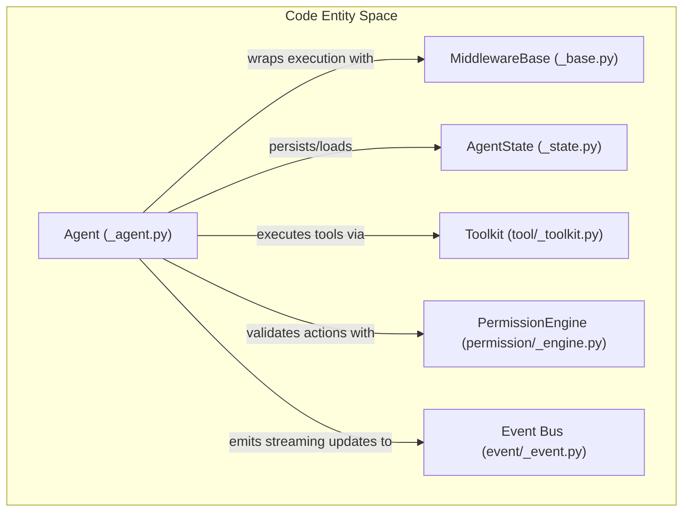
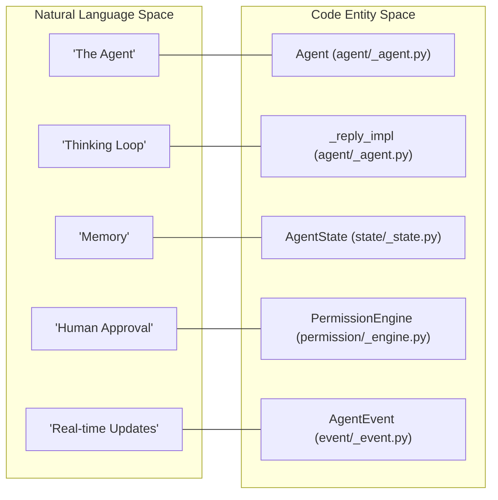

<!-- source: DeepWiki mcp.deepwiki.com · repo agentscope-ai/agentscope · page 2 Core SDK Architecture · fetched 2026-10-30 -->

# Core SDK Architecture

Relevant source files

The following files were used as context for generating this wiki page:

- [src/agentscope/agent/_agent.py](src/agentscope/agent/_agent.py)
- [src/agentscope/agent/_config.py](src/agentscope/agent/_config.py)
- [src/agentscope/app/middleware/_protocol/_agui.py](src/agentscope/app/middleware/_protocol/_agui.py)
- [src/agentscope/app/middleware/_protocol/_base.py](src/agentscope/app/middleware/_protocol/_base.py)
- [src/agentscope/console/_renderer.py](src/agentscope/console/_renderer.py)
- [src/agentscope/event/_event.py](src/agentscope/event/_event.py)
- [src/agentscope/middleware/_base.py](src/agentscope/middleware/_base.py)
- [src/agentscope/state/_state.py](src/agentscope/state/_state.py)
- [tests/agent_basic_test.py](tests/agent_basic_test.py)
- [tests/agent_interrupt_test.py](tests/agent_interrupt_test.py)
- [tests/agent_structured_output_test.py](tests/agent_structured_output_test.py)
- [tests/agui_protocol_test.py](tests/agui_protocol_test.py)
- [tests/hitl_external_execution_test.py](tests/hitl_external_execution_test.py)
- [tests/hitl_user_confirmation_test.py](tests/hitl_user_confirmation_test.py)
- [tests/middleware_test.py](tests/middleware_test.py)

The AgentScope SDK layer provides the fundamental building blocks for creating autonomous agents. It defines the core `Agent` class, the reasoning-acting loop, a sophisticated middleware system for intercepting execution, and a robust message/event bus for communication.

## The Agent & ReAct Loop

The `Agent` class [src/agentscope/agent/_agent.py:112-113]() is the primary entity in the SDK. It orchestrates the interaction between a language model, a toolkit, and internal state. The core of its execution is the **Reasoning-Acting (ReAct)** loop, which allows the agent to iteratively think, call tools, and process results until a task is completed or interrupted.

Key interfaces and configurations include:
*   `reply`: A high-level coroutine for generating a full response [src/agentscope/agent/_agent.py:276-277]().
*   `reply_stream`: An async generator for streaming responses and events [src/agentscope/agent/_agent.py:317-318]().
*   `_reply_impl`: The internal implementation of the ReAct loop [src/agentscope/agent/_agent.py:382-383]().
*   `ReActConfig`: Controls loop parameters such as `max_iters` [src/agentscope/agent/_config.py:182-183]().

For details, see [Agent & ReAct Loop](#2.1).

## Middleware System

AgentScope employs an interception system based on `MiddlewareBase` [src/agentscope/middleware/_base.py:13-14](). Middlewares can be injected into an agent to modify behavior (e.g., adding RAG, logging, or budget constraints) without altering the agent's source code. The system supports two patterns:
1.  **Onion Pattern**: Wraps execution points like `on_reply`, `on_reasoning`, `on_acting`, and `on_model_call` [src/agentscope/middleware/_base.py:19-25]().
2.  **Transformer Pattern**: Sequentially modifies data, such as `on_system_prompt` [src/agentscope/middleware/_base.py:27-28]().

For details, see [Middleware System](#2.2).

### SDK Component Interaction
This diagram illustrates how the `Agent` class coordinates various SDK components during a single `reply` cycle.

Sources: [src/agentscope/agent/_agent.py:112-212](), [src/agentscope/middleware/_base.py:13-31](), [src/agentscope/state/_state.py:176-189]()

## Messages & Events

Communication in AgentScope is handled via `Msg` objects and `AgentEvent` streams. 
*   **Messages**: Structured objects (`Msg`, `AssistantMsg`, `UserMsg`, `SystemMsg`) that represent conversation history and final outputs [src/agentscope/message/__init__.py](). These messages contain various `ContentBlock` types like `TextBlock`, `ThinkingBlock`, `ToolCallBlock`, and `ToolResultBlock` [src/agentscope/message/__init__.py]().
*   **Events**: Fine-grained signals defined in `EventType` (e.g., `TextBlockDeltaEvent`, `ToolCallStartEvent`, `ModelCallEndEvent`) emitted during `reply_stream` to provide real-time feedback [src/agentscope/event/_event.py:26-67]().

For details, see [Messages & Events](#2.3).

## State Management

The `AgentState` class [src/agentscope/state/_state.py:176-177]() encapsulates all persistent data for an agent, including:
*   **Context**: The uncompressed conversation history (`list[Msg]`) [src/agentscope/state/_state.py:187-188]().
*   **Summary**: Compressed memory for long-running sessions, managed via `ContextConfig` [src/agentscope/state/_state.py:183-185](), [src/agentscope/agent/_config.py:51-52]().
*   **ToolContext**: Caches for file tools and activated tool groups [src/agentscope/state/_state.py:32-33]().
*   **ReplyContext**: Metadata for the current active reply, including `cur_iter`, `reply_id`, and `structured_output` requirements [src/agentscope/state/_state.py:149-174]().

Sources: [src/agentscope/state/_state.py:1-212](), [src/agentscope/agent/_config.py:51-140]()

## Permission Engine & HITL

The `PermissionEngine` [src/agentscope/agent/_agent.py:178-179]() governs tool execution. It evaluates `PermissionRule` sets to decide if an action should be allowed, denied, or require **Human-In-The-Loop (HITL)** confirmation. 
*   **HITL Flow**: When a rule returns `PermissionBehavior.ASK` [src/agentscope/permission/_permission.py](), the agent emits a `RequireUserConfirmEvent` [src/agentscope/event/_event.py:60]() and parks the execution until a `UserConfirmResultEvent` is received [src/agentscope/event/_event.py:63]().
*   **Interruption**: Agents handle `UserInterruptEvent` to close pending tool calls with an `interrupted` state [src/agentscope/event/_event.py:64](), [src/agentscope/agent/_agent.py:1010-1015]().

For details, see [Permission Engine & HITL](#2.4).

### Natural Language to Code Mapping
This diagram bridges user-facing concepts to the specific classes and files that implement them.

Sources: [src/agentscope/agent/_agent.py:112-113](), [src/agentscope/agent/_agent.py:382-383](), [src/agentscope/state/_state.py:176-177](), [src/agentscope/event/_event.py:70-71]()

---

