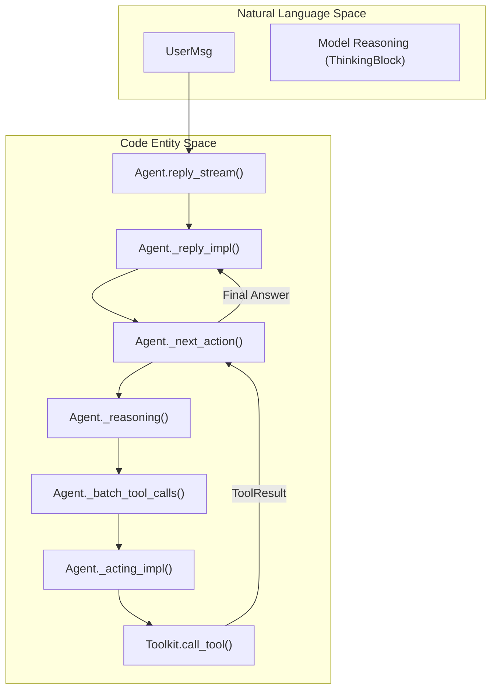
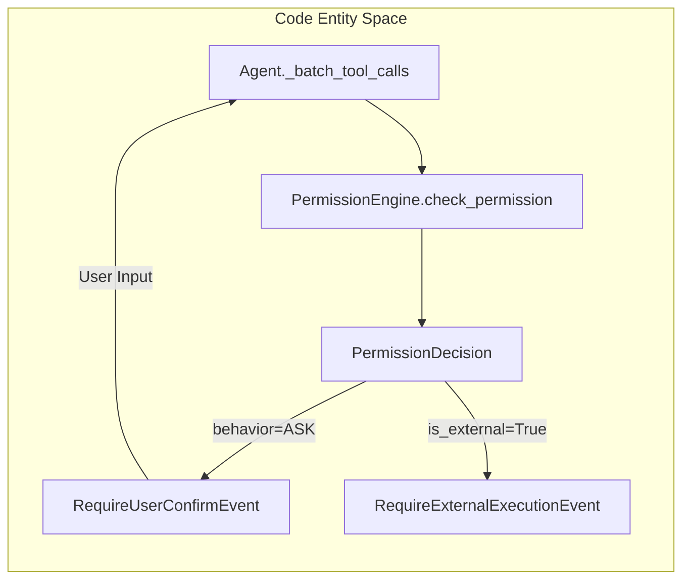

<!-- source: DeepWiki mcp.deepwiki.com · repo agentscope-ai/agentscope · page 2.1 Agent & ReAct Loop · fetched 2026-10-30 -->

# Agent & ReAct Loop

Relevant source files

The following files were used as context for generating this wiki page:

- [src/agentscope/agent/_agent.py](src/agentscope/agent/_agent.py)
- [src/agentscope/agent/_config.py](src/agentscope/agent/_config.py)
- [src/agentscope/agent/_structured_output_tool.py](src/agentscope/agent/_structured_output_tool.py)
- [src/agentscope/agent/_utils.py](src/agentscope/agent/_utils.py)
- [src/agentscope/state/__init__.py](src/agentscope/state/__init__.py)
- [src/agentscope/state/_state.py](src/agentscope/state/_state.py)
- [tests/agent_basic_test.py](tests/agent_basic_test.py)
- [tests/agent_interrupt_test.py](tests/agent_interrupt_test.py)
- [tests/agent_structured_output_test.py](tests/agent_structured_output_test.py)
- [tests/hitl_external_execution_test.py](tests/hitl_external_execution_test.py)
- [tests/hitl_mixed_test.py](tests/hitl_mixed_test.py)
- [tests/hitl_user_confirmation_test.py](tests/hitl_user_confirmation_test.py)
- [tests/middleware_test.py](tests/middleware_test.py)

The `Agent` class is the central orchestration entity in AgentScope. It manages the Reasoning-Acting (ReAct) loop, handles structured outputs, integrates with the middleware system, and manages human-in-the-loop (HITL) interactions.

## 1. The Agent Class Overview

The `Agent` class `[src/agentscope/agent/_agent.py:112-112]()` encapsulates the state, model, toolkit, and configuration required for an autonomous agent to operate.

### Key Components
- **State Management**: Uses `AgentState` `[src/agentscope/agent/_agent.py:169-169]()` to track conversation history, summaries, and tool contexts.
- **Model Integration**: Utilizes a `ChatModelBase` `[src/agentscope/agent/_agent.py:168-168]()` for reasoning and text generation.
- **Toolkit**: A `Toolkit` instance `[src/agentscope/agent/_agent.py:186-186]()` providing the agent with available functions, skills, and MCP tools.
- **Middlewares**: A pipeline of `MiddlewareBase` objects `[src/agentscope/agent/_agent.py:193-215]()` that intercept execution at various hooks (e.g., `on_reply`, `on_acting`).

### Configuration Objects
The agent's behavior is fine-tuned via specialized configuration classes defined in `[src/agentscope/agent/_config.py:1-200]()`:
- `ModelConfig`: Retries and fallback settings.
- `ContextConfig`: Token ratios for triggering compression and summary templates `[src/agentscope/agent/_config.py:51-140]()`.
- `ReActConfig`: Maximum iterations for the loop.
- `InjectionConfig`: Controls runtime state injection (time, timezone, etc.) `[src/agentscope/agent/_config.py:142-184]()`.

**Sources:** `[src/agentscope/agent/_agent.py:112-215]()`, `[src/agentscope/agent/_config.py:1-184]()`.

## 2. The Reply Interface

The `Agent` provides two primary entry points for interaction: `reply` and `reply_stream`.

### reply vs. reply_stream
- **`reply`**: A convenience method that consumes the `reply_stream` and returns the final `Msg` object `[src/agentscope/agent/_agent.py:284-307]()`.
- **`reply_stream`**: The core asynchronous generator that yields `AgentEvent` objects (for UI streaming) and terminates with the final `Msg` `[src/agentscope/agent/_agent.py:309-373]()`.

### Implementation Flow: `_reply_impl`
The internal `_reply_impl` `[src/agentscope/agent/_agent.py:375-496]()` manages the lifecycle of a single response:
1. **Context Preparation**: Injects runtime state (if enabled) and compresses history if token limits are exceeded `[src/agentscope/agent/_agent.py:388-410]()`.
2. **Input Handling**: Merges new messages into the agent's internal context `[src/agentscope/agent/_agent.py:412-424]()`.
3. **The Loop**: Executes the ReAct loop until a termination condition is met (e.g., the model provides a final answer or max iterations are reached).
4. **Finalization**: Cleans up tool caches and updates the `AgentState`.

**Sources:** `[src/agentscope/agent/_agent.py:284-496]()`.

## 3. The ReAct Loop Internals

The Reasoning-Acting loop is implemented through a sequence of internal methods that coordinate model calls and tool executions.

### Execution Pipeline Diagram

Title: ReAct Loop Internal Logic

### Key Loop Functions
- **`_next_action`**: Decides whether to continue reasoning or stop based on the last model response `[src/agentscope/agent/_agent.py:498-580]()`.
- **`_reasoning`**: Wraps the LLM call. It formats the prompt using the `Middleware` pipeline and triggers `ModelCallStartEvent` `[src/agentscope/agent/_agent.py:643-706]()`.
- **`_batch_tool_calls`**: Orchestrates the execution of one or more tool calls. It handles concurrency safety by separating tools into sequential and concurrent batches `[src/agentscope/agent/_agent.py:734-850]()`.

**Sources:** `[src/agentscope/agent/_agent.py:498-850]()`.

## 4. Structured Output

AgentScope supports enforcing structured output via Pydantic models. When a `structured_schema` is provided to `reply`, the agent injects a specialized internal tool called `GenerateStructuredOutput` `[src/agentscope/agent/_agent.py:672-680]()`.

### Mechanism
1. The schema is converted to a JSON schema and passed to the model `[src/agentscope/state/_state.py:164-170]()`.
2. The agent monitors for calls to `GenerateStructuredOutput`.
3. Upon a call, `_GenerateStructuredOutput` validates the input against the Pydantic model `[src/agentscope/agent/_structured_output_tool.py:53-84]()`.
4. If validation fails, the error is fed back into the ReAct loop for the model to self-correct `[tests/agent_structured_output_test.py:175-202]()`.

**Sources:** `[src/agentscope/agent/_agent.py:672-680]()`, `[src/agentscope/state/_state.py:164-170]()`, `[src/agentscope/agent/_structured_output_tool.py:53-84]()`.

## 5. Human-in-the-Loop (HITL) & Interruption

AgentScope handles asynchronous interruptions and permission-based pauses (ASK behavior).

### Permission and Execution Flow

Title: HITL and Tool Execution Flow

### Interruption Handling
- **Cancellation**: If an `asyncio.Task` is cancelled during tool execution, the agent catches `CancelledError`, emits a `UserInterruptEvent`, and marks in-flight tools as `INTERRUPTED` `[src/agentscope/agent/_agent.py:1053-1090]()`.
- **Parked Replies**: When a reply requires user confirmation, the agent "parks" the state. Resumption occurs when a `UserConfirmResultEvent` is passed back into `reply_stream` `[src/agentscope/agent/_agent.py:440-456]()`.
- **Closure of Unfinished Calls**: The method `_close_unfinished_tool_calls` `[src/agentscope/agent/_agent.py:1053-1090]()` ensures that any pending HITL or external execution requests are formally closed with an interrupted state if the reply ends prematurely.

**Sources:** `[src/agentscope/agent/_agent.py:440-1090]()`, `[tests/agent_interrupt_test.py:1-13]()`.

## 6. Context Injection and Compression

To improve reasoning, the agent automatically injects metadata into the context via `_get_injected_content` `[src/agentscope/agent/_agent.py:1260-1323]()`.

| Injected Field | Source | Description |
| :--- | :--- | :--- |
| `current_time` | `datetime.now()` | Localized time based on `InjectionConfig.timezone` `[src/agentscope/agent/_agent.py:1265-1275]()`. |
| `tasks` | `AgentState.task_context` | List of current plan/tasks the agent is tracking `[src/agentscope/agent/_agent.py:1277-1288]()`. |
| `context_usage` | `Model.count_tokens()` | Current token count vs. model limit `[src/agentscope/agent/_agent.py:1290-1318]()`. |

### Compression Pipeline
When `trigger_ratio` is reached `[src/agentscope/agent/_config.py:57-60]()`, the agent:
1. Calls `_compress_context` `[src/agentscope/agent/_agent.py:1134-1234]()`.
2. Uses the model to generate a structured summary based on `SummarySchema` `[src/agentscope/agent/_config.py:9-49]()`.
3. Offloads old messages to the `Offloader` if configured `[src/agentscope/agent/_agent.py:1225-1230]()`.
4. Updates `AgentState.summary` with the new compressed representation `[src/agentscope/state/_state.py:183-185]()`.

**Sources:** `[src/agentscope/agent/_agent.py:1134-1323]()`, `[src/agentscope/agent/_config.py:9-60]()`, `[src/agentscope/state/_state.py:183-185]()`.

---

