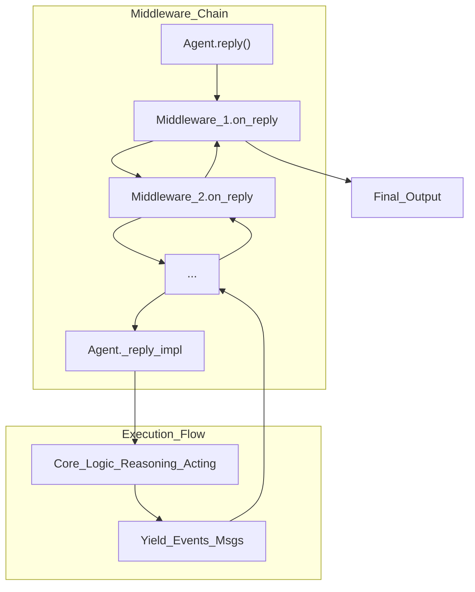
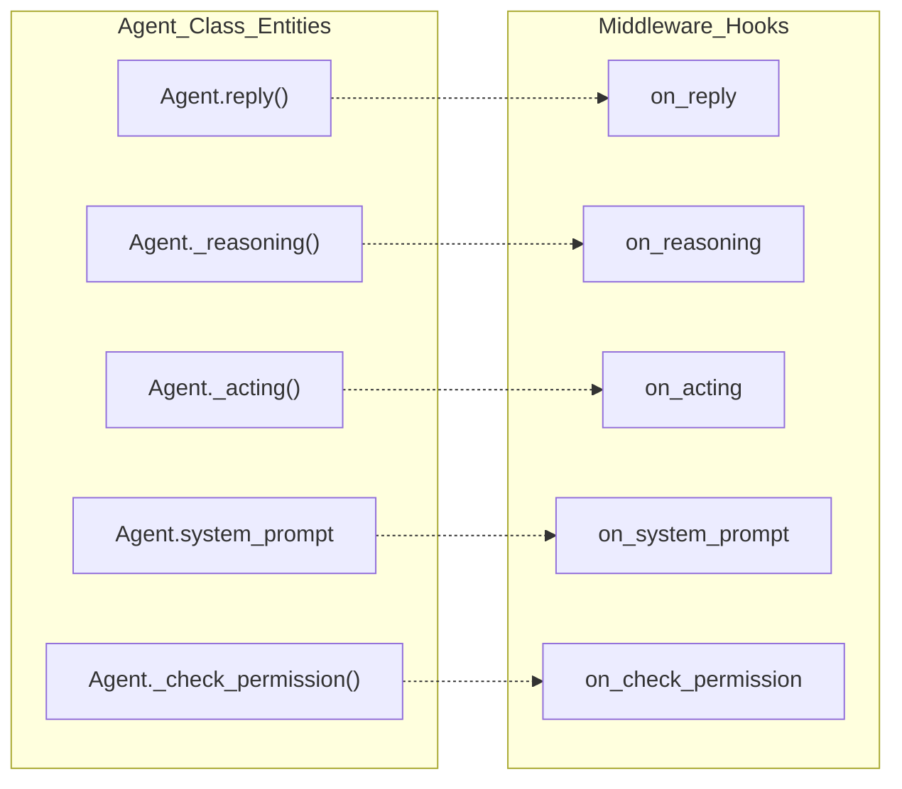

<!-- source: DeepWiki mcp.deepwiki.com · repo agentscope-ai/agentscope · page 2.2 Middleware System · fetched 2026-10-30 -->

# Middleware System

<details>
<summary>Relevant source files</summary>

The following files were used as context for generating this wiki page:

- [src/agentscope/app/middleware/_protocol/_agui.py](src/agentscope/app/middleware/_protocol/_agui.py)
- [src/agentscope/app/middleware/_protocol/_base.py](src/agentscope/app/middleware/_protocol/_base.py)
- [src/agentscope/console/_renderer.py](src/agentscope/console/_renderer.py)
- [src/agentscope/event/_event.py](src/agentscope/event/_event.py)
- [src/agentscope/middleware/__init__.py](src/agentscope/middleware/__init__.py)
- [src/agentscope/middleware/_base.py](src/agentscope/middleware/_base.py)
- [src/agentscope/middleware/_longterm_memory/__init__.py](src/agentscope/middleware/_longterm_memory/__init__.py)
- [src/agentscope/middleware/_longterm_memory/_reme/__init__.py](src/agentscope/middleware/_longterm_memory/_reme/__init__.py)
- [src/agentscope/middleware/_tracing/__init__.py](src/agentscope/middleware/_tracing/__init__.py)
- [src/agentscope/middleware/_tracing/_attributes.py](src/agentscope/middleware/_tracing/_attributes.py)
- [src/agentscope/middleware/_tracing/_converter.py](src/agentscope/middleware/_tracing/_converter.py)
- [src/agentscope/middleware/_tracing/_extractor.py](src/agentscope/middleware/_tracing/_extractor.py)
- [src/agentscope/middleware/_tracing/_setup.py](src/agentscope/middleware/_tracing/_setup.py)
- [src/agentscope/middleware/_tracing/_trace.py](src/agentscope/middleware/_tracing/_trace.py)
- [src/agentscope/middleware/_tracing/_utils.py](src/agentscope/middleware/_tracing/_utils.py)
- [src/agentscope/middleware/_tts_middleware.py](src/agentscope/middleware/_tts_middleware.py)
- [tests/agui_protocol_test.py](tests/agui_protocol_test.py)
- [tests/tracing_test.py](tests/tracing_test.py)
- [tests/tts_middleware_test.py](tests/tts_middleware_test.py)

</details>


The AgentScope Middleware System provides a powerful interception mechanism that allows developers to modify agent behavior without altering the core agent source code. It follows a modular design where middlewares are hooked into specific points of the agent's execution lifecycle, such as model calls, tool execution, and context management.

## Middleware Architecture

AgentScope utilizes two primary patterns for its middleware pipeline:
1.  **Onion Pattern**: Most hooks wrap around an internal implementation. Each middleware can execute logic before and after calling the `next_handler`, which represents the next middleware in the chain or the final core logic [src/agentscope/middleware/_base.py:19-25]().
2.  **Transformer Pattern**: Used for the `on_system_prompt` hook, where the system prompt string is passed through a sequential pipeline of transformations [src/agentscope/middleware/_base.py:27-28]().

### Hook Points

Middlewares can implement any of the following 7 hook points defined in `MiddlewareBase` [src/agentscope/middleware/_base.py:13-29]():

| Hook Name | Purpose | Data Flow |
| :--- | :--- | :--- |
| `on_reply` | Intercepts the entire `Agent.reply` process. | `AsyncGenerator[AgentEvent \| Msg]` |
| `on_reasoning` | Wraps the reasoning/LLM inference phase. | `AsyncGenerator` |
| `on_acting` | Wraps individual tool execution (`toolkit.call_tool`). | `AsyncGenerator[ToolChunk \| ToolResponse]` |
| `on_model_call` | Intercepts raw Model API calls. | `AsyncGenerator[ChatResponse]` |
| `on_check_permission` | Intercepts the permission engine decision. | `Awaitable[PermissionDecision]` |
| `on_compress_context` | Wraps the context compression logic. | `AsyncGenerator` |
| `on_system_prompt` | Transforms the system prompt string. | `str -> str` |

### Middleware Registration

When an `Agent` is initialized, it filters the provided list of middlewares by the hooks they implemented. This optimization ensures that only relevant middlewares are invoked at each hook point [src/agentscope/middleware/_base.py:30-31]().

### Data Flow Diagram: The Onion Pipeline

The following diagram illustrates how a middleware chain wraps the core agent logic (e.g., `_reply_impl`) using the Onion pattern.

**Title: Middleware Execution Pipeline (Onion Pattern)**

Sources: [src/agentscope/middleware/_base.py:13-53](), [src/agentscope/middleware/_base.py:68-95]()

---

## Implementation Details

### The `MiddlewareBase` Class
All middlewares must inherit from `MiddlewareBase`. It provides an `is_implemented` utility to check if a subclass has overridden a specific hook by comparing the subclass method to the base class method [src/agentscope/middleware/_base.py:55-66]().

Middlewares are executed asynchronously. For generator-based hooks (like `on_reply`), the middleware must iterate over the `next_handler()` (often using `async for` or `anext`) and yield the items to maintain the stream [src/agentscope/middleware/_base.py:40-45](), [src/agentscope/middleware/_tracing/_trace.py:206-213]().

### Integration with Agent Execution
The `Agent` class manages the execution of these hooks. The middleware system automatically detects which hooks are implemented at runtime [src/agentscope/middleware/_base.py:30-31]().

**Title: Association of Middleware Hooks to Agent Internals**

Sources: [src/agentscope/middleware/_base.py:13-29](), [src/agentscope/middleware/_base.py:68-175]()

---

## Built-in Middlewares

AgentScope provides several built-in middlewares for common agentic tasks:

### 1. Tracing Middleware (`TracingMiddleware`)
Uses OpenTelemetry (OTel) to trace agent execution. It captures attributes like `gen_ai.conversation.id`, model usage (tokens), and tool execution details [src/agentscope/middleware/_tracing/_trace.py:117-132](). It hooks into `on_reply`, `on_model_call`, and `on_acting` to provide a complete view of the agent's lifecycle [src/agentscope/middleware/_tracing/_trace.py:137-206](). It also handles synthetic spans for externally executed tools [src/agentscope/middleware/_tracing/_trace.py:174-197]().

### 2. Budget Middleware (`ReplyBudgetControlMiddleware`)
Monitors and enforces token or financial budgets for an agent's reply. It hooks into `on_reply` to track usage and control the reasoning-acting loop [src/agentscope/middleware/_budget.py]().

### 3. TTS Middleware (`TTSMiddleware`)
Integrates Text-to-Speech capabilities. It intercepts the `on_reply` stream, collects `TextBlockDeltaEvent` and `TextBlockEndEvent` items, and sends them to a `TTSModelBase` to generate audio content [src/agentscope/middleware/_tts_middleware.py:21-39](). The audio is injected back into the stream as `DataBlockDeltaEvent` [src/agentscope/middleware/_tts_middleware.py:174-179](). It supports both real-time streaming input and non-realtime synthesis [src/agentscope/middleware/_tts_middleware.py:67-109]().

### 4. Long-term Memory Middlewares
Middlewares provide various strategies for persistent agent memory [src/agentscope/middleware/_longterm_memory/__init__.py:8-12]():
*   **ReMeMiddleware**: Retrieval-based Memory that searches historical context [src/agentscope/middleware/_longterm_memory/_reme/__init__.py]().
*   **Mem0Middleware**: Integration with the Mem0 service for managed memory [src/agentscope/middleware/_longterm_memory/_mem0.py]().
*   **AgenticMemoryMiddleware**: High-level memory management for autonomous agents [src/agentscope/middleware/_longterm_memory/_agentic_memory.py]().

### 5. RAG Middleware (`RAGMiddleware`)
Connects an agent to a `KnowledgeBase`. It typically hooks into `on_reply` or `on_reasoning` to perform retrieval before the model is called [src/agentscope/middleware/_rag.py]().

### 6. AGUI Protocol Middleware (`AGUIProtocolMiddleware`)
A specialized middleware used in the Agent Service layer (FastAPI). It intercepts `text/event-stream` responses and converts standard `AgentEvent` objects into the AGUI protocol format (e.g., converting `ReplyStartEvent` to `RUN_STARTED`) for consumption by the Web UI [src/agentscope/app/middleware/_protocol/_agui.py:44-74](), [src/agentscope/app/middleware/_protocol/_base.py:68-81]().

---

## Usage Example

```python
from agentscope.agent import Agent
from agentscope.middleware import TracingMiddleware, ReplyBudgetControlMiddleware

# Initialize middlewares
tracing = TracingMiddleware()
budget = ReplyBudgetControlMiddleware(max_iters=5) 

# Apply to agent
agent = Agent(
    name="Assistant",
    model=my_model,
    system_prompt="You are helpful.",
    middlewares=[tracing, budget]
)
```

Sources:
- Middleware Base Interface: [src/agentscope/middleware/_base.py:1-180]()
- Tracing Implementation: [src/agentscope/middleware/_tracing/_trace.py:117-210]()
- TTS Implementation: [src/agentscope/middleware/_tts_middleware.py:21-118]()
- AGUI Protocol: [src/agentscope/app/middleware/_protocol/_agui.py:44-112]()
- Middleware Registry: [src/agentscope/middleware/__init__.py:1-24]()
- Protocol Base: [src/agentscope/app/middleware/_protocol/_base.py:17-37]()

---

