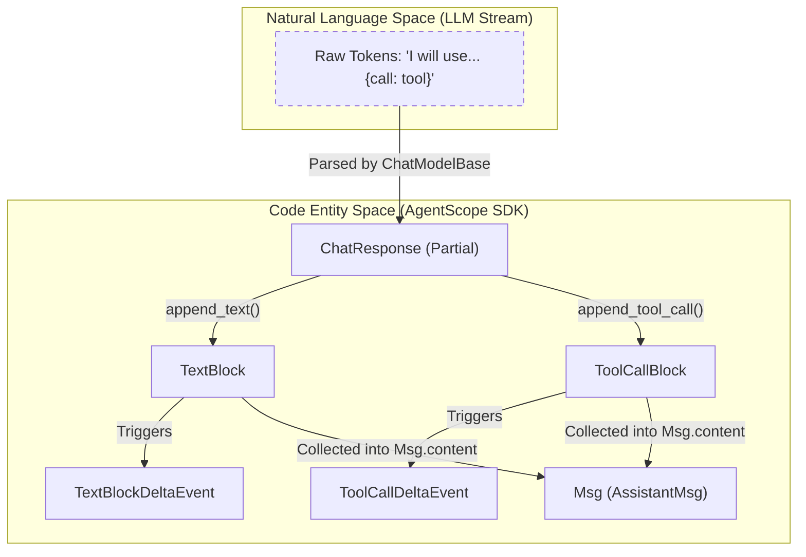
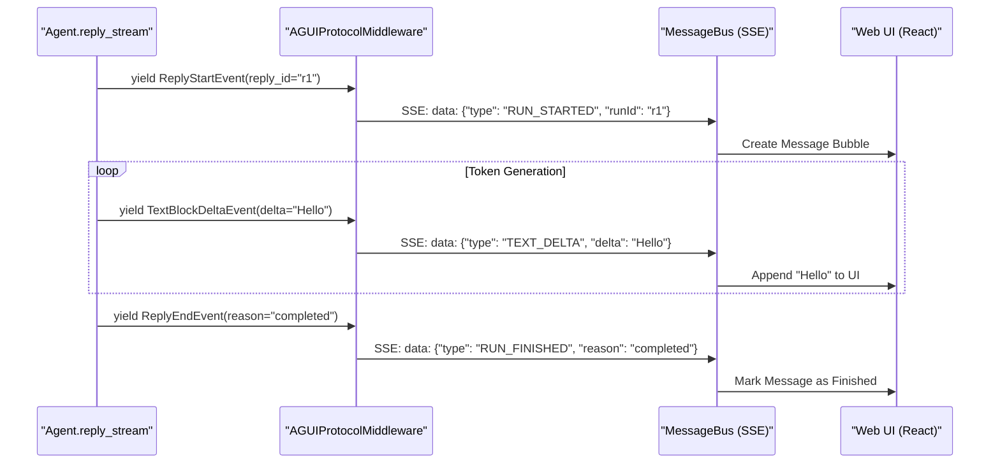

<!-- source: DeepWiki mcp.deepwiki.com · repo agentscope-ai/agentscope · page 2.3 Messages & Events · fetched 2026-10-30 -->

# Messages & Events

Relevant source files

The following files were used as context for generating this wiki page:

- [src/agentscope/app/middleware/_protocol/_agui.py](src/agentscope/app/middleware/_protocol/_agui.py)
- [src/agentscope/app/middleware/_protocol/_base.py](src/agentscope/app/middleware/_protocol/_base.py)
- [src/agentscope/console/_renderer.py](src/agentscope/console/_renderer.py)
- [src/agentscope/event/_event.py](src/agentscope/event/_event.py)
- [src/agentscope/message/_base.py](src/agentscope/message/_base.py)
- [src/agentscope/middleware/_base.py](src/agentscope/middleware/_base.py)
- [src/agentscope/model/_model_response.py](src/agentscope/model/_model_response.py)
- [tests/agui_protocol_test.py](tests/agui_protocol_test.py)
- [tests/compress_context_test.py](tests/compress_context_test.py)
- [tests/event_to_message_test.py](tests/event_to_message_test.py)
- [tests/message_test.py](tests/message_test.py)
- [tests/model_response_test.py](tests/model_response_test.py)
- [tests/service_agent_interrupt_test.py](tests/service_agent_interrupt_test.py)
- [tests/service_inbox_middleware_test.py](tests/service_inbox_middleware_test.py)

AgentScope employs a structured message and event system to facilitate communication between agents and provide a real-time, streaming interface for frontends. The system is built on two primary pillars: the `Msg` class for stateful context and the `AgentEvent` hierarchy for asynchronous, granular updates.

## Message Structure

The `Msg` class is the fundamental unit of information exchange and storage within AgentScope. It is designed to be Pydantic-serializable and serves as the primary element in an agent's context [src/agentscope/message/_base.py:67-69]().

### The Msg Class
A `Msg` represents a single turn in a conversation, characterized by a `role` (user, assistant, or system) and a list of `content` blocks [src/agentscope/message/_base.py:75-80]().

Key fields include:
- `id`: A unique identifier generated upon creation [src/agentscope/message/_base.py:81-82]().
- `name`: The display name of the sender [src/agentscope/message/_base.py:75-76]().
- `usage`: A `Usage` object tracking `input_tokens` and `output_tokens` [src/agentscope/message/_base.py:58-64]().
- `finished_reason`: A `ReplyFinishedReason` enum indicating how the message generation concluded (e.g., `COMPLETED`, `INTERRUPTED`, `ERROR`, `EXCEED_MAX_ITERS`) [src/agentscope/message/_base.py:103-105]().
- `structured_output`: Populated when a structured schema is requested during the reply process [src/agentscope/message/_base.py:106-111]().

### Content Blocks
Instead of a monolithic string, the `content` field is a `list[ContentBlock]` [src/agentscope/message/_base.py:77-78](). This allows a single message to contain mixed media, tool calls, and internal reasoning.

| Block Type | Class | Purpose |
| :--- | :--- | :--- |
| **Text** | `TextBlock` | Standard natural language text [src/agentscope/message/_block.py:46-51](). |
| **Thinking** | `ThinkingBlock` | Internal chain-of-thought or reasoning. Supports `signature` for Anthropic and `thought: True` for Gemini [src/agentscope/message/_block.py:54-66](). |
| **Data** | `DataBlock` | Multimodal data (images, audio, video), supporting `URLSource` or `Base64Source` [src/agentscope/message/_block.py:100-116](). |
| **Tool Call** | `ToolCallBlock` | A request to execute a tool with JSON arguments [src/agentscope/message/_block.py:137-160](). |
| **Tool Result** | `ToolResultBlock` | The output of tool execution, including its state (SUCCESS/ERROR/DENIED) [src/agentscope/message/_block.py:175-197](). |
| **Hint** | `HintBlock` | Out-of-band instructions or system injections (e.g., RAG results or background tool completions) [src/agentscope/message/_block.py:79-88](). |

### Logical Validation
The `Msg` class enforces role-based content restrictions using a Pydantic `model_validator` [src/agentscope/message/_base.py:116-126]():
- **UserMsg**: Restricted to `text` and `data` blocks [src/agentscope/message/_base.py:33-40]().
- **SystemMsg**: Restricted to `text` blocks only [src/agentscope/message/_base.py:42-49]().
- **AssistantMsg**: Can contain any block type, including tool calls and thinking blocks.

Sources: [src/agentscope/message/_base.py:1-126](), [src/agentscope/message/_block.py:46-197](), [src/agentscope/event/_event.py:102-110]()

## Agent Events

Events are transient, granular updates emitted during an agent's `reply_stream`. They allow the frontend to render deltas (like streaming text) and lifecycle changes before the final `Msg` is fully formed.

### Event Hierarchy
All events inherit from `EventBase`, which provides an `id`, `created_at` timestamp, and `metadata` dictionary [src/agentscope/event/_event.py:70-81]().

**Key Event Types (`EventType` enum) [src/agentscope/event/_event.py:26-68]():**
- **Lifecycle**: `REPLY_START`, `REPLY_END`, `MODEL_CALL_START`, `MODEL_CALL_END`.
- **Content Deltas**: `TEXT_BLOCK_DELTA`, `THINKING_BLOCK_DELTA`, `DATA_BLOCK_DELTA`, `TOOL_CALL_DELTA`.
- **Tool Execution**: `TOOL_RESULT_START`, `TOOL_RESULT_END`.
- **HITL**: `REQUIRE_USER_CONFIRM`, `USER_CONFIRM_RESULT`, `REQUIRE_EXTERNAL_EXECUTION`.

#### Natural Language to Code Entity Mapping: Message Generation
This diagram bridges the LLM's raw output stream to the structured `Msg` and `AgentEvent` entities.

Sources: [src/agentscope/event/_event.py:26-68](), [src/agentscope/message/_base.py:67-112](), [src/agentscope/model/_model_response.py:33-165]()

## Streaming Architecture (SSE)

AgentScope uses Server-Sent Events (SSE) to stream agent activity from the `AgentService` to the Web UI.

### The Streaming Pipeline
1. **Agent Execution**: The agent yields `AgentEvent` objects from its `reply_stream` [src/agentscope/middleware/_base.py:73-94]().
2. **Middleware Interception**: Middlewares like `InboxMiddleware` can inject `HintBlock` events into the stream if background messages arrive [tests/service_inbox_middleware_test.py:1-19]().
3. **Protocol Conversion**: The `AGUIProtocolMiddleware` intercepts the SSE stream and converts internal `AgentEvent` JSON into the `AGUI` protocol format (e.g., `REPLY_START` becomes `RUN_STARTED`) [tests/agui_protocol_test.py:73-87]().
4. **Frontend Rendering**: The `ConsoleRenderer` (for CLI) or React components (for Web) consume these events to provide incremental updates [src/agentscope/console/_renderer.py:130-187]().

#### System Sequence: Event Streaming to Frontend
This diagram maps the internal SDK events to the protocol frames seen by the frontend.

### Accumulation and Interruption
The `Msg.append_event` method allows a static message object to "absorb" a stream of events, reconstructing its content blocks in real-time [tests/event_to_message_test.py:4-24](). This is critical for maintaining consistency between the streaming UI and the persistent storage.

If a reply is interrupted (e.g., via `asyncio.CancelledError`), the `CancelDispatcher` ensures the task is terminated and a `ReplyEndEvent` with `finished_reason="interrupted"` is emitted [tests/service_agent_interrupt_test.py:3-19]().

Sources: [src/agentscope/event/_event.py:112-126](), [src/agentscope/console/_renderer.py:78-187](), [tests/agui_protocol_test.py:1-134](), [tests/service_agent_interrupt_test.py:121-195]()

---

