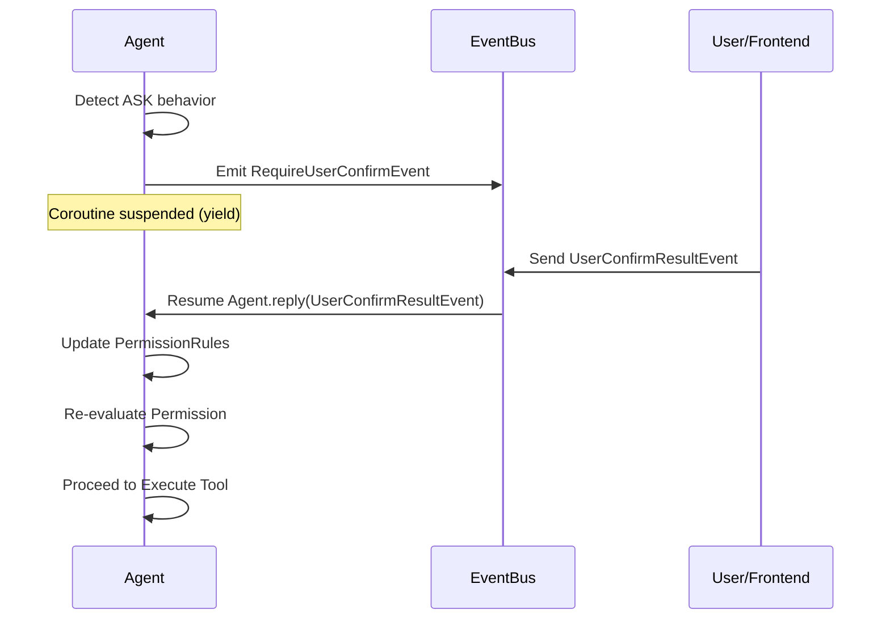

<!-- source: DeepWiki mcp.deepwiki.com · repo agentscope-ai/agentscope · page 2.4 Permission Engine & HITL · fetched 2026-10-30 -->

# Permission Engine & HITL

<details>
<summary>Relevant source files</summary>

The following files were used as context for generating this wiki page:

- [src/agentscope/agent/_agent.py](src/agentscope/agent/_agent.py)
- [src/agentscope/agent/_config.py](src/agentscope/agent/_config.py)
- [src/agentscope/permission/_decision.py](src/agentscope/permission/_decision.py)
- [src/agentscope/permission/_engine.py](src/agentscope/permission/_engine.py)
- [src/agentscope/permission/_types.py](src/agentscope/permission/_types.py)
- [src/agentscope/state/_state.py](src/agentscope/state/_state.py)
- [src/agentscope/tool/_builtin/_bash.py](src/agentscope/tool/_builtin/_bash.py)
- [src/agentscope/tool/_builtin/_bash_parser.py](src/agentscope/tool/_builtin/_bash_parser.py)
- [src/agentscope/tool/_builtin/_edit.py](src/agentscope/tool/_builtin/_edit.py)
- [src/agentscope/tool/_builtin/_write.py](src/agentscope/tool/_builtin/_write.py)
- [tests/agent_basic_test.py](tests/agent_basic_test.py)
- [tests/agent_interrupt_test.py](tests/agent_interrupt_test.py)
- [tests/agent_structured_output_test.py](tests/agent_structured_output_test.py)
- [tests/builtin_bash_test.py](tests/builtin_bash_test.py)
- [tests/hitl_external_execution_test.py](tests/hitl_external_execution_test.py)
- [tests/hitl_user_confirmation_test.py](tests/hitl_user_confirmation_test.py)
- [tests/middleware_test.py](tests/middleware_test.py)
- [tests/permission_bash_parser_test.py](tests/permission_bash_parser_test.py)
- [tests/permission_engine_test.py](tests/permission_engine_test.py)
- [tests/permission_mode_test.py](tests/permission_mode_test.py)

</details>


The Permission Engine in AgentScope provides a robust framework for governing agent actions, particularly tool execution. It enables Human-In-The-Loop (HITL) workflows by intercepting sensitive operations and requesting user confirmation or external execution.

## Permission Architecture

The permission system is centered around the `PermissionEngine`, which evaluates `PermissionRule` objects against a `PermissionContext`. Every agent instance maintains its own `PermissionEngine` initialized with a `PermissionContext` stored in the agent's state [src/agentscope/agent/_agent.py:177-178]().

### Core Components

| Class | Responsibility |
| :--- | :--- |
| `PermissionEngine` | Orchestrates the decision process by evaluating tool-specific and global rules [src/agentscope/permission/_engine.py:17-18](). |
| `PermissionRule` | A data model defining a specific permission (e.g., `allow` or `deny`) for a tool or a specific resource (like a file path) [src/agentscope/permission/_types.py:84-101](). |
| `PermissionContext` | Holds the current `PermissionMode` and the list of active `PermissionRule` objects [src/agentscope/permission/_types.py:102](). |
| `PermissionDecision` | The result of an evaluation, containing a `PermissionBehavior` (ALLOW, DENY, ASK, PASSTHROUGH) and optional metadata [src/agentscope/permission/_decision.py:13-35](). |

### Decision Flow Diagram

This diagram maps the logical flow of a permission check to the code entities involved.

"Permission Check Flow"
```mermaid
graph TD
    subgraph "Natural Language Space"
        "User Request" --> "Agent Reasoning"
        "Agent Reasoning" --> "Action Intent"
    end

    subgraph "Code Entity Space"
        "Action Intent" --> "Agent._acting_impl"
        "Agent._acting_impl" --> "Agent._check_permission_loop"
        "Agent._check_permission_loop" --> "PermissionEngine.check_permission"
        
        "PermissionEngine.check_permission" --> "ToolBase.check_permissions"
        "ToolBase.check_permissions" --> "Decision"
        
        "Decision" -- "PASSTHROUGH" --> "PermissionEngine._evaluate_rules"
        "Decision" -- "ASK" --> "HITL_Flow"
        "Decision" -- "ALLOW" --> "Execute_Tool"
        
        "PermissionEngine._evaluate_rules" --> "PermissionRule.match_rule"
    end

    style "Agent._acting_impl" stroke-dasharray: 5 5
```
Sources: [src/agentscope/agent/_agent.py:1083-1120](), [src/agentscope/permission/_engine.py:38-75](), [src/agentscope/permission/_decision.py:13-35]()

## Permission Modes

The `PermissionMode` defines the baseline behavior for the engine.

*   **`BYPASS`**: Trust all actions. No checks are performed unless a rule is marked as `bypass_immune` [src/agentscope/permission/_types.py:24-25]().
*   **`EXPLORE`**: Read-only operations are auto-allowed. Write/Execute operations default to `ASK` [src/agentscope/permission/_types.py:31-32]().
*   **`ACCEPT_EDITS`**: Similar to `EXPLORE`, but allows file edits within designated working directories without asking [src/agentscope/tool/_builtin/_edit.py:167-178]().
*   **`DONT_ASK`**: Unattended mode. Auto-allows safe operations and fails (denies) anything that would normally require a prompt [src/agentscope/permission/_types.py:53-54]().
*   **`DEFAULT`**: Strict mode. Everything requires explicit rules or user confirmation [src/agentscope/permission/_types.py:18-19]().

## Human-In-The-Loop (HITL) Flow

When a permission check results in `PermissionBehavior.ASK`, the agent enters a "parked" state. It emits a `RequireUserConfirmEvent` and waits for a corresponding `UserConfirmResultEvent` to be injected into the `reply` loop [src/agentscope/agent/_agent.py:1123-1144]().

### HITL Event Sequence

"HITL Event Sequence"

Sources: [src/agentscope/agent/_agent.py:1123-1144](), [src/agentscope/event/_event.py:315-345](), [tests/hitl_user_confirmation_test.py:248-280]()

### External Execution
If a tool is marked as `is_external_tool = True`, the agent does not execute the tool code locally. Instead, it emits a `RequireExternalExecutionEvent` [src/agentscope/agent/_agent.py:1255-1265](). The frontend is responsible for executing the command and returning the result via an `ExternalExecutionResultEvent` [src/agentscope/event/_event.py:365-375]().

## Fine-Grained Shell Permissions

For shell-based tools like `Bash`, AgentScope uses a `BashCommandParser` to perform static analysis of commands before execution. This prevents bypasses like command substitution or subshells unless explicitly permitted.

### Bash Command Parser
The `BashCommandParser` decomposes a command string into components [src/agentscope/tool/_builtin/_bash_parser.py:15-16]().
*   **Redirection Check**: Detects if the command writes to sensitive files [src/agentscope/tool/_builtin/_bash_parser.py:115-125]().
*   **Substitution Check**: Identifies `$(...)` or backticks `` `...` `` which could execute arbitrary code [src/agentscope/tool/_builtin/_bash_parser.py:130-140]().
*   **Dangerous Paths**: The `Bash` tool maintains a list of `DEFAULT_DANGEROUS_FILES` (e.g., `.bashrc`, `/etc/shadow`) and `DEFAULT_DANGEROUS_DIRECTORIES` [src/agentscope/tool/_builtin/_bash.py:139-140]().

### Example: Edit Tool Permission Check
The `Edit` tool implements its own `check_permissions` logic to handle `ACCEPT_EDITS` mode:
1.  **Safety Check**: If the path is in `dangerous_files`, return `ASK` with `bypass_immune=True` [src/agentscope/tool/_builtin/_edit.py:154-161]().
2.  **Working Dir Check**: If in `ACCEPT_EDITS` or `DONT_ASK` and the file is within an allowed path, return `ALLOW` [src/agentscope/tool/_builtin/_edit.py:167-178]().
3.  **Fallback**: Return `PASSTHROUGH` to let the `PermissionEngine` check global rules [src/agentscope/tool/_builtin/_edit.py:181-182]().

## State Management and Interruption

The agent's permission state is persisted within `AgentState.permission_context` [src/agentscope/state/_state.py:214](). During long-running tool executions, if an interruption occurs (e.g., via `UserInterruptEvent`), the agent uses `_close_unfinished_tool_calls` to transition all pending or in-flight tool calls to an `interrupted` state [src/agentscope/agent/_agent.py:1416-1473]().

Sources: [src/agentscope/agent/_agent.py:123-182](), [src/agentscope/tool/_builtin/_edit.py:123-182](), [src/agentscope/tool/_builtin/_bash.py:137-168](), [src/agentscope/tool/_builtin/_bash_parser.py:15-140](), [src/agentscope/state/_state.py:214](), [src/agentscope/agent/_agent.py:1416-1473]()

---

