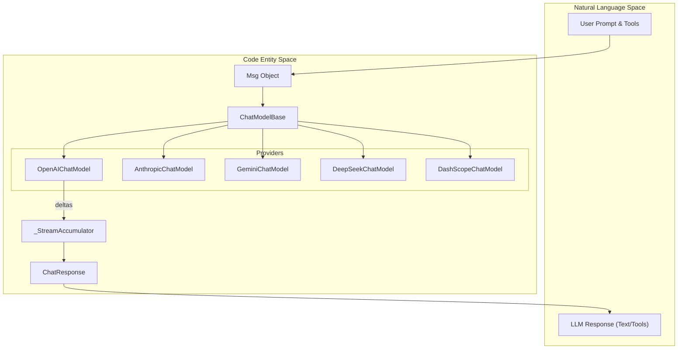
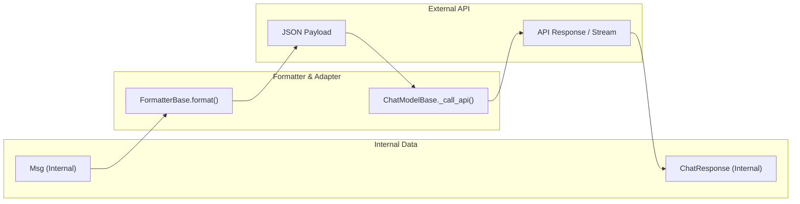

<!-- source: DeepWiki mcp.deepwiki.com · repo agentscope-ai/agentscope · page 3 Model Layer · fetched 2026-10-30 -->

# Model Layer

Relevant source files

The following files were used as context for generating this wiki page:

- [src/agentscope/model/__init__.py](src/agentscope/model/__init__.py)
- [src/agentscope/model/_base.py](src/agentscope/model/_base.py)
- [src/agentscope/model/_utils.py](src/agentscope/model/_utils.py)
- [tests/model_base_test.py](tests/model_base_test.py)
- [tests/model_count_tokens_test.py](tests/model_count_tokens_test.py)

The Model Layer in AgentScope provides a unified abstraction for interacting with various Large Language Model (LLM) providers. It handles the complexities of API communication, streaming response accumulation, retry logic, and credential management, allowing agents to remain model-agnostic.

### Core Abstraction: `ChatModelBase`

The foundation of the model layer is the `ChatModelBase` class [src/agentscope/model/_base.py:36-37](). It defines the standard interface for all chat-based models, including support for streaming [src/agentscope/model/_base.py:49-50](), retry policies [src/agentscope/model/_base.py:52-56](), and token estimation [src/agentscope/model/_base.py:236-237]().

#### Model Execution Flow
When an agent calls a model via `__call__`, the following sequence occurs:
1.  **Retry Logic**: The base class wraps the execution in a retry loop based on `max_retries` [src/agentscope/model/_base.py:184-185](). It only retries on exceptions defined in `_get_retryable_exceptions` [src/agentscope/model/_base.py:100-108]().
2.  **API Execution**: The concrete provider implementation executes `_call_api` [src/agentscope/model/_base.py:187-193]().
3.  **Stream Accumulation**: If streaming is enabled, the `_StreamAccumulator` [src/agentscope/model/_utils.py:199-208]() gathers deltas (e.g., `_AccTextBlock`, `_AccToolCallBlock`, `_AccThinkingBlock`) to produce a final, complete `ChatResponse`.
4.  **Interruption Handling**: If the call is cancelled, it returns a `ChatResponse` with `FinishedReason.INTERRUPTED` [src/agentscope/model/_base.py:195-200]().

**Sources:** [src/agentscope/model/_base.py:36-200](), [src/agentscope/model/_utils.py:199-208]()

---

### Model Entity Architecture

The following diagram illustrates how internal code entities bridge the gap between abstract model concepts and provider-specific implementations.

**Model Layer Architecture**

**Sources:** [src/agentscope/model/_base.py:36-164](), [src/agentscope/model/_utils.py:199-208](), [src/agentscope/model/__init__.py:8-16]()

---

### Model Cards and Configuration

AgentScope uses **Model Cards** to manage model metadata and parameters. Each provider has a `_models` directory containing YAML files that define candidate models and their default settings [src/agentscope/model/_base.py:126-136]().

*   **`ModelCard`**: A Pydantic model that stores model metadata, such as `name`, `label`, `input_types`, `output_types`, and `context_size` [src/agentscope/model/_model_card.py:11-62]().
*   **Dynamic Schema Merging**: `ModelCard.from_yaml` merges the provider's `Parameters` class with YAML-based `parameter_overrides` to generate the final JSON schema used by the frontend [src/agentscope/model/_model_card.py:72-161]().
*   **Credential Management**: Credentials (e.g., API keys) are managed via `CredentialBase` [src/agentscope/model/_base.py:19](), ensuring sensitive information is separated from model logic.

**Sources:** [src/agentscope/model/_base.py:111-156](), [src/agentscope/model/_model_card.py:11-161]()

---

### Standardized Responses and Usage

All models return a `ChatResponse` [src/agentscope/model/_model_response.py:64-65](), which contains:
*   **`content`**: A list of blocks (e.g., `TextBlock`, `ToolCallBlock`, `ThinkingBlock`, `DataBlock`) [src/agentscope/model/_model_response.py:73-74]().
*   **`finished_reason`**: An enum indicating why the model stopped (e.g., `COMPLETED`, `MAX_TOKENS`, `INTERRUPTED`) [src/agentscope/model/_model_response.py:13-20]().
*   **`usage`**: A `ChatUsage` object tracking `input_tokens`, `output_tokens`, and execution `time` [src/agentscope/model/_model_usage.py:9-20]().

**Sources:** [src/agentscope/model/_model_response.py:13-74](), [src/agentscope/model/_model_usage.py:9-32]()

---

### Data Transformation Pipeline

The following diagram shows the transformation of data from internal `Msg` objects to provider-specific payloads and back to structured `ChatResponse` objects.

**Model Data Pipeline**

**Sources:** [src/agentscope/model/_base.py:158-194](), [src/agentscope/model/_model_response.py:64-100]()

---

### Detailed Sub-topics

For in-depth information on specific components of the Model Layer, refer to the following child pages:

*   **[LLM Provider Adapters](#3.1)**: Details on concrete implementations for OpenAI (Chat & Responses API), Anthropic, Gemini, DashScope, DeepSeek, Moonshot, Ollama, and xAI. Covers streaming, thinking/reasoning modes, and tool calling.
*   **[Message Formatters](#3.2)**: Explains how the `FormatterBase` translates internal `Msg` objects into provider-specific API payloads, including multi-agent flattening and multimodal promotion.
*   **[Embedding Models](#3.3)**: Infrastructure for embedding models (`EmbeddingBase`), provider implementations (OpenAI, DashScope, Gemini, Ollama), and integration with the RAG subsystem.
*   **[Text-to-Speech (TTS) Models](#3.4)**: Infrastructure for TTS models (`TTSBase`), supporting audio streaming and integration with agent output via `TTSMiddleware`.

---

