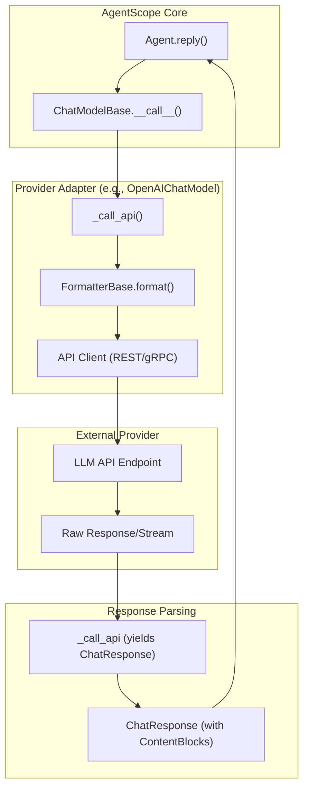
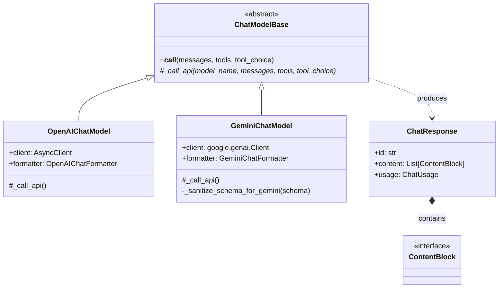

<!-- source: DeepWiki mcp.deepwiki.com · repo agentscope-ai/agentscope · page 3.1 LLM Provider Adapters · fetched 2026-10-30 -->

# LLM Provider Adapters

Relevant source files

The following files were used as context for generating this wiki page:

- [scripts/model_examples/openai_chat_multimodal.py](scripts/model_examples/openai_chat_multimodal.py)
- [src/agentscope/_utils/_common.py](src/agentscope/_utils/_common.py)
- [src/agentscope/formatter/_openai_response_formatter.py](src/agentscope/formatter/_openai_response_formatter.py)
- [src/agentscope/model/_anthropic/_model.py](src/agentscope/model/_anthropic/_model.py)
- [src/agentscope/model/_anthropic/_models/claude-haiku-4-5.yaml](src/agentscope/model/_anthropic/_models/claude-haiku-4-5.yaml)
- [src/agentscope/model/_anthropic/_models/claude-opus-4-5.yaml](src/agentscope/model/_anthropic/_models/claude-opus-4-5.yaml)
- [src/agentscope/model/_anthropic/_models/claude-opus-4-6.yaml](src/agentscope/model/_anthropic/_models/claude-opus-4-6.yaml)
- [src/agentscope/model/_anthropic/_models/claude-opus-4-7.yaml](src/agentscope/model/_anthropic/_models/claude-opus-4-7.yaml)
- [src/agentscope/model/_anthropic/_models/claude-opus-4-8.yaml](src/agentscope/model/_anthropic/_models/claude-opus-4-8.yaml)
- [src/agentscope/model/_anthropic/_models/claude-sonnet-4-5.yaml](src/agentscope/model/_anthropic/_models/claude-sonnet-4-5.yaml)
- [src/agentscope/model/_anthropic/_models/claude-sonnet-4-6.yaml](src/agentscope/model/_anthropic/_models/claude-sonnet-4-6.yaml)
- [src/agentscope/model/_dashscope/_model.py](src/agentscope/model/_dashscope/_model.py)
- [src/agentscope/model/_deepseek/_model.py](src/agentscope/model/_deepseek/_model.py)
- [src/agentscope/model/_gemini/_model.py](src/agentscope/model/_gemini/_model.py)
- [src/agentscope/model/_model_card.py](src/agentscope/model/_model_card.py)
- [src/agentscope/model/_moonshot/_model.py](src/agentscope/model/_moonshot/_model.py)
- [src/agentscope/model/_ollama/_model.py](src/agentscope/model/_ollama/_model.py)
- [src/agentscope/model/_openai_chat/_model.py](src/agentscope/model/_openai_chat/_model.py)
- [src/agentscope/model/_openai_chat/_models/gpt-4.1-nano.yaml](src/agentscope/model/_openai_chat/_models/gpt-4.1-nano.yaml)
- [src/agentscope/model/_openai_chat/_models/gpt-5.5.yaml](src/agentscope/model/_openai_chat/_models/gpt-5.5.yaml)
- [src/agentscope/model/_openai_chat/_models/gpt-audio-mini.yaml](src/agentscope/model/_openai_chat/_models/gpt-audio-mini.yaml)
- [src/agentscope/model/_openai_chat/_models/o3.yaml](src/agentscope/model/_openai_chat/_models/o3.yaml)
- [src/agentscope/model/_openai_chat/_models/o4-mini.yaml](src/agentscope/model/_openai_chat/_models/o4-mini.yaml)
- [src/agentscope/model/_openai_response/_model.py](src/agentscope/model/_openai_response/_model.py)
- [src/agentscope/model/_openai_response/_models/gpt-5.5.yaml](src/agentscope/model/_openai_response/_models/gpt-5.5.yaml)
- [src/agentscope/model/_openai_response/_models/o3.yaml](src/agentscope/model/_openai_response/_models/o3.yaml)
- [src/agentscope/model/_openai_response/_models/o4-mini.yaml](src/agentscope/model/_openai_response/_models/o4-mini.yaml)
- [src/agentscope/model/_xai/_model.py](src/agentscope/model/_xai/_model.py)
- [src/agentscope/model/_xai/_models/grok-3-fast.yaml](src/agentscope/model/_xai/_models/grok-3-fast.yaml)
- [src/agentscope/model/_xai/_models/grok-3-mini.yaml](src/agentscope/model/_xai/_models/grok-3-mini.yaml)
- [src/agentscope/model/_xai/_models/grok-3.yaml](src/agentscope/model/_xai/_models/grok-3.yaml)
- [src/agentscope/model/_xai/_models/grok-4.3.yaml](src/agentscope/model/_xai/_models/grok-4.3.yaml)
- [tests/formatter_openai_response_test.py](tests/formatter_openai_response_test.py)
- [tests/model_anthropic_test.py](tests/model_anthropic_test.py)
- [tests/model_dashscope_test.py](tests/model_dashscope_test.py)
- [tests/model_deepseek_test.py](tests/model_deepseek_test.py)
- [tests/model_gemini_test.py](tests/model_gemini_test.py)
- [tests/model_moonshot_test.py](tests/model_moonshot_test.py)
- [tests/model_ollama_test.py](tests/model_ollama_test.py)
- [tests/model_openai_chat_test.py](tests/model_openai_chat_test.py)
- [tests/model_openai_response_test.py](tests/model_openai_response_test.py)
- [tests/model_xai_test.py](tests/model_xai_test.py)

This page provides a detailed technical overview of the LLM provider adapters in AgentScope. These adapters bridge the gap between AgentScope's internal message representations and the diverse APIs of various model providers, handling API communication, streaming, tool calling, and multimodal data.

## Architecture Overview

AgentScope uses a unified `ChatModelBase` interface [[src/agentscope/model/_base.py:112-114]]() that all provider adapters implement. The core of each adapter is the `_call_api` method, which handles message formatting, parameter preparation, and the actual network request.

### Data Flow: Message to API Response

The following diagram illustrates how a generic request flows through a provider adapter.

**Provider Adapter Data Flow**

**Sources:** [[src/agentscope/model/_openai_chat/_model.py:188-195]](), [[src/agentscope/model/_gemini/_model.py:228-235]](), [[src/agentscope/model/_anthropic/_model.py:179-186]]()

---

## OpenAI Adapters

AgentScope provides two distinct adapters for OpenAI, reflecting the evolution of their API from simple completions to complex reasoning events.

### OpenAI Chat Completions API (`OpenAIChatModel`)
The standard adapter for models like `gpt-4o`. It supports:
*   **Multimodal Inputs:** Handles images and audio via `DataBlock` and `Base64Source` [[src/agentscope/model/_openai_chat/_model.py:18-25]]().
*   **Audio Output:** Can trigger voice responses by setting the `voice` parameter, which automatically injects `audio` into the API `modalities` [[src/agentscope/model/_openai_chat/_model.py:94-107]]().
*   **Reasoning:** Supports `o3` and `o4` models via `reasoning_effort` [[src/agentscope/model/_openai_chat/_model.py:59-70]]().

### OpenAI Responses API (`OpenAIResponseModel`)
A specialized adapter designed for reasoning models (e.g., `o3`, `o4-mini`) that provides first-class streaming events for thinking/reasoning [[src/agentscope/model/_openai_response/_model.py:34-38]]().
*   **Thinking Blocks:** Specifically parses `reasoning` items into `ThinkingBlock` objects [[src/agentscope/model/_openai_response/_model.py:205-216]]().
*   **Event Handling:** Unlike the Chat API which uses `delta` text, the Responses API uses specific event types like `response.text.delta` and `response.content_part.completed` [[tests/model_openai_response_test.py:94-103]]().

**Sources:** [[src/agentscope/model/_openai_chat/_model.py:36-109]](), [[src/agentscope/model/_openai_response/_model.py:31-82]]()

---

## Anthropic Adapter (`AnthropicChatModel`)

The Anthropic adapter manages the `AsyncAnthropic` client and handles their unique event-based streaming protocol.

*   **Thinking Modes:** Supports `adaptive`, `enabled`, and `disabled` modes. `adaptive` is used for newer models like Claude 4.7 [[src/agentscope/model/_anthropic/_model.py:59-72]]().
*   **Redacted Thinking:** Handles `redacted_thinking` blocks, which occur when the model's internal reasoning is encrypted or hidden by the provider [[tests/model_anthropic_test.py:202-207]]().
*   **Streaming Logic:** Iterates through events such as `message_start`, `content_block_start`, and `content_block_delta` to assemble the final `ChatResponse` [[tests/model_anthropic_test.py:6-8]]().

**Sources:** [[src/agentscope/model/_anthropic/_model.py:27-97]](), [[tests/model_anthropic_test.py:39-75]]()

---

## Google Gemini Adapter (`GeminiChatModel`)

Gemini integration utilizes the `google.genai` SDK and features a strict schema sanitization layer.

### Schema Sanitization
Gemini's API has specific restrictions on JSON schemas for tool calling. The `_sanitize_schema_for_gemini` function performs the following [[src/agentscope/model/_gemini/_model.py:25-50]]():
*   **Removes `additionalProperties`**: Not supported by Gemini [[src/agentscope/model/_gemini/_model.py:65-66]]().
*   **Const to Enum**: Converts `const` keywords to single-value `enum` lists [[src/agentscope/model/_gemini/_model.py:70-72]]().
*   **Null Type Handling**: Rewrites `{"type": "null"}` to `{"type": "object"}` or simplifies `anyOf` containing null to ensure compatibility [[src/agentscope/model/_gemini/_model.py:62-89]]().

### Features
*   **Thinking Budget:** Allows specifying a token budget for reasoning [[src/agentscope/model/_gemini/_model.py:131-136]]().
*   **gRPC/REST:** Defaults to using the Google GenAI client which handles the underlying transport [[src/agentscope/model/_gemini/_model.py:201-206]]().

**Sources:** [[src/agentscope/model/_gemini/_model.py:112-154]](), [[src/agentscope/model/_gemini/_model.py:25-109]]()

---

## DashScope & DeepSeek Adapters

Both DashScope (Alibaba) and DeepSeek provide OpenAI-compatible endpoints, allowing AgentScope to reuse the `openai.AsyncClient` while injecting provider-specific logic.

| Feature | DashScope (`DashScopeChatModel`) | DeepSeek (`DeepSeekChatModel`) |
| :--- | :--- | :--- |
| **Client** | `openai.AsyncClient` [[src/agentscope/model/_dashscope/_model.py:167-171]]() | `openai.AsyncClient` [[src/agentscope/model/_deepseek/_model.py:130-135]]() |
| **Thinking** | `thinking_enable` & `thinking_budget` [[src/agentscope/model/_dashscope/_model.py:53-64]]() | `thinking_enable` (via `reasoning_content`) [[src/agentscope/model/_deepseek/_model.py:39-47]]() |
| **Audio** | Supports omni-style voice output [[src/agentscope/model/_dashscope/_model.py:96-109]]() | N/A |
| **Reasoning Effort** | N/A | `high`, `max` [[src/agentscope/model/_deepseek/_model.py:49-58]]() |

**Sources:** [[src/agentscope/model/_dashscope/_model.py:34-112]](), [[src/agentscope/model/_deepseek/_model.py:26-77]]()

---

## Other Provider Adapters

### Moonshot AI (`MoonshotChatModel`)
*   Supports the Kimi series (e.g., `kimi-k3`, `kimi-k2.6`).
*   Handles different token limit keys: uses `max_completion_tokens` for `kimi-k3` and standard `max_tokens` for others [[src/agentscope/model/_moonshot/_model.py:184-190]]().
*   Provides `reasoning_effort` for Kimi models [[src/agentscope/model/_moonshot/_model.py:49-57]]().

### Ollama (`OllamaChatModel`)
*   Interfaces with local Ollama instances via its REST API.
*   Uses a dedicated `OllamaChatFormatter` to handle local model prompt templates [[src/agentscope/model/_ollama/_model.py:132-133]]().

### xAI (`xAIChatModel`)
*   Supports Grok models (e.g., `grok-3`).
*   Implements the OpenAI-compatible interface with `xAI`-specific parameters like `thinking_enable` [[src/agentscope/model/_xai/_model.py:43-47]]().

---

## Technical Implementation Details

### Provider Adapter Class Structure
The following diagram maps the code entities involved in a model call.

**Code Entity Map: Model Call Pipeline**

**Sources:** [[src/agentscope/model/_base.py:112]](), [[src/agentscope/model/_openai_chat/_model.py:36]](), [[src/agentscope/model/_gemini/_model.py:112]](), [[src/agentscope/model/_model_response.py:33-67]]()

### Tool Calling and Schema Sanitization
When tools are passed to a model, the adapter is responsible for converting the AgentScope `Toolkit` schemas into the provider's format. 
*   **OpenAI/DashScope:** Use standard JSON schema.
*   **Gemini:** Requires the recursive cleaning defined in `_sanitize_schema_for_gemini` to remove unsupported keywords like `additionalProperties` [[src/agentscope/model/_gemini/_model.py:25-109]]().
*   **Anthropic:** Uses a specific `tool_use` block type in the response [[tests/model_anthropic_test.py:58-65]]().

### Streaming Logic
All adapters support streaming by returning an `AsyncGenerator[ChatResponse, None]` [[src/agentscope/model/_openai_chat/_model.py:195]]().
1.  **Intermediate Chunks:** `is_last` is set to `False`. Chunks contain partial text, reasoning deltas, or incremental tool arguments.
2.  **Accumulation:** Adapters use helper methods like `append_text`, `append_thinking`, and `append_tool_call` on the `ChatResponse` object to build the final output [[src/agentscope/model/_model_response.py:69-165]]().
3.  **Final Chunk:** `is_last` is set to `True`. This chunk contains the **full accumulated content** and the final `usage` statistics [[src/agentscope/model/_model_response.py:40-42]]().

**Sources:** [[src/agentscope/model/_openai_chat/_model.py:188-195]](), [[src/agentscope/model/_model_response.py:33-165]](), [[tests/model_openai_chat_test.py:4-9]](), [[tests/model_gemini_test.py:3-7]]()

---

