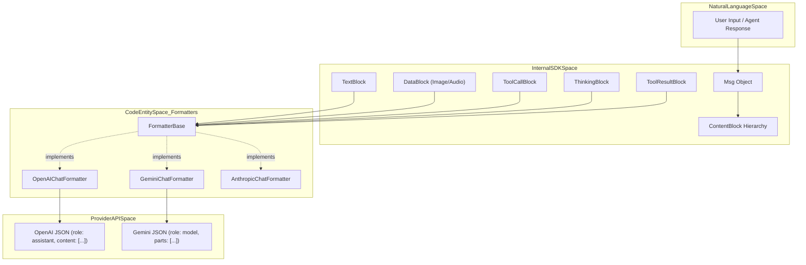
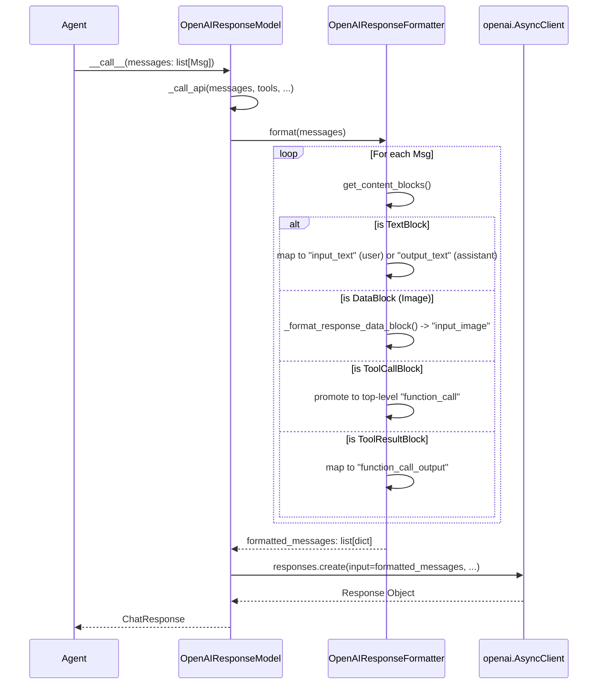

<!-- source: DeepWiki mcp.deepwiki.com · repo agentscope-ai/agentscope · page 3.2 Message Formatters · fetched 2026-10-30 -->

# Message Formatters

Relevant source files

The following files were used as context for generating this wiki page:

- [scripts/model_examples/openai_chat_multimodal.py](scripts/model_examples/openai_chat_multimodal.py)
- [src/agentscope/formatter/_anthropic_formatter.py](src/agentscope/formatter/_anthropic_formatter.py)
- [src/agentscope/formatter/_dashscope_formatter.py](src/agentscope/formatter/_dashscope_formatter.py)
- [src/agentscope/formatter/_deepseek_formatter.py](src/agentscope/formatter/_deepseek_formatter.py)
- [src/agentscope/formatter/_formatter_base.py](src/agentscope/formatter/_formatter_base.py)
- [src/agentscope/formatter/_gemini_formatter.py](src/agentscope/formatter/_gemini_formatter.py)
- [src/agentscope/formatter/_ollama_formatter.py](src/agentscope/formatter/_ollama_formatter.py)
- [src/agentscope/formatter/_openai_formatter.py](src/agentscope/formatter/_openai_formatter.py)
- [src/agentscope/formatter/_openai_response_formatter.py](src/agentscope/formatter/_openai_response_formatter.py)
- [src/agentscope/message/_block.py](src/agentscope/message/_block.py)
- [src/agentscope/model/_openai_response/_model.py](src/agentscope/model/_openai_response/_model.py)
- [tests/formatter_anthropic_test.py](tests/formatter_anthropic_test.py)
- [tests/formatter_dashscope_test.py](tests/formatter_dashscope_test.py)
- [tests/formatter_deepseek_test.py](tests/formatter_deepseek_test.py)
- [tests/formatter_gemini_test.py](tests/formatter_gemini_test.py)
- [tests/formatter_ollama_test.py](tests/formatter_ollama_test.py)
- [tests/formatter_openai_response_test.py](tests/formatter_openai_response_test.py)
- [tests/model_openai_response_test.py](tests/model_openai_response_test.py)

Message formatters in AgentScope are responsible for translating internal `Msg` objects into the specific JSON payloads required by various LLM provider APIs. This layer abstracts away differences in role naming (e.g., `assistant` vs `model`), multimodal data structures (e.g., `image_url` vs `inline_data`), and complex sequences like tool calls and reasoning blocks.

## Core Architecture

All formatters inherit from `FormatterBase`, which defines the standard interface for converting a list of messages into a list of provider-specific dictionaries [src/agentscope/formatter/_formatter_base.py:1-30]().

### Data Flow: Msg to API Payload

The transformation process typically follows this pipeline:
1.  **Extraction**: The formatter iterates through the `Msg` list and calls `get_content_blocks()` to retrieve individual `ContentBlock` objects (e.g., `TextBlock`, `DataBlock`, `ToolCallBlock`, `ToolResultBlock`, `ThinkingBlock`) [src/agentscope/message/_block.py:11-200]().
2.  **Multimodal Processing**: `DataBlock` objects are converted into base64 strings or specific URL formats based on provider requirements. OpenAI and DashScope often use `image_url` structures [src/agentscope/formatter/_openai_formatter.py:77-118](), while Gemini uses `inline_data` [src/agentscope/formatter/_gemini_formatter.py:62-109]().
3.  **Role Mapping**: Internal roles (`user`, `assistant`, `system`) are mapped to provider-specific strings. For example, Gemini maps `assistant` to `model` [src/agentscope/formatter/_gemini_formatter.py:171]().
4.  **Structural Assembly**: Blocks are grouped into the provider's message structure (e.g., OpenAI's `content` list vs Ollama's flat `content` string [src/agentscope/formatter/_ollama_formatter.py:143-149]()).

### Entity Mapping: Natural Language to Code

The following diagram bridges the conceptual transformation from a conversation to the code entities that handle it.

**Message Transformation Entity Map**

Sources: [src/agentscope/formatter/_formatter_base.py:1-30](), [src/agentscope/message/_block.py:11-54](), [src/agentscope/formatter/_openai_formatter.py:189-202]()

---

## Provider-Specific Implementation Details

### OpenAI (Chat & Responses API)
AgentScope supports both the standard Chat Completions API and the newer Responses API (used for `o1`/`o3` models).

*   **Chat Completions**: Uses `OpenAIChatFormatter`. It maps `Msg.name` to the `name` field in the API to distinguish between different agents in the same conversation [src/agentscope/formatter/_openai_formatter.py:189-193]().
*   **Responses API**: Uses `OpenAIResponseFormatter`. Key differences include using `input_text`/`output_text` instead of `text`, and promoting tool calls/results to top-level items in the `input` list rather than nesting them inside a message [src/agentscope/formatter/_openai_response_formatter.py:88-101](). Local `file://` paths are promoted to base64 data URIs [src/agentscope/formatter/_openai_formatter.py:102-108]().

### Anthropic
The `AnthropicChatFormatter` handles Claude's specific requirements:
*   **Thinking Continuity**: Anthropic requires all previous thinking blocks (with their signatures) to be passed back to the API to maintain reasoning continuity [src/agentscope/formatter/_anthropic_formatter.py:46-51]().
*   **Tool Result Forcing**: When a `ToolResultBlock` is encountered, the formatter forces the role to `user`, as tool outputs are considered user-provided context for Claude [src/agentscope/formatter/_anthropic_formatter.py:94](); [tests/formatter_anthropic_test.py:161-174]().
*   **JSON Repair**: Tool call inputs are processed via `_json_loads_with_repair` to handle truncated or malformed LLM outputs [src/agentscope/formatter/_anthropic_formatter.py:176-182]().

### Gemini
`GeminiChatFormatter` maps the internal `assistant` role to `model` [src/agentscope/formatter/_gemini_formatter.py:112-115](). It handles multimodal data via `inline_data` blocks [src/agentscope/formatter/_gemini_formatter.py:62-109](). It supports `thought: true` flags for `ThinkingBlock` objects, but skips empty thinking blocks to avoid API 400 errors [src/agentscope/formatter/_gemini_formatter.py:156-168]().

### Ollama
`OllamaChatFormatter` flattens multiple `TextBlock` objects into a single `content` string [src/agentscope/formatter/_ollama_formatter.py:143-149](). It handles tool calls by converting JSON string arguments into actual Python dictionaries, as required by the Ollama SDK [src/agentscope/formatter/_ollama_formatter.py:199-201]().

### DashScope & DeepSeek
*   **DashScope**: Uses `DashScopeChatFormatter` which is largely OpenAI-compatible but extends support for `video_url` and `input_audio` [src/agentscope/formatter/_dashscope_formatter.py:70-73](). It also supports `application/x-thinking` for reasoning models [src/agentscope/formatter/_dashscope_formatter.py:57-61]().
*   **DeepSeek**: Implements formatters that handle the specific `reasoning_content` field used by DeepSeek's reasoning models [src/agentscope/formatter/_deepseek_formatter.py:1-50]().

---

## Advanced Formatting Logic

### Multi-Agent Flattening
In multi-agent scenarios, the LLM provider may only support a single `user` and `assistant` role. `MultiAgentFormatter` variants (e.g., `AnthropicMultiAgentFormatter`, `GeminiMultiAgentFormatter`) solve this by:
1.  Wrapping historical messages between different agents into a single `user` message.
2.  Using XML-like tags (e.g., `<history>...</history>`) to delineate the conversation history [tests/formatter_anthropic_test.py:189-192]().
3.  Prepending a `conversation_history_prompt` to explain the format to the model [src/agentscope/formatter/_anthropic_formatter.py:194]().

### Tool Result Grouping
Formatters handle the sequence of tool calls and their corresponding results. For instance, in `OpenAIResponseFormatter`, `ToolResultBlock` objects are converted into `function_call_output` items [src/agentscope/formatter/_openai_response_formatter.py:98](). Gemini formatters convert `ToolResultBlock` into a separate `user` role message containing a `function_response` part [tests/formatter_gemini_test.py:155-168]().

### Multimodal Promotion
For providers like OpenAI's Responses API, formatters translate `image_url` into `input_image` [src/agentscope/formatter/_openai_response_formatter.py:79-83](). DashScope formatters handle the promotion of media blocks into specific `image_url`, `video_url`, or `input_audio` types [src/agentscope/formatter/_dashscope_formatter.py:98-105]().

---

## Implementation Diagram

The following sequence diagram illustrates how a `ChatModel` uses a `Formatter` to prepare data for an API call.

**API Call Preparation Sequence**

Sources: [src/agentscope/model/_openai_response/_model.py:155-191](), [src/agentscope/formatter/_openai_response_formatter.py:104-120](), [src/agentscope/message/_block.py:11-127]()

## Summary of Formatter Roles

| Formatter Class | Key Characteristic | Source |
| :--- | :--- | :--- |
| `OpenAIChatFormatter` | Maps `Msg.name` to API `name` field; supports audio/image. | [src/agentscope/formatter/_openai_formatter.py:189]() |
| `OpenAIResponseFormatter` | Uses `input_text` and top-level `function_call` for o1/o3. | [src/agentscope/formatter/_openai_response_formatter.py:88]() |
| `AnthropicChatFormatter` | Preserves `ThinkingBlock` signatures and repairs tool JSON. | [src/agentscope/formatter/_anthropic_formatter.py:46]() |
| `GeminiChatFormatter` | Maps `assistant` to `model`; uses `parts` with `thought` flags. | [src/agentscope/formatter/_gemini_formatter.py:112]() |
| `OllamaChatFormatter` | Flattens content to string; handles dict-based tool arguments. | [src/agentscope/formatter/_ollama_formatter.py:102]() |
| `DashScopeChatFormatter` | OpenAI-compatible with added video/audio/thinking support. | [src/agentscope/formatter/_dashscope_formatter.py:26]() |

Sources:
- `src/agentscope/formatter/_formatter_base.py`
- `src/agentscope/formatter/_openai_formatter.py`
- `src/agentscope/formatter/_openai_response_formatter.py`
- `src/agentscope/formatter/_anthropic_formatter.py`
- `src/agentscope/formatter/_gemini_formatter.py`
- `src/agentscope/formatter/_ollama_formatter.py`
- `src/agentscope/formatter/_dashscope_formatter.py`
- `src/agentscope/formatter/_deepseek_formatter.py`
- `src/agentscope/message/_block.py`
- `src/agentscope/model/_openai_response/_model.py`
- `tests/formatter_anthropic_test.py`
- `tests/formatter_gemini_test.py`
- `tests/formatter_ollama_test.py`
- `tests/formatter_dashscope_test.py`

---

