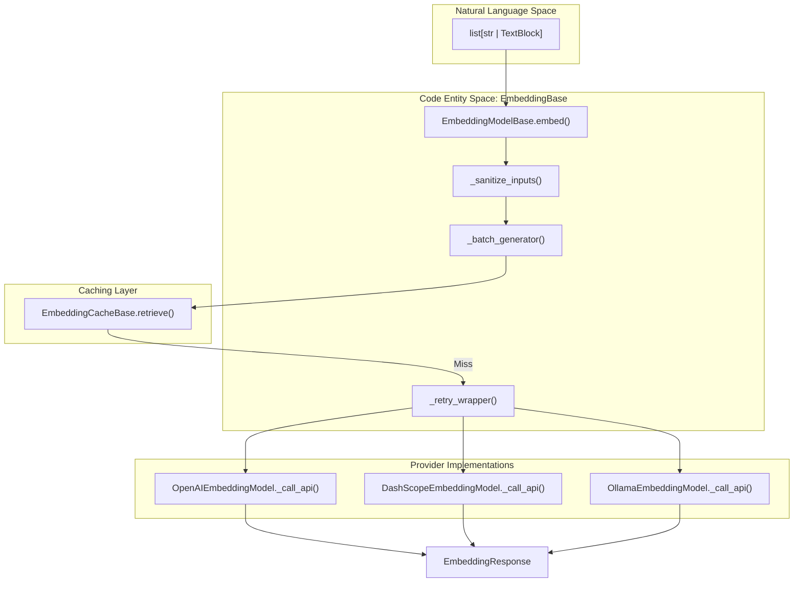
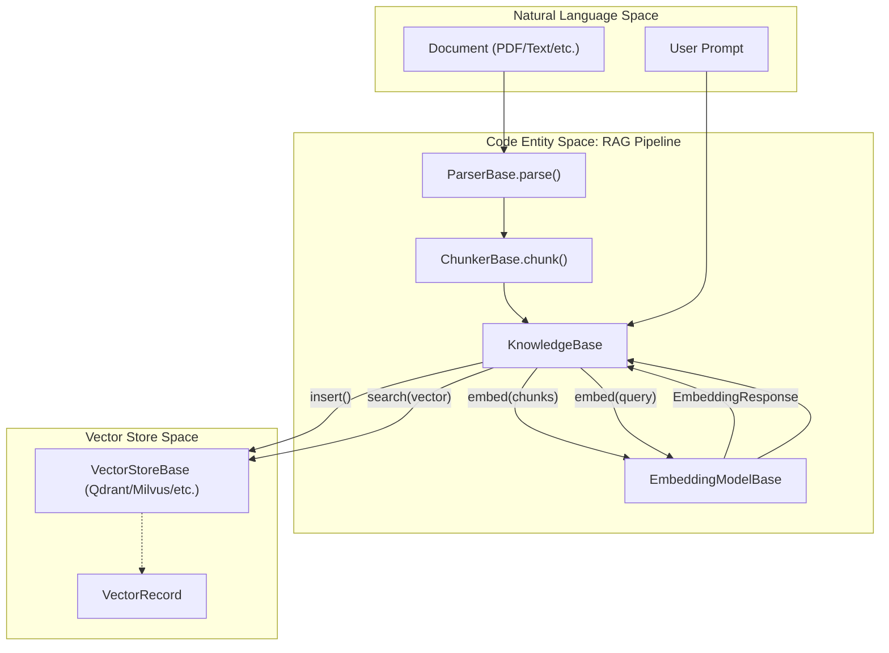

<!-- source: DeepWiki mcp.deepwiki.com · repo agentscope-ai/agentscope · page 3.3 Embedding Models · fetched 2026-10-30 -->

# Embedding Models

Relevant source files

The following files were used as context for generating this wiki page:

- [src/agentscope/embedding/_ollama/_model.py](src/agentscope/embedding/_ollama/_model.py)
- [src/agentscope/embedding/_openai/_model.py](src/agentscope/embedding/_openai/_model.py)
- [src/agentscope/tts/_openai/_model.py](src/agentscope/tts/_openai/_model.py)
- [tests/tts_openai_test.py](tests/tts_openai_test.py)

The embedding model infrastructure in AgentScope provides a standardized interface for transforming text into numerical vectors. This layer supports multiple providers, batching, retry logic, and file-based caching, serving as a critical component for the Retrieval-Augmented Generation (RAG) subsystem.

## Core Infrastructure

AgentScope defines a unified contract for embedding models through the `EmbeddingModelBase` class. This base class handles common concerns like input sanitization, batching large requests, and managing retries for transient API failures.

### Key Data Structures

*   **`EmbeddingResponse`**: Encapsulates the results of an embedding request, including the vectors, usage statistics, and the source (e.g., "network" or "cache") `[src/agentscope/embedding/_embedding_response.py:7-32]()`.
*   **`EmbeddingUsage`**: Tracks token consumption and execution time `[src/agentscope/embedding/_embedding_usage.py:7-14]()`.
*   **`EmbeddingCacheBase`**: An interface for implementing persistent storage of embeddings to reduce API costs and latency `[src/agentscope/embedding/_cache_base.py:10-40]()`.

### Embedding Data Flow
The following diagram illustrates how text moves from the application through the embedding infrastructure to the provider APIs.

**Title: Embedding Request Pipeline**

Sources: `[src/agentscope/embedding/_embedding_base.py:79-136]()`, `[src/agentscope/embedding/_openai/_model.py:115-179]()`, `[src/agentscope/embedding/_ollama/_model.py:85-132]()`.

## Provider Implementations

AgentScope supports several major embedding providers out of the box. Each implementation inherits from `EmbeddingModelBase` and implements the `_call_api` method.

| Provider | Class Name | Default Batch Size | Supported Models (Examples) |
| :--- | :--- | :--- | :--- |
| **OpenAI** | `OpenAIEmbeddingModel` | 2048 | `text-embedding-3-small`, `text-embedding-3-large` |
| **DashScope** | `DashScopeEmbeddingModel` | 25 | `text-embedding-v1`, `text-embedding-v2`, `text-embedding-v3` |
| **Ollama** | `OllamaEmbeddingModel` | 512 | `nomic-embed-text`, `mxbai-embed-large` |
| **Gemini** | `GeminiEmbeddingModel` | 100 | `text-embedding-004` |

### Implementation Details
*   **OpenAI**: Uses the `openai.AsyncClient`. It allows toggling the `pass_dimensions` flag for compatibility with third-party OpenAI-style proxies `[src/agentscope/embedding/_openai/_model.py:96-100]()`.
*   **Ollama**: Interacts with locally hosted models via the `ollama.AsyncClient` `[src/agentscope/embedding/_ollama/_model.py:83-84]()`.
*   **DashScope**: Supports specialized parameters like `text_type` (e.g., `query` vs `document`) to optimize retrieval performance `[src/agentscope/embedding/_dashscope/_model.py:50-70]()`.

Sources: `[src/agentscope/embedding/_openai/_model.py:16-30]()`, `[src/agentscope/embedding/_ollama/_model.py:15-26]()`, `[src/agentscope/embedding/_dashscope/_model.py:15-30]()`.

## Integration with RAG Subsystem

Embedding models are the bridge between raw documents and vector stores in the RAG subsystem. They are primarily orchestrated by the `KnowledgeBase` class.

**Title: RAG Integration and Vector Space Mapping**

Sources: `[src/agentscope/embedding/_embedding_base.py:79-136]()`, `[src/agentscope/embedding/_openai/_model.py:115-179]()`, `[src/agentscope/embedding/_ollama/_model.py:85-132]()`.

### Data Flow in RAG
1.  **Ingestion**: Documents are parsed into data models and then broken into chunks by a chunker implementation.
2.  **Embedding**: The `KnowledgeBase` calls the embedding model's `embed` method to generate vectors for each chunk.
3.  **Storage**: The resulting vectors and original chunk metadata are wrapped in a `VectorRecord` and persisted in a `VectorStoreBase` implementation such as `QdrantStore`, `MilvusLiteStore`, `ElasticsearchStore`, or `MongoDBStore`.
4.  **Retrieval**: During inference, the user query is embedded using the same model, and the resulting vector is used to perform a similarity search against the vector store.

Sources: `[src/agentscope/embedding/_embedding_base.py:79-136]()`, `[src/agentscope/embedding/_openai/_model.py:155-165]()`.

## Caching Mechanism

To prevent redundant API calls for identical text, AgentScope provides a file-based caching layer. The `EmbeddingCacheBase` can be injected into any embedding model instance `[src/agentscope/embedding/_cache_base.py:10-40]()`.

When caching is enabled:
1.  The `_call_api` method first checks the cache using a hash of the input text and model parameters `[src/agentscope/embedding/_openai/_model.py:140-149]()`.
2.  If a hit occurs, the cached vectors are returned with `source="cache"`.
3.  If a miss occurs, the API is called, and the result is stored in the cache before being returned `[src/agentscope/embedding/_openai/_model.py:167-171]()`.

Sources: `[src/agentscope/embedding/_openai/_model.py:101-102]()`, `[src/agentscope/embedding/_ollama/_model.py:108-117]()`.

---

