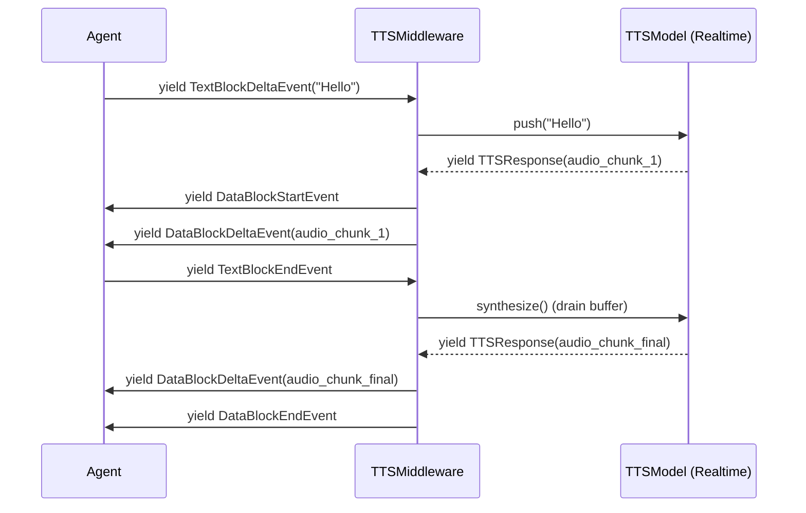

<!-- source: DeepWiki mcp.deepwiki.com · repo agentscope-ai/agentscope · page 3.4 Text-to-Speech (TTS) Models · fetched 2026-10-30 -->

# Text-to-Speech (TTS) Models

<details>
<summary>Relevant source files</summary>

The following files were used as context for generating this wiki page:

- [src/agentscope/credential/_dashscope.py](src/agentscope/credential/_dashscope.py)
- [src/agentscope/credential/_gemini.py](src/agentscope/credential/_gemini.py)
- [src/agentscope/credential/_ollama.py](src/agentscope/credential/_ollama.py)
- [src/agentscope/embedding/_ollama/_model.py](src/agentscope/embedding/_ollama/_model.py)
- [src/agentscope/middleware/_tts_middleware.py](src/agentscope/middleware/_tts_middleware.py)
- [src/agentscope/tts/__init__.py](src/agentscope/tts/__init__.py)
- [src/agentscope/tts/_dashscope/__init__.py](src/agentscope/tts/_dashscope/__init__.py)
- [src/agentscope/tts/_dashscope/_cosyvoice_model.py](src/agentscope/tts/_dashscope/_cosyvoice_model.py)
- [src/agentscope/tts/_dashscope/_cosyvoice_models/cosyvoice-v3-flash.yaml](src/agentscope/tts/_dashscope/_cosyvoice_models/cosyvoice-v3-flash.yaml)
- [src/agentscope/tts/_dashscope/_cosyvoice_models/cosyvoice-v3-plus.yaml](src/agentscope/tts/_dashscope/_cosyvoice_models/cosyvoice-v3-plus.yaml)
- [src/agentscope/tts/_dashscope/_cosyvoice_utils.py](src/agentscope/tts/_dashscope/_cosyvoice_utils.py)
- [src/agentscope/tts/_dashscope/_realtime_model.py](src/agentscope/tts/_dashscope/_realtime_model.py)
- [src/agentscope/tts/_gemini/__init__.py](src/agentscope/tts/_gemini/__init__.py)
- [src/agentscope/tts/_gemini/_model.py](src/agentscope/tts/_gemini/_model.py)
- [src/agentscope/tts/_gemini/_models/gemini-2.5-flash-preview-tts.yaml](src/agentscope/tts/_gemini/_models/gemini-2.5-flash-preview-tts.yaml)
- [src/agentscope/tts/_gemini/_models/gemini-2.5-pro-preview-tts.yaml](src/agentscope/tts/_gemini/_models/gemini-2.5-pro-preview-tts.yaml)
- [src/agentscope/tts/_openai/_model.py](src/agentscope/tts/_openai/_model.py)
- [tests/tts_dashscope_test.py](tests/tts_dashscope_test.py)
- [tests/tts_gemini_test.py](tests/tts_gemini_test.py)
- [tests/tts_middleware_test.py](tests/tts_middleware_test.py)
- [tests/tts_openai_test.py](tests/tts_openai_test.py)

</details>


The Text-to-Speech (TTS) module in AgentScope provides a standardized infrastructure for converting agent reasoning or response text into audio. It supports multiple providers, streaming output, and seamless integration with the agent's message loop via middleware.

## Architecture Overview

The TTS system is built on a base abstraction `TTSModelBase` which defines the contract for synthesis, streaming, and lifecycle management. The infrastructure bridges the gap between raw text produced by LLMs and structured audio data blocks transmitted to the frontend.

### Core Components

*   **`TTSModelBase`**: The abstract base class defining the interface for all TTS implementations [src/agentscope/tts/_tts_base.py:14-117]().
*   **`TTSResponse`**: A standardized container for synthesized audio, wrapping audio data in a `DataBlock` and providing usage statistics [src/agentscope/tts/_tts_response.py:6-19]().
*   **`TTSMiddleware`**: An onion-pattern middleware that intercepts agent replies, detects text blocks, and injects corresponding audio data events [src/agentscope/middleware/_tts_middleware.py:21-39]().
*   **Model Cards**: YAML-based definitions (e.g., `cosyvoice-v3-flash.yaml`) that describe model capabilities, supported voices, and media types [src/agentscope/tts/_dashscope/_cosyvoice_models/cosyvoice-v3-flash.yaml:1-23]().

### Data Flow: Text to Audio Events

The following diagram illustrates how a text response from an LLM is transformed into a stream of audio events through the `TTSMiddleware`.

**TTS Synthesis Pipeline**
```mermaid
graph TD
    subgraph "Natural Language Space"
        [LLM_Output] --> |"Text Stream"| [Agent_Reasoning]
    end

    subgraph "Code Entity Space"
        [Agent_Reasoning] --> |"TextBlockDeltaEvent"| TTSMiddleware["TTSMiddleware.on_reply"]
        TTSMiddleware --> |"push(text)"| TTSModel["TTSModelBase.synthesize / .push"]
        TTSModel --> |"Raw Bytes"| Response["TTSResponse"]
        Response --> |"Base64 + MIME"| DataBlock["DataBlock (Base64Source)"]
        DataBlock --> |"Event Injection"| EventBus["DataBlockStart/Delta/EndEvent"]
    end

    EventBus --> |"SSE Stream"| Frontend["Web UI / Audio Player"]
```
Sources: [src/agentscope/middleware/_tts_middleware.py:51-118](), [src/agentscope/tts/_tts_response.py:6-19](), [src/agentscope/message.py:16-17]()

---

## Provider Implementations

AgentScope supports several major TTS providers, each handling streaming and audio formatting differently.

### 1. OpenAI TTS
Uses the OpenAI Audio Speech API. It supports both standard aggregation (returning a full file) and streaming (yielding incremental chunks).
*   **Supported Formats**: `mp3` (default), `opus`, `aac`, `flac`, `wav`, `pcm` [src/agentscope/tts/_openai/_model.py:24-32]().
*   **Models**: `tts-1`, `tts-1-hd`, `gpt-4o-mini-tts` [src/agentscope/tts/_openai/_model.py:104-106]().
*   **Logic**: When `stream=True`, it uses `with_streaming_response.create` and yields `TTSResponse` chunks as bytes arrive [src/agentscope/tts/_openai/_model.py:168-170](), [src/agentscope/tts/_openai/_model.py:201-220]().

### 2. DashScope (Alibaba)
Provides high-performance models including `CosyVoice`.
*   **CosyVoice**: Optimized for low-latency synthesis [src/agentscope/tts/_dashscope/_cosyvoice_model.py:4-12]().
*   **Realtime Support**: `DashScopeRealtimeTTSModel` implements a WebSocket-based push/pull mechanism for ultra-low latency [src/agentscope/tts/_dashscope/_realtime_model.py:6-12]().
*   **WAV Injection**: Since DashScope models often return raw PCM, AgentScope injects WAV headers (e.g., 24kHz, mono, 16-bit) for browser compatibility [tests/tts_dashscope_test.py:36-42]().

### 3. Gemini TTS
Google's Gemini implementation leverages the `generateContent` API with `AUDIO` response modalities [tests/tts_gemini_test.py:29-39]().
*   **Logic**: It aggregates multiple `inline_data` parts from the Gemini response into a single WAV container [tests/tts_gemini_test.py:103-130]().

Sources: [src/agentscope/tts/_openai/_model.py:46-175](), [src/agentscope/tts/_dashscope/__init__.py:1-12](), [src/agentscope/credential/_dashscope.py:48-60](), [src/agentscope/credential/_gemini.py:45-49]()

---

## TTSMiddleware Integration

The `TTSMiddleware` is the primary way to add voice to an agent. It operates in two modes based on the `realtime` attribute of the model:

| Feature | Non-Realtime (`realtime=False`) | Realtime (`realtime=True`) |
| :--- | :--- | :--- |
| **Trigger** | `TextBlockEndEvent` [src/agentscope/middleware/_tts_middleware.py:82]() | `TextBlockDeltaEvent` [src/agentscope/middleware/_tts_middleware.py:67]() |
| **Input** | Accumulated full text buffer [src/agentscope/middleware/_tts_middleware.py:83]() | Incremental text deltas [src/agentscope/middleware/_tts_middleware.py:69]() |
| **Method** | `tts.synthesize(text)` [src/agentscope/middleware/_tts_middleware.py:99]() | `tts.push(delta)` [src/agentscope/middleware/_tts_middleware.py:70]() |
| **Output** | Full audio sequence emitted at once | Audio emitted as soon as model generates it |

### Lifecycle Management
The middleware uses an `async with` context manager to handle model connections (e.g., opening/closing WebSockets for realtime models) during the `on_reply` execution [src/agentscope/middleware/_tts_middleware.py:63]().

**Middleware Execution Flow**

Sources: [src/agentscope/middleware/_tts_middleware.py:51-118](), [tests/tts_middleware_test.py:52-121]()

---

## Model YAML Cards

Models are defined using YAML cards to decouple implementation from configuration. These cards define the available voices and media types.

**Example: CosyVoice v3 Flash Card**
```yaml
name: cosyvoice-v3-flash
label: CosyVoice-v3-Flash
status: active
input_types:
  - text/plain
output_types:
  - audio/wav
voices:
  - longanyang
  - longanhuan
  - longhuhu_v3
```
Sources: [src/agentscope/tts/_dashscope/_cosyvoice_models/cosyvoice-v3-flash.yaml:1-23]()

---

## Key Classes and Functions

### `TTSModelBase`
*   `synthesize(text, **kwargs)`: Primary entry point for text-to-speech conversion. Returns a single `TTSResponse` or an `AsyncGenerator` [src/agentscope/tts/_tts_base.py:58-81]().
*   `push(text, **kwargs)`: Used for realtime streaming. Pushes text into a model buffer [src/agentscope/tts/_tts_base.py:83-100]().
*   `connect()` / `close()`: Lifecycle hooks for stateful connections (WebSockets/gRPC) [src/agentscope/tts/_tts_base.py:102-117]().

### `TTSResponse`
*   `content`: A `DataBlock` containing a `Base64Source`. The `data` field is a base64-encoded string of the audio bytes [src/agentscope/tts/_tts_response.py:14](), [src/agentscope/message.py:17]().
*   `is_last`: Boolean flag indicating if this is the final chunk in a stream [src/agentscope/tts/_tts_response.py:16]().
*   `usage`: A `TTSUsage` object tracking input tokens, output tokens, and synthesis time [src/agentscope/tts/_tts_response.py:18]().

Sources: [src/agentscope/tts/_tts_base.py:14-117](), [src/agentscope/tts/_tts_response.py:6-19](), [src/agentscope/message.py:16-17]()

---

