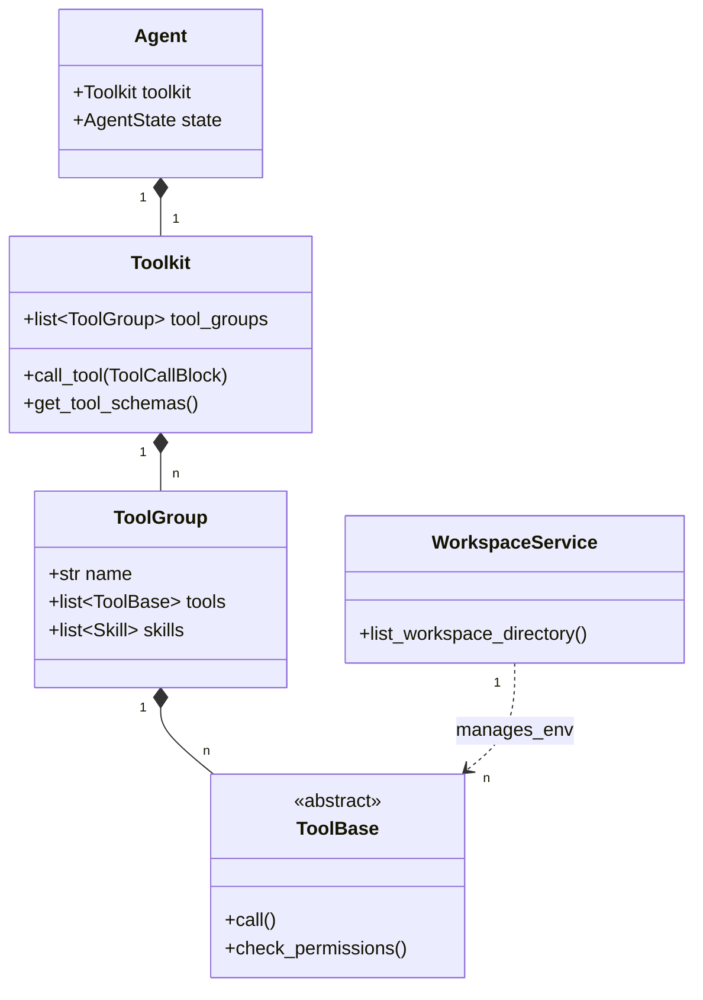

<!-- source: DeepWiki mcp.deepwiki.com · repo agentscope-ai/agentscope · page 4 Tool System · fetched 2026-10-30 -->

# Tool System

<details>
<summary>Relevant source files</summary>

The following files were used as context for generating this wiki page:

- [src/agentscope/app/_router/_schema/_workspace.py](src/agentscope/app/_router/_schema/_workspace.py)
- [src/agentscope/app/deps.py](src/agentscope/app/deps.py)
- [src/agentscope/tool/__init__.py](src/agentscope/tool/__init__.py)
- [src/agentscope/tool/_adapters.py](src/agentscope/tool/_adapters.py)
- [src/agentscope/tool/_builtin/__init__.py](src/agentscope/tool/_builtin/__init__.py)
- [src/agentscope/tool/_builtin/_backend.py](src/agentscope/tool/_builtin/_backend.py)
- [src/agentscope/tool/_builtin/_meta.py](src/agentscope/tool/_builtin/_meta.py)
- [src/agentscope/tool/_builtin/_skill.py](src/agentscope/tool/_builtin/_skill.py)
- [src/agentscope/tool/_response.py](src/agentscope/tool/_response.py)
- [src/agentscope/tool/_tool_group.py](src/agentscope/tool/_tool_group.py)
- [src/agentscope/tool/_toolkit.py](src/agentscope/tool/_toolkit.py)
- [src/agentscope/tool/_types.py](src/agentscope/tool/_types.py)
- [src/agentscope/tool/_utils.py](src/agentscope/tool/_utils.py)
- [tests/backend_local_test.py](tests/backend_local_test.py)
- [tests/mcp_sse_client_test.py](tests/mcp_sse_client_test.py)
- [tests/mcp_streamable_http_client_test.py](tests/mcp_streamable_http_client_test.py)
- [tests/service_workspace_files_test.py](tests/service_workspace_files_test.py)
- [tests/toolkit_skill_test.py](tests/toolkit_skill_test.py)
- [tests/toolkit_test.py](tests/toolkit_test.py)

</details>


The AgentScope tool system provides a unified framework for extending agent capabilities through Python functions, the Model Context Protocol (MCP), and complex multi-step "Skills". It manages the lifecycle of tools, generates schemas for Large Language Models (LLMs), and orchestrates execution across various environments.

## Architecture Overview

The system is centered around the `Toolkit` class, which serves as a container and manager for all executable extensions [src/agentscope/tool/_toolkit.py:66-86](). Tools are organized into `ToolGroup` instances, allowing agents to dynamically activate or deactivate sets of capabilities during a conversation [src/agentscope/tool/_toolkit.py:127-134]().

### Bridging Natural Language and Code
The following diagram illustrates how natural language tool calls from an LLM are resolved into executable code entities within the AgentScope SDK.

**Tool Execution Pipeline**
```mermaid
graph TD
    subgraph "Natural Language Space (LLM)"
        [LLM_Output] -- "JSON Tool Call" --> [ToolCallBlock]
    end

    subgraph "Code Entity Space (SDK)"
        [ToolCallBlock] -- "name & input" --> [Toolkit.call_tool]
        [Toolkit.call_tool] -- "Lookup" --> [RegisteredTool]
        [RegisteredTool] -- "Execute" --> [ToolBase.call]
        
        subgraph "Tool Adapters"
            [ToolBase.call] --> [FunctionTool]
            [ToolBase.call] --> [MCPTool]
        end
        
        [FunctionTool] -- "Invoke" --> [Python_Function]
        [MCPTool] -- "Request" --> [ClientSession]
    end

    [Python_Function] -- "Result" --> [ToolChunk_ToolResponse]
    [ClientSession] -- "Result" --> [ToolChunk_ToolResponse]
    [ToolChunk_ToolResponse] -- "Structured Content" --> [LLM_Observation]
```
**Sources:** [src/agentscope/tool/_toolkit.py:66-86](), [src/agentscope/tool/_adapters.py:31-48](), [src/agentscope/tool/_adapters.py:167-179](), [src/agentscope/tool/_toolkit.py:228-265](), [src/agentscope/message.py:34-37]()

## Core Components

### Toolkit & Tool Groups
The `Toolkit` is the primary interface for managing tools [src/agentscope/tool/_toolkit.py:66-86](). It supports:
- **Registration**: Adding `ToolBase` implementations, `MCPClient` instances, or `Skill` loaders via the constructor or specific registration methods [src/agentscope/tool/_toolkit.py:88-115]().
- **Schema Generation**: Automatically producing JSON schemas (e.g., OpenAI function format) via `get_tool_schemas`, including support for Pydantic `$defs` preservation for complex nested types [src/agentscope/tool/_toolkit.py:171-205](), [src/agentscope/tool/_types.py:117-151]().
- **Dynamic Control**: Using the `ResetTools` meta-tool to let agents switch between `ToolGroup` sets at runtime to manage context efficiency [src/agentscope/tool/_toolkit.py:156-163](), [src/agentscope/tool/_builtin/_meta.py:21-46]().

For implementation details on schema aggregation and group management, see [Toolkit & Tool Groups](#4.1).

### Tool Base & Responses
All tools inherit from `ToolBase` [src/agentscope/tool/_base.py:145-156](). Execution results are encapsulated in a structured format:
- `ToolChunk`: Incremental results for streaming execution, containing `TextBlock` or `DataBlock` [src/agentscope/tool/_response.py:28-48]().
- `ToolResponse`: The final aggregated result. It provides an `append_chunk` method to merge multiple chunks into a single response, handling base64 data merging and state updates [src/agentscope/tool/_response.py:50-70](), [src/agentscope/tool/_response.py:72-170]().

**Sources:** [src/agentscope/tool/_base.py:145-156](), [src/agentscope/tool/_response.py:28-70](), [src/agentscope/tool/_response.py:72-170]()

## Extensions and Integration

### Built-in Tools
AgentScope provides a suite of filesystem and shell tools. These tools use a `BackendBase` (typically `LocalBackend`) to abstract the underlying OS operations [src/agentscope/tool/_builtin/_backend.py:4-29]().
- **Shell**: `Bash` and `PowerShell` [src/agentscope/tool/_builtin/__init__.py:18-19]().
- **Filesystem**: `Read`, `Write`, `Edit`, `Grep`, and `Glob` [src/agentscope/tool/_builtin/__init__.py:20-24]().
- **Task Management**: `TaskCreate`, `TaskUpdate`, `TaskGet`, and `TaskList` for structured agent planning [src/agentscope/tool/__init__.py:23-28]().

For details on backends and shell permissions, see [Built-in Tools](#4.2).

### MCP Integration
The Model Context Protocol (MCP) allows agents to connect to external tool servers. AgentScope's `MCPTool` adapter maps MCP tool definitions to the internal `ToolBase` interface [src/agentscope/tool/_adapters.py:167-203]().
- **Stateful/Stateless**: Supports persistent `ClientSession` or one-off connections via `client_gen` [src/agentscope/tool/_adapters.py:197-203](), [src/agentscope/tool/_toolkit.py:144-151]().
- **Discovery**: Agents can browse and install MCP servers via the `MCPHub` [src/agentscope/app/deps.py:24]().

For protocol details, see [MCP (Model Context Protocol) Integration](#4.3).

### Skills
Skills are high-level capabilities defined by instructions and resource requirements, often defined in a `SKILL.md` format [src/agentscope/tool/_toolkit.py:51-63]().
- **SkillViewer**: A built-in tool that allows agents to read skill instructions to perform complex tasks [src/agentscope/tool/_toolkit.py:165-169]().
- **Skill Hub**: A repository for sharing and installing skills, managed via `SkillHubBase` [src/agentscope/app/deps.py:24]().

For skill formats and loading logic, see [Skills](#4.4).

## Entity Relationship
The following diagram shows how tools and skills relate to the `Agent` and `Workspace` entities.

**System Entity Mapping**

**Sources:** [src/agentscope/tool/_toolkit.py:127-134](), [src/agentscope/tool/_tool_group.py:17-25](), [src/agentscope/app/deps.py:21](), [src/agentscope/app/_router/_workspace.py:20-22]()

---

## Detailed Child Pages
- [Toolkit & Tool Groups](#4.1)
- [Built-in Tools](#4.2)
- [MCP (Model Context Protocol) Integration](#4.3)
- [Skills](#4.4)

---

