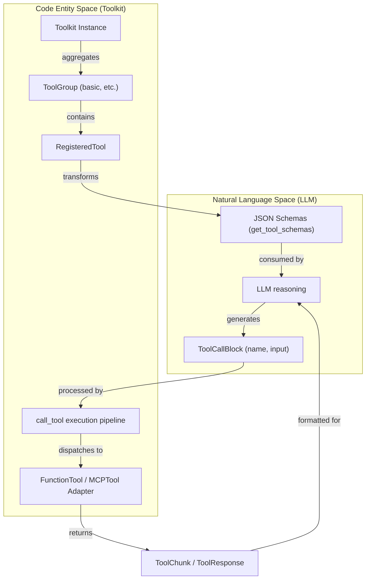
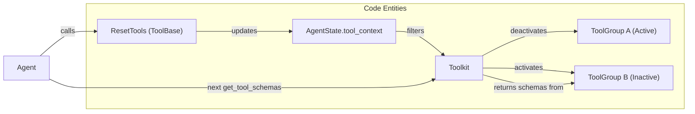

<!-- source: DeepWiki mcp.deepwiki.com · repo agentscope-ai/agentscope · page 4.1 Toolkit & Tool Groups · fetched 2026-10-30 -->

# Toolkit & Tool Groups

Relevant source files

The following files were used as context for generating this wiki page:

- [src/agentscope/app/_router/_schema/_workspace.py](src/agentscope/app/_router/_schema/_workspace.py)
- [src/agentscope/app/deps.py](src/agentscope/app/deps.py)
- [src/agentscope/tool/__init__.py](src/agentscope/tool/__init__.py)
- [src/agentscope/tool/_adapters.py](src/agentscope/tool/_adapters.py)
- [src/agentscope/tool/_builtin/__init__.py](src/agentscope/tool/_builtin/__init__.py)
- [src/agentscope/tool/_builtin/_backend.py](src/agentscope/tool/_builtin/_backend.py)
- [src/agentscope/tool/_builtin/_meta.py](src/agentscope/tool/_builtin/_meta.py)
- [src/agentscope/tool/_builtin/_skill.py](src/agentscope/tool/_builtin/_skill.py)
- [src/agentscope/tool/_response.py](src/agentscope/tool/_response.py)
- [src/agentscope/tool/_tool_group.py](src/agentscope/tool/_tool_group.py)
- [src/agentscope/tool/_toolkit.py](src/agentscope/tool/_toolkit.py)
- [src/agentscope/tool/_types.py](src/agentscope/tool/_types.py)
- [src/agentscope/tool/_utils.py](src/agentscope/tool/_utils.py)
- [tests/backend_local_test.py](tests/backend_local_test.py)
- [tests/mcp_sse_client_test.py](tests/mcp_sse_client_test.py)
- [tests/mcp_streamable_http_client_test.py](tests/mcp_streamable_http_client_test.py)
- [tests/service_workspace_files_test.py](tests/service_workspace_files_test.py)
- [tests/toolkit_skill_test.py](tests/toolkit_skill_test.py)
- [tests/toolkit_test.py](tests/toolkit_test.py)

The `Toolkit` is the central registry and execution engine for tools in AgentScope. It manages the lifecycle of tool functions, MCP (Model Context Protocol) clients, and Agent Skills, providing a unified interface for LLMs to consume tool schemas and execute actions.

## Toolkit Architecture

The `Toolkit` operates by organizing tools into `ToolGroup` objects. By default, every `Toolkit` contains a `"basic"` group. Users can define additional groups to dynamically activate or deactivate sets of capabilities for an agent.

### Key Classes & Entities

| Entity | Description | Source |
| :--- | :--- | :--- |
| `Toolkit` | The main coordinator for tool registration, schema generation, and execution. | [src/agentscope/tool/_toolkit.py:66-86]() |
| `ToolGroup` | A logical container for `ToolBase` objects, `Skill` objects, and `MCPClient` instances. | [src/agentscope/tool/_tool_group.py:29-30]() |
| `RegisteredTool` | A wrapper for `ToolBase` that handles schema transformation and Pydantic model extensions. | [src/agentscope/tool/_types.py:25-42]() |
| `ToolBase` | The abstract base class for all tools (Function, MCP, Built-in). | [src/agentscope/tool/_base.py:7-22]() |

### Data Flow: Schema to Execution

The following diagram illustrates how tools move from code definitions to LLM-consumable schemas and back to execution results.

**Diagram: Tool Schema and Execution Pipeline**

Sources: [src/agentscope/tool/_toolkit.py:171-206](), [src/agentscope/tool/_toolkit.py:273-315](), [src/agentscope/tool/_types.py:56-85]()

## Tool Registration & Adapters

AgentScope uses adapters to normalize different tool types into a common interface.

### FunctionTool
Wraps standard Python functions. It automatically parses docstrings to generate JSON schemas using `_extract_func_description` and `_extract_input_schema` [src/agentscope/tool/_adapters.py:78-82](). It handles both synchronous and asynchronous functions, including those that return generators [src/agentscope/tool/_adapters.py:119-146]().

### MCPTool
Integrates with Model Context Protocol (MCP) servers. It handles the translation between MCP's internal result format and AgentScope's `ToolChunk` format [src/agentscope/tool/_adapters.py:167-173](). It supports both stateful sessions and stateless client generators [src/agentscope/tool/_adapters.py:180-203]().

### Schema Generation & $defs Preservation
When generating schemas via `get_tool_schemas`, the `Toolkit` preserves nested Pydantic models by merging `$defs` from the extended models into the final JSON schema [src/agentscope/tool/_types.py:118-151](). It performs conflict checks to ensure that if multiple tools use the same sub-model definition, they are identical [src/agentscope/tool/_types.py:130-149](). To avoid misleading the LLM, the `Toolkit` recursively removes the `title` field from all schema properties and `$defs` using `_remove_title_field` [src/agentscope/tool/_utils.py:10-43]().

## Execution Pipeline (`call_tool`)

The `call_tool` method is an asynchronous generator that manages the execution of a `ToolCallBlock`.

1.  **Resolution**: The `Toolkit` searches for the tool by name across all activated `ToolGroup`s [src/agentscope/tool/_toolkit.py:291-305]().
2.  **State Injection**: If the tool has `is_state_injected=True`, the `AgentState` is passed into the tool call [src/agentscope/tool/_toolkit.py:311-313]().
3.  **Aggregation**: The pipeline yields `ToolChunk` objects during execution and returns a final `ToolResponse` which aggregates all chunks [src/agentscope/tool/_response.py:72-74]().

### ToolChunk and ToolResponse Aggregation
Tools can stream results using `ToolChunk`. The `ToolResponse.append_chunk` method handles the merging logic:
*   **TextBlocks**: Appended to existing text [src/agentscope/tool/_response.py:91]().
*   **DataBlocks (Base64)**: Merged using `_merge_base64_chunks` to avoid corrupting padding [src/agentscope/tool/_response.py:101-104]().
*   **State**: The final state transitions from `RUNNING` to `SUCCESS`, `ERROR`, `DENIED`, or `INTERRUPTED` based on the chunks received. `ERROR` is treated as the highest priority terminal state [src/agentscope/tool/_response.py:136-147]().

Sources: [src/agentscope/tool/_toolkit.py:273-330](), [src/agentscope/tool/_response.py:50-70](), [src/agentscope/tool/_response.py:13-25]()

## Meta-Tools & Group Management

The `Toolkit` includes built-in meta-tools to allow agents to manage their own tool environment.

### ResetTools
A meta-tool that allows the agent to activate or deactivate specific `ToolGroup`s [src/agentscope/tool/_builtin/_meta.py:21-40](). When an agent calls `ResetTools`, the `Toolkit` updates the `activated_groups` list in the `AgentState` [src/agentscope/tool/_builtin/_meta.py:142-143](). The input schema for `ResetTools` is dynamically generated based on the group names provided to the `Toolkit` [src/agentscope/tool/_builtin/_meta.py:60-77]().

**Diagram: ToolGroup Activation Flow**

Sources: [src/agentscope/tool/_toolkit.py:156-163](), [src/agentscope/tool/_builtin/_meta.py:141-154]()

### SkillViewer
Since Agent Skills are not tools but rather complex instructions, the `SkillViewer` tool allows agents to read the full instructions of a registered skill [src/agentscope/tool/_toolkit.py:165-169](). The `Toolkit` provides a `_get_available_skills` method to the viewer to ensure it only accesses skills within currently activated groups [src/agentscope/tool/_toolkit.py:246-271]().

Sources: [src/agentscope/tool/_toolkit.py:51-63](), [src/agentscope/tool/_toolkit.py:165-169](), [src/agentscope/tool/_builtin/_skill.py:12-13]()

---

