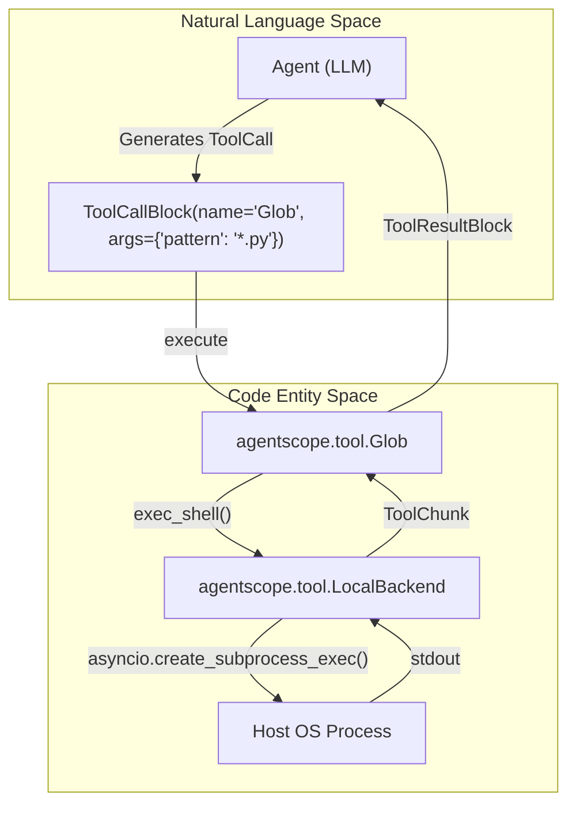
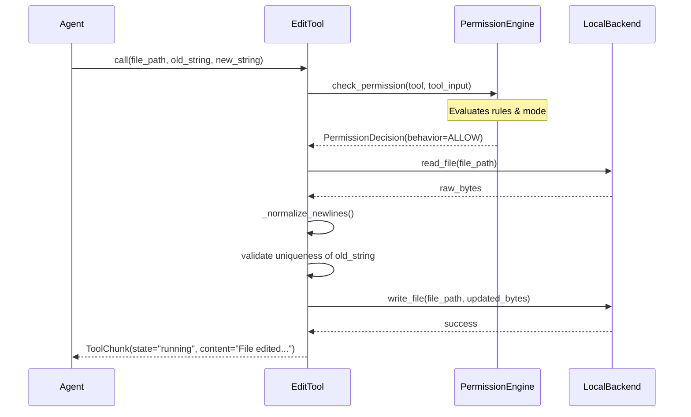

<!-- source: DeepWiki mcp.deepwiki.com · repo agentscope-ai/agentscope · page 4.2 Built-in Tools · fetched 2026-10-30 -->

# Built-in Tools

Relevant source files

The following files were used as context for generating this wiki page:

- [src/agentscope/middleware/_budget.py](src/agentscope/middleware/_budget.py)
- [src/agentscope/permission/_decision.py](src/agentscope/permission/_decision.py)
- [src/agentscope/permission/_engine.py](src/agentscope/permission/_engine.py)
- [src/agentscope/permission/_types.py](src/agentscope/permission/_types.py)
- [src/agentscope/tool/_base.py](src/agentscope/tool/_base.py)
- [src/agentscope/tool/_builtin/_bash.py](src/agentscope/tool/_builtin/_bash.py)
- [src/agentscope/tool/_builtin/_bash_parser.py](src/agentscope/tool/_builtin/_bash_parser.py)
- [src/agentscope/tool/_builtin/_edit.py](src/agentscope/tool/_builtin/_edit.py)
- [src/agentscope/tool/_builtin/_glob.py](src/agentscope/tool/_builtin/_glob.py)
- [src/agentscope/tool/_builtin/_grep.py](src/agentscope/tool/_builtin/_grep.py)
- [src/agentscope/tool/_builtin/_powershell.py](src/agentscope/tool/_builtin/_powershell.py)
- [src/agentscope/tool/_builtin/_read.py](src/agentscope/tool/_builtin/_read.py)
- [src/agentscope/tool/_builtin/_write.py](src/agentscope/tool/_builtin/_write.py)
- [src/agentscope/tool/_constants.py](src/agentscope/tool/_constants.py)
- [tests/builtin_bash_test.py](tests/builtin_bash_test.py)
- [tests/builtin_glob_test.py](tests/builtin_glob_test.py)
- [tests/builtin_powershell_test.py](tests/builtin_powershell_test.py)
- [tests/builtin_write_test.py](tests/builtin_write_test.py)
- [tests/middleware_budget_test.py](tests/middleware_budget_test.py)
- [tests/permission_bash_parser_test.py](tests/permission_bash_parser_test.py)
- [tests/permission_engine_test.py](tests/permission_engine_test.py)
- [tests/permission_mode_test.py](tests/permission_mode_test.py)

AgentScope provides a suite of built-in filesystem and shell tools designed to give agents controlled access to the execution environment. These tools are built upon a unified backend abstraction layer, allowing the same tool logic to operate across local, Docker, or sandboxed environments while integrating deeply with the AgentScope permission system.

## Tool Suite Overview

The built-in tools are categorized into shell execution and filesystem manipulation. They are defined in `src/agentscope/tool/_builtin/` and exported via the main tool module.

| Tool | Class Name | Purpose |
| :--- | :--- | :--- |
| **Bash** | `Bash` | Executes bash commands with persistent working directory [[src/agentscope/tool/_builtin/_bash.py:25]](). |
| **PowerShell** | `PowerShell` | Windows-equivalent shell execution [[src/agentscope/tool/_builtin/_powershell.py:25]](). |
| **Read** | `Read` | Reads file content with line numbers and optional range [[src/agentscope/tool/_builtin/_read.py:19]](). |
| **Write** | `Write` | Overwrites or creates files on the filesystem [[src/agentscope/tool/_builtin/_write.py:26]](). |
| **Edit** | `Edit` | Performs exact string replacements (search-and-replace) [[src/agentscope/tool/_builtin/_edit.py:25]](). |
| **Grep** | `Grep` | High-performance content search using `ripgrep` [[src/agentscope/tool/_builtin/_grep.py:39]](). |
| **Glob** | `Glob` | File and directory discovery using pattern matching [[src/agentscope/tool/_builtin/_glob.py:42]](). |

**Sources:** [[src/agentscope/tool/_builtin/_bash.py:25-30]](), [[src/agentscope/tool/_builtin/_read.py:19-23]](), [[src/agentscope/tool/_builtin/_grep.py:39-43]](), [[src/agentscope/tool/_builtin/_glob.py:42-46]]().

---

## Backend Abstraction (`BackendBase`)

To ensure portability, all built-in tools interact with the environment through the `BackendBase` abstract class. This abstraction captures the core primitives that differ between environments (local vs. containerized).

### Implementation Architecture

The system relies on core primitives that must be implemented by any concrete backend:
1.  `exec_shell`: Executes a program from an `argv` list.
2.  `read_file`: Reads raw bytes from a path.
3.  `write_file`: Writes raw bytes to a path.

### The LocalBackend

`LocalBackend` is the default implementation. It uses `asyncio.create_subprocess_exec` for shell execution and standard asynchronous file operations for host I/O.

#### Data Flow: Natural Language to System Execution
This diagram shows how an agent's intent to "list files" flows from a `ToolCallBlock` through the `Glob` tool and down to the OS.

**Sources:** [[src/agentscope/tool/_builtin/_glob.py:106-115]](), [[tests/builtin_bash_test.py:45-74]]().

---

## Shell Tools: Bash & PowerShell

The `Bash` tool is the primary interface for command execution. It maintains a persistent working directory (`cwd`) across calls within a session, though shell state (like environment variables) does not persist unless explicitly managed [[src/agentscope/tool/_builtin/_bash.py:31-35]]().

### Bash Command Parsing & Security

Before execution, commands are passed through the `BashCommandParser` to detect dangerous patterns or structures that cannot be statically analyzed [[src/agentscope/tool/_builtin/_bash.py:7]]().

The permission integration performs several checks:
*   **Command Substitution:** Patterns like `$(cmd)` or `` `cmd` `` trigger a `PermissionBehavior.ASK` to prevent hidden execution [[tests/builtin_bash_test.py:160-175]]().
*   **Control Flow:** `if`, `for`, and `while` loops are blocked from automatic execution because they cannot be easily audited [[tests/builtin_bash_test.py:176-195]]().
*   **Dangerous Paths:** Access to files in `DEFAULT_DANGEROUS_FILES` (e.g., `.env`, SSH keys) requires explicit user confirmation even in `BYPASS` mode [[src/agentscope/tool/_builtin/_bash.py:139-153]]().
*   **Read-Only Detection:** The `BashCommandParser` uses `tree-sitter-bash` to identify if a command is read-only (e.g., `ls`, `git status`), allowing for automatic execution in `EXPLORE` mode [[src/agentscope/tool/_builtin/_bash_parser.py:155-171]]().

### Windows vs. Unix Differences

AgentScope handles platform differences in the backend layer:
*   **Subprocess Creation:** On Windows, `LocalBackend` uses `creationflags=0x08000000` (`CREATE_NO_WINDOW`) to hide console windows during execution [[tests/builtin_bash_test.py:33-40]]().
*   **Shell Wrappers:** Commands are wrapped in `cmd /c` on Windows and `/bin/sh -c` on Unix systems [[tests/builtin_bash_test.py:65-69]]().

**Sources:** [[src/agentscope/tool/_builtin/_bash.py:31-98]](), [[src/agentscope/tool/_builtin/_bash_parser.py:148-153]](), [[tests/builtin_bash_test.py:22-74]]().

---

## Filesystem Tools

Filesystem tools are designed to be safer and more structured than running raw `cat` or `sed` via `Bash`.

### Read, Write, and Edit

*   **Read:** Returns content with line numbers (format: `line_no\tcontent`). This format is critical for the `Edit` tool to maintain context [[src/agentscope/tool/_builtin/_read.py:26-35]]().
*   **Write:** Overwrites a file. It requires the agent to have used `Read` on the file first if it already exists, ensuring the agent is aware of the current state [[src/agentscope/tool/_builtin/_write.py:33-40]]().
*   **Edit:** Uses exact string replacement. It fails if the `old_string` is not unique in the file to prevent accidental corruption [[src/agentscope/tool/_builtin/_edit.py:31-47]]().

### Search: Grep & Glob

*   **Grep:** Wraps `ripgrep`. It supports multiple output modes: `content` (matching lines), `files_with_matches` (paths only), and `count` [[src/agentscope/tool/_builtin/_grep.py:71-80]](). It enforces a `DEFAULT_HEAD_LIMIT` of 250 to prevent flooding the agent's context [[src/agentscope/tool/_builtin/_grep.py:28]]().
*   **Glob:** Provides a safe way to list files using glob patterns. It uses a bundled `_glob_helper.py` script to ensure consistent behavior across backends [[src/agentscope/tool/_builtin/_glob.py:25-40]]().

#### Tool Execution Flow
This diagram illustrates the internal logic of the `Edit` tool, showing the interaction between the tool, the backend, and the permission engine.

**Sources:** [[src/agentscope/tool/_builtin/_edit.py:25-115]](), [[src/agentscope/tool/_builtin/_grep.py:45-55]](), [[src/agentscope/permission/_engine.py:77-115]]().

---

## Permission Integration

Built-in tools implement `check_permissions` and `match_rule` to provide fine-grained control via the `PermissionEngine`.

### Mode-Based Behavior
The behavior of tools changes based on the `PermissionMode` in the `PermissionContext`:
*   **ACCEPT_EDITS / DONT_ASK:** Tools automatically allow operations within the allowed working directory if the path is not "dangerous" [[src/agentscope/tool/_builtin/_write.py:146-157]]().
*   **Bypass-Immune Checks:** Certain paths (like `.git/config` or SSH keys) are marked `bypass_immune=True`. Even if the system is in `BYPASS` mode, these operations will trigger a user prompt [[src/agentscope/tool/_builtin/_write.py:133-140]]().

### Rule Matching
Tools implement `match_rule` to support pattern-based permission rules. 
*   **Filesystem Tools:** Use `fnmatch` to match glob patterns against `file_path` [[src/agentscope/tool/_builtin/_write.py:166-183]]().
*   **Bash Tool:** Matches against command prefixes or substrings [[src/agentscope/permission/_engine.py:23-24]]().

### Suggestions
When a permission is denied or requires a prompt, tools can generate `PermissionRule` suggestions (e.g., suggesting a rule for a whole directory when one file is accessed) to help the user configure the environment [[src/agentscope/tool/_builtin/_read.py:148-178]]().

**Sources:** [[src/agentscope/tool/_builtin/_write.py:102-164]](), [[src/agentscope/permission/_engine.py:17-31]](), [[src/agentscope/tool/_builtin/_read.py:148-178]]().

---

