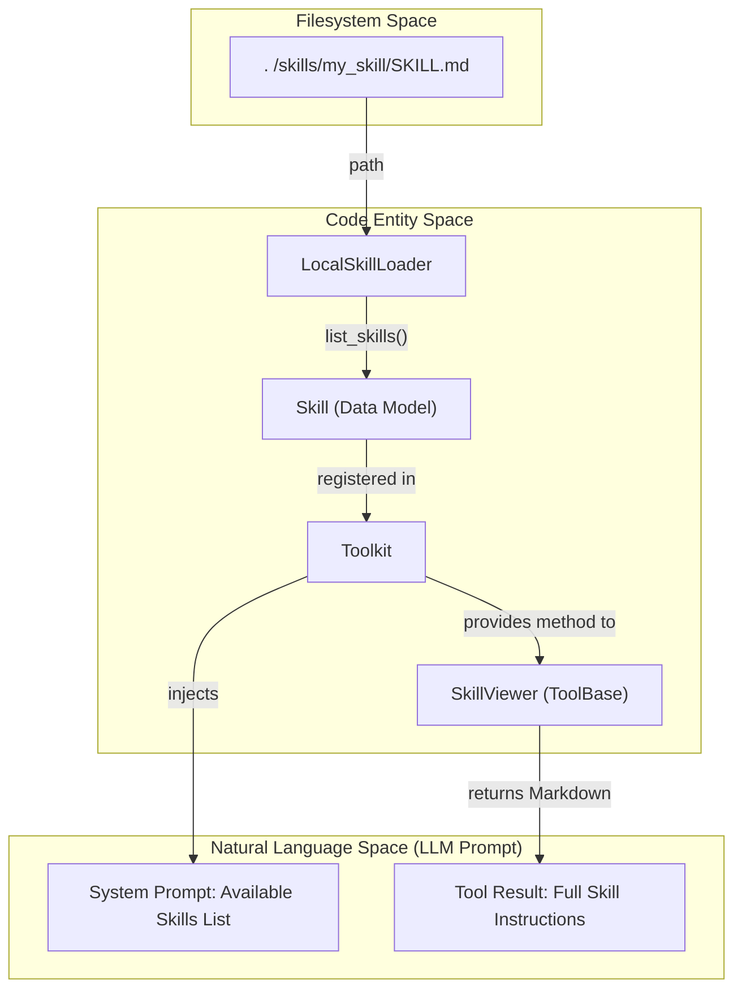
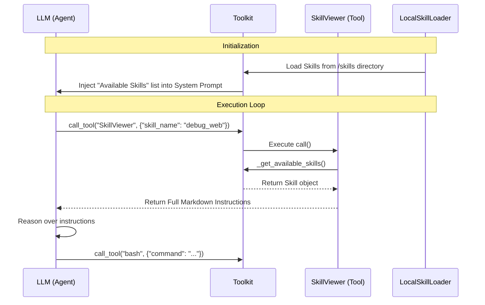

<!-- source: DeepWiki mcp.deepwiki.com · repo agentscope-ai/agentscope · page 4.4 Skills · fetched 2026-10-30 -->

# Skills

<details>
<summary>Relevant source files</summary>

The following files were used as context for generating this wiki page:

- [src/agentscope/app/hub/_skill/_claw_hub.py](src/agentscope/app/hub/_skill/_claw_hub.py)
- [src/agentscope/skill/_local_loader.py](src/agentscope/skill/_local_loader.py)
- [src/agentscope/tool/_adapters.py](src/agentscope/tool/_adapters.py)
- [src/agentscope/tool/_builtin/_meta.py](src/agentscope/tool/_builtin/_meta.py)
- [src/agentscope/tool/_builtin/_skill.py](src/agentscope/tool/_builtin/_skill.py)
- [src/agentscope/tool/_response.py](src/agentscope/tool/_response.py)
- [src/agentscope/tool/_tool_group.py](src/agentscope/tool/_tool_group.py)
- [src/agentscope/tool/_toolkit.py](src/agentscope/tool/_toolkit.py)
- [src/agentscope/tool/_types.py](src/agentscope/tool/_types.py)
- [src/agentscope/tool/_utils.py](src/agentscope/tool/_utils.py)
- [tests/hub_claw_test.py](tests/hub_claw_test.py)
- [tests/mcp_sse_client_test.py](tests/mcp_sse_client_test.py)
- [tests/mcp_streamable_http_client_test.py](tests/mcp_streamable_http_client_test.py)
- [tests/skill_loader_test.py](tests/skill_loader_test.py)
- [tests/toolkit_skill_test.py](tests/toolkit_skill_test.py)
- [tests/toolkit_test.py](tests/toolkit_test.py)

</details>


Skills in AgentScope are a high-level abstraction designed to extend agent capabilities through natural language instructions, scripts, and resources. Unlike tools, which are discrete functions an agent executes, skills provide the "know-how" and contextual guidance for an agent to perform complex tasks using a combination of tools and reasoning.

## 1. Overview and Scope

Skills serve as a bridge between raw tool execution and high-level agent behavior. They are defined in a human-readable and machine-parsable format that includes metadata and markdown-based instructions.

### Skills vs. Tools

| Feature | Tools | Skills |
| :--- | :--- | :--- |
| **Execution** | Called directly by LLM via JSON schema. | Not called directly; instructions are read and followed. |
| **Format** | Python functions or MCP tool definitions. | `SKILL.md` file with frontmatter and Markdown. |
| **Discovery** | Listed in `tools` field of LLM payload. | Injected into system prompt; requires `SkillViewer` tool to read. |
| **Purpose** | Atomic actions (e.g., `read_file`, `bash`). | Procedural knowledge (e.g., "How to debug a React app"). |

---

## 2. The SKILL.md Format

A skill is defined by a `SKILL.md` file located within a directory. It consists of a YAML frontmatter section for metadata and a Markdown section for detailed instructions.

### Structure
```markdown
---
name: skill_name
description: A brief description of what this skill does.
---

# Instructions
Detailed steps, rules, or resource locations for the agent.
```

- **Frontmatter**: Must contain `name` and `description`. The `LocalSkillLoader` parses this frontmatter to populate the `Skill` object [src/agentscope/skill/_local_loader.py:79-105]().
- **Body**: Contains the logic or documentation the agent uses to execute the skill, which is read as the `markdown` content [src/agentscope/skill/_local_loader.py:108-112]().

---

## 3. Implementation Architecture

The skill system relies on `SkillLoaderBase` to discover skills and the `Toolkit` to manage their lifecycle and prompt injection.

### Skill Data Flow: Discovery to Prompt
The following diagram illustrates how skills are loaded from the filesystem and eventually presented to the LLM.

**Natural Language to Code Entity Mapping**

Sources: [src/agentscope/skill/_local_loader.py:43-55](), [src/agentscope/tool/_toolkit.py:88-97](), [src/agentscope/tool/_toolkit.py:237-260]()

### Key Classes

#### Skill (Data Model)
A Pydantic model representing the loaded skill metadata and content.
- `name`: Unique identifier used for lookup by `SkillViewer`.
- `description`: Summary for the agent's skill list in the system prompt.
- `markdown`: The full instruction set retrieved during tool execution.
- `dir`: The absolute path to the skill directory, allowing agents to reference local resources.
- Sources: [src/agentscope/skill/_base.py:22-29]()

#### SkillLoaderBase & LocalSkillLoader
`SkillLoaderBase` defines the interface for discovery. `LocalSkillLoader` implements this by scanning directories for `SKILL.md` files [src/agentscope/skill/_local_loader.py:43-55]().
- `scan_subdir`: If true, recursively searches for skills within the provided path [src/agentscope/skill/_local_loader.py:53-54]().

---

## 4. Integration with Toolkit

The `Toolkit` class is the central orchestrator for skills. It aggregates skills from multiple loaders and manages their visibility to the agent [src/agentscope/tool/_toolkit.py:66-86]().

### Skill Instruction Injection
The `Toolkit` generates a specialized block in the system prompt using the `DEFAULT_SKILL_INSTRUCTION` Jinja2 template [src/agentscope/tool/_toolkit.py:51-63]().

**Prompt Injection Logic:**
1. **Aggregation**: `Toolkit` gathers all skills from its `tool_groups` [src/agentscope/tool/_toolkit.py:244-249]().
2. **Filtering**: Only skills from *activated* tool groups are included in the prompt [src/agentscope/tool/_toolkit.py:251-252]().
3. **Template Rendering**: The skill names, descriptions, and directories are rendered into the prompt to inform the agent of its capabilities [src/agentscope/tool/_toolkit.py:257-260]().

### The SkillViewer Tool
Because full skill instructions can be long and consume significant context, they are not injected into the system prompt directly. Instead, the `Toolkit` automatically registers a `SkillViewer` tool [src/agentscope/tool/_toolkit.py:165-169]().

- **Function**: The agent sees a list of skill summaries. If it decides a skill is relevant to its task, it calls `SkillViewer(skill_name="...")` [src/agentscope/tool/_builtin/_skill.py:22-30]().
- **Return**: The tool returns the full `markdown` content of the skill as a `ToolChunk` to the agent's context [src/agentscope/tool/_builtin/_skill.py:61-68]().

---

## 5. Execution Flow

The interaction between an agent and a skill follows a specific "Read-then-Act" pattern.

**Skill Execution Sequence**

Sources: [src/agentscope/tool/_toolkit.py:207-235](), [src/agentscope/tool/_builtin/_skill.py:50-70]()

---

## 6. Skill Hub (ClawHub)

AgentScope supports remote skill discovery through the **ClawHub** (ClawHub.ai), allowing developers to browse and install community-contributed skills.

- **ClawSkillHub**: A thin async client around the ClawHub HTTP API that exposes registry skills through the `SkillHubBase` interface [src/agentscope/app/hub/_skill/_claw_hub.py:75-84]().
- **Functionality**:
    - `list_skills`: Browse and search for skills by tags or keywords using cursor-paginated endpoints [src/agentscope/app/hub/_skill/_claw_hub.py:236-248]().
    - `download`: Downloads a skill archive (zip) using a streaming interface to minimize memory overhead [src/agentscope/app/hub/_skill/_claw_hub.py:382-395]().
- **Versioning**: ClawHub often uses timestamp-based versioning (`0.YYYYMMDD.HHMMSS`), which the `ClawSkillHub` humanizes into `YYYY-MM-DD` for better readability [src/agentscope/app/hub/_skill/_claw_hub.py:46-72]().

Sources: [src/agentscope/app/hub/_skill/_claw_hub.py:1-17](), [src/agentscope/app/hub/_skill/_base.py:1-20]()

---

