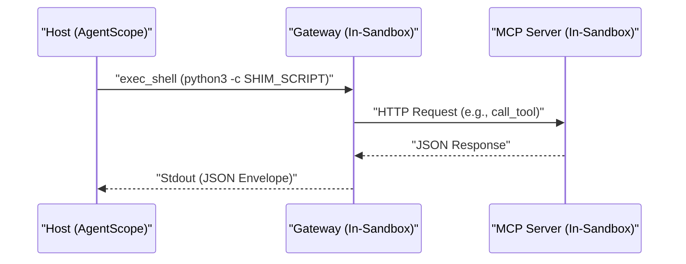

<!-- source: DeepWiki mcp.deepwiki.com · repo agentscope-ai/agentscope · page 5 Workspace & Execution Environments · fetched 2026-10-30 -->

# Workspace & Execution Environments

<details>
<summary>Relevant source files</summary>

The following files were used as context for generating this wiki page:

- [src/agentscope/app/_service/_workspace.py](src/agentscope/app/_service/_workspace.py)
- [src/agentscope/app/workspace_manager/__init__.py](src/agentscope/app/workspace_manager/__init__.py)
- [src/agentscope/app/workspace_manager/_bubblewrap_workspace_manager.py](src/agentscope/app/workspace_manager/_bubblewrap_workspace_manager.py)
- [src/agentscope/workspace/__init__.py](src/agentscope/workspace/__init__.py)
- [src/agentscope/workspace/_base.py](src/agentscope/workspace/_base.py)
- [src/agentscope/workspace/_bubblewrap/__init__.py](src/agentscope/workspace/_bubblewrap/__init__.py)
- [src/agentscope/workspace/_bubblewrap/_bubblewrap_backend.py](src/agentscope/workspace/_bubblewrap/_bubblewrap_backend.py)
- [src/agentscope/workspace/_bubblewrap/_bubblewrap_workspace.py](src/agentscope/workspace/_bubblewrap/_bubblewrap_workspace.py)
- [src/agentscope/workspace/_bubblewrap/_constants.py](src/agentscope/workspace/_bubblewrap/_constants.py)
- [src/agentscope/workspace/_gateway_client.py](src/agentscope/workspace/_gateway_client.py)
- [src/agentscope/workspace/_gateway_shim.py](src/agentscope/workspace/_gateway_shim.py)
- [src/agentscope/workspace/_local_workspace.py](src/agentscope/workspace/_local_workspace.py)
- [src/agentscope/workspace/_mcp_gateway/_mcp_gateway_app.py](src/agentscope/workspace/_mcp_gateway/_mcp_gateway_app.py)
- [src/agentscope/workspace/_utils.py](src/agentscope/workspace/_utils.py)
- [tests/workspace_bubblewrap_test.py](tests/workspace_bubblewrap_test.py)
- [tests/workspace_local_test.py](tests/workspace_local_test.py)

</details>


The Workspace system in AgentScope provides a managed environment for agents to execute tools, manage skills, and persist session data. It abstracts the underlying execution backend—whether it is a local filesystem or a remote sandboxed container—allowing agents to operate consistently across different infrastructure providers [src/agentscope/workspace/_base.py:5-27]().

### Core Architecture

The workspace system is built around the `WorkspaceBase` abstract class, which defines the canonical directory layout and lifecycle management for all execution environments [src/agentscope/workspace/_base.py:65-90]().

#### Canonical Directory Layout
Every workspace, regardless of the provider, follows a standardized internal structure relative to its `workdir` [src/agentscope/workspace/_base.py:35-46]():

| Directory/File | Purpose |
| :--- | :--- |
| `.mcp` | Persisted JSON array of Model Context Protocol (MCP) client configurations [src/agentscope/workspace/_base.py:39](). |
| `data/` | Storage for offloaded multimodal payloads (images, audio, etc.) [src/agentscope/workspace/_base.py:40](). |
| `skills/` | Subdirectories containing reusable agent skills, partitioned by agent [src/agentscope/workspace/_base.py:41](). |
| `sessions/` | Per-session context offloading and tool-result files [src/agentscope/workspace/_base.py:42](). |

#### Entity Mapping: Natural Language to Code
The following diagram illustrates how workspace concepts map to specific code entities within the `agentscope.workspace` module.

**Workspace Entity Mapping**
```mermaid
graph TD
    subgraph "Natural Language Space"
        [Local_Filesystem]
        [Sandboxed_Container]
        [Tool_Execution]
        [Skill_Management]
    end

    subgraph "Code Entity Space"
        [Local_Filesystem] --- LW["LocalWorkspace"]
        [Sandboxed_Container] --- SW["SandboxedWorkspaceBase"]
        [Tool_Execution] --- TB["ToolBase / BackendBase"]
        [Skill_Management] --- SL["Skill / SkillLoader"]
    end

    LW -- "uses" --> LB["LocalBackend"]
    SW -- "uses" --> RB["Docker/E2B/K8s/Bubblewrap Backend"]
    LB -- "implements" --> TB
    RB -- "implements" --> TB

    style LW stroke-width:2px
    style SW stroke-width:2px
```
Sources: [src/agentscope/workspace/_base.py:12-27](), [src/agentscope/workspace/_local_workspace.py:65-75](), [src/agentscope/workspace/__init__.py:5-15]()

---

### Local Workspace
The `LocalWorkspace` implementation operates directly on the host machine's filesystem [src/agentscope/workspace/_local_workspace.py:65-66](). It is the default environment for local development and testing.

Key features include:
* **OS-Aware Tooling**: Automatically selects between `Bash` (POSIX) and `PowerShell` (Windows) based on `os.name` [src/agentscope/workspace/_local_workspace.py:150-153]().
* **Efficient Skill Indexing**: Uses a `_SkillEntry` TypedDict and SHA-256 hashing to track skill changes and manage partitions [src/agentscope/workspace/_local_workspace.py:29-45]().
* **Context Offloading**: Provides a pipeline to move large message histories or tool results into `sessions/` via `offload_context` [tests/workspace_local_test.py:180-205]().

For a deep dive into directory internals and skill management, see **[Local Workspace](#5.1)**.

Sources: [src/agentscope/workspace/_local_workspace.py:65-162](), [tests/workspace_local_test.py:99-142]()

---

### Sandboxed Workspace Providers
For production environments requiring security and isolation, AgentScope supports several sandboxed providers. These workspaces inherit from `SandboxedWorkspaceBase` and utilize a **Gateway Architecture** to communicate between the host and the isolated environment [src/agentscope/workspace/_gateway_client.py:1-22]().

**Sandboxed Communication Flow**

Sources: [src/agentscope/workspace/_gateway_shim.py:48-96](), [src/agentscope/workspace/_gateway_client.py:139-167]()

Supported providers include:
* **Docker & Kubernetes**: Containerized isolation for local or cloud-native scaling [src/agentscope/workspace/__init__.py:8-11]().
* **E2B & Daytona**: Managed cloud sandboxes optimized for AI agents [src/agentscope/workspace/__init__.py:9-10]().
* **OS-Level Sandboxes**: `BubblewrapWorkspace` (Linux) and `AppleContainerWorkspace` (macOS) for lightweight local isolation [src/agentscope/workspace/_bubblewrap/_bubblewrap_workspace.py:52-72]().

For configuration details and provider-specific setup, see **[Sandboxed Workspace Providers](#5.2)**.

---

### Workspace Management
The `WorkspaceManager` hierarchy (e.g., `LocalWorkspaceManager`, `BubblewrapWorkspaceManager`) handles the high-level lifecycle of multiple workspaces, including creation, retrieval, and enforcement of `IsolationPolicy` [src/agentscope/app/workspace_manager/__init__.py:1-28]().

* **IsolationPolicy**: Defines how workspaces are shared or isolated across different sessions or agents [src/agentscope/app/workspace_manager/_base.py:5-6]().
* **Initialization**: The `initialize()` method is idempotent, ensuring that MCP connections and skill directories are restored correctly upon restart [src/agentscope/workspace/_local_workspace.py:175-176]().
* **Git Integration**: The `WorkspaceService` provides utilities for monitoring the git status of the workspace environment to track agent changes via `GitStatus` [src/agentscope/app/_service/_workspace.py:90-140]().

Sources: [src/agentscope/app/workspace_manager/__init__.py:1-28](), [src/agentscope/workspace/_local_workspace.py:164-206](), [src/agentscope/app/_service/_workspace.py:171-212]()

---

