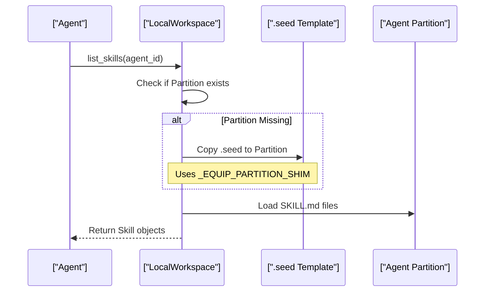
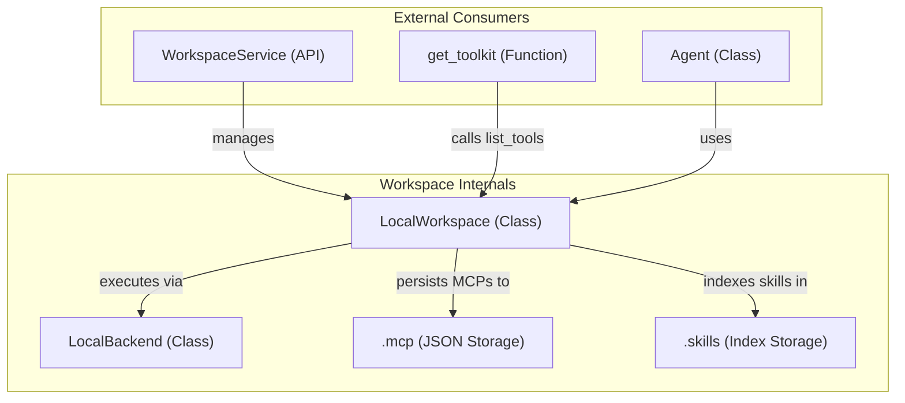

<!-- source: DeepWiki mcp.deepwiki.com · repo agentscope-ai/agentscope · page 5.1 Local Workspace · fetched 2026-10-30 -->

# Local Workspace

Relevant source files

The following files were used as context for generating this wiki page:

- [src/agentscope/app/_router/_workspace.py](src/agentscope/app/_router/_workspace.py)
- [src/agentscope/app/_service/_session.py](src/agentscope/app/_service/_session.py)
- [src/agentscope/app/_service/_toolkit.py](src/agentscope/app/_service/_toolkit.py)
- [src/agentscope/app/_service/_workspace.py](src/agentscope/app/_service/_workspace.py)
- [src/agentscope/workspace/_base.py](src/agentscope/workspace/_base.py)
- [src/agentscope/workspace/_local_workspace.py](src/agentscope/workspace/_local_workspace.py)
- [src/agentscope/workspace/_sandboxed_base.py](src/agentscope/workspace/_sandboxed_base.py)
- [src/agentscope/workspace/_utils.py](src/agentscope/workspace/_utils.py)
- [tests/service_toolkit_test.py](tests/service_toolkit_test.py)
- [tests/workspace_bubblewrap_test.py](tests/workspace_bubblewrap_test.py)
- [tests/workspace_daytona_test.py](tests/workspace_daytona_test.py)
- [tests/workspace_docker_test.py](tests/workspace_docker_test.py)
- [tests/workspace_k8s_test.py](tests/workspace_k8s_test.py)
- [tests/workspace_local_test.py](tests/workspace_local_test.py)
- [tests/workspace_skill_archive_test.py](tests/workspace_skill_archive_test.py)

The `LocalWorkspace` is the primary implementation of the `WorkspaceBase` interface for local execution. It manages a structured directory on the host filesystem, providing agents with a persistent environment for files, tools, skills, and session context [src/agentscope/workspace/_local_workspace.py:65-75]().

## Directory Layout

A `LocalWorkspace` is rooted at a `workdir` (resolved to an absolute path) and maintains a standardized internal structure to ensure isolation and portability [src/agentscope/workspace/_local_workspace.py:120-125]():

| Directory/File | Purpose |
| :--- | :--- |
| `.mcp` | A JSON file persisting `MCPClient` declarations. This allows the workspace to restore MCP connections across restarts [src/agentscope/workspace/_local_workspace.py:71](). |
| `data/` | Stores offloaded multimodal payloads (images, audio) extracted from message streams [src/agentscope/workspace/_local_workspace.py:72](). |
| `skills/` | Contains a `.seed` template and per-agent partitions. Each partition holds the agent's specific `SKILL.md` files and code [src/agentscope/workspace/_local_workspace.py:73](). |
| `sessions/` | Organized by `session_id`. Stores `context.jsonl` (offloaded history) and intermediate tool results [src/agentscope/workspace/_local_workspace.py:74](). |

Sources: [src/agentscope/workspace/_local_workspace.py:65-75](), [src/agentscope/workspace/_base.py:32-43]()

## Tool Provisioning

The `list_tools` method dynamically constructs the agent's toolbox based on the host operating system, ensuring cross-platform compatibility for shell operations [src/agentscope/workspace/_local_workspace.py:141-162]().

*   **Shell Selection**: On Windows (`nt`), it returns the `PowerShell` tool; on POSIX systems, it returns `Bash` [src/agentscope/workspace/_local_workspace.py:150-153]().
*   **Filesystem Tools**: Always includes `Edit`, `Glob`, `Grep`, `Read`, and `Write` [src/agentscope/workspace/_local_workspace.py:157-162]().
*   **Backend Binding**: All built-in tools are bound to `LocalBackend`, which executes commands directly on the host using `subprocess` [src/agentscope/workspace/_local_workspace.py:127](), [src/agentscope/tool/_builtin/_backend.py:138-140]().

Sources: [src/agentscope/workspace/_local_workspace.py:141-162](), [tests/workspace_local_test.py:99-142]()

## Skill Management & Partitioning

`LocalWorkspace` implements a partitioned skill system. While `skill_paths` are provided at initialization to seed the workspace, each agent operates within its own directory level under `skills/` to prevent cross-agent interference [src/agentscope/workspace/_base.py:50-57]().

### SHA-256 Indexing and Conflict Resolution
To maintain the integrity of the skill library, the workspace uses a `.skills` index file [src/agentscope/workspace/_local_workspace.py:29-45]().
1.  **Validation**: When a skill is added, `_validate_and_hash_skill` checks for a valid `SKILL.md` with required frontmatter [src/agentscope/workspace/_local_workspace.py:465-470]().
2.  **Indexing**: It stores a `SHA-256` hash of the `SKILL.md` content. If the content changes on disk, the index is updated [src/agentscope/workspace/_local_workspace.py:32-33]().
3.  **Conflict Resolution**: If two skills share a name but have different hashes, the workspace generates a unique directory name using a numeric suffix (e.g., `my_skill-1`) [src/agentscope/workspace/_local_workspace.py:220-230](). Directory names are sanitized to be safe across OSs [src/agentscope/workspace/_local_workspace.py:47-62]().

### Skill Initialization Flow

Sources: [src/agentscope/workspace/_base.py:143-160](), [src/agentscope/workspace/_local_workspace.py:183-215](), [src/agentscope/workspace/_local_workspace.py:47-62]()

## Context Offloading & Data Scheme

To keep the active LLM context window manageable, `LocalWorkspace` provides a pipeline to offload large or binary data to the `sessions/` and `data/` directories [src/agentscope/workspace/_local_workspace.py:417-430]().

### Multimodal Offloading
When `offload_context` encounters a `DataBlock` with a `Base64Source`, it triggers the following flow [src/agentscope/workspace/_base.py:380-410]():
1.  **Extraction**: The base64 string is decoded into raw bytes.
2.  **Hashing**: A `SHA-256` hash of the bytes is calculated to create a unique filename.
3.  **Storage**: The file is saved in `{workdir}/data/{hash}.{ext}`.
4.  **Reference**: The `Base64Source` in the message is replaced with a `URLSource` using the `workspace://` protocol [src/agentscope/workspace/_base.py:403-408]().

### The `workspace://` URL
This internal scheme abstracts the physical path of the workspace. The `WorkspaceService` in the Agent Service layer resolves these URLs when serving assets to the Web UI [src/agentscope/app/_router/_workspace.py:340-360]().

Sources: [src/agentscope/workspace/_base.py:380-410](), [tests/workspace_local_test.py:180-215]()

## MCP Lifecycle

`LocalWorkspace` manages `MCPClient` declarations via the `.mcp` file [src/agentscope/workspace/_local_workspace.py:71](). 
*   **Restoration**: During `initialize`, it calls `_restore_mcp_specs` to load existing configurations [src/agentscope/workspace/_local_workspace.py:180]().
*   **Isolation**: Each session gets its own `MCPClient` instances so that stateful MCP state never leaks across agents or sessions [src/agentscope/workspace/_base.py:44-48]().
*   **Lazy Connection**: Clients are not connected during workspace initialization; they are built on the first `list_mcps` call for a specific agent/session [src/agentscope/workspace/_local_workspace.py:164-174]().

Sources: [src/agentscope/workspace/_local_workspace.py:164-180](), [src/agentscope/workspace/_base.py:44-48]()

## Security & Archive Management

`LocalWorkspace` inherits the security shims from `WorkspaceBase` to handle archive uploads (e.g., via `add_skill_archive`) safely [src/agentscope/workspace/_base.py:23-26]().

*   **Archive Security Shim**: The `_EXTRACT_ARCHIVE_SHIM` is a Python script that validates archive members before extraction [src/agentscope/workspace/_base.py:183-196]().
*   **Path Traversal Protection**: It uses `os.path.realpath` to ensure that no file in a ZIP or TAR archive resolves to a location outside the designated staging directory [src/agentscope/workspace/_base.py:189-193]().
*   **Decompression Bomb Protection**: It enforces a `max_extracted_bytes` limit (default 500MB) by checking member sizes before extraction [src/agentscope/workspace/_base.py:23](), [src/agentscope/workspace/_base.py:204-208]().

Sources: [src/agentscope/workspace/_base.py:183-208](), [tests/workspace_skill_archive_test.py:96-107]()

## Architecture Overview

The following diagram maps the logical workspace components to the internal code entities.

### Code Entity Relationship

Sources: [src/agentscope/workspace/_local_workspace.py:65-127](), [src/agentscope/app/_service/_toolkit.py:40-56](), [src/agentscope/app/_router/_workspace.py:45-60]()

---

