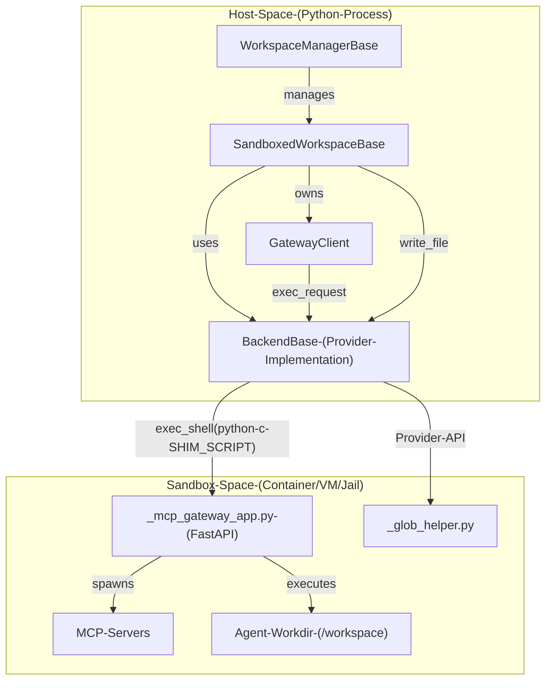
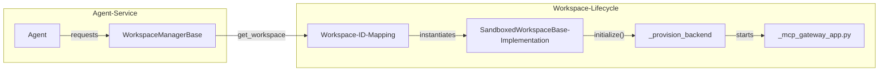

<!-- source: DeepWiki mcp.deepwiki.com · repo agentscope-ai/agentscope · page 5.2 Sandboxed Workspace Providers · fetched 2026-10-30 -->

# Sandboxed Workspace Providers

Relevant source files

The following files were used as context for generating this wiki page:

- [.github/workflows/k8s-workspace.yml](.github/workflows/k8s-workspace.yml)
- [.github/workflows/unittest.yml](.github/workflows/unittest.yml)
- [examples/workspace/apple-container-workspace.md](examples/workspace/apple-container-workspace.md)
- [src/agentscope/app/workspace_manager/__init__.py](src/agentscope/app/workspace_manager/__init__.py)
- [src/agentscope/app/workspace_manager/_applecontainer_workspace_manager.py](src/agentscope/app/workspace_manager/_applecontainer_workspace_manager.py)
- [src/agentscope/app/workspace_manager/_bubblewrap_workspace_manager.py](src/agentscope/app/workspace_manager/_bubblewrap_workspace_manager.py)
- [src/agentscope/app/workspace_manager/_daytona_workspace_manager.py](src/agentscope/app/workspace_manager/_daytona_workspace_manager.py)
- [src/agentscope/middleware/_longterm_memory/_agentic_memory/_middleware.py](src/agentscope/middleware/_longterm_memory/_agentic_memory/_middleware.py)
- [src/agentscope/tool/_task/_create_task.py](src/agentscope/tool/_task/_create_task.py)
- [src/agentscope/workspace/__init__.py](src/agentscope/workspace/__init__.py)
- [src/agentscope/workspace/_applecontainer/__init__.py](src/agentscope/workspace/_applecontainer/__init__.py)
- [src/agentscope/workspace/_applecontainer/_applecontainer_backend.py](src/agentscope/workspace/_applecontainer/_applecontainer_backend.py)
- [src/agentscope/workspace/_applecontainer/_applecontainer_workspace.py](src/agentscope/workspace/_applecontainer/_applecontainer_workspace.py)
- [src/agentscope/workspace/_applecontainer/_constants.py](src/agentscope/workspace/_applecontainer/_constants.py)
- [src/agentscope/workspace/_bubblewrap/__init__.py](src/agentscope/workspace/_bubblewrap/__init__.py)
- [src/agentscope/workspace/_bubblewrap/_bubblewrap_backend.py](src/agentscope/workspace/_bubblewrap/_bubblewrap_backend.py)
- [src/agentscope/workspace/_bubblewrap/_bubblewrap_workspace.py](src/agentscope/workspace/_bubblewrap/_bubblewrap_workspace.py)
- [src/agentscope/workspace/_bubblewrap/_constants.py](src/agentscope/workspace/_bubblewrap/_constants.py)
- [src/agentscope/workspace/_daytona/__init__.py](src/agentscope/workspace/_daytona/__init__.py)
- [src/agentscope/workspace/_daytona/_constants.py](src/agentscope/workspace/_daytona/_constants.py)
- [src/agentscope/workspace/_daytona/_daytona_workspace.py](src/agentscope/workspace/_daytona/_daytona_workspace.py)
- [src/agentscope/workspace/_docker/_docker_workspace.py](src/agentscope/workspace/_docker/_docker_workspace.py)
- [src/agentscope/workspace/_e2b/_e2b_workspace.py](src/agentscope/workspace/_e2b/_e2b_workspace.py)
- [src/agentscope/workspace/_gateway_client.py](src/agentscope/workspace/_gateway_client.py)
- [src/agentscope/workspace/_gateway_shim.py](src/agentscope/workspace/_gateway_shim.py)
- [src/agentscope/workspace/_k8s/_k8s_workspace.py](src/agentscope/workspace/_k8s/_k8s_workspace.py)
- [src/agentscope/workspace/_mcp_gateway/_mcp_gateway_app.py](src/agentscope/workspace/_mcp_gateway/_mcp_gateway_app.py)
- [src/agentscope/workspace/_opensandbox/_constants.py](src/agentscope/workspace/_opensandbox/_constants.py)
- [src/agentscope/workspace/_opensandbox/_opensandbox_workspace.py](src/agentscope/workspace/_opensandbox/_opensandbox_workspace.py)
- [tests/backend_applecontainer_test.py](tests/backend_applecontainer_test.py)
- [tests/backend_bubblewrap_test.py](tests/backend_bubblewrap_test.py)
- [tests/docker/k8s_workspace_test.Dockerfile](tests/docker/k8s_workspace_test.Dockerfile)
- [tests/workspace_applecontainer_test.py](tests/workspace_applecontainer_test.py)

The sandboxed workspace system in AgentScope provides isolated execution environments for agents to perform file operations, run shell commands, and host Model Context Protocol (MCP) servers. By leveraging various virtualization and containerization technologies, AgentScope ensures that agent activities are confined to secure, reproducible, and optionally persistent environments.

## Architecture Overview

Sandboxed workspaces follow a **Gateway Client/Shim** architecture. Instead of the host process communicating directly with tools inside the sandbox, a lightweight FastAPI-based gateway runs inside the environment. The host-side `SandboxedWorkspaceBase` communicates with this gateway via a `GatewayClient` that tunnels requests through the provider's native execution mechanism (e.g., `docker exec`, `kubectl exec`, or `bwrap`).

### Data Flow and Lifecycle

The lifecycle of a sandboxed workspace involves provisioning the underlying resource, bootstrapping the environment, and launching the gateway.

1.  **Provisioning**: The provider-specific `_provision_backend` method attaches to or creates the sandbox resource (e.g., a Docker container, E2B sandbox, or OpenSandbox instance). [src/agentscope/workspace/_sandboxed_base.py:182-183]()
2.  **Bootstrap**: If the environment is fresh, AgentScope installs necessary dependencies (like `uv`, `fastapi`, and `mcp`) and uploads the gateway script `_mcp_gateway_app.py`. [src/agentscope/workspace/_sandboxed_base.py:270-320]()
3.  **Gateway Launch**: The gateway starts inside the sandbox, typically listening on a configurable `gateway_port` (defaulting to 5600). [src/agentscope/workspace/_mcp_gateway/_mcp_gateway_app.py:190-210]()
4.  **Tool Execution**: When an agent calls a tool (e.g., `Bash` or `Read`), the command is sent to the `GatewayClient`, which executes it within the sandbox context. [src/agentscope/workspace/_gateway_client.py:139-167]()

### System Entity Mapping

The following diagram illustrates the relationship between the host-side SDK classes and the sandbox-side execution entities.

**Diagram: Sandboxed Workspace Architecture**

Sources: `src/agentscope/workspace/_sandboxed_base.py:38-63`(), `src/agentscope/workspace/_gateway_client.py:22-49`(), `src/agentscope/workspace/_gateway_shim.py:48-96`()

---

## Core Base Classes

### SandboxedWorkspaceBase
The `SandboxedWorkspaceBase` class provides the template-method lifecycle for all gateway-backed sandboxes. It handles the derivation of sandbox-side paths for the virtual environment, gateway scripts, and logs.

| Attribute | Role |
| :--- | :--- |
| `workdir` | The agent-visible root inside the sandbox (e.g., `/workspace`). |
| `_gateway_home` | Directory holding the venv, script, and logs inside the sandbox. |
| `_bootstrap_cmd_timeout` | Maximum time allowed for installing dependencies (default 1800s). |

Key Methods:
- `initialize()`: Orchestrates backend provisioning, layout setup, and gateway startup. [src/agentscope/workspace/_sandboxed_base.py:171-207]()
- `_setup_mcp_gateway()`: Probes for the gateway, bootstraps if missing, and starts the FastAPI process. [src/agentscope/workspace/_sandboxed_base.py:270-320]()
- `_bootstrap_commands()`: Abstract hook for subclasses to provide shell commands for initial setup. [src/agentscope/workspace/_sandboxed_base.py:160-167]()

Sources: `src/agentscope/workspace/_sandboxed_base.py:38-168`()

---

## Supported Providers

### Docker
`DockerWorkspace` uses `aiodocker` to manage container lifecycles. It supports optional host bind-mounts for persistence.
- **Persistence**: If `host_workdir` is provided, the container's `/workspace` is mapped to the host, allowing `.mcp` and `skills/` to survive container deletion. [src/agentscope/workspace/_docker/_docker_workspace.py:135-137]()
- **Image Building**: Uses a content-hashed Dockerfile to skip builds if the configuration (base image, extra pip packages) hasn't changed. [src/agentscope/workspace/_docker/_docker_workspace.py:11-12]()

Sources: `src/agentscope/workspace/_docker/_docker_workspace.py:43-137`()

### E2B
`E2BWorkspace` leverages the E2B SDK (`AsyncSandbox`) for cloud-based execution.
- **Lifecycle**: `initialize()` resumes a paused sandbox by `workspace_id` stored in E2B metadata. `close()` pauses the sandbox to preserve the filesystem. [src/agentscope/workspace/_e2b/_e2b_workspace.py:10-16]()
- **Persistence**: Sandbox filesystem state is the persistence layer; pausing keeps the disk, and resuming brings it back wholesale. [src/agentscope/workspace/_e2b/_e2b_workspace.py:17-19]()

Sources: `src/agentscope/workspace/_e2b/_e2b_workspace.py:62-149`()

### OpenSandbox
`OpenSandboxWorkspace` provides a flexible sandbox environment with configurable network policies and resource hints.
- **Identification**: Uses `METADATA_WORKSPACE_ID_KEY` ("agentscope.workspace.id") to reattach to existing sandboxes. [src/agentscope/workspace/_opensandbox/_constants.py:43-46]()
- **Configuration**: Supports `NetworkPolicy` and `resource` limits (CPU/Memory) during sandbox creation. [src/agentscope/workspace/_opensandbox/_opensandbox_workspace.py:99-105]()

Sources: `src/agentscope/workspace/_opensandbox/_opensandbox_workspace.py:36-141`()

### Bubblewrap (Linux Only)
`BubblewrapWorkspace` provides unprivileged kernel-level isolation using `bwrap`.
- **Mounts**: Mounts a host directory at `/workspace` and a temp directory at `/tmp`. [src/agentscope/workspace/_bubblewrap/_bubblewrap_workspace.py:65-66]()
- **Networking**: Currently requires `share_net=True` to allow the host-side `GatewayClient` to reach the in-sandbox FastAPI server over loopback. [src/agentscope/workspace/_bubblewrap/_bubblewrap_workspace.py:58-61]()

Sources: `src/agentscope/workspace/_bubblewrap/_bubblewrap_workspace.py:51-170`()

### Daytona
`DaytonaWorkspace` integrates with the Daytona SDK.
- **Path Discovery**: Dynamically derives `_gateway_home` and `workdir` from Daytona SDK path APIs rather than assuming fixed root paths. [src/agentscope/workspace/_daytona/_daytona_workspace.py:31-33]()
- **Persistence**: Uses Daytona's `stop(force=False)` to ensure the filesystem survives between sessions. [src/agentscope/workspace/_daytona/_daytona_workspace.py:16-17]()

Sources: `src/agentscope/workspace/_daytona/_daytona_workspace.py:65-166`()

### Apple Container (macOS Only)
`AppleContainerWorkspace` provides sandboxing on macOS using the native `sandbox-exec` (Seatbelt) profile system.
- **Isolation**: Restricts filesystem access to the workspace directory and specific system paths.
- **Backend**: Uses `AppleContainerBackend` to wrap command execution with the `sandbox-exec -p <profile>` prefix.

Sources: `src/agentscope/workspace/_applecontainer/_applecontainer_workspace.py:36-60`(), `src/agentscope/workspace/_applecontainer/_applecontainer_backend.py:18-30`()

---

## Workspace Configuration & Management

### Provider Configuration Parameters

| Provider | Key Configuration Entities |
| :--- | :--- |
| **Docker** | `base_image`, `host_workdir`, `node_version`, `extra_pip` |
| **E2B** | `template`, `api_key`, `timeout_seconds` |
| **OpenSandbox** | `image`, `network_policy`, `resource`, `sandbox_metadata` |
| **Daytona** | `api_url`, `target`, `os_user` |
| **Bubblewrap** | `host_workdir`, `host_cache_dir`, `share_net` |
| **K8s** | `image`, `namespace`, `pvc_name`, `resource_limits` |

### The Workspace Manager
The `WorkspaceManagerBase` and its provider-specific variants (e.g., `DockerWorkspaceManager`, `E2BWorkspaceManager`) are responsible for the allocation and isolation policy of workspaces. [src/agentscope/app/workspace_manager/_base.py:5-6]()

**Diagram: Workspace Manager and Provider Interaction**

Sources: `src/agentscope/app/workspace_manager/__init__.py:5-28`(), `src/agentscope/workspace/_sandboxed_base.py:171-180`()

---

## Technical Details: The Gateway Shim

The `GatewayClient` does not connect to the FastAPI server via a standard network socket from the host. Instead, it uses the provider's `exec_shell` capability to run a Python "shim" (`SHIM_SCRIPT`) that acts as a local proxy. [src/agentscope/workspace/_gateway_client.py:17-22]()

1.  **Request**: `GatewayClient.exec_request` prepares an HTTP request payload. [src/agentscope/workspace/_gateway_client.py:284-300]()
2.  **Tunnel**: It calls `backend.exec_shell(["python3", "-c", SHIM_SCRIPT, ...])`. [src/agentscope/workspace/_gateway_client.py:328-340]()
3.  **Internal Call**: The `SHIM_SCRIPT` inside the sandbox uses `urllib.request` to make a `localhost` call to the FastAPI gateway. [src/agentscope/workspace/_gateway_shim.py:64-73]()
4.  **Response**: The shim prints a JSON envelope containing the status and body to `stdout`, which the host-side `GatewayClient` parses. [src/agentscope/workspace/_gateway_shim.py:87-95]()

This design ensures that sandboxes do not need to expose ports to the host network, maintaining a high security posture.

Sources: `src/agentscope/workspace/_gateway_client.py:270-360`(), `src/agentscope/workspace/_gateway_shim.py:48-96`()

---

