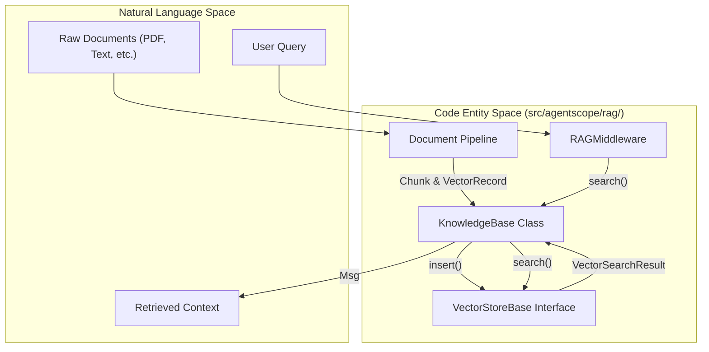
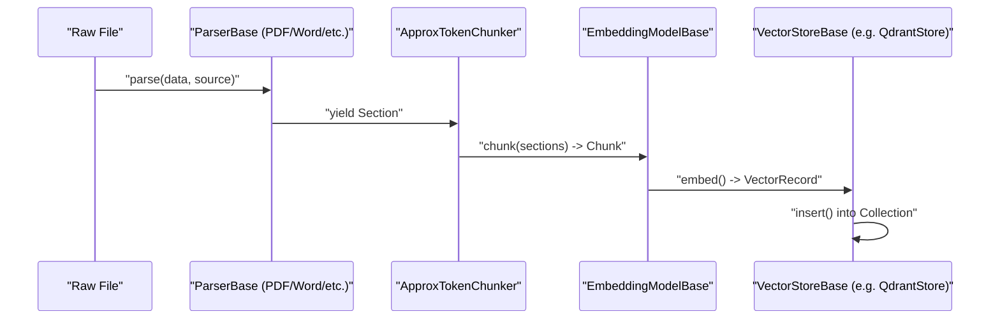

<!-- source: DeepWiki mcp.deepwiki.com · repo agentscope-ai/agentscope · page 6 RAG (Retrieval-Augmented Generation) · fetched 2026-10-30 -->

# RAG (Retrieval-Augmented Generation)

<details>
<summary>Relevant source files</summary>

The following files were used as context for generating this wiki page:

- [examples/long_term_memory/mem0/README.md](examples/long_term_memory/mem0/README.md)
- [examples/long_term_memory/reme/README.md](examples/long_term_memory/reme/README.md)
- [examples/long_term_memory/reme/reme_demo.py](examples/long_term_memory/reme/reme_demo.py)
- [examples/rag/README.md](examples/rag/README.md)
- [pyproject.toml](pyproject.toml)
- [src/agentscope/middleware/_longterm_memory/_reme/_middleware.py](src/agentscope/middleware/_longterm_memory/_reme/_middleware.py)
- [src/agentscope/rag/__init__.py](src/agentscope/rag/__init__.py)
- [src/agentscope/rag/_parser/__init__.py](src/agentscope/rag/_parser/__init__.py)
- [src/agentscope/rag/_parser/_excel.py](src/agentscope/rag/_parser/_excel.py)
- [src/agentscope/rag/_parser/_word.py](src/agentscope/rag/_parser/_word.py)
- [src/agentscope/rag/_vdb/__init__.py](src/agentscope/rag/_vdb/__init__.py)
- [src/agentscope/rag/_vdb/_elasticsearch.py](src/agentscope/rag/_vdb/_elasticsearch.py)
- [src/agentscope/rag/_vdb/_milvus_lite.py](src/agentscope/rag/_vdb/_milvus_lite.py)
- [src/agentscope/rag/_vdb/_mongodb.py](src/agentscope/rag/_vdb/_mongodb.py)
- [src/agentscope/rag/_vdb/_qdrant.py](src/agentscope/rag/_vdb/_qdrant.py)
- [tests/rag_parser_test.py](tests/rag_parser_test.py)
- [tests/rag_vdb_elasticsearch_test.py](tests/rag_vdb_elasticsearch_test.py)
- [tests/rag_vdb_milvus_lite_test.py](tests/rag_vdb_milvus_lite_test.py)
- [tests/rag_vdb_mongodb_test.py](tests/rag_vdb_mongodb_test.py)

</details>


The RAG subsystem in AgentScope provides a modular framework for enhancing agent reasoning with external data. It abstracts the complexities of document processing, vector storage, and retrieval into a unified interface centered around the `KnowledgeBase` class [src/agentscope/rag/_knowledge.py:28-28]().

The system is designed to bridge the gap between unstructured documents (PDFs, Word, etc.) and the structured vector space required by Large Language Models (LLMs). It integrates with the AgentScope SDK via a middleware layer that allows agents to either automatically receive relevant context or actively search for information using tools.

### RAG System Architecture

The following diagram illustrates the relationship between the high-level RAG components and their corresponding code entities.

**RAG System Map: Natural Language to Code Space**

Sources: [src/agentscope/rag/__init__.py:1-51](), [src/agentscope/rag/_knowledge.py:28-28]().

---

### Core Components

The RAG subsystem is built on four primary pillars:

| Component | Code Entity | Responsibility |
|:---|:---|:---|
| **Knowledge Base** | `KnowledgeBase` | Orchestrates the pipeline and vector store; provides the main `search` and `insert` API [src/agentscope/rag/_knowledge.py:28-28](). |
| **Document Pipeline** | `ParserBase`, `ChunkerBase` | Transforms raw files into discrete, embeddable `Chunk` objects [src/agentscope/rag/_parser/__init__.py:4-4](), [src/agentscope/rag/_chunker.py:4-4](). |
| **Vector Store** | `VectorStoreBase` | Handles persistence and similarity search (e.g., Qdrant, Milvus, MongoDB, Elasticsearch) [src/agentscope/rag/_vdb/_vector_store.py:18-18](). |
| **Middleware** | `RAGMiddleware` | Integrates retrieval into the Agent's ReAct loop, supporting both `static` (auto-injection) and `agentic` (tool-driven) modes. |

Sources: [src/agentscope/rag/__init__.py:30-51](), [examples/rag/README.md:1-8]().

---

### Data Flow and Pipeline

The RAG process begins with the document pipeline, which ingests raw data and prepares it for the vector store. This involves parsing files (using specialized parsers for PDF, Word, Excel, etc.) and splitting them into manageable segments using a chunker.

**Pipeline Flow: Document to Vector Store**

Sources: [src/agentscope/rag/_parser/__init__.py:4-20](), [src/agentscope/rag/_chunker.py:4-4](), [src/agentscope/rag/_vdb/_vector_store.py:16-16]().

For a deep dive into parsers (e.g. `PDFParser`, `WordParser`, `ExcelParser`), chunking strategies like `ApproxTokenChunker`, and background indexing tasks, see **[RAG Pipeline: Parsing, Chunking & Indexing](#6.1)**.

---

### Vector Store Backends

AgentScope supports multiple vector database (VDB) backends through the `VectorStoreBase` interface [src/agentscope/rag/_vdb/_vector_store.py:18-18](). This allows developers to switch between local development setups and production-grade distributed databases with minimal code changes.

Supported backends include:
*   **Qdrant**: Default in-memory or local disk storage via `QdrantStore` [src/agentscope/rag/_vdb/_qdrant.py:31-31]().
*   **Milvus Lite**: Local file-based persistence via `MilvusLiteStore` [src/agentscope/rag/_vdb/_milvus_lite.py:26-26]().
*   **MongoDB**: Vector search integrated into MongoDB collections via `MongoDBStore` [src/agentscope/rag/_vdb/_mongodb.py:31-31]().
*   **Elasticsearch**: Dense-vector indexing via `ElasticsearchStore` [src/agentscope/rag/_vdb/_elasticsearch.py:20-20]().

For implementation details, metadata filtering, and backend-specific configuration (e.g. `filter_fields` for MongoDB or `num_candidates` for Elasticsearch), see **[Vector Store Backends](#6.2)**.

---

### Long-term Memory

Beyond static document retrieval, AgentScope utilizes RAG principles to provide agents with "Long-term Memory." This allows agents to persist information across different sessions and recall user preferences or past interactions.

Two primary middlewares are provided for this purpose:
*   **ReMeMiddleware**: An in-process, file-based memory toolkit that "listens" to conversations and automatically extracts memories via an `auto_memory` job [src/agentscope/middleware/_longterm_memory/_reme/_middleware.py:9-10](). It supports `static_control`, `agent_control`, and `both` modes [src/agentscope/middleware/_longterm_memory/_reme/_middleware.py:163-173]().
*   **Mem0Middleware**: Integration with the Mem0 service/library for advanced memory management [examples/long_term_memory/mem0/README.md:1-8]().

For details on how to configure these memory backends and their different retrieval modes, see **[Long-term Memory](#6.3)**.

---

### Installation

The RAG subsystem requires additional dependencies based on the desired parsers and vector stores. These are managed via optional extras in `pyproject.toml`.

```bash
# Basic RAG (parsers and default Qdrant)
pip install "agentscope[rag,vdb-qdrant]"

# With specific VDB backends
pip install "agentscope[vdb-milvus]"
pip install "agentscope[vdb-mongodb]"
pip install "agentscope[vdb-elasticsearch]"

# For long-term memory
pip install "agentscope[memory-reme]"
pip install "agentscope[memory-mem0]"
```
Sources: [pyproject.toml:103-135](), [examples/rag/README.md:12-21]().

---

