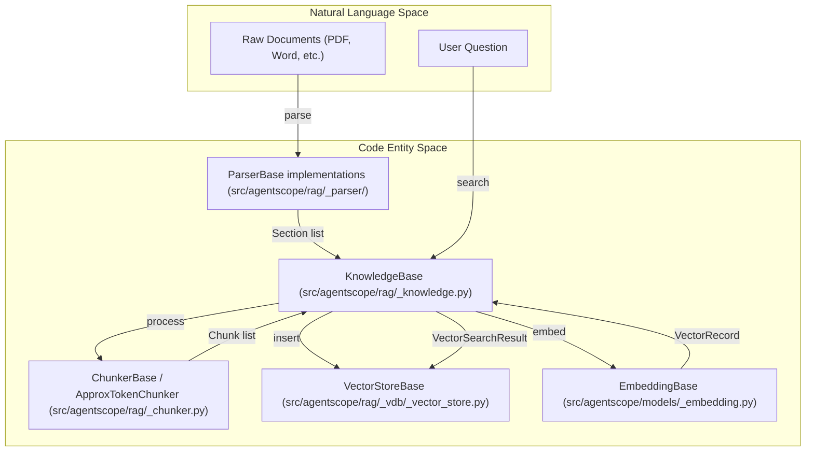
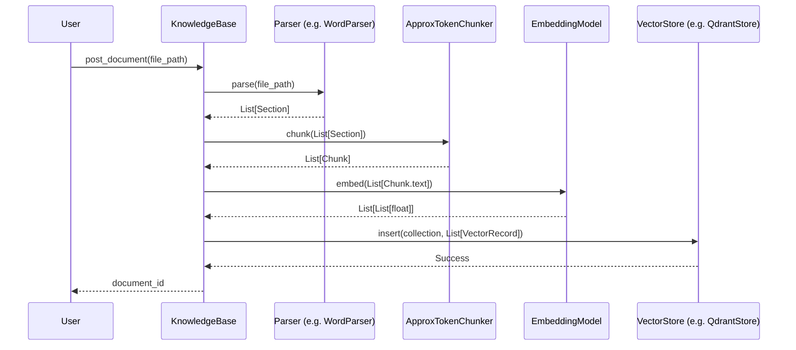

<!-- source: DeepWiki mcp.deepwiki.com · repo agentscope-ai/agentscope · page 6.1 RAG Pipeline: Parsing, Chunking & Indexing · fetched 2026-10-30 -->

# RAG Pipeline: Parsing, Chunking & Indexing

Relevant source files

The following files were used as context for generating this wiki page:

- [pyproject.toml](pyproject.toml)
- [src/agentscope/app/_router/_knowledge_base.py](src/agentscope/app/_router/_knowledge_base.py)
- [src/agentscope/app/_router/_schema/_knowledge_base.py](src/agentscope/app/_router/_schema/_knowledge_base.py)
- [src/agentscope/app/_service/_access.py](src/agentscope/app/_service/_access.py)
- [src/agentscope/app/rag/knowledge_base_manager/_base.py](src/agentscope/app/rag/knowledge_base_manager/_base.py)
- [src/agentscope/app/rag/knowledge_base_manager/_collection_per_kb.py](src/agentscope/app/rag/knowledge_base_manager/_collection_per_kb.py)
- [src/agentscope/app/storage/_model/_knowledge_base.py](src/agentscope/app/storage/_model/_knowledge_base.py)
- [src/agentscope/app/storage/_model/_knowledge_document.py](src/agentscope/app/storage/_model/_knowledge_document.py)
- [src/agentscope/rag/__init__.py](src/agentscope/rag/__init__.py)
- [src/agentscope/rag/_parser/__init__.py](src/agentscope/rag/_parser/__init__.py)
- [src/agentscope/rag/_parser/_excel.py](src/agentscope/rag/_parser/_excel.py)
- [src/agentscope/rag/_parser/_word.py](src/agentscope/rag/_parser/_word.py)
- [src/agentscope/rag/_vdb/__init__.py](src/agentscope/rag/_vdb/__init__.py)
- [tests/rag_parser_test.py](tests/rag_parser_test.py)
- [tests/rag_vdb_elasticsearch_test.py](tests/rag_vdb_elasticsearch_test.py)
- [tests/rag_vdb_milvus_lite_test.py](tests/rag_vdb_milvus_lite_test.py)
- [tests/rag_vdb_mongodb_test.py](tests/rag_vdb_mongodb_test.py)
- [tests/resource_access_policy_test.py](tests/resource_access_policy_test.py)

The Retrieval-Augmented Generation (RAG) pipeline in AgentScope provides a modular framework for transforming unstructured data into searchable vector representations. It handles the lifecycle of document processing from raw file parsing to vector store indexing.

## Pipeline Architecture

The pipeline follows a sequential flow: **Parse → Chunk → Embed → Index**. The orchestration of these steps is managed by the `KnowledgeBase` class, which interacts with specialized components for each stage.

### System to Code Mapping: RAG Orchestration

The following diagram bridges the high-level RAG concepts to the specific classes and interfaces implemented in the codebase.

**Sources:** `src/agentscope/rag/_knowledge.py` [28-28](), `src/agentscope/rag/_parser/_base.py` [4-4](), `src/agentscope/rag/_vdb/_vector_store.py` [8-8](), `src/agentscope/rag/_chunker.py` [4-4]()

## Data Models

The pipeline uses structured models to pass data between stages, ensuring metadata and content integrity.

| Class | Purpose | Source |
| :--- | :--- | :--- |
| `Section` | Output of a `Parser`. Represents a logical unit of a document (e.g., a paragraph, a table, or an image). | `src/agentscope/rag/_document.py` [6-6]() |
| `Chunk` | Output of a `Chunker`. A refined segment of text or data optimized for embedding model context windows. | `src/agentscope/rag/_document.py` [7-7]() |
| `VectorRecord` | The final object stored in vector databases, containing the `vector` (embedding) and the original `Chunk`. | `src/agentscope/rag/_vdb/_vector_store.py` [6-6]() |
| `DocumentSummary` | Metadata about a document in the store, including `document_id` and total chunk counts. | `src/agentscope/rag/_vdb/_vector_store.py` [5-5]() |
| `VectorSearchResult` | Result object returned from a vector store search, containing the `score`, `document_id`, and `Chunk`. | `src/agentscope/rag/_vdb/_vector_store.py` [7-7]() |

**Sources:** `src/agentscope/rag/_document.py` [5-8](), `src/agentscope/rag/_vdb/_vector_store.py` [4-9]()

## Document Parsing (`ParserBase`)

Parsers transform various file formats into a list of `Section` objects. All parsers inherit from `ParserBase` [src/agentscope/rag/_parser/_base.py:4-4]().

### Supported Implementations
*   **TextParser**: Decodes raw bytes into text using configurable encodings [src/agentscope/rag/_parser/_text.py:8-8]().
*   **PDFParser**: Extracts text and structural elements from PDF files [src/agentscope/rag/_parser/_pdf.py:6-6]().
*   **WordParser**: Uses `python-docx` to walk document elements sequentially. It merges adjacent paragraphs and extracts tables as Markdown or JSON [src/agentscope/rag/_parser/_word.py:171-183](). It also extracts embedded images as `DataBlock` objects [src/agentscope/rag/_parser/_word.py:114-168]().
*   **ExcelParser**: Processes sheets using `pandas`. Supports extracting cell coordinates (e.g., "A1") and embedded images via `openpyxl` [src/agentscope/rag/_parser/_excel.py:132-159](). It can treat each sheet as a separate section via `separate_sheet=True` [src/agentscope/rag/_parser/_excel.py:139-142]().
*   **PPTParser**: Extracts text shapes and tables from PowerPoint slides [src/agentscope/rag/_parser/_ppt.py:7-7]().
*   **ImageParser**: Wraps image files into `DataBlock` sections for multimodal processing [src/agentscope/rag/_parser/_image.py:5-5]().

**Sources:** `src/agentscope/rag/_parser/__init__.py` [4-20](), `src/agentscope/rag/_parser/_word.py` [171-200](), `src/agentscope/rag/_parser/_excel.py` [171-200](), `tests/rag_parser_test.py` [15-22]()

## Chunking (`ChunkerBase`)

After parsing, content is split into smaller units to fit LLM context limits and improve retrieval granularity.

### `ApproxTokenChunker`
The primary implementation is `ApproxTokenChunker` [src/agentscope/rag/_chunker.py:4-4](). It approximates token counts based on character length to avoid the overhead of constant tokenizer calls while maintaining a maximum chunk size and overlap.

**Sources:** `src/agentscope/rag/__init__.py` [31-32]()

## Indexing & Orchestration

`KnowledgeBase` acts as the coordinator for the indexing lifecycle. In library mode, users wire these components manually, while in service mode, the `KnowledgeBaseService` and `KnowledgeBaseManager` handle the heavy lifting.

### Data Flow: Indexing a Document

**Sources:** `src/agentscope/rag/_knowledge.py` [28-28](), `src/agentscope/rag/_vdb/_vector_store.py` [102-117]()

### Service Orchestration & Isolation

In the Agent Service context, indexing is managed by `KnowledgeBaseManager` (specifically `CollectionPerKbManager`) which handles:
1.  **Collection Isolation**: Every Knowledge Base is assigned a unique collection named `kb_<uuid>` [src/agentscope/app/rag/knowledge_base_manager/_collection_per_kb.py:84-84]().
2.  **Lifecycle Management**: Creating collections with correct dimensions during KB initialization [src/agentscope/app/rag/knowledge_base_manager/_collection_per_kb.py:86-89]() and dropping them on deletion [src/agentscope/app/rag/knowledge_base_manager/_collection_per_kb.py:137-139]().
3.  **Dimension Policy**: The `CollectionPerKbManager` reports `DimensionPolicyKind.ANY`, allowing users to select any embedding model dimension at creation time [src/agentscope/app/rag/knowledge_base_manager/_collection_per_kb.py:40-50]().

### Service Layer Data Models

The service layer wraps the core RAG models in Pydantic schemas for API communication:
*   **CreateKnowledgeBaseRequest**: Captures the name, description, and the pinned `EmbeddingModelConfig` [src/agentscope/app/_router/_schema/_knowledge_base.py:18-32]().
*   **KnowledgeDocumentView**: Projects the internal `KnowledgeDocumentRecord` to a client-facing view including `status` (`pending`, `processing`, `success`, `error`) and `chunk_count` [src/agentscope/app/_router/_schema/_knowledge_base.py:70-126]().

**Sources:** `src/agentscope/app/rag/knowledge_base_manager/_collection_per_kb.py` [31-40](), [84-143](), `src/agentscope/app/_router/_schema/_knowledge_base.py` [18-126]()

---

