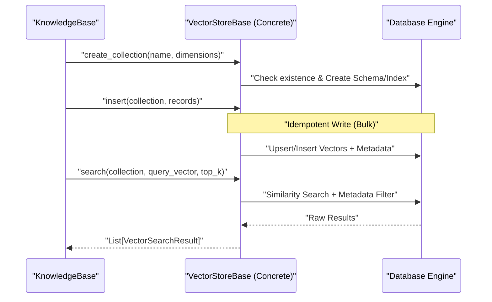
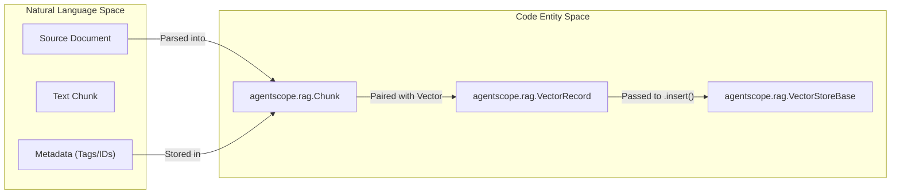
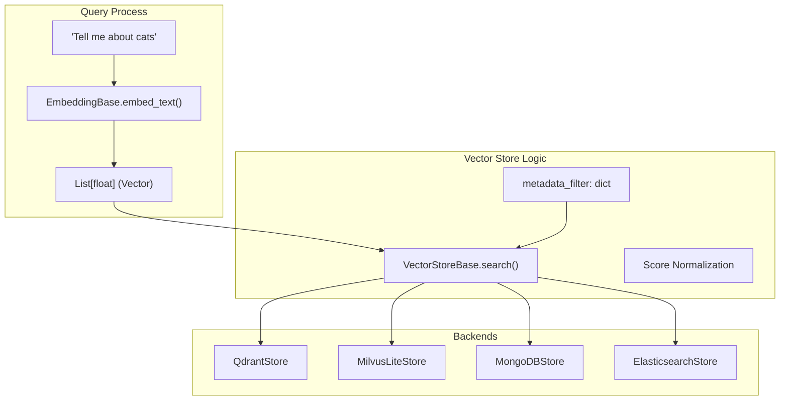

<!-- source: DeepWiki mcp.deepwiki.com · repo agentscope-ai/agentscope · page 6.2 Vector Store Backends · fetched 2026-10-30 -->

# Vector Store Backends

<details>
<summary>Relevant source files</summary>

The following files were used as context for generating this wiki page:

- [examples/long_term_memory/mem0/README.md](examples/long_term_memory/mem0/README.md)
- [examples/long_term_memory/reme/README.md](examples/long_term_memory/reme/README.md)
- [examples/long_term_memory/reme/reme_demo.py](examples/long_term_memory/reme/reme_demo.py)
- [examples/rag/README.md](examples/rag/README.md)
- [pyproject.toml](pyproject.toml)
- [src/agentscope/middleware/_longterm_memory/_reme/_middleware.py](src/agentscope/middleware/_longterm_memory/_reme/_middleware.py)
- [src/agentscope/rag/__init__.py](src/agentscope/rag/__init__.py)
- [src/agentscope/rag/_parser/__init__.py](src/agentscope/rag/_parser/__init__.py)
- [src/agentscope/rag/_parser/_excel.py](src/agentscope/rag/_parser/_excel.py)
- [src/agentscope/rag/_parser/_word.py](src/agentscope/rag/_parser/_word.py)
- [src/agentscope/rag/_vdb/__init__.py](src/agentscope/rag/_vdb/__init__.py)
- [src/agentscope/rag/_vdb/_elasticsearch.py](src/agentscope/rag/_vdb/_elasticsearch.py)
- [src/agentscope/rag/_vdb/_milvus_lite.py](src/agentscope/rag/_vdb/_milvus_lite.py)
- [src/agentscope/rag/_vdb/_mongodb.py](src/agentscope/rag/_vdb/_mongodb.py)
- [src/agentscope/rag/_vdb/_qdrant.py](src/agentscope/rag/_vdb/_qdrant.py)
- [tests/rag_parser_test.py](tests/rag_parser_test.py)
- [tests/rag_vdb_elasticsearch_test.py](tests/rag_vdb_elasticsearch_test.py)
- [tests/rag_vdb_milvus_lite_test.py](tests/rag_vdb_milvus_lite_test.py)
- [tests/rag_vdb_mongodb_test.py](tests/rag_vdb_mongodb_test.py)

</details>


AgentScope provides a flexible abstraction layer for vector databases through the `VectorStoreBase` interface. This allows the RAG (Retrieval-Augmented Generation) subsystem to swap between local, in-memory, and distributed vector stores without changing the application logic.

## VectorStoreBase Interface

The `VectorStoreBase` class defines the standard contract for all vector backend implementations. It ensures that regardless of the underlying database, the system can perform collection management, idempotent writes, and similarity searches.

### Data Flow and Lifecycle
Vector stores in AgentScope are designed as asynchronous context managers. They lazily initialize their respective clients upon the first call to `get_client()` and ensure proper resource cleanup during `__aexit__`.

**Vector Store Interaction Flow**

Sources: [src/agentscope/rag/_vdb/_vector_store.py:1-24](), [src/agentscope/rag/_vdb/_qdrant.py:95-123](), [src/agentscope/rag/_vdb/_milvus_lite.py:78-103](), [src/agentscope/rag/_vdb/_mongodb.py:108-133](), [src/agentscope/rag/_vdb/_elasticsearch.py:67-87]()

### Key Data Structures
- **`VectorRecord`**: Represents a single entry to be stored, containing the `document_id`, the `Chunk` object, and the embedding `vector` [src/agentscope/rag/_vdb/_vector_store.py:23-46]().
- **`VectorSearchResult`**: The return type for search operations, containing the original `Chunk` and the similarity `score` [src/agentscope/rag/_vdb/_vector_store.py:49-65]().
- **`DocumentSummary`**: A specialized structure for storing and retrieving high-level summaries of documents within a collection [src/agentscope/rag/_vdb/_vector_store.py:68-77]().

## Concrete Implementations

AgentScope supports four primary backends, each catering to different scales and deployment requirements.

### 1. Qdrant (Default)
`QdrantStore` is the default backend. It is highly versatile, supporting in-memory operation for testing, local disk persistence, or remote server connections.

| Mode | Configuration | Use Case |
| :--- | :--- | :--- |
| **In-Memory** | `location=":memory:"` | Unit tests and ephemeral demos [src/agentscope/rag/_vdb/_qdrant.py:12-12]() |
| **Local Disk** | `path="/path/to/db"` | Local development with persistence [src/agentscope/rag/_vdb/_qdrant.py:13-13]() |
| **Remote/Cloud** | `url="http://host:6333"` | Production deployments [src/agentscope/rag/_vdb/_qdrant.py:14-14]() |

Sources: [src/agentscope/rag/_vdb/_qdrant.py:9-15](), [src/agentscope/rag/_vdb/_qdrant.py:31-56]()

### 2. Milvus Lite
`MilvusLiteStore` is built on `pymilvus`. It is particularly useful for local RAG workloads because it starts automatically when the URI points to a `.db` file, providing a "serverless" local experience similar to SQLite.

- **Storage**: Maps each Knowledge Base to a Milvus collection [src/agentscope/rag/_vdb/_milvus_lite.py:29-32]().
- **Filtering**: Supports JSON-based flat equality filtering on metadata [src/agentscope/rag/_vdb/_milvus_lite.py:31-32]().
- **Lifecycle**: Handles local server release when using a lite URI during `__aexit__` [src/agentscope/rag/_vdb/_milvus_lite.py:101-102]().

Sources: [src/agentscope/rag/_vdb/_milvus_lite.py:26-52](), [src/agentscope/rag/_vdb/_milvus_lite.py:78-103]()

### 3. MongoDB Vector Search
`MongoDBStore` enables vector search on MongoDB Atlas or self-hosted MongoDB 7.0+ clusters. This is ideal for teams already using MongoDB as their primary database.

- **Indexing**: Automatically creates a `vectorSearch` index type using `SearchIndexModel` [src/agentscope/rag/_vdb/_mongodb.py:179-184]().
- **Metadata**: Fields used for `metadata_filter` must be explicitly declared in `filter_fields` during initialization to be included in the index definition [src/agentscope/rag/_vdb/_mongodb.py:44-46]().
- **Search**: Uses the `$vectorSearch` aggregation stage [src/agentscope/rag/_vdb/_mongodb.py:240-255]().

Sources: [src/agentscope/rag/_vdb/_mongodb.py:31-73](), [src/agentscope/rag/_vdb/_mongodb.py:147-186]()

### 4. Elasticsearch
`ElasticsearchStore` utilizes dense-vector indexes. It is designed for high-throughput environments and complex filtering.

- **Mapping**: Uses `dense_vector` with `cosine` similarity [src/agentscope/rag/_vdb/_elasticsearch.py:98-103]().
- **Safety**: Metadata is duplicated into an object field with `dynamic: "runtime"` to prevent unbounded dynamic mapping issues [src/agentscope/rag/_vdb/_elasticsearch.py:25-27](), [src/agentscope/rag/_vdb/_elasticsearch.py:106-106]().
- **Bulk Operations**: Implements high-efficiency writes using the `bulk` API [src/agentscope/rag/_vdb/_elasticsearch.py:147-150]().

Sources: [src/agentscope/rag/_vdb/_elasticsearch.py:20-58](), [src/agentscope/rag/_vdb/_elasticsearch.py:89-110]()

## Code Entity Space Mapping

The following diagrams bridge the natural language concepts of "Storage" and "Search" to the specific classes and methods in the `agentscope.rag` module.

**Entity Mapping: Document to Vector Record**

Sources: [src/agentscope/rag/_document.py:7-8](), [src/agentscope/rag/_vdb/_vector_store.py:23-46](), [src/agentscope/rag/_vdb/_vector_store.py:79-88]()

**Entity Mapping: Search and Retrieval**

Sources: [src/agentscope/rag/_vdb/__init__.py:4-24](), [src/agentscope/rag/_vdb/_vector_store.py:101-125](), [src/agentscope/rag/_vdb/_vector_store.py:68-77]()

## Core Implementation Details

### Idempotent Writes
Backends implement idempotent writes by associating vectors with deterministic IDs or managing document-level deletions. 
- `ElasticsearchStore` uses a `_record_id` helper to generate deterministic IDs based on content [src/agentscope/rag/_vdb/_elasticsearch.py:135-135]().
- `QdrantStore` uses `upsert` logic to overwrite existing points [src/agentscope/rag/_vdb/_qdrant.py:206-215]().
- `MilvusLiteStore` performs a `delete` followed by `insert` if records already exist for a document [src/agentscope/rag/_vdb/_milvus_lite.py:218-228]().

### Metadata Filtering
Filtering is handled via the `metadata_filter` argument in the `search` method. Each backend translates this dictionary into its native query language:
- **MongoDB**: Translates filters to the `filter` field of the `$vectorSearch` stage [src/agentscope/rag/_vdb/_mongodb.py:240-255]().
- **Elasticsearch**: Translates to boolean `term` or `match` filters within the `knn` query [src/agentscope/rag/_vdb/_elasticsearch.py:193-195]().
- **Milvus**: Uses the `expr` parameter for boolean expressions [src/agentscope/rag/_vdb/_milvus_lite.py:270-285]().

### Score Normalization
Different backends use different similarity metrics (e.g., Cosine, IP, L2).
- `MilvusLiteStore` allows configuring `metric_type` (COSINE, IP, L2) [src/agentscope/rag/_vdb/_milvus_lite.py:48-48]().
- `ElasticsearchStore` defaults to `cosine` [src/agentscope/rag/_vdb/_elasticsearch.py:102-102]().
- `MongoDBStore` supports `cosine`, `euclidean`, and `dotProduct` [src/agentscope/rag/_vdb/_mongodb.py:69-69]().

### Installation Extras
To keep the core package lightweight, vector store dependencies are optional and must be installed via extras:
```bash
pip install "agentscope[vdb-qdrant]"
pip install "agentscope[vdb-milvus]"
pip install "agentscope[vdb-mongodb]"
pip install "agentscope[vdb-elasticsearch]"
```
Sources: [pyproject.toml:103-110](), [examples/rag/README.md:28-52](), [examples/rag/README.md:118-125]()

---

