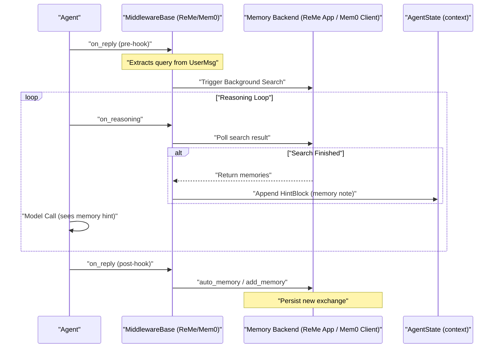
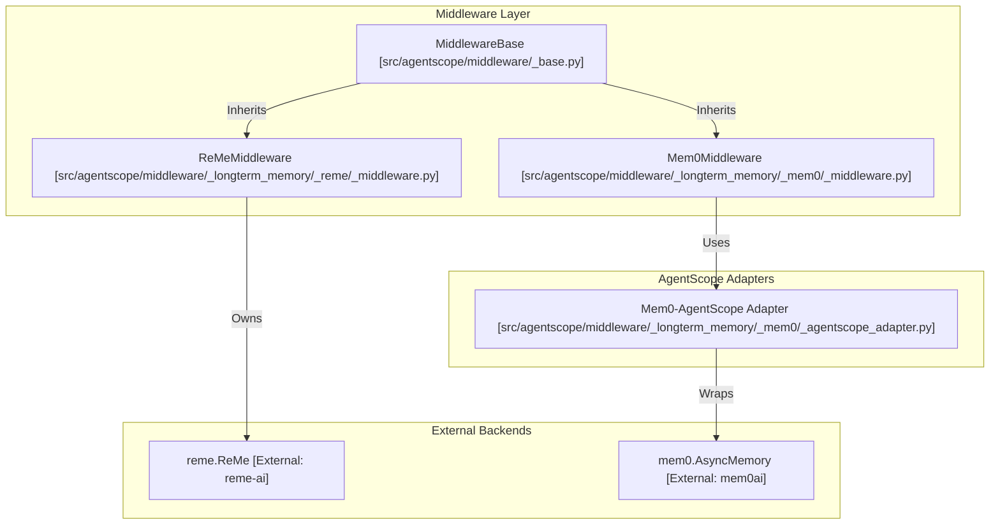

<!-- source: DeepWiki mcp.deepwiki.com · repo agentscope-ai/agentscope · page 6.3 Long-term Memory · fetched 2026-10-30 -->

# Long-term Memory

<details>
<summary>Relevant source files</summary>

The following files were used as context for generating this wiki page:

- [examples/long_term_memory/mem0/README.md](examples/long_term_memory/mem0/README.md)
- [examples/long_term_memory/mem0/oss_demo.py](examples/long_term_memory/mem0/oss_demo.py)
- [examples/long_term_memory/reme/README.md](examples/long_term_memory/reme/README.md)
- [examples/long_term_memory/reme/reme_demo.py](examples/long_term_memory/reme/reme_demo.py)
- [examples/rag/README.md](examples/rag/README.md)
- [src/agentscope/middleware/__init__.py](src/agentscope/middleware/__init__.py)
- [src/agentscope/middleware/_longterm_memory/__init__.py](src/agentscope/middleware/_longterm_memory/__init__.py)
- [src/agentscope/middleware/_longterm_memory/_mem0/__init__.py](src/agentscope/middleware/_longterm_memory/_mem0/__init__.py)
- [src/agentscope/middleware/_longterm_memory/_mem0/_agentscope_adapter.py](src/agentscope/middleware/_longterm_memory/_mem0/_agentscope_adapter.py)
- [src/agentscope/middleware/_longterm_memory/_mem0/_middleware.py](src/agentscope/middleware/_longterm_memory/_mem0/_middleware.py)
- [src/agentscope/middleware/_longterm_memory/_mem0/_tools.py](src/agentscope/middleware/_longterm_memory/_mem0/_tools.py)
- [src/agentscope/middleware/_longterm_memory/_reme/__init__.py](src/agentscope/middleware/_longterm_memory/_reme/__init__.py)
- [src/agentscope/middleware/_longterm_memory/_reme/_middleware.py](src/agentscope/middleware/_longterm_memory/_reme/_middleware.py)
- [src/agentscope/rag/_vdb/_elasticsearch.py](src/agentscope/rag/_vdb/_elasticsearch.py)
- [src/agentscope/rag/_vdb/_milvus_lite.py](src/agentscope/rag/_vdb/_milvus_lite.py)
- [src/agentscope/rag/_vdb/_mongodb.py](src/agentscope/rag/_vdb/_mongodb.py)
- [src/agentscope/rag/_vdb/_qdrant.py](src/agentscope/rag/_vdb/_qdrant.py)

</details>


Long-term memory in AgentScope provides agents with the ability to persist and retrieve information across different sessions and conversations. Unlike short-term context which is limited by model token windows, long-term memory allows agents to recall durable facts, user preferences, and historical decisions [src/agentscope/middleware/_longterm_memory/_reme/_middleware.py:75-82]().

AgentScope implements long-term memory through a specialized **Middleware** system. This allows memory operations (retrieval and storage) to be injected into the agent's reasoning loop without modifying the core agent logic [src/agentscope/middleware/_longterm_memory/_reme/_middleware.py:9-27](). Two primary backends are supported: **ReMe** (AgentScope's native file-based memory) and **Mem0**.

## Architecture & Data Flow

The long-term memory system bridges the gap between the agent's "Natural Language Space" (messages and reasoning) and the "Code Entity Space" (vector stores and memory jobs).

### Memory Middleware Integration

The following diagram illustrates how memory middleware intercepts the agent's `reply` process to perform retrieval and storage.

**Diagram: Memory Middleware Data Flow**

**Sources:** [src/agentscope/middleware/_longterm_memory/_reme/_middleware.py:9-27](), [examples/long_term_memory/reme/README.md:91-105](), [examples/long_term_memory/mem0/README.md:127-145]()

## ReMe Middleware

`ReMeMiddleware` embeds the [ReMe](https://github.com/agentscope-ai/ReMe) application directly in-process. It is a file-based memory toolkit that records memory by listening to conversations and uses LLM-backed jobs to summarize and index facts [src/agentscope/middleware/_longterm_memory/_reme/_middleware.py:4-12]().

### Configuration and Lifecycle
ReMe is instantiated lazily on the first agent call. It requires a `workspace_dir` for storage and a `ChatModelBase` to drive its internal summarization jobs [src/agentscope/middleware/_longterm_memory/_reme/_middleware.py:89-107]().

| Parameter | Type | Description |
|:---|:---|:---|
| `workspace_dir` | `str` | Path where memory cards and indexes are stored [src/agentscope/middleware/_longterm_memory/_reme/_middleware.py:92](). |
| `chat_model` | `ChatModelBase` | LLM used for the `auto_memory` summarization job [src/agentscope/middleware/_longterm_memory/_reme/_middleware.py:138-147](). |
| `embedding_model` | `EmbeddingModelBase` | If provided, enables semantic vector search; otherwise, defaults to BM25 keyword search [src/agentscope/middleware/_longterm_memory/_reme/_middleware.py:149-161](). |
| `mode` | `Literal` | Controls retrieval: `static_control`, `agent_control`, or `both` [src/agentscope/middleware/_longterm_memory/_reme/_middleware.py:163-172](). |

### Retrieval Modes
1.  **`static_control`**: The middleware automatically searches ReMe at the start of a reply and injects results as a `HintBlock` in an `AssistantMsg` named `"memory"` [src/agentscope/middleware/_longterm_memory/_reme/_middleware.py:15-18]().
2.  **`agent_control`**: The middleware exposes a `memory_search` tool. The agent must decide when to call it [src/agentscope/middleware/_longterm_memory/_reme/_middleware.py:19-20]().
3.  **`both`**: Combines automatic injection with tool access [src/agentscope/middleware/_longterm_memory/_reme/_middleware.py:21]().

**Sources:** [src/agentscope/middleware/_longterm_memory/_reme/_middleware.py:85-126](), [examples/long_term_memory/reme/README.md:45-84]()

## Mem0 Middleware

`Mem0Middleware` integrates the [Mem0](https://github.com/mem0ai/mem0) library, supporting both the open-source (OSS) backend and the hosted Mem0 Platform [examples/long_term_memory/mem0/README.md:10-17]().

### Backend Adapters
For the OSS backend, AgentScope provides adapters to wrap AgentScope models (`ChatModelBase` and `EmbeddingModelBase`) into a format compatible with Mem0's internal `AsyncMemory` client [examples/long_term_memory/mem0/README.md:44-51](). This is handled by the `Mem0Middleware` which can accept either a pre-built `client` or raw AgentScope models to build one [examples/long_term_memory/mem0/README.md:98-109]().

### Usage Example (OSS Backend)
```python
from agentscope.middleware import Mem0Middleware
from agentscope.agent import Agent
from agentscope.tool import Toolkit

# Initialize with AgentScope models
mw = Mem0Middleware(
    user_id="alice",
    chat_model=my_chat_model,
    embedding_model=my_embedding_model,
    mode="both"
)

# Register tools if using agent_control or both
agent = Agent(
    ...,
    toolkit=Toolkit(tools=await mw.list_tools()),
    middlewares=[mw]
)
```
**Sources:** [examples/long_term_memory/mem0/README.md:44-51](), [examples/long_term_memory/mem0/oss_demo.py:49-55]()

## Code Entity Mapping

The following diagram maps high-level memory concepts to the specific classes and files within the `agentscope.middleware` and `agentscope.rag` packages.

**Diagram: Memory Code Entity Map**

**Sources:** [src/agentscope/middleware/_longterm_memory/_reme/_middleware.py:85-90](), [src/agentscope/middleware/_longterm_memory/_mem0/_middleware.py:7-11](), [src/agentscope/middleware/__init__.py:7-11]()

## Implementation Details

### Scoping and Sessions
Both middlewares use the `session_id` to scope memory writes. In `ReMeMiddleware`, the `session_id` is read dynamically from `agent.state.session_id` during the `on_reply` hook, allowing a single middleware instance to be shared across multiple agents while maintaining isolated memory streams [src/agentscope/middleware/_longterm_memory/_reme/_middleware.py:23-27]().

### Concurrency and Blocking
Memory retrieval often involves network I/O or vector search. 
- **ReMe**: Retrieval runs in a background `asyncio` task started in `on_reply`. The `on_reasoning` hook polls this task. If the model is fast and the search is slow (e.g., a single-shot reply), the memory might not be injected in time for the first model call; this is known as "best-effort injection" [src/agentscope/middleware/_longterm_memory/_reme/_middleware.py:15-18]().
- **Mem0**: Similar to ReMe, `static_control` queries Mem0 during the pre-reply phase and injects the result at the `ReplyStartEvent` [examples/long_term_memory/mem0/README.md:131-138]().

### Vector Store Integration
While memory middlewares focus on conversational history, they utilize underlying vector store infrastructure for semantic retrieval. Concrete implementations include:
- `MilvusLiteStore`: Local file-based Milvus for easy development [src/agentscope/rag/_vdb/_milvus_lite.py:26-43]().
- `QdrantStore`: Supports in-memory, local disk, and remote server modes [src/agentscope/rag/_vdb/_qdrant.py:31-56]().
- `MongoDBStore`: Utilizes MongoDB Atlas Vector Search [src/agentscope/rag/_vdb/_mongodb.py:31-63]().
- `ElasticsearchStore`: Uses dense-vector indexes for approximate kNN search [src/agentscope/rag/_vdb/_elasticsearch.py:20-31]().

**Sources:** [src/agentscope/middleware/_longterm_memory/_reme/_middleware.py:99-107](), [examples/long_term_memory/reme/README.md:135-148](), [src/agentscope/rag/_vdb/_milvus_lite.py:26-43](), [src/agentscope/rag/_vdb/_qdrant.py:31-56](), [src/agentscope/rag/_vdb/_mongodb.py:31-63](), [src/agentscope/rag/_vdb/_elasticsearch.py:20-31]()

---

