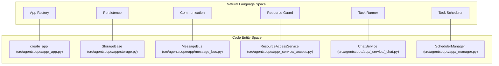
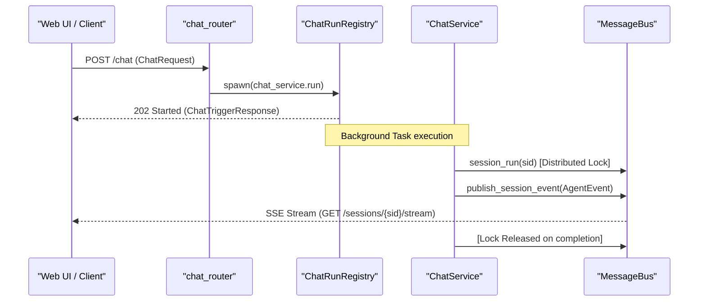

<!-- source: DeepWiki mcp.deepwiki.com · repo agentscope-ai/agentscope · page 7 Agent Service (Backend) · fetched 2026-10-30 -->

# Agent Service (Backend)

Relevant source files

The following files were used as context for generating this wiki page:

- [examples/agent_service/README.md](examples/agent_service/README.md)
- [examples/agent_service/main.py](examples/agent_service/main.py)
- [src/agentscope/app/__init__.py](src/agentscope/app/__init__.py)
- [src/agentscope/app/_app.py](src/agentscope/app/_app.py)
- [src/agentscope/app/_lifespan.py](src/agentscope/app/_lifespan.py)
- [src/agentscope/app/_router/_chat.py](src/agentscope/app/_router/_chat.py)
- [src/agentscope/app/_service/_chat.py](src/agentscope/app/_service/_chat.py)
- [src/agentscope/app/_types.py](src/agentscope/app/_types.py)
- [tests/service_chat_middleware_factory_test.py](tests/service_chat_middleware_factory_test.py)
- [tests/service_team_tools_test.py](tests/service_team_tools_test.py)

The Agent Service is a FastAPI-based, multi-tenant, and multi-session backend built with AgentScope v2. It transitions AgentScope from a local SDK into a managed service capable of persistent storage, background task scheduling, distributed locking, and cross-platform channel integration.

## System Architecture

The service follows a layered architecture where the FastAPI application factory wires together core managers and services. These components are managed through a unified lifespan context to ensure graceful startup and shutdown of persistent resources like Redis and vector stores.

### Entity Relationship: Logic to Code

The following diagram maps high-level system concepts to their corresponding classes and identifiers in the codebase.

**Sources:** [src/agentscope/app/_app.py:81-104](), [src/agentscope/app/_service/_chat.py:89-104](), [src/agentscope/app/_lifespan.py:88-94](), [src/agentscope/app/_lifespan.py:100-104]()

## Core Components

### Application Factory & Lifespan
The `create_app` function is the primary entry point for the service [src/agentscope/app/_app.py:81-104](). It initializes the FastAPI instance and attaches core managers (Storage, MessageBus, WorkspaceManager) to the `app.state` [src/agentscope/app/_app.py:130-145](). The `lifespan` context manager [src/agentscope/app/_lifespan.py:34-45]() handles the ordered initialization of these resources using an `AsyncExitStack` [src/agentscope/app/_lifespan.py:54-75]().

For details, see [Application Factory & Lifespan](#7.1).

**Sources:** [src/agentscope/app/_app.py:81-104](), [src/agentscope/app/_lifespan.py:34-75]()

### Chat Service & Session Management
The `ChatService` [src/agentscope/app/_service/_chat.py:74-87]() is the central execution engine. It handles agent assembly at runtime, including wiring `InboxMiddleware`, `StateChangeMiddleware`, and `ToolOffloadMiddleware` [src/agentscope/app/_service/_chat.py:34-38](). It uses the `MessageBus` for distributed locking to guarantee at most one chat run per session across all processes [src/agentscope/app/_service/_chat.py:81-87]().

For details, see [Chat Service & Session Management](#7.2).

**Sources:** [src/agentscope/app/_service/_chat.py:74-104](), [src/agentscope/app/_lifespan.py:140-154]()

### Storage Backends
Persistence is abstracted through the `StorageBase` interface [src/agentscope/app/storage.py:31-31](). The service supports backends like `RedisStorage` [examples/agent_service/main.py:45-48]() to store `AgentRecord`, `SessionRecord`, and `AgentData` [src/agentscope/app/storage.py:31-31](). The storage lifecycle is managed by the app lifespan [src/agentscope/app/_app.py:131-133]().

For details, see [Storage Backends](#7.3).

**Sources:** [src/agentscope/app/storage.py:31-31](), [examples/agent_service/main.py:45-48](), [src/agentscope/app/_app.py:131-133]()

### API Routers & Schemas
The service exposes REST API routers for agents, chat, sessions, credentials, knowledge bases, models, and workspaces [src/agentscope/app/_app.py:12-28](). The `chat_router` provides a fire-and-forget trigger for chat runs [src/agentscope/app/_router/_chat.py:2-8](), while events are delivered via a separate SSE stream [src/agentscope/app/_router/_chat.py:49-60]().

For details, see [API Routers & Schemas](#7.4).

**Sources:** [src/agentscope/app/_app.py:12-28](), [src/agentscope/app/_router/_chat.py:1-22]()

### Multi-Agent Teams & Sub-Agent Orchestration
The service supports complex orchestration through `SubAgentTemplate` blueprints [src/agentscope/app/_types.py:89-104](). Leaders can use tools like `AgentCreate` and `AgentInvite` [tests/service_team_tools_test.py:25-32]() to spawn workers. The `SubagentHitlProjector` ensures that Human-in-the-Loop (HITL) requests from sub-agents are projected to the leader's UI session [src/agentscope/app/_router/_chat.py:113-127]().

For details, see [Multi-Agent Teams & Sub-Agent Orchestration](#7.5).

**Sources:** [src/agentscope/app/_types.py:89-104](), [src/agentscope/app/_router/_chat.py:113-127](), [tests/service_team_tools_test.py:25-32]()

### Channel Integrations
External platform integrations like `DiscordChannel` and `FeishuChannel` are supported [examples/agent_service/main.py:10-10](). The `ChannelLifecycleDispatcher` manages platform-to-session bindings and heartbeat loops [src/agentscope/app/_lifespan.py:122-132]().

For details, see [Channel Integrations](#7.6).

**Sources:** [src/agentscope/app/_lifespan.py:112-138](), [examples/agent_service/main.py:152-155]()

## Execution Flow

The following diagram illustrates how a chat request is handled, from the router to background execution and event publishing.

**Sources:** [src/agentscope/app/_router/_chat.py:142-160](), [src/agentscope/app/_service/_chat.py:81-87](), [src/agentscope/app/_bus_ops.py:25-25]()

## Child Pages
- [Application Factory & Lifespan](#7.1)
- [Chat Service & Session Management](#7.2)
- [Storage Backends](#7.3)
- [API Routers & Schemas](#7.4)
- [Multi-Agent Teams & Sub-Agent Orchestration](#7.5)
- [Channel Integrations](#7.6)

---

