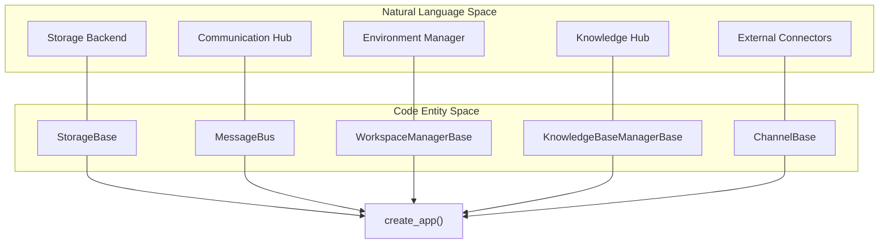
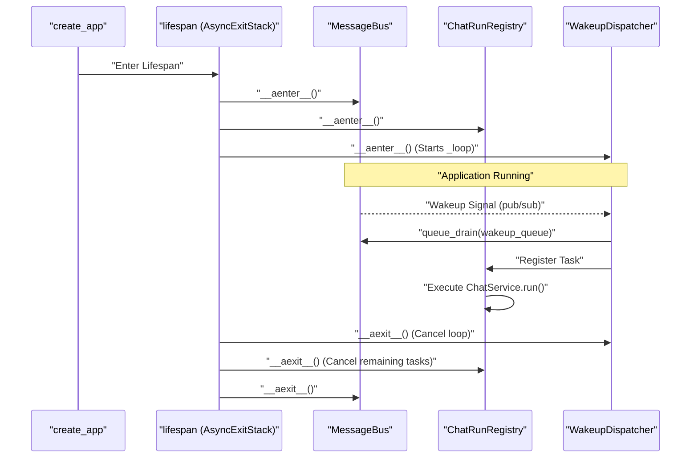

<!-- source: DeepWiki mcp.deepwiki.com · repo agentscope-ai/agentscope · page 7.1 Application Factory & Lifespan · fetched 2026-10-30 -->

# Application Factory & Lifespan

Relevant source files

The following files were used as context for generating this wiki page:

- [examples/agent_service/main.py](examples/agent_service/main.py)
- [src/agentscope/app/__init__.py](src/agentscope/app/__init__.py)
- [src/agentscope/app/_app.py](src/agentscope/app/_app.py)
- [src/agentscope/app/_bus_ops.py](src/agentscope/app/_bus_ops.py)
- [src/agentscope/app/_lifespan.py](src/agentscope/app/_lifespan.py)
- [src/agentscope/app/_manager/_background_task_manager.py](src/agentscope/app/_manager/_background_task_manager.py)
- [src/agentscope/app/_manager/_cancel_dispatcher.py](src/agentscope/app/_manager/_cancel_dispatcher.py)
- [src/agentscope/app/_manager/_scheduler/_scheduler_manager.py](src/agentscope/app/_manager/_scheduler/_scheduler_manager.py)
- [src/agentscope/app/_manager/_wakeup_dispatcher.py](src/agentscope/app/_manager/_wakeup_dispatcher.py)
- [src/agentscope/app/_router/_chat.py](src/agentscope/app/_router/_chat.py)
- [src/agentscope/app/_service/_chat.py](src/agentscope/app/_service/_chat.py)
- [src/agentscope/app/_tool/_agent_create.py](src/agentscope/app/_tool/_agent_create.py)
- [src/agentscope/app/_tool/_agent_invite.py](src/agentscope/app/_tool/_agent_invite.py)
- [src/agentscope/app/_tool/_team_say.py](src/agentscope/app/_tool/_team_say.py)
- [src/agentscope/app/_types.py](src/agentscope/app/_types.py)
- [src/agentscope/app/message_bus/_base.py](src/agentscope/app/message_bus/_base.py)
- [src/agentscope/app/message_bus/_keys.py](src/agentscope/app/message_bus/_keys.py)
- [src/agentscope/app/message_bus/_redis_message_bus.py](src/agentscope/app/message_bus/_redis_message_bus.py)
- [src/agentscope/app/middleware/_tool_offload_middleware.py](src/agentscope/app/middleware/_tool_offload_middleware.py)
- [tests/service_cancel_dispatcher_test.py](tests/service_cancel_dispatcher_test.py)
- [tests/service_chat_middleware_factory_test.py](tests/service_chat_middleware_factory_test.py)
- [tests/service_inbox_handoff_test.py](tests/service_inbox_handoff_test.py)
- [tests/service_team_tools_test.py](tests/service_team_tools_test.py)
- [tests/service_wakeup_dispatcher_test.py](tests/service_wakeup_dispatcher_test.py)
- [tests/tool_offload_middleware_test.py](tests/tool_offload_middleware_test.py)

The AgentScope application layer is built upon a FastAPI-based backend that orchestrates agent execution, persistence, and external communication. The core of this system is the `create_app` factory function and the `lifespan` context manager, which together wire all internal services and manage the lifecycle of background workers and managers.

## Application Factory (`create_app`)

The `create_app` function is the primary entry point for initializing the AgentScope service. It performs dependency injection by wiring storage backends, message buses, and managers into the FastAPI application state `[src/agentscope/app/_app.py:81-104]()`.

### Component Wiring

The factory registers all built-in routers (e.g., `agent_router`, `chat_router`, `session_router`) and mounts them to the FastAPI instance `[src/agentscope/app/_app.py:12-28]()`. It accepts several critical infrastructure components:

| Component | Code Entity | Purpose |
| :--- | :--- | :--- |
| **Storage** | `StorageBase` | Persistence for agents, sessions, and messages `[src/agentscope/app/_app.py:82]()`. |
| **Message Bus** | `MessageBus` | Cross-session inbox delivery, event fan-out, and locking `[src/agentscope/app/_app.py:83]()`. |
| **Workspace** | `WorkspaceManagerBase` | Manages sandboxed environments, skills, and MCP servers `[src/agentscope/app/_app.py:84]()`. |
| **Knowledge** | `KnowledgeBaseManagerBase` | Orchestrates RAG pipelines and vector store handles `[src/agentscope/app/_app.py:85]()`. |
| **Hubs** | `MCPHubBase`, `SkillHubBase` | External registries for browsing/installing tools and skills `[src/agentscope/app/_app.py:90-91]()`. |
| **Channels** | `ChannelBase` | External platform integrations (e.g., Discord, Feishu) `[src/agentscope/app/_app.py:100]()`. |

### Natural Language to Code Entity Mapping

The following diagram bridges the high-level system concepts to the specific classes used in the factory.

**System Entity Mapping**

Sources: `[src/agentscope/app/_app.py:81-104]()`, `[src/agentscope/app/_app.py:31-32]()`, `[src/agentscope/app/channel/__init__.py]()`

## Lifespan Management

The `lifespan` context manager handles the startup and shutdown sequence of all application-wide resources using an `AsyncExitStack` `[src/agentscope/app/_lifespan.py:34-54]()`. This ensures that resources are initialized in a specific order and torn down in reverse, preventing leaks during partial failures.

### Startup Sequence
1.  **Core Infrastructure**: Enters `storage`, `message_bus`, and `workspace_manager` `[src/agentscope/app/_lifespan.py:55-57]()`.
2.  **RAG & Hubs**: Enters `knowledge_base_manager` (which enters the vector store) and all registered `mcp_hubs` and `skill_hubs` `[src/agentscope/app/_lifespan.py:58-71]()`.
3.  **Managers**:
    *   `BackgroundTaskManager`: Tracks offloaded long-running tool tasks `[src/agentscope/app/_lifespan.py:73-76]()`.
    *   `ChatRunRegistry`: Per-process registry of in-flight `asyncio.Task` objects for chat runs `[src/agentscope/app/_lifespan.py:82-83]()`.
    *   `SchedulerManager`: Handles timed triggers and recurring tasks `[src/agentscope/app/_lifespan.py:88-94]()`.
4.  **Services**: Initializes stateless services like `ChatService`, `SessionService`, and `ResourceAccessService` `[src/agentscope/app/_lifespan.py:100-165]()`.
5.  **Dispatchers**: Starts `WakeupDispatcher`, `CancelDispatcher`, and `ChannelLifecycleDispatcher` to listen for bus-driven events `[src/agentscope/app/_lifespan.py:210-226]()`.

### Data Flow & Component Lifespan

Sources: `[src/agentscope/app/_lifespan.py:34-230]()`, `[src/agentscope/app/_manager/_wakeup_dispatcher.py:113-151]()`, `[src/agentscope/app/_service/_chat.py:74-87]()`

## Key Managers & Dispatchers

### BackgroundTaskManager
Manages tool executions that outlive a single request. It tracks tasks offloaded via `ToolOffloadMiddleware` and provides the infrastructure to target them for cancellation `[src/agentscope/app/_manager/_background_task_manager.py:20-40]()`.

### SchedulerManager
Responsible for managing the lifecycle of scheduled tasks. It uses an `AsyncIOScheduler` and, upon a trigger fire, resolves the target session and enqueues a `wake` trigger via `enqueue_run_trigger` `[src/agentscope/app/_manager/_scheduler/_scheduler_manager.py:26-36]()`, `[src/agentscope/app/_manager/_scheduler/_scheduler_manager.py:125-178]()`.

### WakeupDispatcher & CancelDispatcher
These components bridge the `MessageBus` to the local process's event loop:
*   **WakeupDispatcher**: The sole site that spawns `ChatService.run`. It drains the `wakeup_queue` upon receiving a signal `[src/agentscope/app/_manager/_wakeup_dispatcher.py:1-29]()`. It handles `wake`, `resume`, and `message` trigger kinds `[src/agentscope/app/_manager/_wakeup_dispatcher.py:65-82]()`, `[src/agentscope/app/_manager/_wakeup_dispatcher.py:178-200]()`.
*   **CancelDispatcher**: Listens for interruption signals on the bus. It looks up the active `asyncio.Task` in the local `ChatRunRegistry` and cancels it `[src/agentscope/app/_manager/_cancel_dispatcher.py:20-35]()`.

### ChatService Assembly
The `ChatService` is the central logic hub. During a run, it assembles the `Agent` by wiring:
*   **Middlewares**: Including `InboxMiddleware` for bus delivery, `StateChangeMiddleware` for persistence, and `ToolOffloadMiddleware` for background execution `[src/agentscope/app/_service/_chat.py:270-290]()`.
*   **Toolkits**: Injecting workspace-specific tools (MCP, Skills) and service-specific tools like `ScheduleCreate` and `ToolStop` `[src/agentscope/app/_service/_chat.py:292-310]()`.

Sources: `[src/agentscope/app/_app.py:81-180]()`, `[src/agentscope/app/_lifespan.py:34-230]()`, `[src/agentscope/app/_service/_chat.py:74-153]()`, `[src/agentscope/app/_manager/_wakeup_dispatcher.py:1-29]()`.

---

