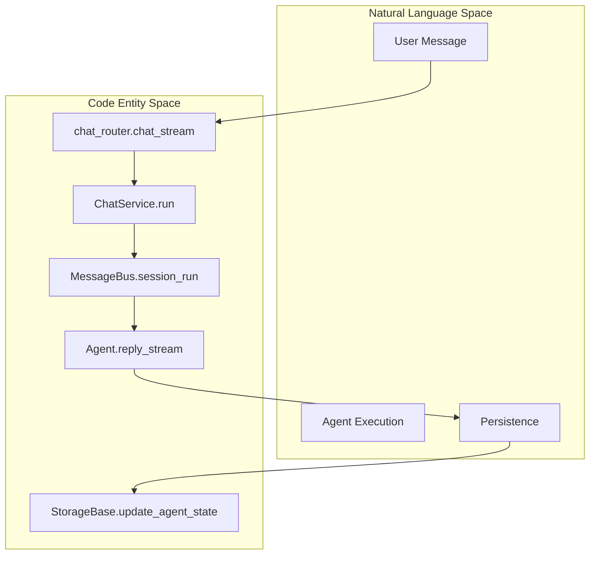
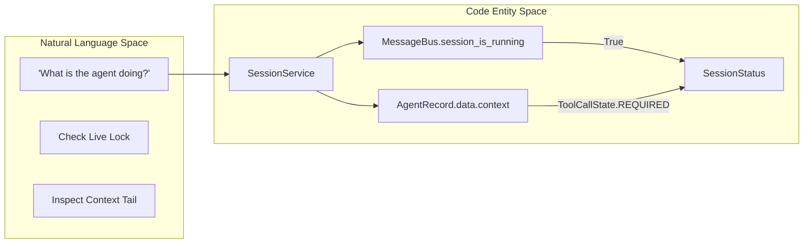

<!-- source: DeepWiki mcp.deepwiki.com · repo agentscope-ai/agentscope · page 7.2 Chat Service & Session Management · fetched 2026-10-30 -->

# Chat Service & Session Management

Relevant source files

The following files were used as context for generating this wiki page:

- [examples/agent_service/main.py](examples/agent_service/main.py)
- [examples/web_ui/frontend/src/api/session.ts](examples/web_ui/frontend/src/api/session.ts)
- [src/agentscope/app/__init__.py](src/agentscope/app/__init__.py)
- [src/agentscope/app/_app.py](src/agentscope/app/_app.py)
- [src/agentscope/app/_lifespan.py](src/agentscope/app/_lifespan.py)
- [src/agentscope/app/_router/_chat.py](src/agentscope/app/_router/_chat.py)
- [src/agentscope/app/_router/_schema/_session.py](src/agentscope/app/_router/_schema/_session.py)
- [src/agentscope/app/_router/_session.py](src/agentscope/app/_router/_session.py)
- [src/agentscope/app/_service/__init__.py](src/agentscope/app/_service/__init__.py)
- [src/agentscope/app/_service/_chat.py](src/agentscope/app/_service/_chat.py)
- [src/agentscope/app/_types.py](src/agentscope/app/_types.py)
- [src/agentscope/app/storage/_base.py](src/agentscope/app/storage/_base.py)
- [src/agentscope/app/storage/_redis_storage.py](src/agentscope/app/storage/_redis_storage.py)
- [src/agentscope/message/__init__.py](src/agentscope/message/__init__.py)
- [tests/service_chat_middleware_factory_test.py](tests/service_chat_middleware_factory_test.py)
- [tests/service_team_tools_test.py](tests/service_team_tools_test.py)
- [tests/storage_redis_test.py](tests/storage_redis_test.py)

The `ChatService` is the central orchestration layer for executing agents within a session. It provides a single source of truth for agent assembly, execution, and state persistence, ensuring that whether a request comes from an HTTP endpoint or a scheduled wakeup dispatcher, the logic remains identical [src/agentscope/app/_service/_chat.py:2-13]().

## Service Architecture

`ChatService` acts as the glue between the high-level `Agent` SDK and the `AgentService` backend infrastructure, including Storage, Message Bus, and Workspace management [src/agentscope/app/_service/_chat.py:74-104]().

### Agent Assembly Pipeline
Every chat turn triggers a dynamic assembly of the agent. This allows the system to inject session-specific tools and middlewares before execution [src/agentscope/app/_service/_chat.py:236-302]().

1.  **Identity Resolution**: Resolves the `AgentRecord` and `SessionRecord` from the storage backend [src/agentscope/app/_service/_chat.py:214-227]().
2.  **Workspace Binding**: Retrieves the per-session `Workspace` handle from the `WorkspaceManager` [src/agentscope/app/_service/_chat.py:229-234]().
3.  **Middleware Injection**: Combines core middlewares (`InboxMiddleware`, `StateChangeMiddleware`, `ToolOffloadMiddleware`) with dynamic factories like `RAGMiddleware` (if knowledge is configured) and `TTSMiddleware` [src/agentscope/app/_service/_chat.py:236-285]().
4.  **Toolkit Construction**: Invokes `get_toolkit` to aggregate tools from the workspace (MCPs, Skills), background task tracking, and team participation logic [src/agentscope/app/_service/_toolkit.py:40-87]().
5.  **Agent Instantiation**: Assembles the final `Agent` instance (or `custom_agent_cls`) with the resolved model configurations and toolkit [src/agentscope/app/_service/_chat.py:304-319]().

### Distributed Session Locking
To prevent race conditions, `ChatService` utilizes a distributed lock via the `MessageBus` [src/agentscope/app/_service/_chat.py:81-83](). The `bus.session_run` context manager ensures that at most one worker process executes a specific `session_id` at any given time [src/agentscope/app/_service/_chat.py:321-325]().

**Entity Association: Chat Execution Flow**

Sources: [src/agentscope/app/_service/_chat.py:78-87](), [src/agentscope/app/_router/_chat.py:1-20](), [src/agentscope/app/_service/_chat.py:321-325]()

## Execution & Streaming

The core execution happens in `ChatService.run`, which handles user messages, external execution results, or user confirmation results [src/agentscope/app/_service/_chat.py:175-186]().

### Reply Stream Iteration
Agent responses are processed as streams. The service iterates over the `reply_stream` provided by the agent, performing three primary actions for every event:
1.  **Event Persistence**: The event is projected into the session's durable history via `SessionProjection` [src/agentscope/app/_service/_chat.py:387-393]().
2.  **Bus Publication**: The event is published to the `MessageBus` via `publish_session_event` for live SSE consumption by subscribers [src/agentscope/app/_service/_chat.py:395-399]().
3.  **HITL Handling**: If the agent produces a `RequireUserConfirmEvent`, the execution "parks" by setting the tool call state to `REQUIRED` and exiting the stream loop [src/agentscope/app/_service/_chat.py:356-370]().

### Safe Persistence with `asyncio.shield`
To prevent data corruption if a client disconnects or a request is cancelled mid-persistence, the service wraps critical state updates in `asyncio.shield`. This ensures that even if the `ChatService.run` task is cancelled, the final agent state (memory, tool results, and context) is successfully written to the `StorageBase` backend [src/agentscope/app/_service/_chat.py:417-425]().

## Session Status & HITL Logic

Session management involves tracking the lifecycle of an agent's reasoning process, especially during Human-In-The-Loop (HITL) scenarios.

### Status Transitions
The `SessionStatus` enum represents the unified state of a session [src/agentscope/app/_service/_session.py:39]():

| Status | Condition |
| :--- | :--- |
| `RUNNING` | A worker currently holds the distributed `session_run` lock [src/agentscope/app/_service/_session.py:92](). |
| `AWAITING_PERMISSION` | The session is idle, but the context ends in a tool call waiting for user confirmation [src/agentscope/app/_service/_session.py:94](). |
| `AWAITING_EXTERNAL_RESULT` | The session is idle, waiting for a result from an offloaded background task [src/agentscope/app/_service/_session.py:95](). |
| `IDLE` | No active run and no pending requirements [src/agentscope/app/_service/_session.py:93](). |

### Parking and Resumption
When an agent requires permission, `ChatService` finishes the current `run` and persists the agent's state with `ToolCallState.REQUIRED` [src/agentscope/app/_service/_chat.py:356-361]().
*   **Wake-up Logic**: Resumption is triggered by the `WakeupDispatcher`, which monitors the `MessageBus` for `UserConfirmResultEvent` or `ExternalExecutionResultEvent` and enqueues a new run trigger [src/agentscope/app/_lifespan.py:13-14]().
*   **Interruption**: Users can cancel a running agent or clear a parked state via the `CancelDispatcher`, which sends a cancel signal through the bus [src/agentscope/app/_lifespan.py:10]().

**Entity Association: Session State Management**

Sources: [src/agentscope/app/_service/_session.py:146-180](), [src/agentscope/message/__init__.py:39]()

## Error Handling

The service distinguishes between two categories of failures:

1.  **Setup Errors**: Occur during agent assembly (e.g., missing credentials, invalid model config). These are classified via `_classify_setup_error` and result in an immediate `HTTPException` [src/agentscope/app/_service/_chat.py:65]().
2.  **Runtime Errors**: Occur during the ReAct loop (e.g., LLM timeouts, tool execution failures). These are caught inside the `run` loop, published as an `AgentEvent` to the UI, and classified via `_classify_error` to decide if the session can remain in a valid state [src/agentscope/app/_service/_chat.py:434-450]().

Sources:
- `src/agentscope/app/_service/_chat.py`
- `src/agentscope/app/_service/_session.py`
- `src/agentscope/app/_service/_toolkit.py`
- `src/agentscope/app/_router/_chat.py`
- `src/agentscope/app/_lifespan.py`
- `src/agentscope/message/__init__.py`

---

