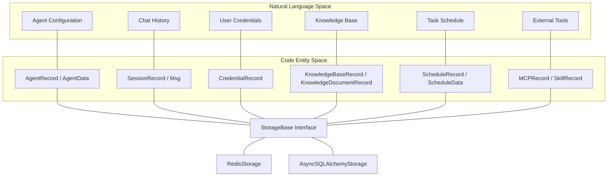
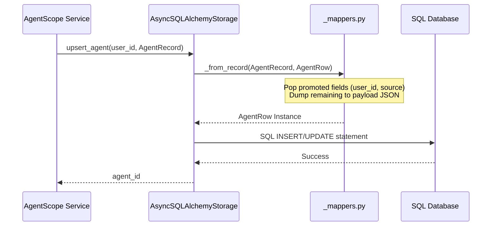

<!-- source: DeepWiki mcp.deepwiki.com · repo agentscope-ai/agentscope · page 7.3 Storage Backends · fetched 2026-10-30 -->

# Storage Backends

Relevant source files

The following files were used as context for generating this wiki page:

- [examples/web_ui/frontend/src/api/session.ts](examples/web_ui/frontend/src/api/session.ts)
- [src/agentscope/app/_router/_schema/_session.py](src/agentscope/app/_router/_schema/_session.py)
- [src/agentscope/app/_router/_session.py](src/agentscope/app/_router/_session.py)
- [src/agentscope/app/_service/__init__.py](src/agentscope/app/_service/__init__.py)
- [src/agentscope/app/storage/__init__.py](src/agentscope/app/storage/__init__.py)
- [src/agentscope/app/storage/_base.py](src/agentscope/app/storage/_base.py)
- [src/agentscope/app/storage/_model/__init__.py](src/agentscope/app/storage/_model/__init__.py)
- [src/agentscope/app/storage/_redis_storage.py](src/agentscope/app/storage/_redis_storage.py)
- [src/agentscope/app/storage/_sql/_storage.py](src/agentscope/app/storage/_sql/_storage.py)
- [src/agentscope/message/__init__.py](src/agentscope/message/__init__.py)
- [tests/storage_redis_test.py](tests/storage_redis_test.py)

The Storage Backends layer provides a unified persistence interface for all AgentScope Service resources, including agents, sessions, message history, credentials, and RAG metadata. It abstracts the underlying database technology, allowing the system to operate across different environments ranging from local development (SQLite) to distributed production deployments (Redis, PostgreSQL) [src/agentscope/app/storage/_sql/_storage.py:3-18]().

## Architecture Overview

The persistence layer is built on a provider-agnostic interface, `StorageBase`, which defines the contract for CRUD operations on system entities [src/agentscope/app/storage/_base.py:29-30](). This layer is consumed by the service routers and the `ChatService` to ensure that agent state and conversation history survive application restarts [src/agentscope/app/_router/_session.py:197-200]().

### Code-to-System Mapping
The following diagram bridges the gap between high-level system concepts and their implementation classes within the storage module.

**Sources:** [src/agentscope/app/storage/_model/__init__.py:4-32](), [src/agentscope/app/storage/_base.py:9-26](), [src/agentscope/app/storage/__init__.py:7-38]()

## Storage Models (Data Schema)

AgentScope uses Pydantic models to define the schema for all persisted entities. These models are shared across all storage implementations and are re-exported in the main storage package [src/agentscope/app/storage/__init__.py:7-38]().

| Model | Purpose | Key Fields |
| :--- | :--- | :--- |
| `AgentData` | Agent configuration and logic. | `system_prompt`, `context_config`, `react_config` [src/agentscope/app/storage/_model/_agent.py:16-30]() |
| `SessionRecord` | Metadata for a specific chat session. | `agent_id`, `workspace_id`, `chat_model_config` [src/agentscope/app/storage/_model/_session.py:84-106]() |
| `Msg` | The fundamental unit of chat history. | `id`, `name`, `role`, `content` [src/agentscope/message/__init__.py:4-18]() |
| `KnowledgeBaseRecord` | Metadata for RAG collections. | `embedding_model_config`, `collection_name` [src/agentscope/app/storage/_model/_knowledge_base.py:34-45]() |
| `KnowledgeDocumentRecord` | Individual file status in a KB. | `status`, `lease_expires_at`, `blob_uri` [src/agentscope/app/storage/_model/_knowledge_document.py:55-73]() |
| `TeamRecord` | Orchestration data for multi-agent teams. | `team_id`, `session_id`, `data (TeamData)` [src/agentscope/app/storage/_model/_team.py:46-55]() |

**Sources:** [src/agentscope/app/storage/_model/__init__.py:1-65]()

## Implementation Backends

### Redis Storage (`RedisStorage`)
The `RedisStorage` implementation is designed for high-performance, distributed scenarios. It uses specific key templates and Redis data structures for indexing [src/agentscope/app/storage/_redis_storage.py:50-51]().

*   **Key Management**: Uses a nested `KeyConfig` class to define templates for records (Strings), indexes (Sets), and message history (Lists) [src/agentscope/app/storage/_redis_storage.py:53-135]().
*   **Message Persistence**: Messages for a session are stored in a Redis List under the key `agentscope:user:{user_id}:session:{session_id}:messages` [src/agentscope/app/storage/_redis_storage.py:91-93]().
*   **Uniqueness Constraints**: Uses Redis Hashes (e.g., `skill_name_index`) to ensure name uniqueness per user for MCPs and Skills [src/agentscope/app/storage/_redis_storage.py:76-80]().
*   **TTL Support**: Supports sliding TTL for record keys, refreshed on every write [src/agentscope/app/storage/_redis_storage.py:163-165]().

**Sources:** [src/agentscope/app/storage/_redis_storage.py:53-180](), [tests/storage_redis_test.py:30-37]()

### SQL Storage (`AsyncSQLAlchemyStorage`)
The SQL backend provides an asynchronous implementation using SQLAlchemy 2.0. It supports any dialect with an async driver (SQLite, PostgreSQL, MySQL) [src/agentscope/app/storage/_sql/_storage.py:3-18]().

*   **Schema Design**: Uses a "Promoted Column + JSON Payload" strategy. Relational fields (like `user_id` or `agent_id`) are stored in dedicated columns for indexing, while the rest of the Pydantic model is stored in a single `payload` JSON column [src/agentscope/app/storage/_sql/_tables.py:4-13]().
*   **Timestamps**: All timestamps are normalized to naive UTC before storage to ensure consistency across distributed nodes [src/agentscope/app/storage/_sql/_storage.py:64-84]().
*   **Initialization**: The backend can automatically run migrations via Alembic or create tables directly at startup using `create_tables=True` [src/agentscope/app/storage/_sql/_storage.py:107-130]().

**Sources:** [src/agentscope/app/storage/_sql/_storage.py:87-188](), [src/agentscope/app/storage/_sql/_tables.py:57-89](), [src/agentscope/app/storage/_sql/_mappers.py:1-40]()

## Data Flow and Utilities

### Serialization and Security
*   **`_dump_with_secrets`**: A utility used by backends to serialize Pydantic models while ensuring `SecretStr` fields are converted to plain strings for storage [src/agentscope/app/storage/_utils.py:12-23]().
*   **Lazy Loading**: `AsyncSQLAlchemyStorage` is lazily loaded in `agentscope.app.storage.__init__.py` to avoid mandatory SQLAlchemy dependencies for Redis-only users [src/agentscope/app/storage/__init__.py:49-64]().

### Team and Session Resolution
*   **`_ensure_team_members`**: Ensures all team members are correctly instantiated and their session IDs are resolved [src/agentscope/app/_router/_session.py:97-97]().
*   **`_build_team_detail`**: Resolves a team's leader agent and member agents into a `TeamDetailResponse` for the session list endpoint [src/agentscope/app/_router/_session.py:59-121]().

### Core Interface Methods
Every backend must implement the following core methods defined in `StorageBase`:
*   `upsert_credential`: Manages LLM API keys [src/agentscope/app/storage/_base.py:49-65]().
*   `upsert_message`: Appends a message to a session's history [src/agentscope/app/storage/_base.py:440-456]().
*   `get_session_messages`: Retrieves message history for an agent with support for pagination via the `before` cursor [src/agentscope/app/storage/_base.py:476-493]().
*   `list_knowledge_documents`: Manages RAG document lifecycles [src/agentscope/app/storage/_base.py:734-752]().

**Sources:** [src/agentscope/app/storage/_base.py:29-800](), [src/agentscope/app/storage/__init__.py:49-64](), [src/agentscope/app/_router/_session.py:59-121]()

---

