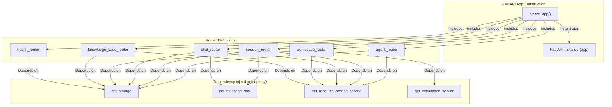
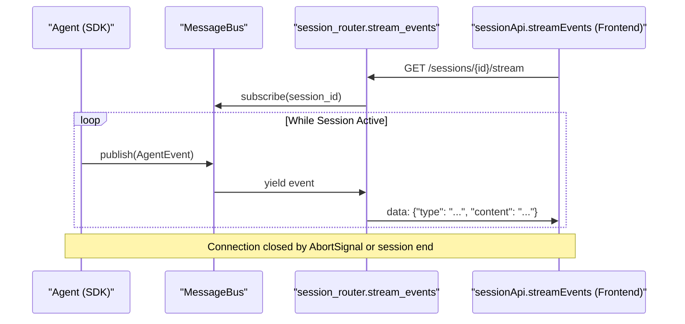
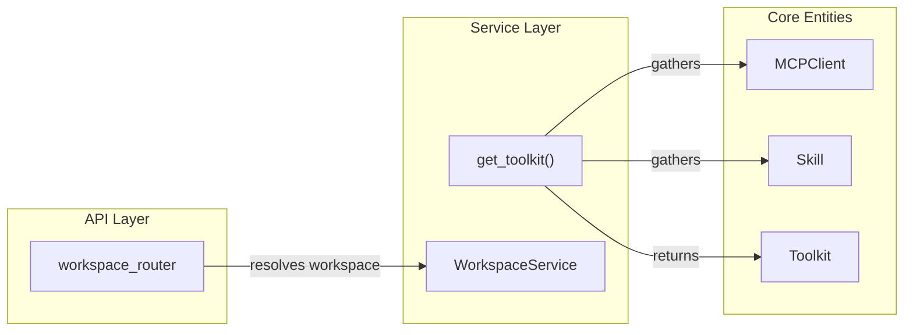

<!-- source: DeepWiki mcp.deepwiki.com · repo agentscope-ai/agentscope · page 7.4 API Routers & Schemas · fetched 2026-10-30 -->

# API Routers & Schemas

Relevant source files

The following files were used as context for generating this wiki page:

- [examples/web_ui/frontend/src/api/client.ts](examples/web_ui/frontend/src/api/client.ts)
- [examples/web_ui/frontend/src/api/health.ts](examples/web_ui/frontend/src/api/health.ts)
- [examples/web_ui/frontend/src/api/index.ts](examples/web_ui/frontend/src/api/index.ts)
- [examples/web_ui/frontend/src/api/types.ts](examples/web_ui/frontend/src/api/types.ts)
- [examples/web_ui/frontend/src/i18n/locales/en.json](examples/web_ui/frontend/src/i18n/locales/en.json)
- [examples/web_ui/frontend/src/i18n/locales/zh.json](examples/web_ui/frontend/src/i18n/locales/zh.json)
- [examples/web_ui/frontend/src/pages/channel/channel-form.tsx](examples/web_ui/frontend/src/pages/channel/channel-form.tsx)
- [examples/web_ui/frontend/src/pages/setup/index.tsx](examples/web_ui/frontend/src/pages/setup/index.tsx)
- [src/agentscope/app/_router/__init__.py](src/agentscope/app/_router/__init__.py)
- [src/agentscope/app/_router/_health.py](src/agentscope/app/_router/_health.py)
- [src/agentscope/app/_router/_schema/__init__.py](src/agentscope/app/_router/_schema/__init__.py)
- [src/agentscope/app/_router/_schema/_health.py](src/agentscope/app/_router/_schema/_health.py)
- [src/agentscope/app/_router/_workspace.py](src/agentscope/app/_router/_workspace.py)
- [src/agentscope/app/_service/_session.py](src/agentscope/app/_service/_session.py)
- [src/agentscope/app/_service/_toolkit.py](src/agentscope/app/_service/_toolkit.py)
- [src/agentscope/workspace/_sandboxed_base.py](src/agentscope/workspace/_sandboxed_base.py)
- [tests/health_router_test.py](tests/health_router_test.py)
- [tests/service_toolkit_test.py](tests/service_toolkit_test.py)
- [tests/workspace_daytona_test.py](tests/workspace_daytona_test.py)
- [tests/workspace_docker_test.py](tests/workspace_docker_test.py)
- [tests/workspace_k8s_test.py](tests/workspace_k8s_test.py)
- [tests/workspace_skill_archive_test.py](tests/workspace_skill_archive_test.py)

The AgentScope backend is built as a FastAPI application, organized into modular routers that expose the SDK's capabilities via a RESTful API. This layer handles request validation using Pydantic schemas, manages resource access control, and facilitates real-time communication through Server-Sent Events (SSE).

## Router Architecture

The application factory `create_app` registers all built-in routers automatically [src/agentscope/app/_app.py:108-109](). Each router is responsible for a specific domain of the AgentScope ecosystem, from agent lifecycle management to real-time chat streaming.

### Core Routers Overview

| Router | Responsibility | Key Endpoints |
|:---|:---|:---|
| `agent_router` | Agent definition & discovery | `GET /`, `POST /`, `GET /schema/v2` |
| `session_router` | Chat session lifecycle & history | `POST /`, `GET /{id}/messages`, `GET /{id}/stream` |
| `chat_router` | Message injection & HITL response | `POST /{session_id}` |
| `credential_router` | API key & provider management | `GET /`, `POST /`, `GET /schemas` |
| `knowledge_base_router` | RAG management & document ingestion | `POST /`, `POST /{id}/upload`, `POST /{id}/search` |
| `workspace_router` | Filesystem, MCP, and Skill management | `GET /mcp`, `GET /skill`, `GET /list` |
| `hub_router` | Global MCP & Skill discovery | `GET /mcp`, `GET /skill` |
| `health_router` | System status & connectivity check | `GET /` |
| `channel_router` | External platform (Discord/Feishu) bindings | `GET /`, `POST /`, `POST /{id}/actions` |
| `schedule_router` | Cron-based task scheduling | `GET /`, `POST /`, `GET /{id}/sessions` |

### Router Registration Flow
The following diagram illustrates how the `create_app` factory wires the routers and their dependencies.

**System to Code Entity Mapping: Router Initialization**

**Sources:** [src/agentscope/app/_app.py:81-104](), [src/agentscope/app/_router/__init__.py:3-17](), [src/agentscope/app/_router/_workspace.py:20-25]()

---

## Session Router & SSE Streaming

The `session_router` is the most complex endpoint, managing the intersection of persisted state and live execution. It uses `SessionView` to bundle session records with their active status and team details [src/agentscope/app/_router/_schema/_session.py:82-85]().

### Session Status Lifecycle
The `SessionService` provides a unified `SessionStatus` enum [src/agentscope/app/_service/_session.py:61-96](). It collapses cluster liveness (from the `MessageBus` run-lock) and durable parking state (from persisted `AgentState.context`) into a single value for the UI:
*   `RUNNING`: A worker holds the distributed lease [src/agentscope/app/_service/_session.py:92]().
*   `AWAITING_PERMISSION`: Parked on a Human-in-the-loop (HITL) confirm [src/agentscope/app/_service/_session.py:83-86]().
*   `AWAITING_EXTERNAL_RESULT`: Parked on an external tool execution [src/agentscope/app/_service/_session.py:87-90]().
*   `IDLE`: No active run or pending tool calls [src/agentscope/app/_service/_session.py:93]().

### Live Event Streaming
Real-time interaction is achieved via the `stream_events` endpoint, which returns a `StreamingResponse` [src/agentscope/app/_router/_session.py:8-9](). The frontend consumes this via a fetch-based SSE generator to handle custom headers like `X-User-ID` [examples/web_ui/frontend/src/api/client.ts:1-20]().

**Data Flow: Agent to Frontend SSE**

**Sources:** [src/agentscope/app/_service/_session.py:98-141](), [src/agentscope/app/_router/_schema/_session.py:80-82](), [examples/web_ui/frontend/src/api/types.ts:137-152]()

---

## Workspace Router: MCP & Skills

The `workspace_router` manages the dynamic environment of a session, specifically handling the installation of MCP clients and skills into a `WorkspaceBase` instance [src/agentscope/app/_router/_workspace.py:2-3]().

### MCP Management
The router provides endpoints to list live MCP tools and their health status by resolving the workspace via `WorkspaceService` [src/agentscope/app/_router/_workspace.py:53-65](). When an MCP is added manually, it is also persisted in the user's library [src/agentscope/app/_router/_workspace.py:129-135]().

### Skill Management
Skills can be uploaded directly or added from a library. The `upload_skill` endpoint handles multi-part form data, validating the skill manifest and storing the code within the workspace's local storage [src/agentscope/app/_router/_workspace.py:263-280](). The `WorkspaceService` uses an `UploadManifest` to track successful and failed uploads [src/agentscope/app/_service/_workspace.py:28]().

**System to Code Entity Mapping: Workspace Tool Assembly**

**Sources:** [src/agentscope/app/_router/_workspace.py:45-59](), [src/agentscope/app/_service/_toolkit.py:40-56](), [src/agentscope/app/_service/_workspace.py:14-28]()

---

## Request & Response Schemas

AgentScope uses Pydantic for all API schemas, ensuring strict type safety and automatic documentation generation. These schemas are mirrored in TypeScript for the Web UI [examples/web_ui/frontend/src/api/types.ts:1-50]().

### Key Schema Categories

1.  **Configuration Schemas**: Define how agents and sessions are structured.
    *   `AgentData`: Core agent identity, system prompts, and `ReActConfig` [examples/web_ui/frontend/src/api/types.ts:43-50]().
    *   `SessionConfig`: Binds an agent to specific `ChatModelConfig`, `TTSModelConfig`, and `SessionKnowledgeConfig` [examples/web_ui/frontend/src/api/types.ts:116-132]().
2.  **Request Schemas**: Used for `POST` and `PATCH` operations.
    *   `CreateAgentRequest`: Fields required to instantiate an agent [src/agentscope/app/_router/_schema/_agent.py:46-49]().
    *   `UpdateSessionRequest`: Supports partial updates for parameters like `cwd` or `permission_mode` [src/agentscope/app/_router/_schema/_session.py:77-78]().
3.  **View Schemas**: Enriched records for UI consumption.
    *   `AgentView`: Includes an `editable` flag based on ownership [examples/web_ui/frontend/src/api/types.ts:52-60]().
    *   `TeamDetailResponse`: Resolves a team's leader and member agents into a single object [src/agentscope/app/_router/_schema/_session.py:83-85]().

**Sources:** [src/agentscope/app/_router/_schema/__init__.py:4-85](), [examples/web_ui/frontend/src/api/types.ts:3-110]()

---

## Dependency Injection & Security

The `deps.py` module provides the bridge between the FastAPI request context and the underlying service layer.

### Core Dependencies
*   `get_current_user_id`: Extracts the user identity from the `X-User-ID` header [src/agentscope/app/_router/_workspace.py:21]().
*   `get_storage`: Provides access to the persistence backend (SQL/Redis) [src/agentscope/app/_router/_workspace.py:23]().
*   `get_resource_access_service`: Enforces the `ResourceAccessPolicyBase`, determining if a user can view or edit a specific agent, credential, or knowledge base [src/agentscope/app/_service/_toolkit.py:34]().
*   `get_workspace_service`: Resolves the execution environment (local or sandboxed) for a specific user/agent/session triplet [src/agentscope/app/_router/_workspace.py:24]().

### Resource Validation
Routers perform proactive validation using these dependencies. For example, the `workspace_router` calls `workspace_service.resolve` to ensure the caller has access to the requested workspace before performing file or tool operations [src/agentscope/app/_router/_workspace.py:61-65]().

**Sources:** [src/agentscope/app/_router/_workspace.py:20-27](), [src/agentscope/app/_service/_toolkit.py:52]()

---

## Health Check & System Status

The `health_router` provides a critical endpoint for monitoring the operational state of the backend components.

### Health Endpoint (`GET /health`)
It returns a `HealthResponse` containing the status of various system components [src/agentscope/app/_router/_schema/_health.py:10-15]():
*   **Storage**: Connection to the database/Redis.
*   **Message Bus**: Availability of the pub/sub system.
*   **Workspace**: Status of the local or sandboxed execution environments.
*   **Index Worker**: Operational status of the RAG background tasks.

**Sources:** [src/agentscope/app/_router/_health.py:1-20](), [src/agentscope/app/_router/_schema/_health.py:1-15]()

---

