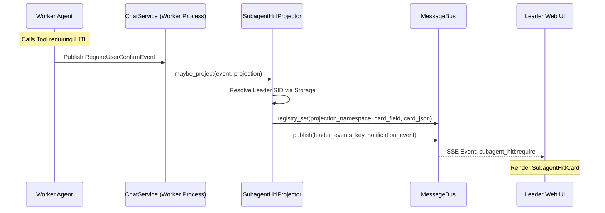

<!-- source: DeepWiki mcp.deepwiki.com · repo agentscope-ai/agentscope · page 7.5 Multi-Agent Teams & Sub-Agent Orchestration · fetched 2026-10-30 -->

# Multi-Agent Teams & Sub-Agent Orchestration

Relevant source files

The following files were used as context for generating this wiki page:

- [examples/agent_service/main.py](examples/agent_service/main.py)
- [src/agentscope/app/__init__.py](src/agentscope/app/__init__.py)
- [src/agentscope/app/_app.py](src/agentscope/app/_app.py)
- [src/agentscope/app/_bus_ops.py](src/agentscope/app/_bus_ops.py)
- [src/agentscope/app/_lifespan.py](src/agentscope/app/_lifespan.py)
- [src/agentscope/app/_manager/_scheduler/_scheduler_manager.py](src/agentscope/app/_manager/_scheduler/_scheduler_manager.py)
- [src/agentscope/app/_manager/_wakeup_dispatcher.py](src/agentscope/app/_manager/_wakeup_dispatcher.py)
- [src/agentscope/app/_router/_chat.py](src/agentscope/app/_router/_chat.py)
- [src/agentscope/app/_service/_chat.py](src/agentscope/app/_service/_chat.py)
- [src/agentscope/app/_tool/_agent_create.py](src/agentscope/app/_tool/_agent_create.py)
- [src/agentscope/app/_tool/_agent_invite.py](src/agentscope/app/_tool/_agent_invite.py)
- [src/agentscope/app/_tool/_team_say.py](src/agentscope/app/_tool/_team_say.py)
- [src/agentscope/app/_types.py](src/agentscope/app/_types.py)
- [src/agentscope/app/message_bus/_keys.py](src/agentscope/app/message_bus/_keys.py)
- [src/agentscope/app/middleware/_tool_offload_middleware.py](src/agentscope/app/middleware/_tool_offload_middleware.py)
- [tests/service_chat_middleware_factory_test.py](tests/service_chat_middleware_factory_test.py)
- [tests/service_inbox_handoff_test.py](tests/service_inbox_handoff_test.py)
- [tests/service_team_tools_test.py](tests/service_team_tools_test.py)
- [tests/service_wakeup_dispatcher_test.py](tests/service_wakeup_dispatcher_test.py)
- [tests/tool_offload_middleware_test.py](tests/tool_offload_middleware_test.py)

Multi-agent orchestration in AgentScope follows a **Leader-Worker** pattern. A leader agent (typically the one the user interacts with directly) can dynamically form a team, spawn specialized worker agents, delegate tasks, and collect reports. This system is built on a set of specialized tools, a template-based worker configuration system, and a cross-session projection mechanism that surfaces worker Human-In-The-Loop (HITL) requests to the leader's UI.

## 1. Orchestration Pattern: Leader-Worker

The orchestration is governed by framework-builtin tools: `AgentCreate`, `AgentInvite`, and `TeamSay`. These tools interact directly with the `StorageBase` and `MessageBus` to manage session state and inter-agent communication [src/agentscope/app/_service/_chat.py:91-103](), [src/agentscope/app/_lifespan.py:140-154]().

### 1.1 Team Formation & Lifecycle
*   **`AgentCreate`**: Spawns a brand-new worker agent. The worker is assigned a `source='team'` attribute and is automatically joined to the leader's team. It utilizes a `SubAgentTemplate` for its initial configuration [src/agentscope/app/_types.py:89-102]().
*   **`AgentInvite`**: Borrows an existing user-owned agent into the team. Unlike `AgentCreate`, it mints a fresh team-scoped `SessionRecord` on top of an existing `AgentRecord`, preserving the agent's global state and workspace while allowing it to participate in the team conversation.
*   **`TeamSay`**: The primary communication tool. It delivers messages to the target agent's inbox and triggers a wake-up via the `MessageBus` [src/agentscope/app/_bus_ops.py:163-204]().

### 1.2 Communication: TeamSay
Communication between members is strictly routed through the `TeamSay` tool. It provides role-specific instructions:
*   **Leaders**: Use it to pass new requirements or follow-up questions. They are instructed not to poll, as workers report back automatically.
*   **Workers**: Must use it to report task results to the leader upon completion. It is their primary channel for sharing findings or asking for clarification.

### 1.3 Natural Language to Code Entity Space: Team Orchestration

| Natural Language Concept | Code Entity / Class | File Reference |
| :--- | :--- | :--- |
| **Team Leader** | `Agent` with `team_id` in `SessionRecord` | [src/agentscope/app/_service/_chat.py:31]() |
| **Spawn Worker** | `AgentCreate` tool | [src/agentscope/app/_tool/_agent_create.py]() |
| **Invite Existing Agent** | `AgentInvite` tool | [src/agentscope/app/_tool/_agent_invite.py]() |
| **Worker Template** | `SubAgentTemplate` | [src/agentscope/app/_types.py:89]() |
| **Report Results** | `TeamSay` tool | [src/agentscope/app/_tool/_team_say.py]() |
| **Team Registry** | `TeamRecord` in `StorageBase` | [src/agentscope/app/storage/_base.py]() |

Sources: [src/agentscope/app/_service/_chat.py:89-154](), [src/agentscope/app/_types.py:89-185](), [src/agentscope/app/_bus_ops.py:163-204]()

## 2. Sub-Agent Templates

`SubAgentTemplate` defines the blueprint for workers created via `AgentCreate`. Templates allow developers to define specialized roles (e.g., "researcher", "coder") with specific system prompts and permission postures [src/agentscope/app/_types.py:89-104]().

### 2.1 Configuration & Inheritance
Templates support fine-grained control over how workers inherit state from the leader:
*   **`system_prompt_template`**: A format string accepting placeholders like `{team_name}`, `{leader_name}`, and `{member_description}` [src/agentscope/app/_types.py:123-129]().
*   **Permission Inheritance**: Controlled by flags in the template:
    *   `override_leader_mode`: If `True`, the worker uses the template's `PermissionMode` (e.g., `EXPLORE` for read-only workers). If `False`, it inherits the leader's current mode [src/agentscope/app/_types.py:151-161]().
    *   `extend_leader_permission_rules`: Merges leader-confirmed rules into the worker, preventing redundant HITL prompts for the user [src/agentscope/app/_types.py:163-175]().
    *   `extend_leader_working_directories`: Merges working directories (like `AdditionalWorkingDirectory`) from the leader to the worker [src/agentscope/app/_types.py:177-185]().

### 2.2 Template Registry
Templates are registered during application startup via `create_app` [src/agentscope/app/_app.py:97]() and stored in the `ChatService` [src/agentscope/app/_service/_chat.py:100](). When `AgentCreate` is called, it routes to the appropriate template based on the `subagent_type` parameter [src/agentscope/app/_service/_chat.py:150-153]().

Sources: [src/agentscope/app/_types.py:89-185](), [src/agentscope/app/_app.py:81-104](), [src/agentscope/app/_service/_chat.py:90-154]()

## 3. Subagent HITL Projection

Since workers run in background sessions, their Human-In-The-Loop (HITL) requests (e.g., tool execution confirmation) would normally be invisible to the user. The `SubagentHitlProjector` solves this by mirroring worker events onto the leader's session [src/agentscope/app/_service/_projectors.py]().

### 3.1 Data Flow: Worker to Leader UI
1.  A worker agent publishes a `RequireUserConfirmEvent` [src/agentscope/app/_service/_chat.py:61]().
2.  The `ChatService.run` method for the worker invokes all registered `EventProjector` instances [src/agentscope/app/_service/_chat.py:102]().
3.  `SubagentHitlProjector` identifies the event, resolves the leader's `session_id`, and uses `SessionProjection` to write a durable "card" to the leader's session [src/agentscope/app/_types.py:41-56]().
4.  The leader's session receives a notification via the `MessageBus`, and the Web UI renders a `SubagentHitlCard`.

### 3.2 System Interaction Diagram

Title: Worker HITL Projection Flow

Sources: [src/agentscope/app/_service/_chat.py:74-161](), [src/agentscope/app/_types.py:41-87](), [src/agentscope/app/message_bus/_keys.py:62-101]()

## 4. Implementation Details

### 4.1 ChatService Integration
The `ChatService` is the central orchestrator for team runs. It manages the assembly of agents with their specific middlewares (like `InboxMiddleware`) and tools [src/agentscope/app/_service/_chat.py:90-154](). It also handles session locking via `MessageBus.session_run` to ensure only one run occurs per session at a time [src/agentscope/app/_service/_chat.py:82-87]().

### 4.2 Team Session Management
Team triggers are handled by the `WakeupDispatcher`. When a worker reports back via `TeamSay`, it delivers a `HintBlock` to the leader's inbox and enqueues a `wake` trigger [src/agentscope/app/_bus_ops.py:163-204](). The dispatcher then spawns a `ChatService.run` for the leader to process the worker's report [src/agentscope/app/_manager/_wakeup_dispatcher.py:65-131]().

### 4.3 Code Entity Mapping: Infrastructure

| Code Symbol | Role | Source |
| :--- | :--- | :--- |
| `EventProjector` | Protocol for cross-session event mirroring. | [src/agentscope/app/_types.py:41]() |
| `SessionProjection` | Shared primitive for writing to target session UI feeds. | [src/agentscope/app/_service/_session_projection.py]() |
| `WakeupDispatcher` | Drains the shared trigger queue to spawn runs. | [src/agentscope/app/_manager/_wakeup_dispatcher.py:65]() |
| `MessageBusKeys` | Defines the `projection_namespace` and `projection_field` formats. | [src/agentscope/app/message_bus/_keys.py:67-82]() |

Sources: [src/agentscope/app/_service/_chat.py:74-161](), [src/agentscope/app/_manager/_wakeup_dispatcher.py:65-131](), [src/agentscope/app/_bus_ops.py:163-204](), [src/agentscope/app/message_bus/_keys.py:62-101]()

---

