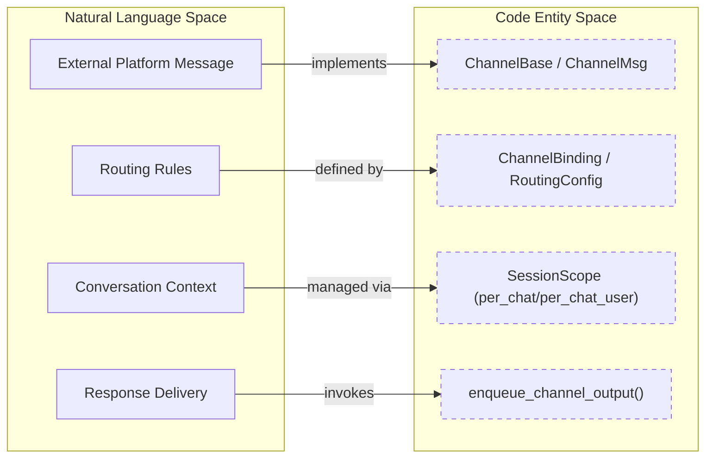
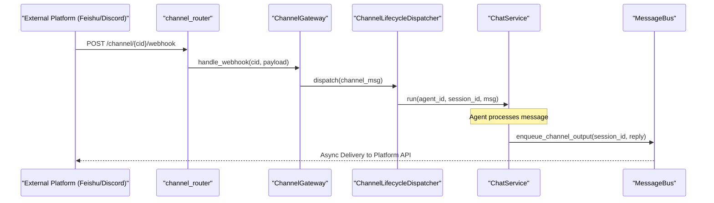

<!-- source: DeepWiki mcp.deepwiki.com · repo agentscope-ai/agentscope · page 7.6 Channel Integrations · fetched 2026-10-30 -->

# Channel Integrations

<details>
<summary>Relevant source files</summary>

The following files were used as context for generating this wiki page:

- [examples/agent_service/main.py](examples/agent_service/main.py)
- [examples/web_ui/frontend/src/api/client.ts](examples/web_ui/frontend/src/api/client.ts)
- [examples/web_ui/frontend/src/api/health.ts](examples/web_ui/frontend/src/api/health.ts)
- [examples/web_ui/frontend/src/api/index.ts](examples/web_ui/frontend/src/api/index.ts)
- [examples/web_ui/frontend/src/api/types.ts](examples/web_ui/frontend/src/api/types.ts)
- [examples/web_ui/frontend/src/i18n/locales/en.json](examples/web_ui/frontend/src/i18n/locales/en.json)
- [examples/web_ui/frontend/src/i18n/locales/zh.json](examples/web_ui/frontend/src/i18n/locales/zh.json)
- [examples/web_ui/frontend/src/pages/channel/channel-form.tsx](examples/web_ui/frontend/src/pages/channel/channel-form.tsx)
- [examples/web_ui/frontend/src/pages/setup/index.tsx](examples/web_ui/frontend/src/pages/setup/index.tsx)
- [src/agentscope/app/__init__.py](src/agentscope/app/__init__.py)
- [src/agentscope/app/_app.py](src/agentscope/app/_app.py)
- [src/agentscope/app/_lifespan.py](src/agentscope/app/_lifespan.py)
- [src/agentscope/app/_router/__init__.py](src/agentscope/app/_router/__init__.py)
- [src/agentscope/app/_router/_chat.py](src/agentscope/app/_router/_chat.py)
- [src/agentscope/app/_router/_health.py](src/agentscope/app/_router/_health.py)
- [src/agentscope/app/_router/_schema/__init__.py](src/agentscope/app/_router/_schema/__init__.py)
- [src/agentscope/app/_service/_chat.py](src/agentscope/app/_service/_chat.py)
- [src/agentscope/app/_types.py](src/agentscope/app/_types.py)
- [tests/service_chat_middleware_factory_test.py](tests/service_chat_middleware_factory_test.py)
- [tests/service_team_tools_test.py](tests/service_team_tools_test.py)

</details>


Channel integrations allow AgentScope agents to connect to external communication platforms such as **Feishu** and **Discord**. The system bridges external platform events (like messages) to the internal AgentScope session and message bus infrastructure, enabling agents to operate as bots or automated assistants within third-party ecosystems.

## Architecture Overview

The channel system follows a registry-based architecture where specific platform implementations inherit from a base class and are managed by a central dispatcher during the application lifespan.

### Data Flow: Platform to Agent

1.  **Platform Event**: An external platform sends a webhook or event to the `channel_router` [src/agentscope/app/_router/_channel.py]().
2.  **ChannelGateway**: Receives the raw platform payload and translates it into an internal `Msg` [src/agentscope/app/_lifespan.py:127-131]().
3.  **Routing & Binding**: The `ChannelLifecycleDispatcher` uses `RoutingConfig` and `ChannelBinding` rules to determine which agent should handle the message and which `session_id` to use based on the `ChatKind` (e.g., group vs. private) [src/agentscope/app/app/_service/_chat.py:30-30]().
4.  **ChatService**: The dispatcher triggers `ChatService.run`, which handles agent assembly, middleware wiring, and execution [src/agentscope/app/_service/_chat.py:140-154]().
5.  **Output Enqueue**: Agent responses are published to the `MessageBus` via `enqueue_channel_output` [src/agentscope/app/_service/_chat.py:22-22]().
6.  **Platform Delivery**: The channel's background worker picks up the message from the bus and sends it back to the external platform API.

### Code Entity Mapping
This diagram maps conceptual communication elements to the specific code entities responsible for them in the AgentScope service layer.

Title: Communication Space to Code Entity Mapping


**Sources:** [src/agentscope/app/channel/__init__.py](), [src/agentscope/app/_service/_chat.py:20-31](), [src/agentscope/app/_lifespan.py:112-138]()

---

## Core Components

### ChannelBase & Registry
`ChannelBase` is the abstract base class for all platform integrations. It defines the lifecycle methods for starting the channel, handling incoming webhooks, and sending outgoing messages. The `ChannelTypeRegistry` maintains a mapping of available channel types that can be instantiated by the service [src/agentscope/app/_app.py:30-30]().

### ChannelLifecycleDispatcher
The `ChannelLifecycleDispatcher` is the orchestrator for all active channels within the `FastAPI` application lifespan [src/agentscope/app/_lifespan.py:123-132]().
-   **Reconciliation**: It periodically checks the `StorageBase` for new or updated channel configurations created via the API.
-   **Heartbeats**: For socket-based channels (like Discord), it maintains active connections.
-   **Triggering Runs**: When a message arrives, it resolves the session and calls `ChatService.run` [src/agentscope/app/_service/_chat.py:140-154]().

### Session Scopes
Routing determines how an external platform's `chat_id` (e.g., a Discord Channel ID or Feishu Group ID) maps to an internal `session_id`.

| Scope | Description | Code Symbol |
| :--- | :--- | :--- |
| `per_chat` | All users in a specific platform group/channel share the same agent session. | `SessionScope.PER_CHAT` |
| `per_chat_user` | Each user within a platform group/channel gets a unique private session. | `SessionScope.PER_CHAT_USER` |

**Sources:** [src/agentscope/app/_router/_schema/_channel.py:9-12](), [src/agentscope/app/_service/_chat.py:30-31]()

---

## Implementation Details

### Integration Workflow

The following sequence diagram illustrates the lifecycle of a message received from an external platform until the agent's response is sent back.

Title: Channel Message Processing Flow


**Sources:** [src/agentscope/app/_router/_channel.py](), [src/agentscope/app/_service/_chat.py:20-27](), [src/agentscope/app/_lifespan.py:123-138]()

### Concrete Implementations

#### Feishu (Lark) Channel
The `FeishuChannel` implementation handles the Feishu event subscription protocol [examples/agent_service/main.py:10-10]().
-   **Validation**: Supports challenge URL validation for webhook setup.
-   **Security**: Handles decryption of message content if encrypted.
-   **Mapping**: Maps Feishu `open_chat_id` to AgentScope sessions.

#### Discord Channel
The `DiscordChannel` uses a websocket-based gateway approach [examples/agent_service/main.py:10-10]().
-   **Intents**: Requires specific Gateway Intents to read message content.
-   **Persistence**: Maintains a persistent connection managed by the `ChannelLifecycleDispatcher`.

---

## Configuration & Binding Rules

Channels are configured and managed via the `channel_router` [src/agentscope/app/_router/_channel.py]().

### ChannelBinding
A `ChannelBinding` defines how incoming traffic is routed to specific agents:
-   `match_key`: The attribute to check (e.g., `chat_id`).
-   `match_value`: The value to match (e.g., a specific group ID).
-   `agent_id`: The ID of the agent that should respond.
-   `session_scope`: The isolation level for the session.

### Registration in create_app
To enable channel support, implementations must be passed to the `create_app` factory [src/agentscope/app/_app.py:100-100]().

```python
# Example from examples/agent_service/main.py:152-155
app = create_app(
    # ... other configurations
    channels=[
        DiscordChannel,
        FeishuChannel,
    ],
)
```

## UI Integration
The frontend provides a management interface for channels, allowing users to:
-   Create and update channel configurations [src/agentscope/app/_router/_schema/_channel.py:10-11]().
-   View active chat IDs and session mappings [src/agentscope/app/_router/_schema/_channel.py:7-9]().
-   Toggle channel status (Enabled/Disabled) [examples/web_ui/frontend/src/i18n/locales/en.json:15-15]().

**Sources:** [src/agentscope/app/_app.py:81-104](), [src/agentscope/app/_lifespan.py:112-138](), [examples/agent_service/main.py:152-156]()

---

