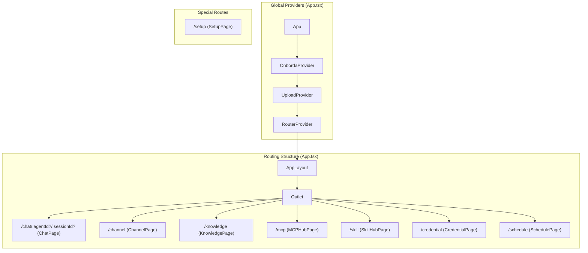
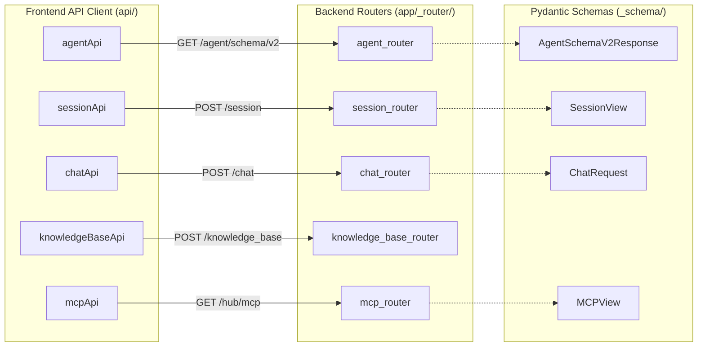

<!-- source: DeepWiki mcp.deepwiki.com · repo agentscope-ai/agentscope · page 8 Web UI Frontend · fetched 2026-10-30 -->

# Web UI Frontend

Relevant source files

The following files were used as context for generating this wiki page:

- [examples/web_ui/frontend/src/App.tsx](examples/web_ui/frontend/src/App.tsx)
- [examples/web_ui/frontend/src/api/client.ts](examples/web_ui/frontend/src/api/client.ts)
- [examples/web_ui/frontend/src/api/health.ts](examples/web_ui/frontend/src/api/health.ts)
- [examples/web_ui/frontend/src/api/index.ts](examples/web_ui/frontend/src/api/index.ts)
- [examples/web_ui/frontend/src/api/types.ts](examples/web_ui/frontend/src/api/types.ts)
- [examples/web_ui/frontend/src/components/error/RouteError.tsx](examples/web_ui/frontend/src/components/error/RouteError.tsx)
- [examples/web_ui/frontend/src/i18n/locales/en.json](examples/web_ui/frontend/src/i18n/locales/en.json)
- [examples/web_ui/frontend/src/i18n/locales/zh.json](examples/web_ui/frontend/src/i18n/locales/zh.json)
- [examples/web_ui/frontend/src/pages/channel/channel-form.tsx](examples/web_ui/frontend/src/pages/channel/channel-form.tsx)
- [examples/web_ui/frontend/src/pages/setup/index.tsx](examples/web_ui/frontend/src/pages/setup/index.tsx)
- [src/agentscope/app/_router/__init__.py](src/agentscope/app/_router/__init__.py)
- [src/agentscope/app/_router/_health.py](src/agentscope/app/_router/_health.py)
- [src/agentscope/app/_router/_schema/__init__.py](src/agentscope/app/_router/_schema/__init__.py)

The AgentScope Web UI is a React-based single-page application (SPA) built with TypeScript and Vite. It serves as the primary human-interactive layer for the Agent Service, providing a visual environment for multi-agent chat, workspace management, and resource configuration (credentials, knowledge bases, MCP servers, and skills).

## Application Architecture

The frontend is structured as a client-side routed application using `react-router-dom`. It utilizes a layout-driven architecture where the `AppLayout` component provides a persistent navigation sidebar, while page-specific content is rendered within an `Outlet` [examples/web_ui/frontend/src/App.tsx:35-62]().

### Component Hierarchy & Routing
The root `App` component manages the initial setup state and wraps the application in global providers for translations, file uploads, and onboarding tours [examples/web_ui/frontend/src/App.tsx:66-90]().

**Sources:**
- Router definition: [examples/web_ui/frontend/src/App.tsx:33-64]()
- Global Provider wrapping: [examples/web_ui/frontend/src/App.tsx:75-89]()
- Setup route handling: [examples/web_ui/frontend/src/App.tsx:21-31]()

## Key Frontend Systems

### Setup and Health Probing
Before the application is accessible, the `SetupPage` requires a server URL and username [examples/web_ui/frontend/src/pages/setup/index.tsx:42-43](). It uses the `healthApi` to probe the backend's `/health` endpoint to ensure the service is compatible and all internal components (storage, message bus, chat service) are ready [examples/web_ui/frontend/src/pages/setup/index.tsx:78-87](). The UI specifically reports on component readiness, such as `storage`, `message_bus`, and `workspace_manager` [src/agentscope/app/_router/_health.py:12-22]().

**Sources:**
- Health probe logic: [examples/web_ui/frontend/src/api/health.ts:7-19]()
- Backend health status logic: [src/agentscope/app/_router/_health.py:29-89]()
- Setup persistence: [examples/web_ui/frontend/src/pages/setup/index.tsx:88-89]()

### API Client & Type Safety
The frontend communicates with the FastAPI backend via a central `client` [examples/web_ui/frontend/src/api/client.ts:124-145](). This client handles:
*   **Authentication:** Injecting the `X-User-ID` header into every request [examples/web_ui/frontend/src/api/client.ts:41]().
*   **Error Handling:** Extracting detailed error messages from backend responses and displaying them via toasts [examples/web_ui/frontend/src/api/client.ts:108-113]().
*   **Type Mirroring:** TypeScript interfaces in `types.ts` mirror the Pydantic schemas defined in the backend's `_schema` modules, such as `AgentData`, `SessionConfig`, and `KnowledgeBase` [examples/web_ui/frontend/src/api/types.ts:43-150]().

For details, see [Frontend API Client](#8.3).

### Chat Interface
The chat interface handles the rendering of complex agent outputs, including multi-modal data and tool execution logs. It manages the message history and consumes SSE (Server-Sent Events) streams from the backend to provide real-time agent reasoning and tool call feedback [examples/web_ui/frontend/src/i18n/locales/en.json:109-136]().

For details, see [Chat Interface](#8.1).

### Resource Management
Management pages provide forms for configuring the agent environment. For example, the `ChannelPage` allows binding agents to external platforms like Feishu or Discord using the `ChannelForm` [examples/web_ui/frontend/src/pages/channel/channel-form.tsx:114-233](). The frontend also manages agent identity, context configuration, and ReAct loop parameters [examples/web_ui/frontend/src/api/types.ts:23-40]().

For details, see [Management Pages & Panels](#8.2).

## Entity Mapping: Frontend to Backend

The following diagram bridges the frontend API calls to the corresponding backend routers and schema definitions.

**Sources:**
- API Exports: [examples/web_ui/frontend/src/api/index.ts:1-14]()
- Backend Router Registry: [src/agentscope/app/_router/__init__.py:3-35]()
- Schema Aggregation: [src/agentscope/app/_router/_schema/__init__.py:4-85]()

## Internationalization (i18n)
The UI supports multiple languages (English and Chinese) through JSON locale files. These files define translations for common UI elements, tool names (e.g., `bash`, `read`, `edit`), and error descriptions ranging from authentication failures to rate limits [examples/web_ui/frontend/src/i18n/locales/en.json:61-136]().

**Sources:**
- English Locales: [examples/web_ui/frontend/src/i18n/locales/en.json:1-158]()
- Chinese Locales: [examples/web_ui/frontend/src/i18n/locales/zh.json:1-158]()

---

