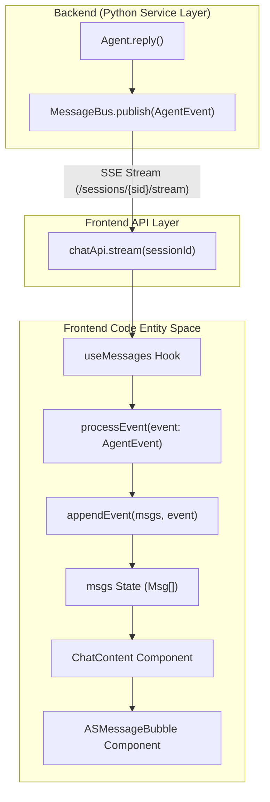

<!-- source: DeepWiki mcp.deepwiki.com · repo agentscope-ai/agentscope · page 8.1 Chat Interface · fetched 2026-10-30 -->

# Chat Interface

<details>
<summary>Relevant source files</summary>

The following files were used as context for generating this wiki page:

- [examples/web_ui/frontend/package.json](examples/web_ui/frontend/package.json)
- [examples/web_ui/frontend/src/components/chat/ASMessageBubble.tsx](examples/web_ui/frontend/src/components/chat/ASMessageBubble.tsx)
- [examples/web_ui/frontend/src/components/chat/ChatContent.tsx](examples/web_ui/frontend/src/components/chat/ChatContent.tsx)
- [examples/web_ui/frontend/src/components/chat/ConfirmCard.tsx](examples/web_ui/frontend/src/components/chat/ConfirmCard.tsx)
- [examples/web_ui/frontend/src/components/chat/SubagentHitlCard.tsx](examples/web_ui/frontend/src/components/chat/SubagentHitlCard.tsx)
- [examples/web_ui/frontend/src/components/chat/TextInput.tsx](examples/web_ui/frontend/src/components/chat/TextInput.tsx)
- [examples/web_ui/frontend/src/components/chat/tool-renderers/BashRenderer.tsx](examples/web_ui/frontend/src/components/chat/tool-renderers/BashRenderer.tsx)
- [examples/web_ui/frontend/src/components/chat/tool-renderers/DefaultRenderer.tsx](examples/web_ui/frontend/src/components/chat/tool-renderers/DefaultRenderer.tsx)
- [examples/web_ui/frontend/src/components/chat/tool-renderers/EditRenderer.tsx](examples/web_ui/frontend/src/components/chat/tool-renderers/EditRenderer.tsx)
- [examples/web_ui/frontend/src/components/chat/tool-renderers/ReadRenderer.tsx](examples/web_ui/frontend/src/components/chat/tool-renderers/ReadRenderer.tsx)
- [examples/web_ui/frontend/src/components/chat/tool-renderers/WriteRenderer.tsx](examples/web_ui/frontend/src/components/chat/tool-renderers/WriteRenderer.tsx)
- [examples/web_ui/frontend/src/components/chat/tool-renderers/_shared.tsx](examples/web_ui/frontend/src/components/chat/tool-renderers/_shared.tsx)
- [examples/web_ui/frontend/src/components/panel/McpPanel.tsx](examples/web_ui/frontend/src/components/panel/McpPanel.tsx)
- [examples/web_ui/frontend/src/components/panel/PanelDock.tsx](examples/web_ui/frontend/src/components/panel/PanelDock.tsx)
- [examples/web_ui/frontend/src/hooks/useMessages.ts](examples/web_ui/frontend/src/hooks/useMessages.ts)
- [examples/web_ui/frontend/src/index.css](examples/web_ui/frontend/src/index.css)
- [examples/web_ui/frontend/src/pages/chat/ChatViewport.tsx](examples/web_ui/frontend/src/pages/chat/ChatViewport.tsx)
- [examples/web_ui/pnpm-lock.yaml](examples/web_ui/pnpm-lock.yaml)
- [tests/service_scheduler_test.py](tests/service_scheduler_test.py)

</details>


The AgentScope Web UI Chat Interface is a React-based frontend designed to provide a rich, interactive environment for multi-agent collaboration. It handles real-time message streaming via Server-Sent Events (SSE), Human-in-the-Loop (HITL) interactions, and complex tool rendering.

## Architecture Overview

The interface is structured into a hierarchical shell where responsibilities are split between URL management and session rendering.

*   **`ChatViewport`**: The main container for a specific session, managing model configurations, permission modes, and the side panel dock [examples/web_ui/frontend/src/pages/chat/ChatViewport.tsx:152-163](). It manages the right-hand main panel of the chat page, including the message stream and workspace drawer [examples/web_ui/frontend/src/pages/chat/ChatViewport.tsx:152-160]().
*   **`useMessages`**: The core hook managing the message state, SSE event consumption, and HITL lifecycle [examples/web_ui/frontend/src/hooks/useMessages.ts:109-128]().

### Data Flow: From SSE to UI

The following diagram illustrates how a backend `AgentEvent` is transformed into a rendered message bubble.

**Event Processing Flow**

**Sources:** [examples/web_ui/frontend/src/hooks/useMessages.ts:81-93](), [examples/web_ui/frontend/src/hooks/useMessages.ts:171-173](), [examples/web_ui/frontend/src/components/chat/ChatContent.tsx:158-166]()

## Core Components

### ChatViewport
The `ChatViewport` is the primary layout engine for the chat experience. It uses a `ResizablePanelGroup` to split the view between the message stream and a `PanelDock` for management tools (MCP, Skills, Tasks) [examples/web_ui/frontend/src/pages/chat/ChatViewport.tsx:46-49](). It maintains local state for session-specific configurations like `selectedModel`, `selectedTTSModel`, and `permissionMode`, persisting changes via the `sessionApi` [examples/web_ui/frontend/src/pages/chat/ChatViewport.tsx:176-183]().

### ChatContent & Message Rendering
`ChatContent` manages the scrollable area of the conversation. It uses a `MessageScrollerProvider` to handle automatic scrolling to the bottom as new tokens stream in [examples/web_ui/frontend/src/components/chat/ChatContent.tsx:154-155]().

*   **`ASMessageBubble`**: The atomic unit of chat, rendering a single `Msg` object [examples/web_ui/frontend/src/components/chat/ChatContent.tsx:160-164]().
*   **`TextInput`**: A multi-functional composer supporting:
    *   **Auto-expanding textarea**: Grows up to 6 lines (approx. 126px based on 21px line height) before scrolling [examples/web_ui/frontend/src/components/chat/TextInput.tsx:115]().
    *   **File Processing**: Asynchronous file processing via `fileProcessor` before sending [examples/web_ui/frontend/src/components/chat/TextInput.tsx:72-77](). It tracks per-file status as `processing` or `done` [examples/web_ui/frontend/src/components/chat/TextInput.tsx:42-49]().
    *   **Phase Management**: Switches between "Send" and "Stop" (interrupt) based on the `ReplyPhase` (`idle`, `streaming`, `interrupting`) [examples/web_ui/frontend/src/components/chat/TextInput.tsx:79-85]().

### Tool Renderers
AgentScope uses specialized renderers to visualize tool calls and results. All renderers utilize the `ToolCallRow` shell for consistent styling and collapsible behavior [examples/web_ui/frontend/src/components/chat/tool-renderers/_shared.tsx:67-75]().

| Tool | Renderer Role | Key Code Symbols |
| :--- | :--- | :--- |
| **Bash** | Renders shell commands and terminal output. | `BashRenderer` |
| **Read** | Displays file content with line numbers using `DiffPreview`. | `ReadRenderer`, `buildContextDiff` |
| **Write** | Shows file creation or overwrite with diff stats. | `WriteRenderer`, `countDiffStats` |
| **Edit** | Renders a unified diff of file changes. | `EditRenderer`, `countLineChanges` |
| **Default** | Fallback for generic tool calls (e.g. MCP). | `DefaultRenderer`, `parseInput` |

**Sources:** [examples/web_ui/frontend/src/components/chat/tool-renderers/_shared.tsx:157-168](), [examples/web_ui/frontend/src/components/chat/tool-renderers/ReadRenderer.tsx:35-40](), [examples/web_ui/frontend/src/components/chat/tool-renderers/EditRenderer.tsx:24-30]()

## Human-in-the-Loop (HITL)

HITL is managed through specialized "Confirm Cards" that appear when an agent requires permission to execute a tool.

### ConfirmCard
The `ConfirmCard` is triggered when a `ToolCallBlock` has a state of `asking` [examples/web_ui/frontend/src/components/chat/ChatContent.tsx:130-132](). It supports:
*   **Keyboard Shortcuts**: Arrow keys for selection, `Enter` to confirm [examples/web_ui/frontend/src/components/chat/ConfirmCard.tsx:49-69]().
*   **Suggested Rules**: Allows the user to approve the call and create a `PermissionRule` to bypass future prompts via `yes_with_rule` [examples/web_ui/frontend/src/components/chat/ConfirmCard.tsx:119-125]().

### SubagentHitlCard
In multi-agent teams, worker agents might require HITL. These are projected from worker sessions onto the leader session as `CustomEvent` payloads [examples/web_ui/frontend/src/hooks/useMessages.ts:21-25](). The frontend renders these via `SubagentHitlCard`, allowing users to manage team permissions from the leader's view [examples/web_ui/frontend/src/components/chat/SubagentHitlCard.tsx:23-33]().

## State Management: useMessages Hook

The `useMessages` hook is the stateful heart of the chat interface. It synchronizes history and live streams [examples/web_ui/frontend/src/hooks/useMessages.ts:81-88]().

**Message Lifecycle States**
```mermaid
stateDiagram-v2
    [*] --> "idle" : "Initial State"
    "idle" --> "streaming" : "ReplyStartEvent"
    "streaming" --> "streaming" : "ContentBlockDeltaEvent"
    "streaming" --> "interrupting" : "User clicks Stop (onInterrupt)"
    "interrupting" --> "idle" : "ReplyEndEvent / 10s Timeout"
    "streaming" --> "idle" : "ReplyEndEvent"
```
**Sources:** [examples/web_ui/frontend/src/hooks/useMessages.ts:59-76](), [examples/web_ui/frontend/src/hooks/useMessages.ts:94-99]()

### Key Functions in `useMessages`
*   **`processEvent(event)`**: The primary dispatcher for incoming SSE events. It updates the `msgs` array by appending new blocks or updating existing ones using `appendEvent` [examples/web_ui/frontend/src/hooks/useMessages.ts:171-173]().
*   **`scheduleUpdate()`**: Uses `requestAnimationFrame` to batch UI re-renders [examples/web_ui/frontend/src/hooks/useMessages.ts:162-168]().
*   **`onUserConfirm(...)`**: Sends HITL decisions back to the backend via `chatApi` [examples/web_ui/frontend/src/hooks/useMessages.ts:239-246]().

**Sources:** [examples/web_ui/frontend/src/hooks/useMessages.ts:141-144](), [examples/web_ui/frontend/src/hooks/useMessages.ts:109-128]()

---

