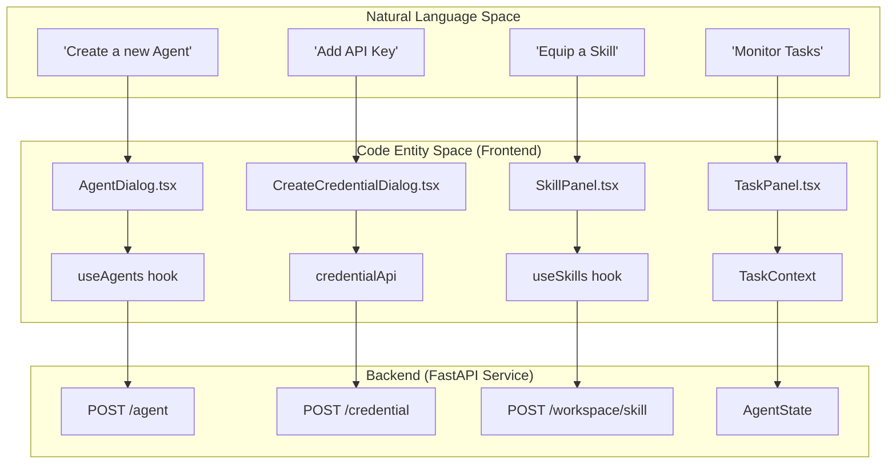
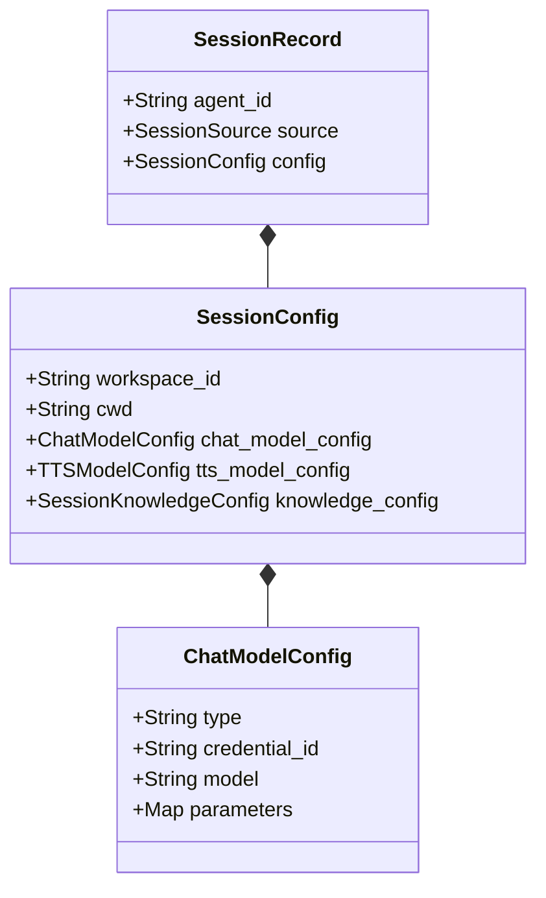

<!-- source: DeepWiki mcp.deepwiki.com · repo agentscope-ai/agentscope · page 8.2 Management Pages & Panels · fetched 2026-10-30 -->

# Management Pages & Panels

Relevant source files

The following files were used as context for generating this wiki page:

- [examples/web_ui/frontend/src/components/dialog/AddSkillDialog.tsx](examples/web_ui/frontend/src/components/dialog/AddSkillDialog.tsx)
- [examples/web_ui/frontend/src/components/dialog/AgentDialog.tsx](examples/web_ui/frontend/src/components/dialog/AgentDialog.tsx)
- [examples/web_ui/frontend/src/components/dialog/CreateCredentialDialog.tsx](examples/web_ui/frontend/src/components/dialog/CreateCredentialDialog.tsx)
- [examples/web_ui/frontend/src/components/dialog/EditAgentDialog.tsx](examples/web_ui/frontend/src/components/dialog/EditAgentDialog.tsx)
- [examples/web_ui/frontend/src/components/dialog/EditCredentialDialog.tsx](examples/web_ui/frontend/src/components/dialog/EditCredentialDialog.tsx)
- [examples/web_ui/frontend/src/components/dialog/RenameSessionDialog.tsx](examples/web_ui/frontend/src/components/dialog/RenameSessionDialog.tsx)
- [examples/web_ui/frontend/src/components/dialog/WorkingDirectoryDialog.tsx](examples/web_ui/frontend/src/components/dialog/WorkingDirectoryDialog.tsx)
- [examples/web_ui/frontend/src/components/hub/ResourcePanel.tsx](examples/web_ui/frontend/src/components/hub/ResourcePanel.tsx)
- [examples/web_ui/frontend/src/components/panel/PanelEmpty.tsx](examples/web_ui/frontend/src/components/panel/PanelEmpty.tsx)
- [examples/web_ui/frontend/src/components/panel/PermissionPanel.tsx](examples/web_ui/frontend/src/components/panel/PermissionPanel.tsx)
- [examples/web_ui/frontend/src/components/panel/SkillPanel.tsx](examples/web_ui/frontend/src/components/panel/SkillPanel.tsx)
- [examples/web_ui/frontend/src/components/panel/TaskPanel.tsx](examples/web_ui/frontend/src/components/panel/TaskPanel.tsx)
- [examples/web_ui/frontend/src/components/panel/TeamPanel.tsx](examples/web_ui/frontend/src/components/panel/TeamPanel.tsx)
- [examples/web_ui/frontend/src/components/popover/ModelParametersPopover.tsx](examples/web_ui/frontend/src/components/popover/ModelParametersPopover.tsx)
- [examples/web_ui/frontend/src/components/select/AgentSelect.tsx](examples/web_ui/frontend/src/components/select/AgentSelect.tsx)
- [examples/web_ui/frontend/src/components/select/LlmSelect.tsx](examples/web_ui/frontend/src/components/select/LlmSelect.tsx)
- [examples/web_ui/frontend/src/components/ui/resizable.tsx](examples/web_ui/frontend/src/components/ui/resizable.tsx)
- [examples/web_ui/frontend/src/components/ui/toggle.tsx](examples/web_ui/frontend/src/components/ui/toggle.tsx)
- [examples/web_ui/frontend/src/pages/chat/index.tsx](examples/web_ui/frontend/src/pages/chat/index.tsx)
- [examples/web_ui/frontend/src/pages/credential/index.tsx](examples/web_ui/frontend/src/pages/credential/index.tsx)
- [examples/web_ui/frontend/src/pages/knowledge/index.tsx](examples/web_ui/frontend/src/pages/knowledge/index.tsx)
- [examples/web_ui/frontend/src/pages/mcp/index.tsx](examples/web_ui/frontend/src/pages/mcp/index.tsx)
- [examples/web_ui/frontend/src/pages/skill/index.tsx](examples/web_ui/frontend/src/pages/skill/index.tsx)
- [src/agentscope/app/storage/_model/_session.py](src/agentscope/app/storage/_model/_session.py)
- [src/agentscope/credential/_moonshot.py](src/agentscope/credential/_moonshot.py)

The AgentScope Web UI provides a comprehensive set of management interfaces for orchestrating agents, sessions, and workspace resources. These components bridge the gap between high-level user intent and the underlying FastAPI backend services.

## Architecture Overview

The management UI is structured into two primary patterns:
1.  **Full-screen Pages**: Dedicated routes (e.g., `/credential`, `/knowledge`, `/mcp`, `/skill`) for broad resource management [examples/web_ui/frontend/src/pages/credential/index.tsx:45-50]().
2.  **Contextual Panels**: Dockable sidebars within the chat viewport that provide session-specific controls (e.g., Team, Skill, Permissions, Task) [examples/web_ui/frontend/src/components/panel/SkillPanel.tsx:65-71]().

### Data Flow: Natural Language to Code Entity Space

The following diagram maps UI concepts to the specific code entities and API interfaces they interact with.

**Sources:** [examples/web_ui/frontend/src/components/dialog/AgentDialog.tsx:65-75](), [examples/web_ui/frontend/src/pages/credential/index.tsx:4-14](), [examples/web_ui/frontend/src/components/panel/SkillPanel.tsx:23-47](), [examples/web_ui/frontend/src/components/panel/TaskPanel.tsx:86-103]().

---

## Agent & Session Management

### Agent Dialogs
Agents are created and modified via `AgentDialog` and `EditAgentDialog`. These components consume a dynamic schema from the backend (`useAgentSchema`) to render form fields for:
*   **Identity**: Name and System Prompt [examples/web_ui/frontend/src/components/dialog/AgentDialog.tsx:68-69]().
*   **Context Config**: Token limits and memory settings [examples/web_ui/frontend/src/components/dialog/AgentDialog.tsx:70]().
*   **ReAct Config**: Reasoning loop parameters [examples/web_ui/frontend/src/components/dialog/AgentDialog.tsx:71]().
*   **Invite Config**: Settings for sub-agent orchestration [examples/web_ui/frontend/src/components/dialog/AgentDialog.tsx:72]().

### Session Sidebar
The main chat sidebar [examples/web_ui/frontend/src/pages/chat/index.tsx:86-152]() manages the `(agentId, sessionId)` pair.
*   **Selection**: URL-driven state using `useParams` for `agentId`, `sessionId`, and `memberId` [examples/web_ui/frontend/src/pages/chat/index.tsx:88-96]().
*   **Sticky Config**: Creating a new session inherits the model configuration (`chat_model_config` and `fallback_chat_model_config`) of the previously active session to ensure continuity [examples/web_ui/frontend/src/pages/chat/index.tsx:164-177]().
*   **Source Tracking**: Sessions are tagged with a `SessionSource` (User, Schedule, or Channel) [src/agentscope/app/storage/_model/_session.py:12-19]().

**Sources:** [examples/web_ui/frontend/src/pages/chat/index.tsx](), [examples/web_ui/frontend/src/components/dialog/AgentDialog.tsx](), [src/agentscope/app/storage/_model/_session.py]().

---

## Contextual Panels

Panels are rendered within the chat interface to provide real-time interaction with the active workspace and agent state.

### Dockable Panel Types

| Panel | Code Entity | Purpose |
| :--- | :--- | :--- |
| **Team** | `TeamPanel` | Manage sub-agents and worker session focus [examples/web_ui/frontend/src/pages/chat/index.tsx:127-136](). |
| **Skill** | `SkillPanel` | Browse, upload, and remove skills from the current workspace [examples/web_ui/frontend/src/components/panel/SkillPanel.tsx:65-71](). |
| **Permission** | `PermissionPanel` | Monitor active tool execution rules (Allow/Deny/Ask) and working directories [examples/web_ui/frontend/src/components/panel/PermissionPanel.tsx:154-162](). |
| **Task** | `TaskPanel` | Compact view of the agent's current task queue, status (`completed`, `in_progress`), and dependencies (`blocked_by`) [examples/web_ui/frontend/src/components/panel/TaskPanel.tsx:26-35](). |

### Permission Visualization
The `PermissionPanel` organizes rules by behavior (`allow`, `deny`, `ask`) and tool name [examples/web_ui/frontend/src/components/panel/PermissionPanel.tsx:197-202](). It uses `TruncatedCode` to handle long path patterns while providing full visibility via tooltips [examples/web_ui/frontend/src/components/panel/PermissionPanel.tsx:36-64]().

### Task Monitoring
The `TaskPanel` implements a smart filtering logic to keep the UI clean:
*   **Ellipsis Sentinel**: Only the last 3 completed tasks in a leading run are shown; earlier ones are collapsed behind an ellipsis [examples/web_ui/frontend/src/components/panel/TaskPanel.tsx:46-70]().
*   **State Icons**: Uses `Loader2` for `in_progress` tasks and `SquareCheck` for `completed` tasks [examples/web_ui/frontend/src/components/panel/TaskPanel.tsx:26-35]().

**Sources:** [examples/web_ui/frontend/src/components/panel/SkillPanel.tsx](), [examples/web_ui/frontend/src/components/panel/PermissionPanel.tsx](), [examples/web_ui/frontend/src/components/panel/TaskPanel.tsx]().

---

## Resource Management Pages

### Credential Management
The `/credential` page [examples/web_ui/frontend/src/pages/credential/index.tsx]() provides a unified view for managing API keys and model cards.
*   **Model Table**: Displays models categorized by `llm`, `tts`, and `embedding` [examples/web_ui/frontend/src/pages/credential/index.tsx:45-50]().
*   **Modality Mapping**: Backend MIME types are collapsed into user-friendly labels (e.g., `application/x-thinking` -> `reasoning`, `audio/*` -> `audio`) [examples/web_ui/frontend/src/pages/credential/index.tsx:90-102]().
*   **Sensitive Data**: The `MaskedValue` component toggles visibility of API keys [examples/web_ui/frontend/src/pages/credential/index.tsx:53-69]().

### MCP & Skill Hubs
The Hub pages allow users to browse available resources from the AgentScope ecosystem.
*   **MCP Hub**: Interacts with `mcpApi` to browse and install servers.
*   **Skill Hub**: Uses `useSkills` hook to fetch available skill definitions and metadata (author, icon, description) [examples/web_ui/frontend/src/components/panel/SkillPanel.tsx:78-79]().

**Sources:** [examples/web_ui/frontend/src/pages/credential/index.tsx](), [examples/web_ui/frontend/src/components/panel/SkillPanel.tsx]().

---

## Configuration & Tooling

### Model Parameters Popover
The `ModelParametersPopover` allows real-time adjustment of session-level model settings [examples/web_ui/frontend/src/components/popover/ModelParametersPopover.tsx]().
*   **Dynamic Form**: Resolves JSON schemas from `ModelCard` properties into React components (`BooleanField`, `EnumField`, `NumberField`, `StringField`) [examples/web_ui/frontend/src/components/popover/ModelParametersPopover.tsx:84-192]().
*   **Validation**: Implements range checking for numeric parameters based on `minimum`, `maximum`, and `exclusive` schema constraints [examples/web_ui/frontend/src/components/popover/ModelParametersPopover.tsx:156-170]().
*   **Fallback & TTS**: Supports configuring primary chat models, fallback models, and TTS (Text-to-Speech) engines in a single popover [examples/web_ui/frontend/src/components/popover/ModelParametersPopover.tsx:198-212]().

### Workspace Management
The `SessionConfig` object stores the persistent state of the workspace for a session [src/agentscope/app/storage/_model/_session.py:114-178]().
*   **Working Directory (`cwd`)**: Purely a viewing anchor in the UI, stored as a relative or absolute path [src/agentscope/app/storage/_model/_session.py:134-161]().
*   **Knowledge Config**: Persists session-level RAG (Retrieval-Augmented Generation) attachments and middleware parameters [src/agentscope/app/storage/_model/_session.py:87-113]().

**Sources:** [examples/web_ui/frontend/src/components/popover/ModelParametersPopover.tsx](), [src/agentscope/app/storage/_model/_session.py]().

---

