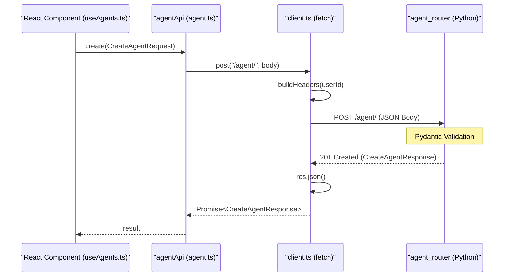
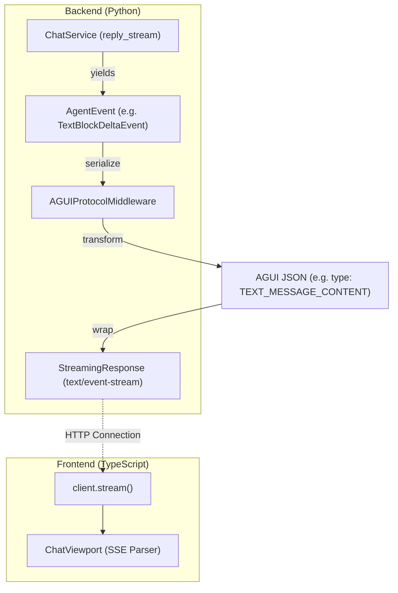

<!-- source: DeepWiki mcp.deepwiki.com · repo agentscope-ai/agentscope · page 8.3 Frontend API Client · fetched 2026-10-30 -->

# Frontend API Client

Relevant source files

The following files were used as context for generating this wiki page:

- [examples/web_ui/frontend/src/api/agent.ts](examples/web_ui/frontend/src/api/agent.ts)
- [examples/web_ui/frontend/src/api/client.ts](examples/web_ui/frontend/src/api/client.ts)
- [examples/web_ui/frontend/src/api/health.ts](examples/web_ui/frontend/src/api/health.ts)
- [examples/web_ui/frontend/src/api/index.ts](examples/web_ui/frontend/src/api/index.ts)
- [examples/web_ui/frontend/src/api/types.ts](examples/web_ui/frontend/src/api/types.ts)
- [examples/web_ui/frontend/src/hooks/useAgents.ts](examples/web_ui/frontend/src/hooks/useAgents.ts)
- [examples/web_ui/frontend/src/i18n/locales/en.json](examples/web_ui/frontend/src/i18n/locales/en.json)
- [examples/web_ui/frontend/src/i18n/locales/zh.json](examples/web_ui/frontend/src/i18n/locales/zh.json)
- [examples/web_ui/frontend/src/pages/channel/channel-form.tsx](examples/web_ui/frontend/src/pages/channel/channel-form.tsx)
- [examples/web_ui/frontend/src/pages/setup/index.tsx](examples/web_ui/frontend/src/pages/setup/index.tsx)
- [src/agentscope/app/_router/__init__.py](src/agentscope/app/_router/__init__.py)
- [src/agentscope/app/_router/_agent.py](src/agentscope/app/_router/_agent.py)
- [src/agentscope/app/_router/_health.py](src/agentscope/app/_router/_health.py)
- [src/agentscope/app/_router/_schema/__init__.py](src/agentscope/app/_router/_schema/__init__.py)
- [src/agentscope/app/_router/_schema/_agent.py](src/agentscope/app/_router/_schema/_agent.py)
- [src/agentscope/app/middleware/_protocol/_agui.py](src/agentscope/app/middleware/_protocol/_agui.py)
- [src/agentscope/app/middleware/_protocol/_base.py](src/agentscope/app/middleware/_protocol/_base.py)
- [src/agentscope/console/_renderer.py](src/agentscope/console/_renderer.py)
- [src/agentscope/event/_event.py](src/agentscope/event/_event.py)
- [src/agentscope/middleware/_base.py](src/agentscope/middleware/_base.py)
- [tests/agui_protocol_test.py](tests/agui_protocol_test.py)

The Frontend API Client is a TypeScript-based communication layer that bridges the React Web UI with the FastAPI-powered Agent Service. It provides a type-safe interface for CRUD operations on agents, sessions, and workspaces, while also handling the complex AGUI protocol transformation for streaming agent events.

## Base Client Configuration

The core of the frontend communication is the `client` object defined in [examples/web_ui/frontend/src/api/client.ts:124-145](). It is built on the standard Web `fetch` API and provides a structured way to handle request options, headers, and errors.

### Server Connection & Identity
The client relies on `localStorage` to persist connection settings across sessions:
*   **Base URL**: Retrieved via `getBaseUrl()`, which reads the `server_url` key [examples/web_ui/frontend/src/api/client.ts:3]().
*   **User Identity**: Every request includes an `X-User-ID` header, retrieved via `getUserId()` from the `username` key [examples/web_ui/frontend/src/api/client.ts:4-41]().

### Error Handling
The client uses a custom `ApiError` class to wrap non-2xx HTTP responses [examples/web_ui/frontend/src/api/client.ts:10-20]().
*   **Detail Extraction**: It attempts to parse the backend's Pydantic error details from the JSON response body [examples/web_ui/frontend/src/api/client.ts:47-57]().
*   **Automatic Toasts**: Unless the `silent` option is set to `true`, errors are automatically displayed to the user via `sonner` toasts [examples/web_ui/frontend/src/api/client.ts:104-111]().
*   **Timeouts**: A specific `TIMEOUT_STATUS` (408) is reported if a request exceeds its `timeoutMs` [examples/web_ui/frontend/src/api/client.ts:38-99]().

### Data Flow: Frontend to Backend
The following diagram illustrates how a frontend action (e.g., creating an agent) flows through the client to the FastAPI routers.

**Diagram: API Request Lifecycle**

Sources: [examples/web_ui/frontend/src/api/client.ts:124-145](), [examples/web_ui/frontend/src/api/agent.ts:11-23](), [src/agentscope/app/_router/_agent.py:165-175]()

## API Modules

The API is partitioned into modules mirroring the backend router structure [src/agentscope/app/_router/__init__.py:3-17]().

| Module | Purpose | Key Functions |
| :--- | :--- | :--- |
| `agentApi` | Agent CRUD and Schema | `list()`, `getSchema()`, `create()`, `update()` |
| `sessionApi` | Chat session management | `list()`, `create()`, `delete()`, `stream()` |
| `workspaceApi` | Filesystem, MCP, and Skills | `directories()`, `mcp.add()`, `skill.upload()` |
| `healthApi` | Service readiness probes | `check(baseUrl, userId)` |
| `knowledgeBaseApi`| RAG document management | `list()`, `upload()`, `delete()` |
| `channelApi` | External platform channels | `list()`, `create()`, `update()`, `getTypes()` |

### Type Definitions
TypeScript interfaces in `types.ts` mirror the Pydantic schemas defined in the backend [src/agentscope/app/_router/_schema/__init__.py:4-85]().
*   **Agent Configuration**: `AgentData` [examples/web_ui/frontend/src/api/types.ts:43-50]() includes `ContextConfig`, `ReActConfig`, and `InviteConfig` [examples/web_ui/frontend/src/api/types.ts:23-39]().
*   **Session Management**: `SessionConfig` [examples/web_ui/frontend/src/api/types.ts:116-132]() defines the model, TTS, and knowledge base settings for a specific chat.
*   **Workspace**: `DirectoryEntry` [examples/web_ui/frontend/src/api/types.ts:228-235]() provides metadata for the sandboxed filesystem.

Sources: [examples/web_ui/frontend/src/api/types.ts:3-235](), [src/agentscope/app/_router/_schema/__init__.py:1-173](), [examples/web_ui/frontend/src/api/index.ts:1-14]()

## AGUI Protocol Middleware

The frontend consumes agent events via a Server-Sent Events (SSE) stream. To ensure compatibility with the Web UI's rendering logic, the backend employs `AGUIProtocolMiddleware` to transform internal `AgentEvent` objects into the AGUI protocol format.

### Protocol Transformation Logic
The middleware intercepts `text/event-stream` responses [src/agentscope/app/middleware/_protocol/_base.py:69-81](). It iterates through the SSE frames, extracts the JSON `data:` payload, and converts it using `_convert_to_protocol` [src/agentscope/app/middleware/_protocol/_base.py:142-160]().

**Key Mappings (Internal Event -> AGUI Protocol):**
*   `ReplyStartEvent` -> `RUN_STARTED` [src/agentscope/app/middleware/_protocol/_agui.py:96-100]()
*   `TextBlockDeltaEvent` -> `TextMessageContentEvent` [src/agentscope/app/middleware/_protocol/_agui.py:138-142]()
*   `ToolCallStartEvent` -> `ToolCallStartEvent` [src/agentscope/app/middleware/_protocol/_agui.py:171-176]()
*   `ReplyEndEvent` -> `RUN_FINISHED` or `RUN_ERROR` [src/agentscope/app/middleware/_protocol/_agui.py:102-112]()
*   `ThinkingBlockDeltaEvent` -> `ReasoningMessageContentEvent` [src/agentscope/app/middleware/_protocol/_agui.py:160-164]()

### Stream Processing Flow
The following diagram shows how the `AGUIProtocolMiddleware` sits between the `ChatService` and the Frontend Client.

**Diagram: AGUI Protocol Transformation**

Sources: [src/agentscope/app/middleware/_protocol/_agui.py:44-228](), [tests/agui_protocol_test.py:73-87](), [examples/web_ui/frontend/src/api/client.ts:59-116](), [src/agentscope/event/_event.py:26-68]()

## Health Probing and Setup

The `healthApi` is unique because it allows probing a server *before* the connection settings are persisted in `localStorage` [examples/web_ui/frontend/src/api/health.ts:7-18]().

### The /health Endpoint
The backend `get_health` handler inspects the `app.state` to ensure all critical components (storage, message bus, chat service) are initialized [src/agentscope/app/_router/_health.py:64-80](). If any lifespan component is missing, it returns a `503 Service Unavailable` [src/agentscope/app/_router/_health.py:83-89]().

### Setup Page Logic
During the setup phase in `SetupPage`:
1.  The user enters a URL and Username.
2.  `handleSubmit` calls `healthApi.check` with these explicit values [examples/web_ui/frontend/src/pages/setup/index.tsx:78-82]().
3.  If the response is a valid `HealthResponse` with a version string, the settings are saved to `localStorage` [examples/web_ui/frontend/src/pages/setup/index.tsx:88-90]().

Sources: [src/agentscope/app/_router/_health.py:29-89](), [examples/web_ui/frontend/src/pages/setup/index.tsx:67-96](), [examples/web_ui/frontend/src/api/health.ts:7-19]()

---

