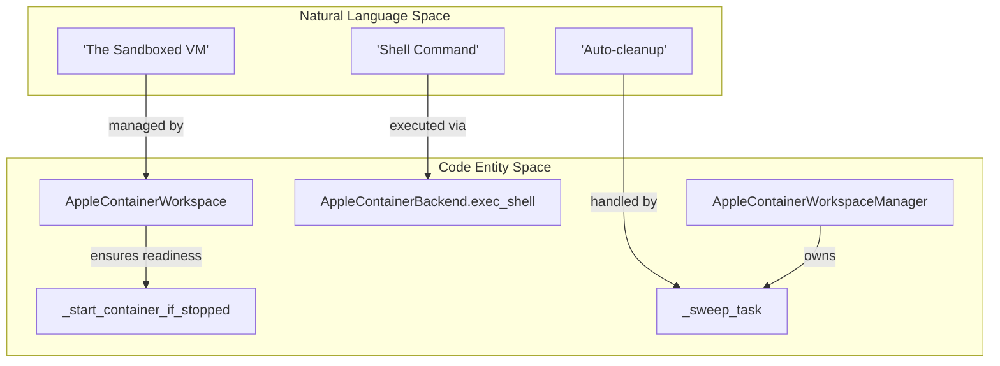
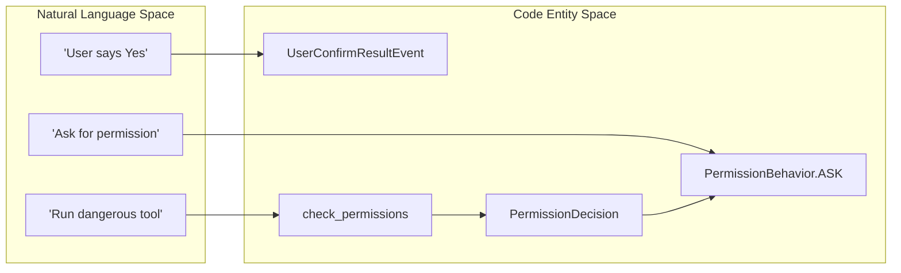

<!-- source: DeepWiki mcp.deepwiki.com · repo agentscope-ai/agentscope · page 9.1 Unit & Integration Tests · fetched 2026-10-30 -->

# Unit & Integration Tests

Relevant source files

The following files were used as context for generating this wiki page:

- [.github/workflows/unittest.yml](.github/workflows/unittest.yml)
- [examples/workspace/apple-container-workspace.md](examples/workspace/apple-container-workspace.md)
- [src/agentscope/app/workspace_manager/_applecontainer_workspace_manager.py](src/agentscope/app/workspace_manager/_applecontainer_workspace_manager.py)
- [src/agentscope/workspace/_applecontainer/__init__.py](src/agentscope/workspace/_applecontainer/__init__.py)
- [src/agentscope/workspace/_applecontainer/_applecontainer_backend.py](src/agentscope/workspace/_applecontainer/_applecontainer_backend.py)
- [src/agentscope/workspace/_applecontainer/_applecontainer_workspace.py](src/agentscope/workspace/_applecontainer/_applecontainer_workspace.py)
- [src/agentscope/workspace/_applecontainer/_constants.py](src/agentscope/workspace/_applecontainer/_constants.py)
- [tests/backend_applecontainer_test.py](tests/backend_applecontainer_test.py)
- [tests/hitl_mixed_test.py](tests/hitl_mixed_test.py)
- [tests/utils.py](tests/utils.py)
- [tests/workspace_applecontainer_test.py](tests/workspace_applecontainer_test.py)

The AgentScope test suite is designed to ensure the reliability of its two-layer architecture, covering everything from core SDK message formatting to complex sandboxed workspace executions. The suite utilizes `unittest` and `IsolatedAsyncioTestCase` to handle the asynchronous nature of agentic interactions and model calls [tests/hitl_mixed_test.py:5]().

## Test Suite Organization

The testing infrastructure is partitioned into functional groups that mirror the codebase structure.

| Test Group | Focus Area | Key Files |
|:---|:---|:---|
| **Agent & Context** | Reasoning loops, context compression, and state management. | `tests/compress_context_test.py` |
| **Model Adapters** | Provider-specific API handling, streaming, and tool call parsing. | `tests/model_gemini_test.py`, `tests/model_anthropic_test.py` |
| **Formatters** | Translation of `Msg` objects to provider payloads (OpenAI, Anthropic, Gemini). | `tests/formatter_anthropic_test.py`, `tests/formatter_gemini_test.py` |
| **Workspaces** | Local and sandboxed (Docker, Apple Container) execution and lifecycle. | `tests/workspace_applecontainer_test.py`, `tests/workspace_local_test.py` |
| **Tools & Bash** | Built-in tool behavior, subprocess management, and command parsing. | `tests/builtin_bash_test.py`, `tests/backend_applecontainer_test.py` |
| **Storage** | Persistence backends including Redis and SQL implementations. | `tests/storage_redis_test.py` |
| **Permissions & HITL** | Rule evaluation, Human-In-The-Loop (HITL) confirmation flows, and shell safety. | `tests/hitl_mixed_test.py`, `tests/permission_bash_parser_test.py` |

Sources: [tests/hitl_mixed_test.py:1-33](), [tests/workspace_applecontainer_test.py:1-26](), [tests/backend_applecontainer_test.py:1-20]().

## Mocking Patterns

AgentScope relies heavily on mocking to avoid expensive API calls and provide deterministic tests for non-deterministic LLM outputs.

### Model Mocking
The `MockModel` utility simulates LLM responses [tests/utils.py:51-73](). It allows developers to:
- **Set Sequences**: Provide a list of `ChatResponse` objects, exceptions, or nested lists for streaming to be returned/raised in order [tests/utils.py:81-100]().
- **Simulate Streams**: Return an `AsyncGenerator` that yields chunks or raises errors mid-stream by wrapping responses in a list [tests/utils.py:124-130]().
- **Structured Output**: Mock the `_call_api_with_structured_output` method for schema-based reasoning tests using `set_structured_response` [tests/utils.py:137-152]().

### API Response Mocking
For provider-specific tests, the suite mocks the underlying client libraries or CLI tools. For example, `TestAppleContainerBackendUnit` mocks `asyncio.create_subprocess_exec` to exercise error paths like `FileNotFoundError` (exit code 127) or `asyncio.TimeoutError` without requiring a real container runtime [tests/backend_applecontainer_test.py:137-170]().

Sources: [tests/utils.py:42-152](), [tests/backend_applecontainer_test.py:119-148]().

## Workspace & Execution Environment Tests

Workspace tests verify the interaction between the agent and its environment, including file persistence and sandboxing.

### Apple Container Testing
`TestAppleContainerWorkspaceConstruct` ensures that the `AppleContainerWorkspace` correctly initializes with default constants like `DEFAULT_BASE_IMAGE` ("python:3.11-slim") and `CONTAINER_WORKDIR` ("/workspace") [tests/workspace_applecontainer_test.py:31-46](). 

Lifecycle and backend tests verify:
- **CLI Availability**: Detecting if the `container` binary is missing or if the service is down by checking for `RuntimeError` during `_check_cli` [tests/workspace_applecontainer_test.py:161-184]().
- **Image Normalization**: The `_normalize_image_ref` static method correctly shortens canonical refs like `docker.io/library/python` to `python` to satisfy the `container` CLI requirements [tests/workspace_applecontainer_test.py:75-138]().
- **Backend Command Construction**: Verification that `AppleContainerBackend` correctly constructs `argv` for `container exec`, ensuring the `--workdir` flag is present but the `--` separator (which the CLI treats as an executable) is omitted [tests/backend_applecontainer_test.py:39-76]().

### Natural Language to Code Entity Space: Workspace
The following diagram illustrates how natural language workspace concepts map to specific code entities during testing.

Title: Workspace Test Mapping

Sources: [src/agentscope/workspace/_applecontainer/_applecontainer_workspace.py:75-102](), [src/agentscope/app/workspace_manager/_applecontainer_workspace_manager.py:37-64](), [tests/workspace_applecontainer_test.py:38-46](), [src/agentscope/workspace/_applecontainer/_applecontainer_backend.py:64-92]().

## Human-In-The-Loop (HITL) & Permission Tests

HITL tests ensure that agents correctly pause for user confirmation when sensitive tools are invoked.

### Mixed Confirmation Flows
`AgentMixTest` verifies that an agent can handle a mix of sequential and concurrent tool calls that require permission [tests/hitl_mixed_test.py:108-122](). The test asserts that:
1. The agent invokes `check_permissions` and emits a `UserConfirmResultEvent` when a tool returns `PermissionBehavior.ASK` [tests/hitl_mixed_test.py:53-63]().
2. The agent correctly resumes execution after receiving a `ConfirmResult.ALLOW` payload within a `UserConfirmResultEvent` [tests/hitl_mixed_test.py:204]().
3. The internal `Agent` reasoning loop correctly handles `ExternalExecutionResultEvent` for tools marked as `is_external_tool` [tests/hitl_mixed_test.py:36-51]().

### Natural Language to Code Entity Space: Permissions
The following diagram maps permission concepts to the underlying implementation classes.

Title: Permission and HITL Mapping

Sources: [tests/hitl_mixed_test.py:53-63](), [tests/hitl_mixed_test.py:29-33](), [src/agentscope/workspace/_applecontainer/_applecontainer_workspace.py:157-191]().

## Running Tests

AgentScope uses `pytest` and `coverage` for test execution and reporting [ .github/workflows/unittest.yml:29-37]().

### CI/CD Pipeline
The GitHub Actions workflow runs the suite across `ubuntu-latest`, `windows-latest`, and `macos-26` [ .github/workflows/unittest.yml:8-12](). 
- **Environment Setup**: Installs `uv` for fast dependency management [ .github/workflows/unittest.yml:17-20]().
- **Linux Specifics**: Installs `bubblewrap` to support sandboxing tests on Linux runners [ .github/workflows/unittest.yml:21-25]().
- **Execution**: Runs `coverage run -m pytest tests -v` to ensure full branch coverage [ .github/workflows/unittest.yml:34]().

### Utility Helpers
- `AnyString`: Overrides `__eq__` to match any string, useful for validating UUIDs or dynamic IDs in events [tests/utils.py:16-25]().
- `AnyValue`: Matches any data type, used for unpredictable timestamps or token counts in `usage` blocks [tests/utils.py:28-39]().
- `compare_by_printing`: A debug utility to dump expected vs actual JSON objects for visual inspection during local development [tests/utils.py:155-158]().

Sources: [ .github/workflows/unittest.yml:1-38](), [tests/utils.py:1-40]().

---

