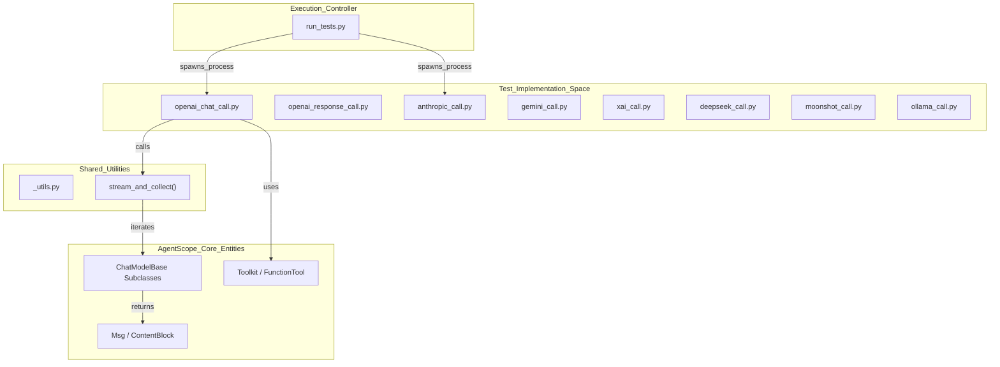
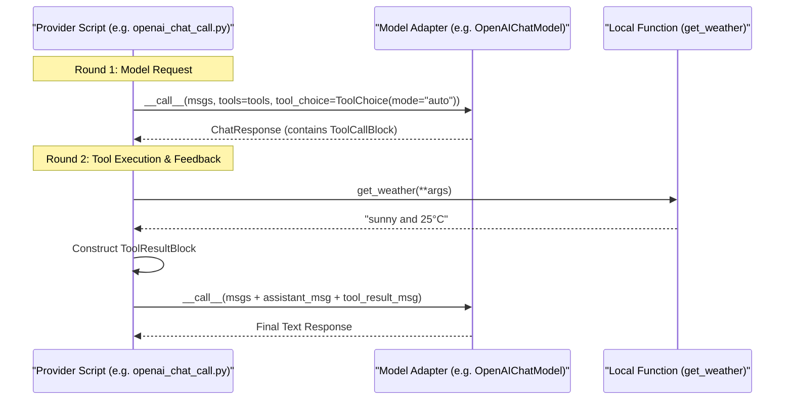

<!-- source: DeepWiki mcp.deepwiki.com · repo agentscope-ai/agentscope · page 9.2 Model Example Scripts · fetched 2026-10-30 -->

# Model Example Scripts

<details>
<summary>Relevant source files</summary>

The following files were used as context for generating this wiki page:

- [scripts/model_examples/README.md](scripts/model_examples/README.md)
- [scripts/model_examples/_utils.py](scripts/model_examples/_utils.py)
- [scripts/model_examples/anthropic_call.py](scripts/model_examples/anthropic_call.py)
- [scripts/model_examples/anthropic_multiagent.py](scripts/model_examples/anthropic_multiagent.py)
- [scripts/model_examples/anthropic_multiagent_multimodal.py](scripts/model_examples/anthropic_multiagent_multimodal.py)
- [scripts/model_examples/dashscope_call.py](scripts/model_examples/dashscope_call.py)
- [scripts/model_examples/dashscope_multiagent.py](scripts/model_examples/dashscope_multiagent.py)
- [scripts/model_examples/dashscope_multiagent_multimodal.py](scripts/model_examples/dashscope_multiagent_multimodal.py)
- [scripts/model_examples/deepseek_call.py](scripts/model_examples/deepseek_call.py)
- [scripts/model_examples/deepseek_multiagent.py](scripts/model_examples/deepseek_multiagent.py)
- [scripts/model_examples/gemini_call.py](scripts/model_examples/gemini_call.py)
- [scripts/model_examples/gemini_multiagent.py](scripts/model_examples/gemini_multiagent.py)
- [scripts/model_examples/gemini_multiagent_multimodal.py](scripts/model_examples/gemini_multiagent_multimodal.py)
- [scripts/model_examples/moonshot_call.py](scripts/model_examples/moonshot_call.py)
- [scripts/model_examples/ollama_call.py](scripts/model_examples/ollama_call.py)
- [scripts/model_examples/ollama_multiagent.py](scripts/model_examples/ollama_multiagent.py)
- [scripts/model_examples/openai_chat_call.py](scripts/model_examples/openai_chat_call.py)
- [scripts/model_examples/openai_response_call.py](scripts/model_examples/openai_response_call.py)
- [scripts/model_examples/xai_call.py](scripts/model_examples/xai_call.py)

</details>


The `scripts/model_examples/` directory provides a comprehensive suite of verification scripts for the LLM providers supported by AgentScope. These scripts serve as both integration tests and technical references for developers, demonstrating how to interact with model adapters directly, handle streaming reasoning, execute tool calling, and manage multimodal inputs.

## Directory Layout and Test Types

The examples are organized by provider and suffixed by the specific capability they demonstrate.

| Suffix | File Pattern | Verification Scope |
|:---|:---|:---|
| `call` | `*_call.py` | Simple text interaction, two-round tool calling, and structured JSON output via `generate_structured_output`. |
| `multiagent` | `*_multiagent.py` | Multi-party conversations utilizing specialized `MultiAgentFormatter` implementations. |
| `multimodal` | `*_multimodal.py` | Processing of `DataBlock` objects containing images, audio, or video. |
| `multiagent_multimodal` | `*_multiagent_multimodal.py` | Combined scenarios where multimodal content is shared within a multi-agent context. |

Sources: [scripts/model_examples/README.md:8-70]()

## Unified Test Runner (`run_tests.py`)

The `run_tests.py` script provides a centralized interface for executing the example suite. It features automatic provider detection based on environment variables and generates a summary report of the results.

### Provider Availability Detection
The runner identifies available providers by checking for specific environment variables:
*   **OpenAI Chat**: `OPENAI_API_KEY` (Chat Completions API) [scripts/model_examples/README.md:77]()
*   **OpenAI Response**: `OPENAI_API_KEY` (Responses API for o1/o3/o4-mini) [scripts/model_examples/README.md:78]()
*   **Anthropic**: `ANTHROPIC_API_KEY` (Claude models) [scripts/model_examples/README.md:79]()
*   **DashScope**: `DASHSCOPE_API_KEY` (Qwen series) [scripts/model_examples/README.md:80]()
*   **DeepSeek**: `DEEPSEEK_API_KEY` [scripts/model_examples/README.md:81]()
*   **Gemini**: `GEMINI_API_KEY` [scripts/model_examples/README.md:82]()
*   **Moonshot**: `MOONSHOT_API_KEY` [scripts/model_examples/README.md:83]()
*   **xAI**: `XAI_API_KEY` (Grok models) [scripts/model_examples/README.md:84]()
*   **Ollama**: Detected via local server availability at `http://localhost:11434` [scripts/model_examples/README.md:85]().

Sources: [scripts/model_examples/README.md:73-86](), [scripts/model_examples/README.md:112-124]()

### Code Entity Space: Execution Flow
The following diagram illustrates the relationship between the test runner, the utility helpers, and the provider-specific scripts.

Title: Model Example Execution Flow

Sources: [scripts/model_examples/run_tests.py:1-200](), [scripts/model_examples/_utils.py:15-104](), [scripts/model_examples/openai_chat_call.py:71-134]()

## Implementation Details: `_utils.py`

The `stream_and_collect` function in `_utils.py` is the primary helper for consuming `AsyncGenerator[ChatResponse, None]` outputs from model calls.

### Key Features of `stream_and_collect`:
1.  **Reasoning Support**: Detects `ThinkingBlock` instances and prints them with a `[Thinking]` prefix [scripts/model_examples/_utils.py:42-46]().
2.  **Streaming Text**: Prints `TextBlock` content incrementally as it arrives [scripts/model_examples/_utils.py:47-53]().
3.  **Binary Data Tracking**: For `DataBlock` chunks (e.g., streaming audio), it tracks chunk counts and cumulative byte sizes [scripts/model_examples/_utils.py:54-74]().
4.  **Final Aggregation**: Returns the final `ChatResponse` (where `is_last=True`) which contains the complete accumulated content, allowing the caller to inspect `ToolCallBlock` objects without re-processing the stream [scripts/model_examples/_utils.py:38-40](), [scripts/model_examples/_utils.py:104]().

Sources: [scripts/model_examples/_utils.py:15-104]()

## Model Interaction Patterns

The example scripts follow a standardized pattern for verifying three core LLM capabilities.

### 1. Basic Call & Tooling
The `*_call.py` scripts demonstrate a two-round interaction for tool calling. Note that the OpenAI Responses API requires using `call_id` for matching tool results [scripts/model_examples/openai_response_call.py:117-125]().

Title: Tool Call Verification Pattern

Sources: [scripts/model_examples/openai_chat_call.py:71-134](), [scripts/model_examples/xai_call.py:76-137](), [scripts/model_examples/openai_response_call.py:77-141]()

### 2. Structured Output
Scripts verify the `generate_structured_output` method by passing a Pydantic `BaseModel` (e.g., `MathSolution`). The model is expected to return a JSON object matching the schema, which AgentScope parses into the `content` field of the response.

Sources: [scripts/model_examples/openai_chat_call.py:150-186](), [scripts/model_examples/gemini_call.py:150-181](), [scripts/model_examples/deepseek_call.py:151-184]()

### 3. Multi-Agent & Multimodal
Multi-agent scripts demonstrate the use of provider-specific formatters, such as `GeminiMultiAgentFormatter` [scripts/model_examples/gemini_multiagent_multimodal.py:20](), to flatten conversation history. Multimodal scripts utilize `DataBlock` with `URLSource` [scripts/model_examples/gemini_multiagent_multimodal.py:36-38]() or `Base64Source` to send media.

Sources: [scripts/model_examples/gemini_multiagent_multimodal.py:18-89](), [scripts/model_examples/openai_chat_call.py:1-191]()

## Running Examples

### Execution via Runner
To list available providers and their environment variable status:
```bash
python scripts/model_examples/run_tests.py --list
```
To run specific tests (e.g., only basic calls for OpenAI and Anthropic):
```bash
python scripts/model_examples/run_tests.py --providers openai_chat,anthropic --tests call
```

### Individual Execution
Individual scripts can be run directly if the environment variables are set. For Ollama, the server must be running locally:
```bash
# Example for DeepSeek
export DEEPSEEK_API_KEY="sk-..."
python scripts/model_examples/deepseek_call.py

# Example for Ollama
ollama serve
ollama pull qwen3:14b
python scripts/model_examples/ollama_call.py
```

Sources: [scripts/model_examples/README.md:89-207](), [scripts/model_examples/ollama_call.py:4-9]()

---

